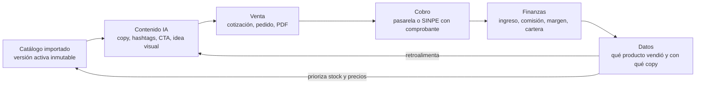
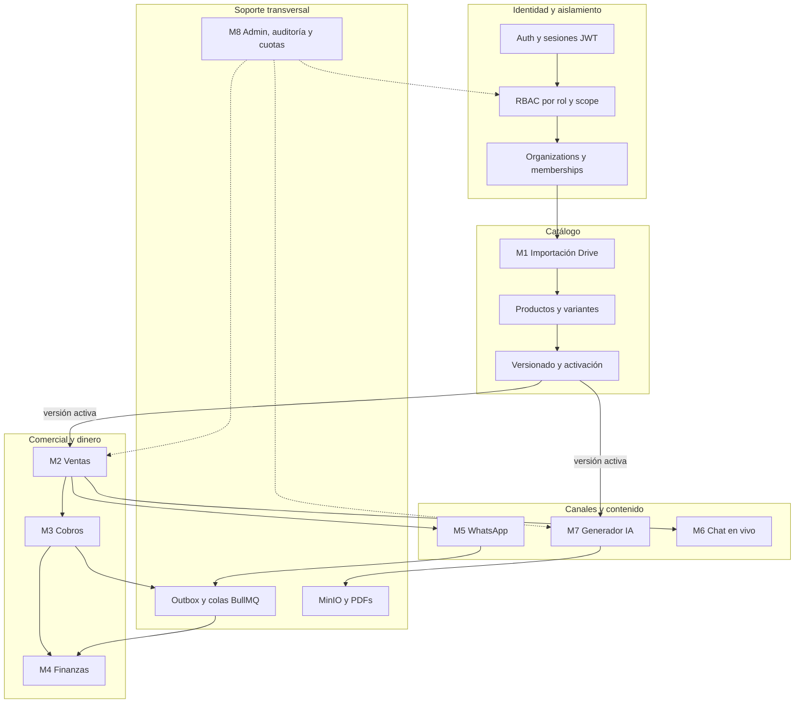
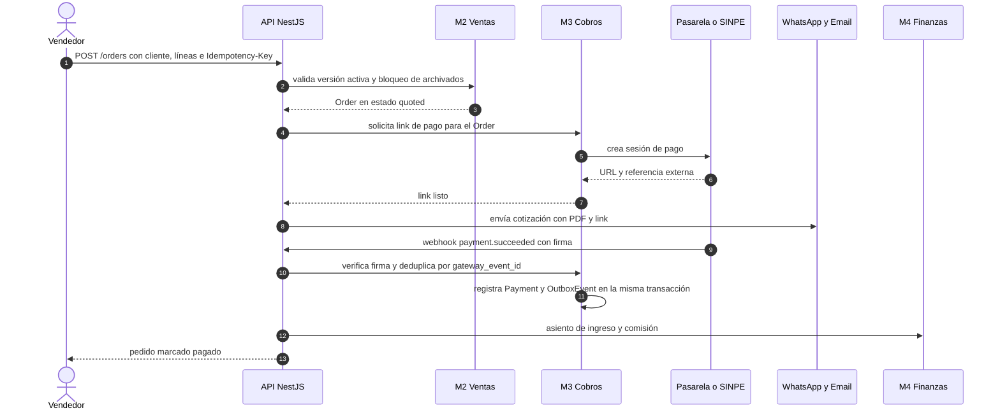

# Análisis de producto, negocio, riesgos y costes

> Este documento **no redefine arquitectura**: acepta como vinculantes los ADR-01..ADR-18 y
> el modelo de aislamiento de `docs/01-CONTEXTO-Y-DECISIONES.md`. Su trabajo es distinto:
> traducir el brief en decisiones de producto, cuantificar el negocio, destapar los
> requisitos que el brief calla y ordenar el MVP. Lo que aquí se decide se implementa en
> `docs/03-SPEC.md` y se ejecuta según `docs/04-GUIA-IMPLEMENTACION.md`.

## 0. Cómo leer este documento

### 0.1 Marcas de confianza

Cada afirmación relevante lleva una marca implícita según esta tabla. Cuando no coincide con
la realidad medida, la culpa es del documento, no del lector.

| Marca | Significado | Consecuencia si resulta falsa |
|---|---|---|
| `[BRIEF]` | Hecho tomado literalmente de `docs/00-BRIEF.md` | Nada: es la fuente de verdad del encargo |
| `[ADR-NN]` | Decisión ya tomada en `docs/01-CONTEXTO-Y-DECISIONES.md` | Solo el Lead de arquitectura puede cambiarla, con sección de cambio explícita |
| `SUPUESTO S-nn` | Dato estimado por el equipo, sin fuente primaria verificada | Se revisa en el anexo A; puede mover costes y precio |
| `[INFERENCIA]` | Conclusión derivada de brief + ADR + conocimiento de mercado | Revisable con evidencia de campo |
| `PREGUNTA ABIERTA QA-nn` | No se puede resolver con la información disponible | Bloquea una decisión de diseño, no la construcción |

`SUPUESTO`: en este análisis **no se hizo investigación primaria de mercado** (entrevistas,
encuestas, scraping de precios). Todo dato de mercado, tarifa o volumen es una estimación
de trabajo declarada en el anexo A, con su cálculo cuando aplica. Presentar estos números
como hechos sería deshonesto y llevaría a decisiones de inversión equivocadas.

### 0.2 Convenciones numéricas

- **Divisas**: colones costarricenses (₡) y dólares estadounidenses (USD). Tipo de cambio de
  trabajo: **₡535 por USD** (`SUPUESTO S-01`; rango observado 2024–2026 ~₡505–₡545).
- **Separadores**: miles con espacio (₡22 000), decimales con coma (USD 0,000 744). Evita la
  ambigüedad de `1.234` entre formatos es-CR y en-US.
- **Redondeo**: se conservan 3–4 decimales en costes unitarios para que el cálculo sea
  auditable; las tablas de totales redondean a 2 decimales.
- **Periodo**: mensual salvo indicación contraria. "MVP" = fases F0–F4 (semanas 1–14).

### 0.3 Refinamientos propuestos (no contradicen ningún ADR)

Se registran aquí para que la spec los absorba sin discusión. Ninguno cambia una decisión de
arquitectura; todos acotan alcance o cambian una unidad de medida.

| ID | Refinamiento | Motivo | Dónde aterriza |
|---|---|---|---|
| DPC-01 | La cuota de IA se expresa en **tokens** por organización y periodo, no en "generaciones" | El coste real depende de tokens; una "generación" cambia de tamaño al mejorar la plantilla | `03-SPEC` §7 y §cuotas |
| DPC-02 | **SINPE Móvil con comprobante validado** es método de cobro de primera clase en el MVP, al mismo nivel que las pasarelas | Es el medio dominante del mercado meta y cuesta 0 % de comisión; sin él, el flujo "venta → cobro → finanzas" no se puede demostrar con clientes reales | `03-SPEC` §cobros, `04-GUIA` F2 |
| DPC-03 | El PDF de cotización/recibo lleva la leyenda **"Comprobante interno, no es factura electrónica"** | Evita el riesgo legal de parecer un comprobante fiscal sin autorización de Hacienda | `03-SPEC`, plantillas PDF |
| DPC-04 | Las **variantes se aplanan** en el MVP: cada combinación (talla/color) importada es un `Product` con `variant_label`; `ProductVariant` existe para el futuro pero no es obligatoria | Modelar matriz de variantes multiplica la UI de importación y el motor de stock; el brief no exige matriz | `03-SPEC` §modelo de datos |
| DPC-05 | La **importación masiva de calendario editorial** se ejecuta como una sola llamada al proveedor por lote (N posts), no N llamadas | El cálculo de §9.2 muestra un coste por post ~4× menor | `03-SPEC` §7 |

## 1. Resumen ejecutivo

### 1.1 Qué es el producto

**VentasCatálogo** es una PWA que convierte un archivo de catálogo —Google Sheets, Excel, CSV
o PDF, típicamente guardado en Drive— en un negocio operativo: importar productos, cotizar,
vender, cobrar, llevar finanzas, atender por WhatsApp y chat, y **generar contenido de
marketing con IA a partir de los datos reales de esos productos** `[BRIEF]` `[ADR-01..ADR-03]`.

La unidad de aislamiento no es la empresa sino el **catálogo**: cada catálogo (una temporada,
una marca, una feria) es una unidad de negocio con sus productos, ventas, pagos, gastos y
posts `[BRIEF]` `[ADR-07]`. La versión del catálogo es **inmutable** una vez activada
`[ADR-08]`, de modo que cambiar de temporada no reescribe los precios que se usaron para
vender en la anterior.

El activo diferencial declarado no es "otro CRM" sino el **ciclo cerrado** catálogo →
contenido → venta → cobro → datos → mejor contenido `[ADR §1]`. Este análisis asume ese ciclo
como tesis y lo verifica en la sección 6: si el ciclo no se cierra dentro del producto, el
producto es una suma de herramientas sueltas y pierde contra el status quo (Excel + WhatsApp),
que es gratis.

Ese ciclo tiene **dos caras** `[ADR-17]`: la Cara A (backoffice de staff) opera el catálogo y el
contenido; la Cara B (tienda y portal del cliente) ejecuta la compra, el pago y el seguimiento.
Sin la Cara B el producto es un ERP interno y el ciclo se corta en la venta; por eso el módulo
de usuarios y las dos audiencias de token `[ADR-18]` son requisito de producto y no un extra.
El análisis de actores, ciclo de vida y soporte de las dos caras está en §2.1 y §2.4.

### 1.2 El ciclo cerrado

La arista `F → B` es la que casi nadie cubre (ver §6): contenido informado por resultados
reales, no por intuición. En el MVP esa arista existe de forma **manual y explícita** —el
usuario ve ventas por producto junto al historial de posts—, y solo en F5+ se convierte en
bucle automático (`docs/05-IDEAS.md`).

### 1.3 Para quién: cliente ideal (ICP)

| Dimensión | ICP primario | ICP secundario | Anti-ICP (no atender en MVP) |
|---|---|---|---|
| Negocio | Revendedor o PYME que vende por catálogo de temporada (ropa, calzado, accesorios, cosmética, artículos de feria) | Distribuidora pequeña con varias marcas o líneas | Retail con local y POS propio; enterprise con ERP |
| Tamaño | 50–1 000 SKU, 1–5 personas | 1 000–5 000 SKU, 5–15 personas | > 5 000 SKU (el brief pide soporte, pero no es el ICP de lanzamiento) |
| Catálogos simultáneos | 1–3 activos, 4–12 al año | 5–20 | 1 catálogo estático para siempre |
| Canal de venta | WhatsApp como canal principal; feria física; Instagram/Facebook | Link de pago y web | Solo marketplace (Amazon, eBay) |
| Cobro | SINPE Móvil, efectivo, transferencia, ocasional tarjeta | Tarjeta y link de pago | Facturación electrónica obligatoria compleja (fase 3+) |
| Madurez digital | Excel o Sheets; sin sistema; usa el celular como herramienta principal | Algo de Shopify/Treinta | Ya tiene ERP y equipo de TI |
| Dolor dominante | "Tengo el catálogo en un Excel y se me pierde el control de precios, stock y cobros; publicar contenido me toma horas" | "Necesito separar marcas y no mezclar reportes" | "Necesito integración contable profunda" |

`SUPUESTO S-02`: la feria y el catálogo de temporada son un patrón comercial relevante en
Costa Rica (ropa, calzado, belleza, artesanía) y explican el requisito de PWA y de cambio de
catálogo por puntero. No está cuantificado con datos primarios → `QA-01`.

### 1.4 Por qué gana (cinco razones, cada una con su porqué)

| # | Razón | Porqué es defendible | Riesgo que la debilita |
|---|---|---|---|
| 1 | **Importar desde Drive en lugar de teclear** | El coste real de adopción de cualquier sistema de catálogo es cargar 500–5 000 SKU a mano. Si la importación funciona al primer intento, el "time to first sale" cae de días a horas. Es la única función que ningún competidor del §6 hace bien para es-CR | La importación de archivos sucios es exactamente donde se rompe: por eso §4 trata 24 requisitos implícitos y §7 la pone como riesgo top |
| 2 | **Aislamiento por catálogo con versión inmutable** | Permite al revendedor operar "Verano 2026" sin tocar los números de "Invierno 2025" `[ADR-07/08]`. Treinta y Loyverse modelan *negocio*, no *temporada*; Shopify obliga a duplicar tiendas | Añade complejidad a toda consulta y a la IA (`R2`, `R6`); una fuga entre catálogos destruye la confianza (§7 RG-01) |
| 3 | **Contenido IA anclado al producto real** | El prompt se construye con nombre, atributos, precio y stock del catálogo, con regla anti-alucinación `[BRIEF]` `[ADR-11]`. Later/Buffer generan copy genérico porque no ven el catálogo | Calidad percibida < expectativa; si el copy necesita reescritura siempre, el valor cae (§8 KPI de aprobación) |
| 4 | **Cobro y finanzas por catálogo, no solo facturación** | El revendedor necesita saber margen por temporada y cuánto le deben. Es lo que hoy vive en un cuaderno o en un Excel paralelo | Sin conciliación bancaria ni facturación electrónica, el contador seguirá pidiendo Excel (fase 3+) |
| 5 | **Precio y canal nativos de es-CR** | CRC + USD, IVA 13 %, SINPE, WhatsApp. Shopify cuesta USD 39+/mes antes de apps y no resuelve SINPE; Treinta es más fuerte en Colombia/México | Competidor local con más capital o WhatsApp nativo por parte de Meta |

La ventaja 1 es la más frágil y la más valiosa: es donde hay que invertir calidad de ingeniería
(pipeline de normalización, cuarentena, reintentos) y no en features vistosas.

### 1.5 Recomendación ejecutiva

1. **Construir el MVP como validación comercial, no como negocio terminado.** A 90 días el
   objetivo es 10 organizaciones reales con catálogo activo y al menos una venta cobrada, no
   MRR relevante (§8).
2. **Mantener íntegro el orden de fases de `docs/01` §7**, con dos ajustes dentro de F2:
   SINPE/comprobante antes de la segunda pasarela, y `DPC-03` en todas las plantillas de PDF.
3. **Tratar la importación como el producto en sí.** Es el 40 % del valor percibido y la
   principal causa potencial de abandono. Presupuestar pruebas con archivos reales sucios en
   cada fase (`04-GUIA` §9).
4. **Cortar del MVP**: OCR de PDF escaneado, chat anónimo, facturación electrónica,
   conciliación bancaria y generación de imágenes. Todo está en §10 como `Won't` o `Could`
   con su ruta de regreso en `docs/05-IDEAS.md`.
5. **Instrumentar el coste de IA desde el primer día** (`AiUsageLedger`): sin coste por
   organización no hay SaaS sostenible `[ADR-15]`. La cuota se fija en tokens (DPC-01).
6. **No prometer facturación electrónica.** El comprobante interno es una decisión
   deliberada (§5 A-02) y debe comunicarse así en el producto y en el sitio de venta.
7. **Presupuestar USD 52,50/mes de techo** (≈USD 26,50 de gasto esperado en los primeros 90
   días) según §9.1, con techo duro de USD 30 de IA y alerta al 70 %.
8. **Tratar la Cara B (tienda y portal del cliente) como parte del MVP**, no como fase
   posterior: `[ADR-17]` la hace requisito de producto; sin ella el ciclo se corta en la venta
   y el producto compite como backoffice contra Treinta y Loyverse (§6.4).

### 1.7 Resumen de la oportunidad, con honestidad numérica

| Métrica | Valor de trabajo | Naturaleza |
|---|---|---|
| Mercado atendible (SAM) en CR/Centroamérica | 400–1 000 organizaciones con perfil del §1.3 | `SUPUESTO S-03`, sin fuente primaria; se valida con 10 entrevistas (§12 QA-01) |
| Objetivo a 12 meses | 40–60 organizaciones de pago | `SUPUESTO S-04`, 10 % del SAM bajo |
| Punto de equilibrio con un salario de desarrollador | ≈142 organizaciones | Cálculo en §9.5; hoy fuera del objetivo de 12 meses |
| Conclusión | El MVP debe ser barato, medible y desechable si no valida; no es un apuesta de capital | `[INFERENCIA]` |

La conclusión incómoda de §1.7 es la más importante de este documento: **con la estructura de
costes de `docs/01` (equipo de 1–2 personas, infra < USD 60/mes), el producto necesita ~142
organizaciones de pago para sostener un sueldo**, y el SAM estimado no garantiza llegar. Esto
no invalida el proyecto; obliga a tratarlo como experimento con puerta de decisión al final
de F4 (§11.3) en lugar de como negocio con plan de crecimiento asumido.

## 2. Actores, roles y superficie de acceso

### 2.1 Las dos caras del producto y el modelo de actores

El brief enumera siete roles `[BRIEF]` §8 y, sin decirlo, describe **un producto con dos caras**:
el cliente final no es un rol más del backoffice, es **otra audiencia** con su propia superficie.
`[ADR-17]` lo fija como requisito: un mismo backend, una misma base de datos, dos shells de UI,
dos audiencias de token (`aud=staff` / `aud=customer`) y un módulo de usuarios unificado `[ADR-18]`.
La consecuencia para el análisis es que hay que definir **el doble de actores** que en un ERP
interno, con dos reglas nuevas: un actor pertenece a una cara (R8) y el cliente solo ve lo suyo (R9).

| | **Cara A — Backoffice (staff)** | **Cara B — Tienda y portal del cliente** |
|---|---|---|
| Para quién | superadmin, org_admin, catalog_admin, vendedor, finanzas, social_manager, agente_chat | cliente final (persona), cliente empresa/revendedor, invitado sin sesión |
| Objetivo | operar el negocio: importar, vender, cobrar, analizar, generar contenido | comprar, cotizar, pagar, seguir su pedido, conversar |
| Superficie | `app.ventascatalogo.com` (o `/panel`) | `tienda.ventascatalogo.com`, catálogo público `/c/{slug}`, portal `/mi-cuenta` |
| Shell de UI | sidebar denso, tablas, formularios; desktop-first | mobile-first, PWA instalable, checkout en 3 pasos |
| Token y sesión | `aud=staff`; access 15 min + refresh 7 días; MFA TOTP obligatorio para org_admin y superadmin | `aud=customer`; access 15 min + refresh 30 días; magic link o Google; sin MFA |
| Alcance de datos | lo de su organización/catálogo según rol y scope | solo sus pedidos, cotizaciones, pagos, chats y datos |

**Cara A — Actores de backoffice.** Todos operan con token `aud=staff`; ninguno puede usar el
carrito ni el checkout del cliente (`AUTH_WRONG_AUDIENCE`, R8).

| Actor (rol) | Qué ve | Qué puede hacer | Qué **no** puede hacer | Módulos |
|---|---|---|---|---|
| `superadmin` | Organizaciones, cuotas, métricas de uso y coste IA agregadas, estado de jobs | Crear/suspender orgs, fijar cuotas, reejecutar jobs, impersonar con motivo y auditoría | Ver contenido de catálogos ajenos sin motivo registrado; modificar precios de una org | M8 + lectura de M1–M7 para soporte |
| `org_admin` | Todos los catálogos, usuarios, cuotas, finanzas consolidadas | Invitar/revocar usuarios y roles, crear catálogos, conectar Drive, configurar pasarelas | Cambiar cuotas de plataforma; ver otras orgs | M1–M8 |
| `catalog_admin` | Productos, versiones, ventas y contenido de sus catálogos | Importar, mapear, validar, activar/archivar versiones, aprobar contenido | Ver finanzas de otros catálogos; tocar pasarelas; gestionar usuarios de la org | M1, M2, M7, lectura de M3/M4 |
| `vendedor` | Catálogo activo con **precio de venta**, clientes asignados, sus cotizaciones y pedidos | Cotizar, crear pedidos, compartir PDF y link de pago, registrar cobro con comprobante | Ver costo, margen, gastos ni reportes; anular pagos confirmados; activar versiones | M2, M3 (registro), M5 (envío) |
| `finanzas` | Ingresos, egresos, costos, márgenes, cartera, comisiones, conciliación | Registrar gastos, validar comprobantes SINPE, notas de crédito, exportar, configurar pasarelas | Editar productos ni precios; generar contenido; activar versiones | M3, M4, lectura de M2 |
| `social_manager` | Catálogo activo (sin costos), historial de contenido, consumo de IA | Generar posts, editar/aprobar borradores, crear calendarios | Ver finanzas; editar precios; datos personales de clientes más allá de nombre/ciudad | M7, lectura de M2 |
| `agente_chat` | Conversaciones asignadas, contexto del cliente y del pedido, plantillas | Responder chat y WhatsApp, enviar plantillas aprobadas, escalar, cerrar | Ver finanzas; generar contenido; catálogos no asignados | M5, M6, lectura de M2 |
| `auditor_lectura` (**implícito**) | Todo en solo lectura, incluidos `audit_log` y versiones | Exportar reportes y trazas de auditoría | Cualquier mutación | M4, M8 |
| `integrador_sistema` (**implícito**) | Endpoints de su scope por API key de organización | Leer catálogo, crear pedidos, recibir webhooks | UI; datos de otras orgs; cuotas de plataforma | API pública F5+ (`docs/05-IDEAS.md`) |

**Cara B — Actores de tienda y portal.** Todos operan con token `aud=customer` y solo sobre
recursos propios (R9); no ven ningún endpoint de backoffice.

| Actor | Qué ve | Qué puede hacer | Qué **no** puede hacer | Módulos |
|---|---|---|---|---|
| Cliente final (persona) | Catálogo público compartido, sus cotizaciones, pedidos, pagos, chats | Ver, aceptar cotización, pagar por link, descargar su recibo, pedir devolución, chatear autenticado | Ver otros catálogos, costos, stock si está oculto, ni datos de otros clientes | Catálogo público, M3, M6, M5 (recepción) |
| Cliente empresa/revendedor | Lo mismo, más los usuarios de su empresa y el historial consolidado de la cuenta | Invitar a sus compradores, comprar con su lista de precios, pagar y delegar | Ver precios de otras empresas; ver el backoffice; cambiar condiciones comerciales | Catálogo público, M2 (lectura), M3, M6 |
| Invitado (sin sesión) | Catálogo público y precios públicos | Navegar, armar carrito, cotizar y **pagar como invitado** (R11) | Ver historial, chatear, descargar recibos ni acceder a `/mi-cuenta` | Catálogo público, checkout invitado |
| Persona con doble pertenencia | En la org A es colaborador; en la org B es cliente | Ambas cosas, **nunca en la misma sesión**: cambia de cara al cambiar de audiencia (`/panel` vs `/mi-cuenta`) | Mezclar permisos de las dos caras en un mismo token | Todas, una cara a la vez |

**Porqué de los dos actores implícitos de Cara A**: (a) el brief pide auditoría `[BRIEF]` pero
ningún rol puede leerla sin permiso de escritura, lo que anula su utilidad en una PyME con
contador externo; (b) el brief pide "arquitectura escalable" y un integrador sin rol propio
acaba usando credenciales de persona, lo que rompe la trazabilidad `[ADR §4.9]`.

`SUPUESTO S-05`: el rol de **plataforma** (`superadmin`) es distinto del rol **dentro de una
organización**; un superadmin de VentasCatálogo no es miembro de la org del cliente, opera con
elevación auditada (R10) y sin lectura de datos de negocio salvo autorización registrada.

### 2.2 Matriz de visibilidad de campos sensibles

Esta tabla es la que evita la fuga de información más común en este tipo de producto: el
vendedor que ve el costo y negocia bajo el precio de lista.

| Campo | `vendedor` | `social_manager` | `agente_chat` | `catalog_admin` | `finanzas` | `cliente` |
|---|---|---|---|---|---|---|
| `Product.cost_amount_minor` | Oculto | Oculto | Oculto | Visible | Visible | Oculto |
| `Product.price_amount_minor` | Visible | Visible | Visible | Visible | Visible | Visible si catálogo público |
| `Product.stock` | Visible (lectura) | Visible | Visible | Visible y editable | Visible | Visible solo si `show_stock=true` |
| `Order.total`, `Order.status` | Sus pedidos | Agregado | Sus conversaciones | Sus catálogos | Todos | Los suyos |
| `Payment.provider_ref` | No | No | No | Sí (lectura) | Sí | Solo el suyo |
| `Customer.phone/email` | Clientes asignados | No | Conversaciones asignadas | Sí | Sí (para cobro) | El suyo |
| `AuditLog` | No | No | No | Lectura de sus catálogos | Lectura de finanzas | No |
| `AiUsageLedger` | No | Su consumo | No | Su consumo | Coste agregado | No |

`SUPUESTO S-06`: `catalog_admin` ve costos porque es quien importa el archivo, que los
contiene; ocultarlos obligaría a una importación en dos pasos, fricción desproporcionada en
el MVP. Decisión revisable si el ICP declara que el importador es un tercero.

El **invitado de la Cara B** no aparece en la tabla porque no tiene sesión: recibe una proyección
pública del catálogo (sin costo, sin stock si `show_stock=false`) y no accede a `AuditLog`,
`AiUsageLedger` ni a ningún recurso `self`. El `CustomerAccount` de una empresa se proyecta hacia
sus usuarios como si fueran "los suyos", nunca como datos de otro cliente (R9).

### 2.3 Reglas de escalado y cambios de rol

| Situación | Regla | Porqué |
|---|---|---|
| Un usuario pertenece a 2 organizaciones | El token de sesión fija `organization_id` activa; cambiar de org exige reemisión o header explícito validado contra membership | Evita que el frontend "adivine" el tenant y que un ID filtrado sirva para leer otra org `[ADR §5 R1]` |
| Cambio de rol durante la sesión | Los permisos se revalidan en cada request contra BD (caché de 60 s como máximo); no se confía en claims del JWT más allá de identidad y org | Un JWT con rol embebido y 24 h de vida mantiene privilegios revocados `[ADR §4.8]` |
| Revocación de membership | Invalida sesiones del usuario en esa org (lista de revocación en Redis o `token_version` en `User`) | El caso real es el vendedor despedido que conserva el móvil |
| Escalado temporal (vendedor que también cobra) | Se otorga permiso por excepción registrada en `audit_log` con caducidad, no un rol nuevo | Evita proliferación de roles; mantiene trazabilidad |
| Impersonación de soporte | Solo `superadmin`, con motivo obligatorio, ventana máxima de 60 min, banner visible y registro de auditoría | El soporte necesita reproducir fallos sin convertirse en puerta trasera |
| Un usuario es staff de una org y cliente de otra | Las dos pertenencias coexisten; el token fija `aud` y la organización activa; `/panel` y `/mi-cuenta` se resuelven por audiencia | Un mismo email en dos contextos no debe permitir saltar de cara con el token de la otra (R8) |
| Un staff intenta usar la tienda o el checkout | Rechazo `AUTH_WRONG_AUDIENCE`; la tienda se abre con sesión `customer` distinta o como invitado | Evita pedidos y carritos atribuidos a usuarios internos, que ensucian las métricas |

### 2.4 Análisis del módulo de usuarios y las dos caras

#### 2.4.1 Por qué un mismo `User` debe poder ser colaborador y cliente

`[ADR-18]` impone una identidad única (`User`) con dos formas de pertenencia: `Membership` +
`RoleAssignment` para staff y `CustomerAccount` para cliente. Los casos que lo justifican no
son teóricos: son el día a día de una PyME que revende.

| Escenario real | Identidad | Pertenencias | Qué implica |
|---|---|---|---|
| Dueño de tienda que además compra a un distribuidor | Un `User` | staff (`org_admin`) en su org + `CustomerAccount` en la org distribuidora | Un solo login; dos caras; el token decide qué ve |
| Empleado que compra para sí con descuento | Un `User` | `Membership` vendedor + `CustomerAccount` en la misma org | Debe poder comprar como cliente sin exponer su rol interno en la tienda |
| Contador externo de dos PYMES | Un `User` | `Membership` finanzas en dos orgs, sin `CustomerAccount` | `aud=staff` con dos orgs; selector de contexto obligatorio |
| Cliente final que nunca será staff | Un `User` | Solo `CustomerAccount` | El 90 % de los usuarios de la Cara B; no debe ver jamás un menú de backoffice |
| Ex colaborador que sigue comprando | Un `User` | `Membership` revocada + `CustomerAccount` activa | La baja de staff no debe borrar su cuenta de cliente (y viceversa) |

**Porqué una sola identidad y no dos tablas de usuarios**: (a) una persona real tiene un email,
un teléfono y una contraseña; duplicarla crea dos verdades y un soporte que no sabe cuál es
"la buena"; (b) la Ley 8968 da derecho de acceso: la persona debe poder ver **todo** lo que el
sistema sabe de ella, y con dos identidades eso exige una correlación que nadie hace; (c) los
históricos de pedidos y conversaciones deben sobrevivir a cambios de rol, y eso solo es posible
si el `user_id` es el mismo. `SUPUESTO S-21`: entre el 15 % y el 30 % de las cuentas `User`
acabarán con más de una pertenencia en 12 meses; es una estimación, no un dato medido (`QA-13`).

#### 2.4.2 Ciclo de vida del usuario

| Estado | Cómo se entra | Qué puede hacer | Cómo se sale | Datos y trazabilidad |
|---|---|---|---|---|
| `invited` (staff) | `org_admin` invita con rol y scope | Aceptar invitación y fijar contraseña | Acepta (→`active`) o caduca a 7 días | Invitación en `audit_log`; sin PII más allá del email |
| `email_unverified` | Registro de cliente o invitación aceptada sin clic | Navegar y comprar como invitado, sin historial ni chat | Verifica (enlace de 24 h) → `active` | Se reenvía; la compra no se bloquea |
| `active` | Verificación completada | Todo lo de su cara y sus permisos | Suspensión, baja o bloqueo por intentos | `last_login_at`; sesiones por dispositivo |
| `locked` | 5 intentos fallidos en 15 min (OAuth no aplica) | Nada hasta desbloqueo | Autodesbloqueo por email o espera de 30 min | Contador en Redis; evento en `audit_log` |
| `suspended` | Decisión de `org_admin` o de plataforma | Nada; sus datos siguen | Reactivación explícita | Motivo obligatorio; sesiones revocadas |
| `deleted` (lógico) | Baja solicitada | Nada | Anonimización diferida (A-17) | `deleted_at`; históricos contables intactos (R5) |
| `anonymized` | Job de purga tras la retención | Nada | — | Email/teléfono/nombre sustituidos; `user_id` conservado para no romper pedidos |

Reglas del ciclo: MFA TOTP obligatorio para `org_admin` y `superadmin` (recomendado para
`finanzas`); magic link de un solo uso con TTL de 15 min para clientes; recuperación de
contraseña con enlace de un solo uso y TTL de 30 min; ninguna sesión sobrevive a una suspensión.
El coste de este ciclo está en §10 (épicas `E-USR-*`).

#### 2.4.3 Implicaciones de soporte: el coste real de las cuentas

`SUPUESTO S-22`: un ticket de acceso cuesta ≈8 min de soporte ≈ **USD 3** de coste interno.
Con 60 usuarios de tienda y 5 tickets por cada 100 usuarios al mes son **3 tickets ≈ USD 9/mes**;
es barato hasta que una PyME comparte una sola cuenta.

| Situación | Frecuencia esperada | Coste por caso | Mitigación de producto |
|---|---|---|---|
| Cliente olvidó su contraseña | 25–35 % de los tickets de acceso (`S-23`) | 8 min | Reset autoservicio + magic link; cero intervención humana |
| Cuenta compartida en una PyME (3 empleados, un login) | Alta en el ICP; el dueño la crea "para no pagar usuarios" | Rompe la auditoría: no se sabe quién vendió | Invitaciones por persona incluidas en el plan base; rol vendedor sin coste extra (`SUPUESTO S-24`) |
| Cliente compró como invitado y quiere su historial | Alta en el primer mes | 6 min | Checkout invitado que crea `CustomerAccount` reclamable por email verificado; conversión esperada 35 % (`S-25`) |
| Colaborador que renuncia | Media | 2 min + riesgo de acceso residual | Revocación de sesiones ≤60 s y traspaso de cartera asignada |
| Cliente empresa con 3 compradores | Media en B2B | 10 min (alta manual) | Varios `User` bajo un `CustomerAccount` con permisos `self` |
| Cambio de email o teléfono | Baja | 8 min | Doble confirmación y periodo de gracia de 48 h |
| Cliente que es cliente de dos organizaciones | Baja | 5 min | Selector de contexto en `/mi-cuenta`, sin cuentas duplicadas |

**Regla operativa**: si un ticket de acceso requiere que un humano toque la base de datos, es un
bug de producto. El objetivo de KPI-U04 se persigue con autoservicio, no contratando soporte.

#### 2.4.4 Riesgos de confundir las dos caras en una sola UI

| Riesgo | Cómo se manifiesta | Mitigación adoptada |
|---|---|---|
| Densidad y abandono | El cliente abre su portal y ve navegación de importación, finanzas y cuotas | Shells separados (`/panel` vs `/mi-cuenta`) `[ADR-17]`; cero componentes de backoffice en la tienda |
| Error humano del staff | Un colaborador entra a la tienda con su sesión de staff y no ve su pedido | Selector explícito de cara; si el token no coincide, `AUTH_WRONG_AUDIENCE` con acción "abrir la otra cara" |
| Sesiones cruzadas | Una cookie de backoffice se reutiliza en el dominio de tienda | Token por audiencia, cookies por subdominio y `aud` verificado en cada request (R8) |
| Expectativas del cliente | El cliente cree que "es admin" porque su email aparece en un menú de usuarios | La tienda nunca muestra el concepto de rol; solo "Mis pedidos", "Mis pagos", "Mi cuenta" |
| Presupuesto de rendimiento | El JS del panel (tablas, editores) se carga en la tienda móvil | Bundles separados por shell; presupuesto de JS por ruta en los `RNF` |
| Soporte confundido | El agente no sabe en qué cara está el cliente | `aud` y cara visibles en la ficha de soporte; los correos enlazan siempre a la cara correcta |

**Porqué no se construye una sola UI con permisos**: se evaluó (era la alternativa descartada de
`[ADR-17]`) y cuesta entre 15 % y 25 % más de tickets por confusión de menús, además de exponer
densidad de backoffice al cliente. El coste de las dos caras son dos shells y dos audiencias de
token (≈14,5 días-persona, §10.2); el retorno es capturar la venta completa del cliente final.

## 3. Descomposición funcional de los ocho módulos

### 3.1 Vista de conjunto y orden de construcción

| Módulo | Propósito en una frase | Complejidad (1–5) | Fase | Dependencias duras | Valor medible |
|---|---|---|---|---|---|
| M0 Usuarios y dos caras | Identidad única, roles por permiso y dos audiencias (staff/cliente) | **3** | F0/F4 | Auth, RBAC, `CustomerAccount` | Colaboradores activados; clientes registrados; tickets de acceso |
| M1 Importación Drive | Convertir un archivo de catálogo en una versión válida sin teclear nada | **5** | F1 | OAuth Google, MinIO, cola `catalog.import`, M8 | SKU importados; % filas válidas; tiempo hasta catálogo activo |
| M2 Ventas | Cotizar, pedir y vender solo productos de la versión activa | **4** | F1 | M1, PDF, RBAC por scope | Cotizaciones/semana; conversión cotización→pedido |
| M3 Cobros | Convertir un pedido en dinero registrado y conciliado | **3** | F2 | M2, pasarelas, webhooks, `outbox_events` | % pedidos cobrados; tiempo hasta cobro |
| M4 Finanzas | Saber cuánto se ganó, cuánto se debe y por qué catálogo | **3** | F2 | M3, comprobantes en MinIO, exportación | Margen bruto por catálogo; cartera vencida |
| M5 WhatsApp | Usar el canal real del cliente con plantillas aprobadas y bandeja | **3** | F3 | M2, M3, credenciales Meta, opt-in | Mensajes entregados; recordatorios efectivos |
| M6 Chat en vivo | Conversación en tiempo real con historial ligado a cliente y pedido | **3** | F3 | Socket.IO + adapter Redis, M5 | Conversaciones atendidas; tiempo de respuesta |
| M7 Generador IA | Producir contenido publicable a partir de datos reales del catálogo | **4** | F3 | M1, proveedor IA, cuotas, cola `ai.generate` | Posts generados y aprobados; coste por post |
| M8 Admin y seguridad | Que todo lo anterior sea seguro, auditable y con coste controlado | **3** | F0/F4 | Todos | Cobertura de auditoría; cuota respetada; coste IA/org |

**Lógica del orden**: M0 no es un módulo de negocio sino el cimiento: sin identidad, roles por
permiso y dos audiencias `[ADR-17/18]`, la Cara B no existe y cada módulo posterior tendría que
reescribir sesiones. Sus épicas de identidad van en F0 y su endurecimiento (MFA, sesiones
revocables) en F4. M1 y M2 son el producto mínimo vendible (sin catálogo no hay nada que
vender). M3 y M4 convierten la venta en negocio y son requisito del criterio de aceptación
"cobros en tiempo real" `[BRIEF]`. M7 se adelanta en valor percibido pero depende de M1 con
calidad; construirlo antes produce demos bonitas con catálogos falsos. M6 es el módulo con
menos validación del ICP: el cliente ya habla por WhatsApp (M5); el chat solo aporta cuando
hay catálogo público (decisión de `docs/01` §11.4), y por eso va al final de F3 con alcance
reducido (§10).

### 3.2 M1 — Conexión e importación desde Google Drive

| Aspecto | Detalle |
|---|---|
| **Propósito** | Eliminar la carga manual de catálogo y producir una `CatalogVersion` reproducible y auditable a partir de un archivo en Drive `[BRIEF]` `[ADR-08]` |
| **Capacidades MVP** | OAuth2 con scope de solo lectura (`drive.readonly` o `drive.file`), selección de carpeta raíz, interpretación "1 subcarpeta = 1 catálogo" `[BRIEF]`; snapshot del archivo descargado a MinIO; parseo de Sheets (export), Excel (xlsx), CSV (UTF-8/Latin-1, `;`/`,`), PDF con capa de texto; detección heurística de columnas + mapeo visual guardado por catálogo para reutilizar; normalización de dinero, SKU, stock, categorías y variantes; validaciones de integridad; cuarentena de filas con motivo; creación de versión `draft`; validación; activación; reporte de importación descargable (CSV) con filas aceptadas, advertidas y rechazadas; idempotencia por `file_checksum` |
| **Entradas** | Credencial OAuth cifrada; `folder_id` o `file_id`; mapeo de columnas; reglas por catálogo (`currency`, `tax_included`, `allow_negative_stock`, `price_source`) |
| **Salidas** | `CatalogImportJob` con estado y progreso; `CatalogVersion` (`draft`→`validated`→`active`); `Product` + `ProductImage` en MinIO; `ImportReport`; `AuditLog`; evento `catalog.version.activated` |
| **Dependencias** | M8 (permisos y auditoría), MinIO, BullMQ (`catalog.import`), Google Drive API, `packages/contracts` para el DTO de mapeo |
| **Complejidad 5 — porqué** | El 70–80 % del esfuerzo está en datos sucios, no en la API: codificaciones, precios con símbolo y separadores mezclados, SKU repetidos, celdas combinadas de Excel, filas de subtotal, imágenes referenciadas por nombre, PDFs sin estructura. Además define el contrato de escritura que consumen M2 y M7: un error aquí contamina todo el sistema |
| **Riesgos específicos** | Importación de archivos reales fuera del laboratorio (RG-03); cuotas y permisos de Drive (RG-06); PDF escaneado sin OCR → rechazo no explicado; imágenes que no se pueden descargar; reimportación que duplica versión (mitigado con `file_checksum` + unique por catálogo) |
| **Criterio de salida (demo)** | Importar 3 archivos reales (Sheets, xlsx, CSV) de ≥300 filas con ≥95 % de filas aceptadas, motivo legible para cada rechazo, y que un segundo intento del mismo archivo **no** cree una versión nueva |
| **Decisión de alcance** | OCR **fuera del MVP**: el brief lo marca "opcional" `[BRIEF]`; un OCR mediocre produce precios mal leídos, y un precio mal leído es peor que un rechazo explícito. PDF sin capa de texto se rechaza con `IMPORT_PDF_NO_TEXT` y se ofrece la ruta "exportar el archivo a Sheets" |

### 3.3 M2 — Ventas

| Aspecto | Detalle |
|---|---|
| **Propósito** | Que un vendedor cotice y venda con el catálogo activo, con precios y stock confiables, y que quede registro de la versión usada `[BRIEF]` `[ADR-07/08]` |
| **Capacidades MVP** | Dashboard del catálogo activo con buscador (nombre, SKU, categoría) y filtros (categoría, stock, precio); carrito; cotización con vigencia y folio legible; PDF generado en servidor con plantilla y datos de la versión usada; conversión `Quote → Order` y registro de venta directa; máquina de estados (`draft`, `quoted`, `accepted`, `paid`, `delivered`, `cancelled`); cliente con normalización de teléfono a E.164 (+506) y deduplicación; asignación de vendedor y comisión simple; **bloqueo duro** de venta con producto de versión `archived` [R4 de `docs/01` §5] |
| **Entradas** | `catalog_version_id` resuelto del puntero activo; líneas (producto, cantidad, precio override justificado); cliente; moneda; `tax_included`; notas |
| **Salidas** | `Quote` y `Order` con líneas congeladas (nombre, precio, impuesto en el momento); PDF; eventos `quote.created`, `order.created`, `order.cancelled`; descuento de stock (transaccional) |
| **Dependencias** | M1 (productos), M3 (link de pago), MinIO/`pdf.render`, M8 (RBAC, auditoría), `Idempotency-Key` en creación de pedido |
| **Complejidad 4 — porqué** | Dinero en enteros de unidad menor `[ADR-09]` obliga a definir redondeo por línea y por total; el PDF tiene que ser reproducible desde la versión histórica; la máquina de estados toca inventario, cobros y finanzas. Cada error aquí se traduce en discusiones con el cliente |
| **Riesgos específicos** | Totales que no cuadran al céntimo por redondeo o IVA incluido; PDF distinto al pedido; stock negativo por concurrencia; cotización vencida cobrada; fuga de costo a vendedor (RG-08) |
| **Criterio de salida (demo)** | Una cotización de 20 líneas con IVA 13 % incluido y líneas en CRC y USD produce los totales correctos en los 100 casos de la tabla de pruebas; el PDF se regenera idéntico; vender un producto de versión archivada devuelve `CATALOG_ARCHIVED` |
| **Regla MVP** | El precio de línea es el del producto en la versión; un override por línea exige motivo y queda en `audit_log` y en el PDF. Sin esto, el dueño no puede auditar descuentos |

### 3.4 M3 — Cobros

| Aspecto | Detalle |
|---|---|
| **Propósito** | Convertir un pedido en dinero registrado, con o sin pasarela, sin doble cobro ni doble registro `[BRIEF]` `[ADR-12]` |
| **Capacidades MVP** | Configuración de pasarelas por organización (Stripe, MercadoPago, PayPal) con credenciales cifradas; link de pago vinculado a `Order` con expiración; webhooks entrantes verificados por firma y deduplicados por `gateway_event_id`; registro de pagos totales y parciales; **SINPE Móvil con comprobante** validado por finanzas (DPC-02); recibos descargables; recordatorios automatizados por email (y WhatsApp en M5); marca de pedido pagado solo cuando el neto cubre el total; registro de comisión |
| **Entradas** | `Order` con total y moneda; configuración de pasarela; webhook de pasarela; comprobante SINPE (imagen/PDF) subido por el cliente o vendedor; `Idempotency-Key` |
| **Salidas** | `Payment` (estado, monto, comisión, referencia), `Receipt` PDF, evento `payment.succeeded` en outbox, asiento de finanzas, `AuditLog` |
| **Dependencias** | M2, MinIO (comprobantes), `webhook.process`, cifrado de credenciales, conciliación manual en MVP |
| **Complejidad 3 — porqué** | Es poca superficie funcional pero concentra el riesgo financiero: firma, idempotencia, estados de pasarela que llegan desordenados (`succeeded` después de `expired`), y un flujo manual (SINPE) que no puede automatizarse |
| **Riesgos específicos** | Doble registro de pago (RG-04); webhook perdido y pedido que nunca se marca pagado; comprobante falso o repetido; comisión mal calculada; reembolso no soportado en pasarela elegida |
| **Criterio de salida (demo)** | Pago de prueba en sandbox de Stripe y de MercadoPago marca el pedido pagado **una sola vez** ante 5 entregas duplicadas del mismo webhook; un comprobante SINPE aprobado por finanzas genera `Payment` con método `sinpe`; el recibo cuadra con el pedido |
| **Decisión de alcance** | El MVP usa **checkout alojado / link de pago**, nunca formulario de tarjeta propio: mantiene PCI-DSS en SAQ-A (§7 RG-19) y evita el trabajo de tokenización |

### 3.5 M4 — Finanzas

| Aspecto | Detalle |
|---|---|
| **Propósito** | Responder tres preguntas en una pantalla: cuánto entró, cuánto se ganó y cuánto falta por cobrar, segmentado por catálogo `[BRIEF]` `[ADR §5 R7]` |
| **Capacidades MVP** | Panel de ingresos, egresos, costo de mercadería, margen bruto/neto y flujo de caja por periodo; registro de gastos con comprobante y categoría; reportes por catálogo, periodo, vendedor y método de pago; cartera (facturas pendientes y vencidas); comisiones por vendedor; exportación CSV/XLSX con streaming; vista consolidada multi-catálogo explícita |
| **Entradas** | `Payment`, `Refund`, `Order` (costo congelado por línea), `Expense` + comprobante; parámetros de periodo en `America/Costa_Rica` |
| **Salidas** | Reportes y exportaciones; `Expense`/`ExpenseAttachment`; nota de crédito; alarmas de margen negativo; snapshot mensual de cierre |
| **Dependencias** | M3 (pagos y comisiones), M2 (costo por línea), MinIO, M8 (permisos de finanzas) |
| **Complejidad 3 — porqué** | Los cálculos son sencillos si el modelo congeló costo y comisión en la línea y el pago. Toda la complejidad se traslada al modelo de datos, que es exactamente donde debe estar |
| **Riesgos específicos** | Doble conteo de un pago con refund parcial; comisión contada como egreso y también restada del ingreso; cortes diarios en UTC mal alineados `[ADR §4.2]`; exportación que agota memoria |
| **Criterio de salida (demo)** | `Σ pagos − Σ reembolsos − Σ gastos` del periodo coincide con el reporte exportado al céntimo, y el corte diario respeta medianoche de Costa Rica |
| **Regla MVP** | El costo de la línea se **congela** al crear el pedido (no se recalcula desde el producto): es la única forma de que el margen histórico no cambie cuando el catálogo cambia de versión |

### 3.6 M5 — WhatsApp

| Aspecto | Detalle |
|---|---|
| **Propósito** | Operar el canal principal del cliente final con plantillas aprobadas, trazabilidad y cumplimiento de las políticas de Meta `[BRIEF]` |
| **Capacidades MVP** | Conexión de número y `WABA` por organización; registro de plantillas con versión y estado de aprobación; envío de plantilla con variables (cotización, link de pago, confirmación, recordatorio); verificación de opt-in y de ventana de 24 h; bandeja de entrada para agentes con historial; estados de entrega/lectura; fallback automático a email si la plantilla es rechazada o el número falla |
| **Entradas** | `WhatsAppTemplate` aprobada, `Customer.phone` en E.164, opt-in registrado, variables del pedido |
| **Salidas** | `WhatsAppMessage` (estado, `wamid`, coste estimado), eventos de entrega, `AuditLog`, métrica de calidad de plantilla |
| **Dependencias** | M2/M3 (datos de la plantilla), credenciales Meta, cola `reminder.send`, M6 (conversación si el cliente responde) |
| **Complejidad 3 — porqué** | La API es directa; el cumplimiento no: categoría de plantilla, opt-in, ventana y política de calidad determinan si el canal funciona o se bloquea |
| **Riesgos específicos** | Cuenta bloqueada por reportes (RG-18); plantilla rechazada; envío de marketing fuera de opt-in; coste por plantilla de marketing superior al previsto (§9.3) |
| **Criterio de salida (demo)** | Enviar plantilla `utility` aprobada a un número con opt-in y recibir estado `delivered`; el sistema rechaza el envío libre fuera de la ventana de 24 h con `WHATSAPP_WINDOW_CLOSED` |
| **Decisión de alcance** | Solo plantillas `utility` y `authentication` en MVP (confirmaciones y cobro). Las campañas de marketing quedan fuera: son la categoría más cara y la que más bloqueos genera |

### 3.7 M6 — Chat en vivo

| Aspecto | Detalle |
|---|---|
| **Propósito** | Conversación en tiempo real con historial ligado a cliente, pedido y catálogo, para clientes **autenticados** `[BRIEF]` `[docs/01 §11.4]` |
| **Capacidades MVP** | Chat dentro de la app para cliente y agente; widget embebible en el catálogo público que exige identificación (nombre + email o teléfono) antes de abrir conversación; salas Socket.IO por `conversation_id` con adapter Redis; historial inmutable por cliente/pedido; adjuntos en MinIO con límite de tamaño; notificación por email si el agente no está conectado; asignación y cierre de conversación |
| **Entradas** | `ChatConversation` + `ChatMessage`; identidad del cliente; `traceId`; JWT en handshake |
| **Salidas** | Mensajes en tiempo real (y `ChatMessage` persistido antes de emitir), notificaciones, métricas de primera respuesta |
| **Dependencias** | Socket.IO + Redis adapter `[ADR-05/§6]`, M2 (contexto de pedido), M5 (si el agente responde por WhatsApp) |
| **Complejidad 3 — porqué** | Tiempo real es fácil; persistencia, reconexión, orden de mensajes y multi-instancia son lo que cuesta. Con una sola instancia en VPS, el adapter Redis es barato y evita rehacerlo en F4 |
| **Riesgos específicos** | Mensaje perdido si se emite antes del commit (se resuelve con outbox); spam y abuso desde el widget; retención indefinida con datos personales (RG-17); expectativa de "chat en vivo 24/7" que una PyME no puede cumplir |
| **Criterio de salida (demo)** | Dos navegadores intercambian mensajes en <1 s con orden estable; un mensaje no se pierde si Redis se reinicia justo después del commit; el historial se conserva al reconectar |
| **Decisión de alcance** | Chat **anónimo no** entra al MVP: exigir identificación reduce abuso, cumple la decisión de `docs/01` y evita conversaciones huérfanas sin cliente. Un chat guest con captcha queda como `Could` (§10) y su riesgo se registra en RG-17 |

### 3.8 M7 — Generador de contenido para redes sociales (IA)

| Aspecto | Detalle |
|---|---|
| **Propósito** | Producir contenido publicable (copy, hashtags, CTA e idea visual) derivado de los datos reales de la versión activa, sin inventar atributos ni precios `[BRIEF]` `[ADR-11]` |
| **Capacidades MVP** | Selección de 1..N productos de la versión activa; configuración de plataforma (Instagram, Facebook, TikTok, LinkedIn, X), tono (profesional, humorístico, urgente, inspirador), objetivo (venta directa, engagement, educativo), idioma, longitud, emojis, CTA; generación con streaming SSE; 3 variantes comparables; validaciones post-generación; biblioteca de borradores con estados (`draft`, `approved`, `discarded`); vinculación a `catalog_id`, `catalog_version_id` y productos; generación masiva tipo calendario ("5 posts con los productos de más stock"); sugerencia de idea visual (qué foto usar o qué video grabar); caché por hash de entrada; medición de tokens y coste por organización; plantillas de prompt versionadas |
| **Entradas** | `product_ids` de la versión activa; parámetros creativos; `prompt_version`; cuota y coste disponible; `Idempotency-Key` |
| **Salidas** | `AiGenerationJob`; `SocialPost` con `generatedText` JSON validado (título, copy por variante, hashtags, CTA, idea visual); `AiUsageLedger`; eventos `social.post.generated`, `social.post.approved`; consumo de cuota |
| **Dependencias** | M1 (datos), proveedor IA abstracto `[ADR-11]`, cola `ai.generate`, M8 (cuotas), MinIO (referencia de imágenes) |
| **Complejidad 4 — porqué** | No es "llamar a un LLM": es garantizar no-alucinación con datos pobres, validar JSON de forma tolerante, medir coste real, aplicar cuotas, hacer streaming y permitir cambiar de proveedor sin tocar features. El 60 % del trabajo es ingeniería de prompt y validación, no integración |
| **Riesgos específicos** | Inventar precio o descuento inexistente (riesgo reputacional y legal); coste descontrolado (RG-02, RG-16); calidad insuficiente que obliga a reescribir (mata la propuesta de valor); latencia percibida; dependencia del proveedor (RG-11) |
| **Criterio de salida (demo)** | 20 generaciones reales sobre 3 productos: 0 invenciones de precio o atributo en revisión manual; p95 <12 s; coste medido por post <USD 0,002; un cambio de proveedor por variable de entorno no rompe ningún endpoint |
| **Decisión de alcance** | La IA **no publica**: genera borradores que el humano copia o programa manualmente. Publicar en redes exige tokens de cada plataforma, revisión de apps y riesgo de bloqueo; queda en F5 (`docs/05-IDEAS.md`). Generar imágenes queda fuera del MVP (coste y calidad impredecibles) |

### 3.9 M8 — Administración y seguridad

| Aspecto | Detalle |
|---|---|
| **Propósito** | Hacer que el sistema sea operable por una persona, auditable y con coste bajo control `[BRIEF]` `[ADR-15]` |
| **Capacidades MVP** | RBAC por rol y scope comprobado en servicio `[ADR §4.8]`; `audit_log` append-only con actor, antes/después y `traceId`; gestión de usuarios y memberships por organización; configuración de organización (moneda, zona horaria, datos fiscales, logo); cuotas de IA en tokens por org y periodo con tope duro; panel de coste IA por organización; salud del sistema (`/health`, estado de colas, jobs fallidos); feature flags por org; exportación de datos y baja con anonimización diferida |
| **Entradas** | Acciones de usuario; configuración de superadmin; consumo del proveedor IA; estado de colas |
| **Salidas** | `AuditLog`; `AiUsageLedger`; `Notification`; reportes de uso; bloqueo por cuota (`AI_QUOTA_EXCEEDED`) |
| **Dependencias** | Todos los módulos; Redis (contadores de cuota rápida); pino/Sentry |
| **Complejidad 3 — porqué** | Cada pieza es simple; lo que cuesta es que sea transversal y no se olvide en ningún endpoint. La auditoría se implementa como interceptor + servicio de dominio, no a mano en cada controlador |
| **Riesgos específicos** | Auditoría incompleta (RG-10); cuota mal contada que bloquea al cliente que paga o permite gasto ilimitado; superadmin convertido en agujero de seguridad |
| **Criterio de salida (demo)** | Toda mutación sensible genera `audit_log` con before/after; superar la cuota devuelve `AI_QUOTA_EXCEEDED` y no llama al proveedor; una revocación de sesión surte efecto en ≤60 s |

### 3.10 Diagramas de referencia

**Mapa de módulos y dependencias duras.** Las flechas continuas son dependencias de datos o de
ejecución; las punteadas, dependencias transversales. Cualquier flecha nueva que no esté aquí
es una señal de acoplamiento a revisar en code review.

**Flujo de importación (M1).** El punto crítico es la decisión "fila válida / cuarentena": la
importación nunca debe abortar por una fila mala, pero tampoco debe activar una versión con
datos financieros dudosos.

```mermaid
flowchart LR
    A["Admin conecta Drive con OAuth2 de lectura"] --> B["Selecciona carpeta raíz"]
    B --> C["Descubre subcarpetas y archivos"]
    C --> D{"Formato soportado"}
    D -- "Sheets, xlsx, csv" --> E["Descarga snapshot a MinIO"]
    D -- "PDF con capa de texto" --> E
    D -- "PDF escaneado o formato raro" --> X["Rechazo IMPORT_FORMAT_UNSUPPORTED<br/>con instrucción de exportar a Sheets"]
    E --> F["Detecta columnas y propone mapeo"]
    F --> G["Admin confirma mapeo y reglas del catálogo"]
    G --> H["Normaliza filas: dinero, SKU, stock, teléfonos"]
    H --> I{"Fila válida"}
    I -- "No" --> Q["Cuarentena con motivo legible"]
    I -- "Sí" --> K["Copia imágenes a MinIO con reintento acotado"]
    Q --> K
    K --> L["Crea CatalogVersion en borrador"]
    L --> M{"¿Errores bloqueantes?"}
    M -- "Sí" --> N["Corrige mapeo y reintenta con la misma Idempotency-Key"]
    N --> H
    M -- "No" --> O["draft a validated con reporte descargable"]
    O --> P["Activa: cambia active_version_id"]
    P --> R["Catálogo disponible en ventas y en el generador IA"]
```

**Flujo venta → cobro → finanzas (M2 → M3 → M4).** La idempotencia y el outbox son lo que
hacen que este flujo sea seguro cuando el webhook llega dos veces o cuando Redis cae.

## 4. Requisitos implícitos que el brief no dice

Esta sección es el corazón del análisis: son los casos que aparecen en la primera semana con
un cliente real y que el brief no menciona. Cada uno se registra con ID `RI-nn` para que la
spec lo convierta en requisito funcional y en caso de prueba. "Impacto si se ignora" se
expresa en términos del negocio, no de la elegancia del código.

| ID | Requisito implícito | Por qué el brief no lo dice | Impacto si se ignora | Decisión MVP |
|---|---|---|---|---|
| RI-01 | **Producto sin SKU**: generar `sku` determinista (`hash` de nombre + variante + fila) y marcarlo como `sku_generated` | El brief asume que toda fila trae SKU `[BRIEF]` §1 | Sin SKU no hay unicidad: 30–40 % de catálogos reales no lo traen y la importación se bloquea entera | SKU autogenerado con advertencia no bloqueante; visible en el reporte para que el usuario lo corrija |
| RI-02 | **Producto sin imagen**: placeholder y exclusión de "idea visual" que la requiera | El brief lista "imagen" como columna `[BRIEF]` §1 | Un post con imagen rota es peor que no publicar; además `PDF` sin imágenes queda vacío | Placeholder local; post generado con aviso `missing_image`; nunca inventar una imagen |
| RI-03 | **Catálogo vacío o versión sin productos**: bloquear activación y mostrar estado vacío accionable | El brief no contempla el fallo de importación total | Un catálogo activo vacío deja al vendedor sin nada que vender y a la IA sin datos (alucina) | Activación bloqueada si `products=0`; error `CATALOG_VERSION_EMPTY` con enlace a reintentar importación |
| RI-04 | **Precios con IVA incluido o no, y con separadores mixtos** (`₡1 234,56`, `1,234.56`, `₡1234,5`, vacío) | El brief no menciona impuestos ni formato `[BRIEF]` | Se multiplica el riesgo de precio ×10 o ÷100; una cotización mal calculada rompe la confianza | Parser tolerante + regla `tax_included` por catálogo `[ADR §4.3]`; toda fila ambigua va a cuarentena, nunca se adivina |
| RI-05 | **Precio 0, negativo o costo > precio** | El brief solo valida "precios vacíos" `[BRIEF]` §1 | Margen negativo invisible; el dueño descubre que vendió a pérdida al cerrar el mes | Precio ≤ 0 → cuarentena; costo > precio → advertencia + alerta de margen negativo en M4 |
| RI-06 | **SKU duplicado dentro del archivo y contra la versión anterior** | El brief dice "validaciones de SKU duplicados" pero no la política `[BRIEF]` §1 | Import bloqueado o, peor, dos productos con el mismo SKU y stock dividido | Dentro del archivo: gana la última fila, las anteriores van a cuarentena con motivo. Contra versión anterior: diff explícito (nuevo / modificado / ausente) |
| RI-07 | **Producto que desaparece en la nueva versión** | El brief habla de versiones, no de bajas `[BRIEF]` §1 | Se borra del catálogo y el histórico de ventas queda huérfano o con datos mutados | La versión anterior es inmutable `[ADR-08]`; el producto ausente se marca `discontinued` en la nueva y desaparece de venta, no del histórico |
| RI-08 | **Stock negativo, decimal o no numérico** ("agotado", "-", 3.5) | El brief asume enteros `[BRIEF]` | Bloquea importación o permite vender lo que no hay; el inventario se vuelve increíble | Stock → entero ≥ 0 con clamp y advertencia; `allow_negative_stock` configurable por catálogo, por defecto `false` (`docs/01 §11.5`) |
| RI-09 | **Variantes** (talla/color) con stock y precio propios | El brief lista "variantes" solo como columna de mapeo `[BRIEF]` §1 | Si se aplanan mal, el vendedor no distingue la talla y el stock es inútil; si se modela matriz completa, la importación se triplica | DPC-04: variante aplanada como producto con `variant_label`; `ProductVariant` reservado para F5 |
| RI-10 | **Imágenes que no se pueden copiar** (enlace caducado, sin permiso, >límite de tamaño) | El brief no discute el destino de imágenes (`docs/01 §11.3` sí: copiar a MinIO) | Catálogo sin fotos, posts sin material y PDFs pobres; reintentos infinitos | Copia a MinIO al importar con reintento acotado (3) y job de reparación; fallo → placeholder + fila advertida |
| RI-11 | **Permisos de vendedor**: no ve costos, márgenes, gastos ni otros catálogos | El brief solo enumera roles `[BRIEF]` §8 | Fuga de información comercial: el vendedor negocia sabiendo el margen, o comparte catálogos de otra temporada | Matriz de §2.2 implementada en servicio; prueba de aislamiento automatizada por rol y por `catalog_id` |
| RI-12 | **Devoluciones y notas de crédito** (pago parcial y devolución total o parcial) | El brief solo menciona pagos totales y parciales `[BRIEF]` §3 | Finanzas infladas, cliente con saldo a favor sin registro, disputa sin rastro | `Refund` + nota de crédito con comprobante interno (DPC-03); sin afectar factura fiscal (no existe en MVP) |
| RI-13 | **Multi-moneda dentro de una organización** (catálogo en USD, cobro en CRC) | El brief no menciona moneda `[BRIEF]`; `docs/01 §2` asume CRC y USD | Totales sin sentido, márgenes cruzados, exportaciones inutilizables | `currency` por catálogo `[ADR-09]`; pago en moneda distinta exige `exchange_rate` manual registrado y visible en el recibo |
| RI-14 | **IVA 13 % incluido o desglosado, y precios "turísticos"** | El brief no menciona impuestos en absoluto | Cotización con IVA duplicado o sin IVA; el cliente final compara y desconfía | `tax_rate` en puntos base + `tax_included` por catálogo `[ADR §4.3]`; sin excepciones por línea en MVP |
| RI-15 | **Edición concurrente de una versión `draft`** (dos admins importando a la vez) | El brief no considera concurrencia | Dos escrituras parciales dejan la versión inconsistente y sin poder activarse | Bloqueo optimista por `version` + job exclusivo por catálogo; conflicto → `CATALOG_VERSION_CONFLICT` con instrucción de reintentar |
| RI-16 | **Reintentos de importación idempotentes** | El brief no habla de fallos `[BRIEF]` §1 | Cada reintento crea versión nueva: se multiplican las versiones, las cuotas y la confusión | Idempotencia por `file_checksum` + `Idempotency-Key`; reintento devuelve el job existente con su estado |
| RI-17 | **Vigencia y vencimiento de la cotización** | El brief no menciona validez `[BRIEF]` §2 | Se cobra con precios de hace 3 meses o se acepta una cotización vencida con stock inexistente | `valid_until` obligatorio (default 15 días `SUPUESTO S-07`); vencida → `QUOTE_EXPIRED`, se reemite copia con precios actuales |
| RI-18 | **Cliente duplicado por formato de teléfono** (`8888-8888`, `+50688888888`, `506 8888 8888`) | El brief no habla de identidad de cliente | Dos clientes, dos historiales, dos cobros, recordatorios duplicados | Normalización E.164 + unicidad por `(organization_id, phone_e164)`; fusión manual con auditoría |
| RI-19 | **Archivar un catálogo con pedidos abiertos** | El brief dice bloquear ventas de archivados, no qué pasa con lo pendiente `[BRIEF]` §2 | Pedidos que no se pueden cobrar o entregar; o peor, cobros sobre un catálogo "muerto" | Archivado permitido solo si no hay pedidos en estado abierto, o con confirmación que conserva lectura; los pedidos existentes siguen operables |
| RI-20 | **Corte diario y reportes en zona horaria de Costa Rica** | El brief no menciona fechas `[BRIEF]` | Un cierre de caja del día 5 incluye ventas del 4 o del 6; el cuadre con efectivo nunca coincide | UTC en BD, `America/Costa_Rica` en reportes y PDF `[ADR §4.2]`; pruebas con ventas a 23:30 y 00:30 hora local |
| RI-21 | **Cuota de almacenamiento por organización** (imágenes y PDFs) | El brief no habla de límites `[BRIEF]` §8 | Una org con 5 000 SKU × 4 fotos llena el disco del VPS y afecta a todos | Límite por org (`SUPUESTO S-08`: 5 GB por org en MVP) con aviso al 80 % y bloqueo al 100 %; cálculo en §9.1 |
| RI-22 | **Documento que no puede llamarse factura** | El brief pide "recibos descargables" `[BRIEF]` §3 | Riesgo legal: un PDF con aspecto de factura sin autorización de Hacienda puede interpretarse como comprobante falso | Leyenda obligatoria DPC-03 en cotización, recibo y nota de crédito |
| RI-23 | **Doble clic / doble envío** en "generar", "pagar", "aprobar" | El brief no habla de idempotencia de UI `[BRIEF]` | Doble generación cobrada dos veces a la cuota; doble pedido; doble comprobante | `Idempotency-Key` en cliente + botón bloqueado con estado; cubierto en `RNF` de `03-SPEC` |
| RI-24 | **Exportación de datos y baja** (portabilidad y derecho de supresión) | El brief no habla de protección de datos `[BRIEF]` | Incumplimiento de Ley 8968; el cliente no puede salir del producto y desconfía al entrar | Exportación CSV/XLSX completa por org; baja con anonimización diferida a 30 días tras retención legal de comprobantes |
| RI-25 | **Rendimiento en gama baja**: 5 000 SKU, móvil de 3 GB de RAM, red 3G | El brief asume "escalable" `[BRIEF]` §8 | La app "funciona" en oficina y es inusable en feria, que es donde se vende | Paginación por cursor, virtualización de listas, PWA con caché de lectura `[ADR-14]`, presupuesto de JS por ruta en `RNF` |
| RI-26 | **Comprobante SINPE repetido o falsificado** | El brief no contempla cobros manuales | Se confirma dos veces el mismo depósito; pérdida directa de dinero | Hash SHA-256 del archivo único por organización; duplicado → `PAYMENT_PROOF_DUPLICATE` para revisión |
| RI-27 | **Límite de tamaño de importación** (filas, MB, imágenes) | El brief no fija límites `[BRIEF]` | Un archivo de 200 000 filas agota memoria del worker y tumba la cola entera | Límite MVP: 20 000 filas y 200 MB por archivo (`SUPUESTO S-09`); por encima, rechazo explicado y ruta de división del archivo |
| RI-28 | **Producto con datos fiscales/Hacienda** (cabys, unidad de medida) para fase 3 | El brief no lo pide, pero `docs/01` deja facturación electrónica para después | Sin `cabys` ni UoM, la facturación electrónica futura exige reimportar todo el catálogo | Campos opcionales reservados (`cabys_code`, `uom`) sin UI en MVP; solo se almacenan si vienen en el archivo |
| RI-29 | **Sesión expirada en medio de una cotización** | El brief no menciona ciclo de sesión `[BRIEF]` §8 | Se pierde el trabajo del vendedor en la feria y se duplica el pedido al reintentar | Autosave de borrador + reanudación por `Idempotency-Key`; refresh token silencioso |
| RI-30 | **Idioma del contenido generado distinto del idioma de la UI** | El brief da tono y plataforma pero no idioma `[BRIEF]` §7 | Posts en español neutro para un público de EE. UU. o en inglés para clientes locales: contenido inútil | `language` explícito en la generación (`es-CR` por defecto, `en` disponible); el prompt lo respeta y se valida en la salida |
| RI-31 | **Verificación de email obligatoria para staff y recomendada para cliente** | El brief no habla de verificación `[BRIEF]` §8 | Cuentas con email falso, recuperación imposible, invitaciones que nunca llegan a su destinatario | Email verificado antes de `active` en staff; cliente puede comprar sin verificar (RI-34) pero no ver historial |
| RI-32 | **Magic link / enlace de un solo uso** para clientes | El brief solo menciona JWT y Google OAuth `[BRIEF]` §8 | El cliente móvil abandona el registro con contraseña; el soporte de contraseñas se dispara (`S-23`) | Magic link TTL 15 min, un solo uso, ligado a `aud=customer`; Google OAuth como alternativa |
| RI-33 | **Invitación de colaboradores con rol y scope** (no alta manual de usuarios) | El brief enumera roles pero no el proceso de alta `[BRIEF]` §8 | El dueño crea cuentas a mano y comparte contraseñas: se pierde la auditoría de quién hizo qué | `Membership(invited)` + `RoleAssignment`; enlace de invitación 7 días; revocable; nunca se muestra la contraseña al invitador (RI-35) |
| RI-34 | **Checkout como invitado que luego reclama cuenta** | El brief no contempla compra sin registro; R11 sí lo exige en la tienda | Si se obliga a registrarse antes de pagar, se pierde entre 40 % y 60 % de las compras móviles (`SUPUESTO S-25`) | Checkout invitado crea pedido + `CustomerAccount` reclamable; al reclamar, hereda historial y conversaciones por email verificado |
| RI-35 | **MFA para roles administrativos** | El brief no menciona segundo factor `[BRIEF]` §8 | Robo de sesión de `org_admin` = control total de la organización y de sus datos | TOTP obligatorio `org_admin`/`superadmin`; recomendado `finanzas`; códigos de recuperación de un solo uso |
| RI-36 | **Sesiones revocables por dispositivo** y cierre de sesión global | El brief no habla de sesiones `[BRIEF]` §8 | El colaborador despedido conserva el móvil con sesión válida; no hay forma de cortarla | `AuthSession` revocable; listado de dispositivos en `/mi-cuenta` y en el panel; revocación ≤60 s |
| RI-37 | **Un cliente es cliente de dos organizaciones distintas** | El brief asume un cliente por negocio `[BRIEF]` §2 | Duplicación de personas, historiales partidos, incoherencia con Ley 8968 (derecho de acceso) | Un `User`, dos `CustomerAccount`; selector de contexto en `/mi-cuenta`; nunca se mezclan pedidos ni precios |
| RI-38 | **Cuentas de equipo: varios usuarios por cliente empresa** | El brief habla de "cliente" en singular `[BRIEF]` §2 | La empresa comparte un login: sin trazabilidad de quién compró y con permisos de más | `CustomerAccount` con N `User`; permisos `self` sobre la cuenta; el titular invita y revoca |
| RI-39 | **Consentimiento y aviso de datos con doble finalidad** (marketing con IA vs operación) | El brief no habla de consentimiento `[BRIEF]` §7 | Se usa el email del cliente para campañas sin base legal; RG-21 con agravante de datos de contacto | Consentimiento separado (operación / marketing / WhatsApp), registrado con fecha y origen; revocable; el aviso de privacidad describe el envío de datos al proveedor de IA |
| RI-40 | **Anonimización que no rompe los históricos contables** | El brief no habla de supresión `[BRIEF]` | Borrar la cuenta arrastra pedidos y pagos: se rompe la auditoría y la contabilidad | Baja lógica + anonimización de PII en `User`/`Customer` conservando `user_id` y pedidos; pagos retenidos 5 años (A-17) |

## 5. Ambigüedades del brief y resoluciones recomendadas

Cada fila cierra una decisión de alcance que, sin resolver, aparecería como discusión en la
mitad de la implementación. La columna "coste de la opción elegida" es deliberada: ninguna
decisión es gratis y el equipo debe saber qué está pagando.

| ID | Ambigüedad | Opciones | Recomendación | Coste / consecuencia de la opción elegida |
|---|---|---|---|---|
| A-01 | **¿Multi-tenant desde el día 1?** El brief habla de "superadmin" y "admin de catálogo" `[BRIEF]` §8, lo que implica varios clientes, pero no lo dice | (a) Mono-empresa, (b) multi-org ligero, (c) multi-org con autoservicio y facturación | **(b) multi-org ligero** `[ADR-06]`, con alta de organizaciones **manual por superadmin** en el MVP | +15–20 días-persona de RBAC y scoping; se evita toda la infraestructura de billing, planes y trials (≈25 días-persona). El coste de migrar después de mono-empresa es prohibitivo |
| A-02 | **¿Facturación electrónica de Costa Rica en el MVP?** `docs/01 §11.2` la sitúa en fase 3 | (a) En MVP con Hacienda v4.4, (b) fuera del MVP, (c) enlace a un proveedor externo | **(b) fuera del MVP**; el sistema emite **comprobante interno** con leyenda legal (DPC-03) y campos fiscales reservados (RI-28) | Sin factura, el contador sigue necesitando su sistema. Coste de integrarla en MVP: +6–8 semanas de certificación, firma y contingencia. Compensación: se permite declarar "no fiscal" y no se promete lo que no hay |
| A-03 | **¿Las imágenes se sirven desde Drive o se copian?** | (a) Hotlink a Drive, (b) copia a MinIO, (c) subida manual | **(b) copia a MinIO al importar** (`docs/01 §11.3`) | +2–3 días de trabajo y almacenamiento (§9.1). A cambio: imágenes disponibles aunque el archivo se mueva, PDFs reproducibles y URLs firmadas sin exponer la cuenta de Drive. El hotlink caduca y filtra permisos de Drive |
| A-04 | **¿El catálogo público es anónimo o autenticado?** | (a) Solo autenticado, (b) público con token, (c) público indexable con SEO | **(b) público con token revocable**; la compra exige datos de contacto y el chat exige identificación `[docs/01 §11.4]` | +3–4 días (token, rate limit, ocultar costo y stock sensible). No indexable en MVP (SEO en F5): se pierde tráfico orgánico a cambio de no exponer precios de mayorista |
| A-05 | **¿Se permite vender sin stock?** | (a) Nunca, (b) configurable por catálogo, (c) siempre | **(b) configurable por catálogo, por defecto `false`** (`docs/01 §11.5`) | +1 día; el default protege al revendedor de vender lo que no tiene. La feria y el "sobre pedido" son casos reales del ICP, por eso es configurable y no prohibido |
| A-06 | **"Medios de pago" no está definido**: el brief solo lista pasarelas `[BRIEF]` §3 | (a) Solo pasarelas, (b) pasarelas + SINPE con comprobante, (c) caja manual sin comprobante | **(b)** DPC-02: pasarela de tarjeta + SINPE Móvil con comprobante validado + registro de efectivo en finanzas | +4–5 días (subida, hash de duplicados, cola de validación). Se gana: el 60–80 % de los cobros reales del ICP no pasan por tarjeta, y sin SINPE la demo no representa al cliente |
| A-07 | **Alcance real de "PDF con OCR opcional"** `[BRIEF]` §1 | (a) OCR completo, (b) solo PDF con capa de texto, (c) OCR en fase posterior | **(b)**: rechazo explícito de PDF escaneado con error accionable | Ahorra 5–8 días-persona y elimina una fuente de precios mal leídos (un precio mal leído es peor que un rechazo). Riesgo: clientes con catálogos impresos fotografiados; se atiende en F5 con OCR/visión (`docs/05-IDEAS.md`) |
| A-08 | **Alcance de "chat en vivo"** `[BRIEF]` §6 | (a) Solo clientes autenticados en la app, (b) widget público anónimo, (c) ambos | **(a)** en MVP + widget que exige identificación; guest anónimo queda `Could` | +2 días ahorrados y menos abuso y menos datos huérfanos. Coste: el visitante curioso no puede preguntar sin registrarse; para una PyME que vive en WhatsApp, el chat es secundario |
| A-09 | **¿Qué significa "generación masiva" y "calendario de contenidos"?** `[BRIEF]` §7 | (a) N generaciones independientes, (b) un lote con contexto compartido, (c) calendario con fechas y aprobación | **(b)** lote con contexto compartido (DPC-05) y **(c)** solo como borrador con fechas sugeridas, sin programación automática | (b) es 4× más barato por post (§9.2). (c) sin publicación real: prometer "programa y olvídate" cuando no hay integración con Meta sería venta engañosa |
| A-10 | **"Conversión de cotización a pedido y a venta"**: ¿venta = pedido pagado o entregado? `[BRIEF]` §2 | (a) venta = pedido creado, (b) venta = pago confirmado, (c) venta = entregado | **(b)**: se contabiliza ingreso con `payment.succeeded`; entrega es un estado logístico que no toca finanzas | Evita doble métrica y descuadres: el dueño cobra con frecuencia antes de entregar. La entrega se registra como `fulfilled_at` y alimenta KPIs logísticos, no ingresos |
| A-11 | **¿El cliente final es B2C, B2B o ambos?** `[BRIEF]` no lo dice | (a) Solo B2C, (b) solo B2B, (c) ambos con precio por lista | **(c)** ambos con **lista de precios por catálogo** (pública y mayorista) en F2 del producto; el MVP soporta una sola lista y deja el campo preparado | Modelar dos listas desde el inicio cuesta 2 días y evita una migración con riesgo de precios filtrados. `SUPUESTO S-11`: el revendedor típico tiene precio público y precio de distribuidor |
| A-12 | **¿Cómo se cobra la IA?** El brief pide límites de uso pero no modelo de negocio `[BRIEF]` §8 | (a) Ilimitado con fair use, (b) cuota incluida por plan, (c) consumo medido por tokens | **(b)** cuota en tokens incluida en el plan (DPC-01), con extensión de pago en F5 | Mide y comunica en la unidad correcta; un plan "ilimitado" con coste variable por tokens es una bomba de margen. `SUPUESTO S-12`: plan base USD 19/mes con 2 M tokens de IA |
| A-13 | **Número de WhatsApp: ¿uno por organización o por catálogo?** | (a) Por organización, (b) por catálogo, (c) compartido de plataforma | **(a) por organización** en MVP; el número es de la empresa, no de la temporada | Una WABA por catálogo multiplica verificaciones y costes. Si un cliente necesita dos marcas con números distintos, eso es dos organizaciones |
| A-14 | **¿"Base de datos de clientes" es global o por catálogo?** | (a) Global por organización, (b) por catálogo | **(a) global por organización**, con historial de compras segmentado por catálogo | Un cliente que compró en verano es el mismo en invierno: aislarlo por catálogo rompería la fidelización y duplicaría registros (RI-18). El aislamiento se aplica a transacciones, no a personas |
| A-15 | **¿Quién es "superadmin" y qué puede ver?** | (a) Soporte total con acceso a todo, (b) soporte sin acceso a contenido, (c) acceso con autorización y auditoría | **(c)**: impersonación con motivo, límite de tiempo y auditoría (§2.1) | +1 día; protege la confianza (el cliente entrega sus precios) y cumple el principio de minimización de Ley 8968 |
| A-16 | **¿Se permite modificar productos de una versión activa?** | (a) No, nunca, (b) sí con auditoría, (c) sí sin restricción | **(a) nunca**: se crea una versión nueva y se activa | Cumple `[ADR-08]` y `R3`; el coste es una operación más (crear versión por cambio de precio) que se resuelve con un botón "nueva versión desde la activa" (edición rápida en F2) |
| A-17 | **Retención y borrado de datos**: el brief no fija plazos | (a) Indefinida, (b) 24 meses operativos + 5 años comprobantes, (c) configurable | **(b)** como default: operación 24 meses, comprobantes y pagos 5 años por defensa ante reclamos, anonimización del resto | Cumple derecho de supresión sin destruir evidencia contable; el coste es una política clara en el aviso de privacidad y un job de purga (§7 RG-17) |
| A-18 | **Idioma del producto y del contenido** | (a) Solo español, (b) español + inglés | **(a)** UI es-CR en MVP con `i18n` preparado; el **contenido generado** sí acepta `en` (RI-30) | Evita traducir toda la UI en MVP (≈4 días) sin cerrar el caso del revendedor que exporta; el contenido es donde el idioma tiene valor comercial |
| A-19 | **¿Dos caras = dos aplicaciones o una aplicación con dos shells?** `[ADR-17]` fija dos shells, no la topología de despliegue | (a) Dos apps y dos despliegues, (b) una app Next.js con dos route groups y middleware por host, (c) una app en una sola ruta con permisos | **(b)**: un despliegue, dos shells (`/(staff)` y `/(store)`), subdominios resueltos por middleware, `packages/ui` separado por carpeta | (b) evita duplicar build, sesión y observabilidad (+0 despliegues) y mantiene el aislamiento de UI. (a) duplica todo el mantenimiento; (c) es la alternativa descartada de `[ADR-17]` |
| A-20 | **¿MFA obligatorio para todo el staff?** | (a) Para todos, (b) solo roles administrativos, (c) opcional | **(b)**: obligatorio `org_admin` y `superadmin`, recomendado `finanzas`, opcional el resto | Obligar a un vendedor de feria a configurar TOTP frena la adopción; permitir que un admin viva sin MFA expone toda la organización (RI-35) |
| A-21 | **¿El mismo email puede ser staff y cliente a la vez?** | (a) No, un email = un tipo de cuenta, (b) sí, una identidad con dos pertenencias | **(b)** según `[ADR-18]`; una identidad, dos caras y **una sesión por audiencia** | Coste: el login debe resolver qué cara abrir cuando hay dos pertenencias (pantalla "¿dónde quieres entrar?"). Se evita duplicar personas y romper el historial |
| A-22 | **¿Quién invita a los otros usuarios de una cuenta empresa?** | (a) Solo el staff, (b) el titular del `CustomerAccount`, (c) ambos | **(b)** con supervisión del staff: el titular invita/revoca compradores de su empresa; el staff puede revocar por seguridad | Sin esto, cada comprador nuevo es un ticket de soporte (KPI-U04); con esto, el cliente empresa se autogestiona sin tocar el backoffice |

### 5.1 Lo que la spec debe congelar de esta sección

1. `active_version_id` como único origen de productos para venta e IA; edición de la versión
   activa prohibida (A-16).
2. Comprobante interno no fiscal con leyenda, y campos fiscales reservados (A-02, RI-22, RI-28).
3. SINPE con comprobante como método de primera clase con hash de deduplicación (A-06, RI-26).
4. Catálogo público por token revocable, sin costo ni stock sensible, no indexable (A-04).
5. Cuota IA en tokens, con tope duro y contador atómico (A-12, DPC-01).
6. Variante aplanada y lista de precios única preparada para la segunda (DPC-04, A-11).
7. Un solo despliegue con dos shells (`/(staff)`, `/(store)`), middleware por host y token por
   audiencia (`aud=staff` / `aud=customer`) con `AUTH_WRONG_AUDIENCE` (A-19, R8).
8. Identidad única `User` con `Membership`/`RoleAssignment` (staff) y `CustomerAccount`
   (cliente), incluidas la doble pertenencia y las cuentas de equipo (A-21, A-22, RI-37, RI-38).

## 6. Panorama competitivo

### 6.1 Alternativas reales del ICP

No competimos contra un producto: competimos contra **una combinación de herramientas y una
hoja de cálculo**. Por eso la comparación relevante es de coste total y de trabajo manual, no
de lista de features.

| Alternativa | Qué resuelve bien | Qué no resuelve para el ICP | Coste de referencia anual | Fricción de adopción |
|---|---|---|---|---|
| **Excel/Sheets + WhatsApp** (el status quo real) | Todo, mal: es gratis, flexible y ya está en uso | Sin control de versiones de precio, sin trazabilidad de cobros, sin contenido IA, errores de stock, sin reportes por temporada | USD 0 en licencias; **coste oculto**: 3–6 h/semana de trabajo manual (`SUPUESTO S-13`) | Ninguna. Es el enemigo a vencer por confianza, no por features |
| **Shopify + apps** | Tienda, pagos, catálogo sólido, ecosistema, SEO | Cuota mensual + apps; SINPE no nativo; el aislamiento es por tienda (duplicar todo por temporada); contenido social vía app aparte; configuración en inglés; onboarding de 5 000 SKU no sale de un Excel sucio | ≈USD 39 base + 2 apps (≈USD 20) + IA social (≈USD 25) ≈ **USD 84/mes ≈ USD 1 008/año** (`SUPUESTO S-10`) + comisión de pasarela | Alta: tema, dominio, apps, pagos, curva de aprendizaje |
| **Treinta** (CO/MX) | Catálogo, inventario, ventas y POS móvil muy usados en LatAm; freemium | Enfoque *negocio*, no *temporada*; contenido IA incipiente; es-CR y SINPE no son su centro; reportes por catálogo débil | Freemium; pro ≈ **USD 10–20/mes** (`SUPUESTO S-10`) | Baja; es el competidor más peligroso por precio y UX |
| **Loyverse** | POS e inventario retail, gratis, multiplataforma | Es POS de local: no nace del catálogo de temporada ni de WhatsApp; sin IA de contenido; sin cobros por link | Gratis; complementos ≈ **USD 25/mes** (`SUPUESTO S-10`) | Media: requiere operar caja |
| **Later / Buffer** (contenido social) | Programación multicanal, calendarios, analítica | Generan copy genérico: **no ven el catálogo**, no saben el precio ni el stock; no cobran ni venden; no aíslan por catálogo | ≈USD 25–40/mes (Later) o ≈USD 6/canal/mes (Buffer) (`SUPUESTO S-10`) | Baja, pero es una herramienta desconectada |
| **Alegra** (facturación/contabilidad CR) | Factura electrónica, contabilidad, cumplimiento local | No vende por WhatsApp, no importa catálogos de temporada, no genera contenido | ≈USD 20–50/mes (`SUPUESTO S-10`) | Media; es complemento, no sustituto |
| **Combo Shopify + Later + Alegra** | Cubre tienda, contenido y factura | ≈USD 130–160/mes, tres silos, tres inicios de sesión, datos que no se hablan, tareas manuales de enlace | ≈**USD 1 560–1 920/año** | Alta: 3 productos, 3 facturaciones, 3 soportes |

### 6.2 El hueco que ocupa VentasCatálogo

| Dimensión | Status quo | Shopify | Treinta | Later | VentasCatálogo |
|---|---|---|---|---|---|
| Importar catálogo desde Drive con mapeo | Manual | No (CSV con plantilla) | Parcial | N/A | **Sí, con cuarentena y versión** |
| Aislar por temporada/marca con histórico intacto | No | Duplicando tienda | No | N/A | **Sí (`catalog_version`)** |
| Contenido IA anclado a datos del producto | No | App de terceros | Parcial | No | **Sí, con anti-alucinación** |
| Cobro por link + SINPE + finanzas por catálogo | Manual | Link sí, SINPE no | Parcial | No | **Sí** |
| WhatsApp como canal operativo con plantillas | Manual | App de terceros | Parcial | No | **Sí, integrado** |
| Precio para una PyME de CR | USD 0 + horas | USD 84/mes | USD 10–20/mes | USD 25–40/mes | **USD 19/mes** (`SUPUESTO S-12`) |
| Onboarding de 500 SKU | Días de tecleo | Horas + apps | Horas | N/A | **Minutos si el archivo está limpio; <1 h si está sucio** |

**Posicionamiento en una frase**: *el sistema operativo del catálogo de temporada* — importa el
Excel que ya tienes, conviértelo en un negocio que cobra, y usa la IA para venderlo sin
inventar nada.

**Por qué esa frase y no "todo en uno"**: "todo en uno" compite de frente con Shopify y
Treinta en su terreno y con su presupuesto. "Catálogo de temporada" define un nicho donde el
aislamiento por versión es la arquitectura correcta y donde los grandes no van a rehacer su
modelo de datos.

### 6.3 Lectura competitiva honesta

1. **La amenaza a 12 meses es Treinta**, no Shopify: mismo mercado, móvil, precio bajo y
   velocidad de producto. Nuestra única defensa sostenible es la importación desde Drive con
   versionado y el ciclo contenido→venta→cobro; si eso se copia, no queda foso `[INFERENCIA]`.
2. **El status quo es el competidor más fuerte**: Excel + WhatsApp es gratis y funciona. La
   propuesta tiene que ahorrar horas desde la primera semana, no "digitalizar" la operación.
   Por eso los KPIs de §8 incluyen horas ahorradas y no solo usuarios.
3. **El precio de USD 19/mes es una hipótesis, no un hecho**: hay que probarlo con 10 clientes
   antes de F4 (test de precio en §11.3 de `docs/05-IDEAS.md` y `QA-02`).
4. **No hay que ganar en features, sino en fricción de entrada**: si importar el catálogo real
   funciona, la conversión mejora; si falla, ninguna feature de IA lo salva.

### 6.4 Modelos de dos caras en la competencia

Las dos caras `[ADR-17]` no son una idea original: son el patrón de todo el comercio. Lo que
cambia es **qué se pone en cada cara** y cuánto se cobra por tenerlas juntas.

| Producto | Cara de staff | Cara de cliente | Lectura para VentasCatálogo |
|---|---|---|---|
| **Shopify** | Admin completo (productos, pedidos, analítica) en inglés | Storefront con temas, checkout propio | Referencia de separación; nuestro coste no incluye temas ni apps, y el aislamiento por temporada no existe allí |
| **Tienda Nube** | Admin en español, enfocado a tienda online | Storefront + cuenta de cliente | Fuerte en B2C online; nace de la tienda, no del catálogo de temporada ni de WhatsApp |
| **Loyverse** | Backoffice de POS, inventario, empleados | Sin cara de cliente real (solo recibos) | No compite en Cara B; confirma que un POS no es un portal de cliente |
| **Treinta** | App única con roles y permisos | Link de catálogo; el cliente no tiene portal propio | Muestra que el ICP tolera una sola app, pero sin separar audiencias la Cara B se queda en "link bonito" |
| **Later / Buffer** | Solo staff (marketing) | — | No tienen cara B: no cobran ni venden |
| **VentasCatálogo** | Backoffice denso (`/panel`, `aud=staff`) | Tienda + `/mi-cuenta` (`aud=customer`), invitado incluido | Las dos caras conectadas al **mismo pedido, catálogo versionado y conversación**; sin tienda que configurar |

**Implicaciones competitivas**:

1. **Tener dos caras no diferencia por sí solo**: Shopify y Tienda Nube ya las tienen y con más
   madurez. La diferencia es que nuestra Cara B **no exige montar una tienda**: el cliente entra
   por el link del catálogo que el vendedor ya comparte por WhatsApp, y el pedido nace en el
   mismo sistema que la cotización.
2. **Sin Cara B se pierde la mitad del ciclo**: el producto quedaría como backoffice y competiría
   de frente con Treinta y Loyverse en su terreno y con su precio. La Cara B es la que captura
   el pago del cliente final y convierte la cotización en ingreso.
3. **El coste de las dos caras es acotado** frente al de un e-commerce: no hay temas, ni dominio
   propio, ni SEO, ni apps (≈14,5 dp, §10.2). Es asequible porque se apoyan en el mismo backend.
4. **No competimos con Shopify en Cara B de escaparate**, sino en Cara B de **portal de pedidos,
   pagos y conversación** para catálogos de temporada. Prometer escaparate sería una guerra
   perdida (§6.2).

## 7. Análisis de riesgos

Escalas: probabilidad `P` y impacto `I` de 1 a 5; exposición = `P × I`.
Criterio de severidad: **≥20 crítico** (decisión de continuidad), **12–19 alto** (plan de
contención obligatorio antes de salir a producción), **6–11 medio** (se monitorea),
**≤5 bajo** (se acepta y se documenta). La columna "indicador temprano" es la que convierte el
riesgo en algo accionable: si no se puede medir, no se puede mitigar.

### 7.1 Riesgos técnicos

| ID | Riesgo | P | I | Exp. | Mitigación | Indicador temprano |
|---|---|---|---|---|---|---|
| RG-01 | **Fuga de datos entre catálogos u organizaciones** — una consulta sin `catalog_id`, un reporte agregado mal filtrado, un listado que mezcla versiones | 3 | 5 | **15 alto** | `catalogScope` resuelto en guard + interceptor y revalidado en servicio `[ADR-07/R1/R2]`; pruebas de aislamiento automatizadas por entidad y por rol en CI (bloqueantes, no opcionales); revisión obligatoria de todo PR que toque consultas | Cualquier test de aislamiento en rojo; reporte con productos de dos catálogos; bug reportado por un cliente |
| RG-02 | **Coste de IA descontrolado** — un usuario genera 5 000 posts con el botón de calendario | 4 | 4 | **16 alto** | Cuota en tokens con contador atómico y tope duro (DPC-01); `AiUsageLedger` por org; caché por hash; lote en vez de N llamadas (DPC-05); proveedor con límite de gasto configurado | Coste/día por encima de la línea base; org con >90 % de cuota a mitad de mes |
| RG-03 | **Importación de archivos reales sucios bloquea el onboarding** | 4 | 4 | **16 alto** | Pipeline de normalización tolerante + cuarentena + reporte legible; pruebas con archivos reales de clientes en cada fase; mensajes de error accionables | % de filas aceptadas <80 %; tiempo hasta catálogo activo >24 h; abandono en el paso de mapeo |
| RG-04 | **Webhook duplicado o perdido** — pedido marcado pagado dos veces o nunca | 3 | 5 | **15 alto** | Firma verificada; deduplicación por `gateway_event_id`; escritura en transacción + outbox `[ADR-13]`; conciliación programada que compara estado de la pasarela contra `Payment`; endpoint idempotente | Diferencia entre pagos de pasarela y `Payment` >0 en conciliación; alerta de `Payment` en `pending` >30 min |
| RG-05 | **Caída de Redis o de las colas** detiene generación, PDFs, recordatorios y procesamiento de webhooks | 3 | 3 | **9 medio** | Plan B documentado con cola en Postgres (`SKIP LOCKED`, `[ADR-05]`); webhooks se persisten antes de encolar; reintentos con backoff y DLQ; `/health` reporta estado de colas | Profundidad de cola creciente; jobs en `waiting` >5 min; errores de conexión a Redis en Sentry |
| RG-06 | **Token de Google Drive revocado, caducado o cuota de API agotada** | 3 | 4 | **12 alto** | Refresh token cifrado en reposo `[ADR §4.13]`; scope mínimo `drive.file` con Picker (evita verificación de scopes restringidos, §9.6); snapshot descargado a MinIO para que la operación no dependa de Drive después de importar; reintentos y re-consentimiento guiado | Importaciones fallando con 401/403; usuarios pidiendo reconectar Drive |
| RG-07 | **Migración destructiva en producción** (columna borrada, `NOT NULL` sobre datos existentes) | 2 | 5 | **10 medio** | `prisma migrate deploy` con backup previo obligatorio; migraciones siempre reversibles o en dos pasos (expandir → migrar → contraer); revisión en PR; ensayo en staging con copia de producción | Fallo en `migrate status`; migración que tarda más de lo previsto en staging |
| RG-08 | **Fuga de costo/margen al rol vendedor** | 2 | 4 | **8 medio** | Proyección de DTO por rol (nunca devolver la entidad completa); matriz de §2.2 como prueba de contrato; auditoría de respuestas de API en pruebas | El vendedor reporta ver un campo de costo; snapshot de API con campos extra |
| RG-09 | **Totales que no cuadran por redondeo, IVA incluido o multi-moneda** | 3 | 4 | **12 alto** | Dinero en enteros menores `[ADR-09]`; redondeo bancario definido por línea y por total; tabla de 100 casos de prueba con IVA incluido/desglosado y dos monedas; el costo se congela en la línea | Diferencia de 1 unidad menor entre PDF y pedido; cliente reclamando un total |
| RG-10 | **Auditoría incompleta** — acciones sensibles sin `audit_log` | 3 | 3 | **9 medio** | Interceptor automático + pruebas que verifican un `audit_log` por cada endpoint de mutación listado en la spec | Cobertura de auditoría <100 % en la prueba de contrato |
| RG-11 | **El proveedor de IA cambia precio, modelo o se cae** | 3 | 3 | **9 medio** | Interfaz `AiProvider` `[ADR-11]`; fallback OpenAI-compatible; plantillas versionadas; prueba de contrato del adaptador con doble fake | Latencia p95 >15 s; errores 429/5xx del proveedor >1 %; cambio de precio anunciado |
| RG-12 | **Rendimiento inaceptable en móvil de gama baja con 5 000 SKU** | 3 | 3 | **9 medio** | Paginación por cursor, virtualización, presupuesto de JS por ruta, caché de catálogo en IndexedDB `[ADR-14]`; medición con throttling 3G en CI de E2E | p95 de listado >400 ms; rebote en la vista de productos; queja de lentitud en feria |
| RG-13 | **PDF no reproducible o con acentos y colones rotos** | 3 | 2 | **6 medio** | Fuente embebida con soporte Unicode; el PDF se genera desde un snapshot congelado, no desde el producto vivo; prueba de regresión por hash de contenido | PDF regenerado distinto para el mismo pedido; glifos faltantes en revisión visual |
| RG-14 | **Baja del proveedor de IA o de Google con impacto de plataforma** (cambio de términos, cierre de API en la región) | 2 | 4 | **8 medio** | Adaptadores, contratos y pruebas de contrato; datos de catálogo en Postgres (no en el proveedor); sin dependencia de almacenamiento de terceros | Avisos de cambio de términos; deprecación anunciada |

### 7.2 Riesgos de negocio y mercado

| ID | Riesgo | P | I | Exp. | Mitigación | Indicador temprano |
|---|---|---|---|---|---|---|
| RG-15 | **Churn por onboarding fallido** — el cliente no logra importar y abandona en la semana 1 | 4 | 4 | **16 alto** | Importación asistida (acompañar al cliente en la primera carga); reporte de cuarentena claro; objetivo de 85 % al primer intento; SLA de soporte en la primera semana | Org sin catálogo activo a los 7 días; tickets por importación >30 % del total |
| RG-16 | **Treinta u otro competidor copia importación + versionado y gana por distribución** | 3 | 4 | **12 alto** | Foso en el ciclo cerrado y en datos históricos del cliente; velocidad en el nicho es-CR; precio agresivo; no competir en features genéricas | Un competidor anuncia importación desde Drive o catálogos por temporada; comparativas en ventas |
| RG-17 | **Concentración en un cliente ancla** (una org = >40 % del MRR) | 3 | 4 | **12 alto** | Límite de concentración como KPI; pipeline con al menos 3 verticales; contrato con precio que refleja el riesgo | % de MRR del mayor cliente >40 %; dependencia de una sola recomendación |
| RG-18 | **Precio mal calibrado** (USD 19 demasiado alto para el ICP o demasiado bajo para el coste) | 3 | 3 | **9 medio** | Prueba de precio con 10 clientes antes de F4; coste por org instrumentado; plan con cuota que se pueda subir sin rehacer contratos | Conversión demo→pago <20 %; orgs que piden descuento; orgs que agotan cuota y no pagan extensión |
| RG-19 | **Coste de WhatsApp mayor al previsto** por usar plantillas de marketing o por tarifas nuevas de Meta | 3 | 3 | **9 medio** | Solo plantillas `utility` en MVP (§3.6); email como canal por defecto de recordatorios; medir y repercutir consumo por org | Coste de WhatsApp >10 % del MRR; plantillas rechazadas por categoría |
| RG-20 | **Dependencia de un único VPS** (sin alta disponibilidad) | 3 | 4 | **12 alto** | Snapshots diarios + restore probado; objetivo de uptime 99,5 % (aceptado explícitamente en §7.4); migrar a Postgres gestionado al superar ~30 orgs | Reinicios inesperados; latencia de disco; caída >1 h en el mes |

### 7.3 Riesgos legales y de cumplimiento

| ID | Riesgo | P | I | Exp. | Mitigación | Indicador temprano |
|---|---|---|---|---|---|---|
| RG-21 | **Incumplimiento de la Ley 8968 de Protección de la Persona frente al tratamiento de sus Datos Personales (CR)**: falta de base legal, de aviso de privacidad, de atención de derechos ARCO, de registro de bases de datos ante PRODHAB, o de contrato de encargado con proveedores (IA, email, Drive) | 2 | 5 | **10 medio** | Aviso de privacidad en español con finalidades y plazos; consentimiento de opt-in para WhatsApp; contrato de encargado con el proveedor de IA y con el de correo; proceso documentado de ARCO y exportación/borrado; registro ante PRODHAB como trámite de puesta en marcha (`QA-03`) | Reclamo de un titular; auditoría de un cliente corporativo; cambio normativo |
| RG-22 | **Bloqueo de la cuenta o del número de WhatsApp Business** por políticas de Meta (calidad, opt-in, contenido) | 3 | 4 | **12 alto** | Registro de opt-in con fecha y fuente; solo plantillas aprobadas; límite de envíos por hora; email como respaldo; monitoreo de la calidad de plantilla | Bajada de la calificación de calidad; errores 131026/131047; reportes de usuarios |
| RG-23 | **PCI-DSS por manejo indebido de datos de tarjeta** | 1 | 5 | **5 bajo** | Checkout alojado / link de pago, nunca formulario propio; el navegador no ve la tarjeta; prohibido loggear payloads de pasarela; alcance SAQ-A documentado | Aparición de PAN o CVV en logs; formulario de tarjeta en el frontend propio |
| RG-24 | **Documento con apariencia de factura fiscal** sin autorización de Hacienda (riesgo de comprobante falso) | 2 | 5 | **10 medio** | Leyenda obligatoria "Comprobante interno, no es factura electrónica" en cotización, recibo y nota de crédito (DPC-03); no usar la palabra "factura" en la UI; campos fiscales reservados (RI-28) | Un cliente pide "factura" para crédito fiscal; el equipo de ventas promete facturación |
| RG-25 | **Uso de datos de Google Drive para fines no autorizados** (política de uso limitado de Google API) y envío de contenido a un LLM de terceros sin base legal | 2 | 4 | **8 medio** | Scope mínimo; aviso de privacidad que declare el procesamiento por IA; no usar los datos para entrenar modelos propios; DPA con el proveedor; consentimiento explícito del cliente al generar contenido | Cliente pregunta si sus datos entrenan modelos; verificación de OAuth que exige justificar el envío a terceros |
| RG-26 | **Cookies y analítica sin consentimiento** (Ley 8968 y buenas prácticas) | 3 | 2 | **6 medio** | Analítica sin cookies o con banner de consentimiento; no cargar scripts de terceros antes del consentimiento | Escaneo de cookies con identificadores de terceros |

### 7.4 Riesgos operativos y aceptados

| ID | Riesgo | P | I | Exp. | Mitigación / decisión | Indicador temprano |
|---|---|---|---|---|---|---|
| RG-27 | **Bus factor 1**: una sola persona entiende el sistema | 5 | 5 | **25 crítico** | Este paquete documental (`04-GUIA` ejecutable), tests como contrato, runbook de incidentes, acceso a secretos en gestor compartido, revisión externa trimestral | Nadie más puede desplegar; documentación desactualizada respecto al código |
| RG-28 | **Backups nunca restaurados**: el respaldo existe, la restauración no se probó | 3 | 5 | **15 alto** | Restauración mensual programada con acta; RPO 24 h / RTO 4 h como objetivo `[ADR-15]`; backup externo al VPS | Restore fallido o que tarda más de 4 h; backup con tamaño anómalo |
| RG-29 | **Soporte de una persona con promesa comercial de 24/7** | 4 | 3 | **12 alto** | Horario de soporte explícito; canal único (WhatsApp) con respuestas fuera de horario automatizadas; FAQ; triage con estados | Tickets sin primera respuesta >8 h; el fundador contesta a las 23:00 |
| RG-30 | **Incidente de seguridad sin runbook** (credencial filtrada, acceso indebido) | 2 | 4 | **8 medio** | Rotación de secretos, principio de menor privilegio, registro de accesos, runbook de incidente en `04-GUIA` §11; notificación a afectados según Ley 8968 | Alertas de Sentry inusuales; accesos superadmin atípicos; secretos en repositorio |

### 7.5 Riesgos que se aceptan deliberadamente

| Riesgo aceptado | Por qué se acepta | Condición para revisar |
|---|---|---|
| Un solo VPS sin alta disponibilidad (RG-20) | Un equipo de 1–2 personas no puede operar HA; el coste se dispara | Superar 30 orgs o tener clientes con SLA contractual |
| Sin facturación electrónica (A-02) | La certificación cuesta más que el retorno esperado en el MVP | 5 clientes que la exijan como condición de compra |
| Sin OCR de PDF escaneado (A-07) | Precios mal leídos son peor que un rechazo | >20 % de los catálogos reales llegan escaneados |
| Sin publicación automática en redes (A-09) | Apps y tokens de cada plataforma, más riesgo de bloqueo | 50 % de los usuarios pegan el contenido en un programador externo todos los meses |
| Sin chat anónimo (A-08) | Abuso, datos huérfanos y decisión de `docs/01 §11.4` | Evidencia de que el tráfico del catálogo público pregunta y no convierte |

### 7.6 Riesgos específicos de las dos caras y del módulo de usuarios

| ID | Riesgo | P | I | Exp. | Mitigación | Indicador temprano |
|---|---|---|---|---|---|---|
| RG-31 | **Escalado de privilegios entre caras**: un token `aud=customer` alcanza un endpoint de staff (o al contrario) | 3 | 5 | **15 alto** | Verificación de `aud` en guard global + denegación por defecto; matriz endpoint × audiencia como prueba de contrato en CI; el cliente nunca recibe rutas de `/panel` | `AUTH_WRONG_AUDIENCE` en endpoints que no deberían tocarse; alerta si un token customer llama a `/api/v1/admin/*` |
| RG-32 | **Enumeración de usuarios**: login, registro o invitación revelan si un email existe | 3 | 3 | **9 medio** | Respuestas uniformes y tiempos constantes; rate limit por IP y por org; verificación por email en lugar de mensaje revelador; invitación que no confirma pertenencia previa | Picos de intentos de login por email; informes de usuarios "adivinados" |
| RG-33 | **Sesiones cruzadas**: refresh token reutilizado entre audiencias o subdominios | 2 | 5 | **10 medio** | Refresh ligado a `aud` y `session_id`; rotación con detección de reutilización; cookies host-only por subdominio; revocación global por dispositivo | Refresh reutilizado en la misma familia de tokens; sesión que salta de `/panel` a `/mi-cuenta` |
| RG-34 | **Soporte de contraseñas y cuentas compartidas**: el dueño comparte un login y se pierde la trazabilidad | 4 | 3 | **12 alto** | Autoservicio de reset; invitaciones por persona incluidas en el plan; detección de sesiones simultáneas anómalas y aviso al `org_admin` | Tickets de acceso por 100 usuarios >5/mes; una `Membership` con más de 3 dispositivos activos |
| RG-35 | **Derecho de supresión (Ley 8968) frente a históricos contables** | 3 | 4 | **12 alto** | Anonimización con `user_id` conservado y pedidos/pagos intactos (RI-40, A-17); procedimiento ARCO documentado; job auditado | Solicitud de baja sin procedimiento; respuesta al titular >5 días |
| RG-36 | **Doble pertenencia mal resuelta**: el contexto de organización se pierde en `/mi-cuenta` y el cliente ve datos de otra org | 2 | 5 | **10 medio** | Selector de contexto obligatorio; filtro por `customer_id` y `organization_id` en el repositorio (R9); pruebas de aislamiento por audiencia en CI | Un cliente ve un pedido ajeno; bug de "contexto equivocado" en soporte |
| RG-37 | **UI mezclada**: piezas de backoffice filtradas a la tienda o viceversa | 4 | 2 | **8 medio** | Shells y `packages/ui` separados por carpeta `staff/` y `store/`; presupuesto de componentes por shell; revisión de diseño por PR | Tickets "no encuentro X" en la tienda; componentes de tabla/filtros cargados en la Cara B |

## 8. Métricas de éxito

**Definición del reloj**: `D0` = fecha de la primera organización real sobre el entorno de
producción, al final de F2 (semana 9 del plan de `docs/01` §7). Los objetivos de 90 días se
miden a partir de `D0 + 90 días`, con F4 desplegado en la semana 14. Sin esta definición, los
KPIs se comparan contra sí mismos y no dicen nada.

### 8.1 KPIs de producto y adopción

| ID | KPI | Fórmula | Línea base (D0) | Objetivo 90 días | Fuente |
|---|---|---|---|---|---|
| KPI-P01 | Organizaciones activas | orgs con ≥1 pedido en 30 días | 0 | **10** | `orders` agrupado por org |
| KPI-P02 | Activación | orgs con catálogo activo + 1er pedido en ≤14 días ÷ orgs onboardeadas | n/d | **≥60 %** | `catalog_versions`, `orders` |
| KPI-P03 | Time to first value | mediana de horas desde el alta hasta la primera versión activa | n/d | **≤4 h** (y p95 ≤48 h) | `audit_log`, `catalog_import_jobs` |
| KPI-P04 | Éxito de importación | importaciones con ≥95 % de filas aceptadas al primer intento ÷ total | n/d | **≥85 %** | `catalog_import_jobs` |
| KPI-P05 | Adopción de IA | orgs activas que generan ≥10 posts/mes ÷ orgs activas | 0 | **≥50 %** | `ai_generation_jobs`, `social_posts` |
| KPI-P06 | Utilidad del contenido | posts publicados sin reescritura ÷ posts generados (encuesta ligera de 1 clic) | n/d | **≥60 %** | `social_posts.status` |
| KPI-P07 | Conversión comercial | pedidos originados en cotización ÷ cotizaciones creadas | n/d | **≥35 %** | `quotes`, `orders` |
| KPI-P08 | Velocidad de cobro | pedidos cobrados en ≤7 días ÷ pedidos cobrados | n/d | **≥60 %** | `payments`, `orders` |
| KPI-P09 | Retención semanal | orgs con sesión en semana 4 ÷ cohorte de alta | n/d | **≥70 %** | `audit_log`/analítica |
| KPI-P10 | Horas ahorradas | horas/semana declaradas ahorradas (encuesta mensual de 3 preguntas) | 0 | **≥3 h/org** | encuesta |
| KPI-P11 | Satisfacción | NPS de encuesta trimestral | n/d | **≥30** | encuesta |

**Porqué estos y no otros**: miden el ciclo cerrado en sus tres puntos de fricción reales —
importar (P03, P04), generar (P05, P06) y cobrar (P07, P08). Un producto que importa rápido,
genera contenido usable y cobra rápido tiene defensa; el resto son métricas de vanidad.

### 8.2 KPIs técnicos

| ID | KPI | Fórmula / condición | Objetivo 90 días | Cómo se mide |
|---|---|---|---|---|
| KPI-T01 | Rendimiento de listado | p95 de `GET /products` con 5 000 SKU y 1 versión activa | **<400 ms** | prueba de carga en CI + APM |
| KPI-T02 | Latencia de generación IA | p95 desde el `POST` hasta el primer token (TTFT) y hasta el último | **TTFT <2 s; total <12 s** | métricas de la cola + proveedor |
| KPI-T03 | Importación | p95 de importación de 5 000 filas sin imágenes | **<180 s** | job metrics |
| KPI-T04 | Tasa de error | respuestas 5xx ÷ total de requests | **<1 %** | Sentry / logs |
| KPI-T05 | Disponibilidad | tiempo con `/health` en verde ÷ tiempo total del mes | **≥99,5 %** (≤3 h 36 min de caída/mes) | monitor externo |
| KPI-T06 | Fiabilidad de jobs | jobs fallidos sin reintento exitoso ÷ jobs totales | **<1 %** | BullMQ + DLQ |
| KPI-T07 | Cobertura de pruebas | cobertura de la capa de dominio (servicios y cálculos) | **≥70 %** | Vitest |
| KPI-T08 | Restauración | restore completo probado con RTO y RPO medidos | **1/mes; RTO ≤4 h; RPO ≤24 h** | acta de restore |
| KPI-T09 | Webhook a pedido pagado | p95 desde webhook recibido hasta `Order` pagado y finanzas actualizadas | **<30 s** | trazas |
| KPI-T10 | Fugas de aislamiento | número de tests de aislamiento en rojo | **0** (gate de CI) | suite de pruebas |
| KPI-T11 | Coste de IA | coste del `AiUsageLedger` ÷ org activa | **≤USD 2/org/mes** | ledger |
| KPI-T12 | Coste de infraestructura | factura mensual del VPS + storage + IA | **≤USD 60/mes** | factura |

### 8.3 KPIs de negocio

| ID | KPI | Fórmula | Objetivo 90 días | Nota |
|---|---|---|---|---|
| KPI-B01 | MRR | orgs de pago × ARPU (USD 19) | **USD 190** | 10 orgs × USD 19 |
| KPI-B02 | Churn de logos | orgs que cancelan ÷ orgs al inicio del mes | **≤5 % mensual** | 5 % ⇒ vida media 20 meses |
| KPI-B03 | Margen bruto | (MRR − costes variables − infra) ÷ MRR | **≥60 %** | cálculo en §9.5 (82,1 %) |
| KPI-B04 | CAC | gasto de adquisición ÷ orgs nuevas | **≤USD 60** | venta por referencia y WhatsApp |
| KPI-B05 | LTV/CAC | LTV ÷ CAC | **≥3** | §9.5 da 5,2 |
| KPI-B06 | Días de cartera | saldo pendiente ÷ ventas a crédito del periodo × 30 | **≤7 días** | M4 |
| KPI-B07 | Carga de soporte | tickets ÷ org ÷ semana | **≤2** | objetivo de documentación y UX |
| KPI-B08 | Demo a pago | orgs que pagan ÷ demos realizadas | **≥30 %** | canal directo |
| KPI-B09 | Validación de precio | orgs que aceptan USD 19 sin descuento | **≥3** | test de precio `QA-02` |

### 8.4 KPIs de usuarios y de las dos caras

Miden si la Cara B se usa de verdad o es decorativa. Una tienda sin clientes registrados es un
escaparate caro; un portal sin pedidos self-service es un formulario de contacto.

| ID | KPI | Fórmula | Objetivo 90 días | Fuente |
|---|---|---|---|---|
| KPI-U01 | Activación de clientes registrados | cuentas `customer` con ≥1 pedido en 30 días ÷ cuentas creadas | **≥40 %** | `customer_accounts`, `orders` |
| KPI-U02 | Autoservicio | pedidos creados en la Cara B sin intervención de staff ÷ pedidos totales | **≥25 %** | `orders` (`created_by_audience`) |
| KPI-U03 | Onboarding de colaborador | mediana de horas desde la invitación hasta su primera acción registrada | **≤24 h** | `audit_log` |
| KPI-U04 | Tickets de acceso | tickets de login/contraseña/pertenencia ÷ 100 usuarios activos | **≤5/mes** | helpdesk |
| KPI-U05 | Conversión invitado→cuenta | cuentas reclamadas tras compra como invitado ÷ pedidos de invitado | **≥35 %** (`S-25`) | `customer_accounts.claimed_at` |

### 8.5 KPIs de guardia (si se incumplen, se detiene el desarrollo de features)

1. Coste de IA por org > USD 2/mes durante 2 semanas.
2. Uptime <99 % en un mes.
3. Cualquier fuga de aislamiento confirmada (aunque sea en staging).
4. Tasa de error de importación >20 % en clientes reales.
5. Cualquier incidente de seguridad con exposición de datos personales.

La razón de separar esta lista es operativa: en un equipo de una persona es fácil seguir
construyendo features mientras la base se degrada; estos cinco números tienen poder de veto.

## 9. Modelo de costes y unit economics

Todos los cálculos se muestran para que puedan rebatirse. Las tarifas son **supuestos de
trabajo** (anexo A), no cotizaciones; la estructura del cálculo sobrevive aunque cambien los
precios.

### 9.1 Infraestructura mensual

| Componente | Especificación para el MVP (10 orgs, ≤50 000 SKU acumulados) | USD/mes esperado | Comentario |
|---|---|---|---|
| VPS único | 4 vCPU, 8 GB RAM, 160 GB NVMe; corre Caddy, api, web, Postgres, Redis, MinIO | 14,00 | `SUPUESTO S-14`: proveedor low-cost EU/US (equivalente a CX32/CPX31) |
| Snapshot del VPS | Backup diario del proveedor | 3,00 | ≈20 % del VPS |
| Backup externo | 1 TB en almacenamiento de objetos/Storage Box, retención 30 días | 4,00 | Fuera del VPS: protege contra pérdida del proveedor |
| Dominio + DNS | `.com` con DNS del registrador | 1,50 | USD 18/año |
| TLS | Let's Encrypt vía Caddy | 0,00 | Sin coste, renovación automática |
| Email transaccional | Resend/SMTP con free tier de 3 000 correos/mes | 0,00 | 10 orgs × 300 correos/mes = 3 000: justo en el límite; al excederlo, USD 20/mes |
| Sentry | Free tier (5 000 eventos/mes) | 0,00 | Plan team USD 26/mes solo si se supera el tier |
| Monitorización de uptime | Free tier de un monitor externo | 0,00 | Obligatorio para medir KPI-T05 |
| Google Drive API | Cuota estándar de proyecto | 0,00 | Sin coste; el riesgo es la cuota, no el precio (§7 RG-06) |
| **Subtotal fijo** | | **22,50** | |
| IA (consumo real esperado) | 100 generaciones/mes al inicio (§9.2) | 0,10–1,00 | Crece con el uso; techo duro de USD 30 |
| WhatsApp (consumo esperado) | 10 orgs × 20 plantillas `utility` × USD 0,015 | 3,00 | Pass-through a partir de USD 10/org/mes (§9.7) |
| **Total esperado a 90 días** | | **≈26,50** | Muy por debajo del techo de USD 60 |
| **Techo presupuestado** | fijo 22,50 + IA 30,00 | **52,50** | Coincide con el techo declarado en `docs/01 §2` (<USD 60) |

**Cálculo de almacenamiento** (el recurso que primero se agota en este producto):

- Imágenes por catálogo activo: 5 000 SKU × 1,8 imágenes × 220 KB ≈ **1,9 GB**.
- Con 3 versiones retenidas por organización: 5,7 GB por org.
- 10 organizaciones: 57 GB + PDFs y comprobantes (10 orgs × 200 docs × 150 KB ≈ 0,3 GB) ≈ **57,3 GB**.
- Backup comprimido (≈50 %): **≈29 GB** → el Storage Box de 1 TB sobra por 3 años.

Conclusión: el disco de 160 GB aguanta el MVP completo y el backup externo es holgado. El
límite por organización (RI-21, 5 GB) no es una restricción técnica sino una política de coste.

**Las dos caras no añaden coste de infraestructura** `[ADR-17]`: el mismo VPS sirve `app.` y
`tienda.` (dos vhosts en Caddy, 0 USD) y la misma base de datos atiende a staff y cliente. El
coste de las dos caras es de desarrollo (≈14,5 dp, §10.2) y de superficie de ataque (RG-31 a
RG-37), no de infraestructura. `SUPUESTO S-26`: el tráfico de la tienda en un catálogo compartido
por WhatsApp es de 300–800 visitas/mes por organización, despreciable para el VPS.

**Por qué no se usa Postgres gestionado en el MVP**: un managed de 2 GB cuesta USD 15–25/mes
y duplica el gasto sin resolver el problema real del equipo (operar un VPS con backups
probados). Se migra cuando haya clientes con SLA o al superar ~30 orgs (§7 RG-20).

### 9.2 Coste de IA por escenario

**Supuestos de tarifa** (`SUPUESTO S-27`, verificar antes de facturar): modelo económico tipo
`deepseek-chat` a USD 0,28 por millón de tokens de entrada sin caché, USD 0,028 por millón con
caché y USD 0,42 por millón de salida. Un modelo de razonamiento se estima a USD 0,42/M de
entrada y USD 0,42/M de salida con ~1 100 tokens de razonamiento facturables por respuesta
(`SUPUESTO S-28`).

**Composición de una generación** (un post con 1–3 productos):

| Concepto | Tokens | Tarifa USD/M | Coste USD |
|---|---|---|---|
| Prompt de sistema + plantilla versionada (cacheado) | 600 | 0,028 | 0,000 016 8 |
| Datos normalizados de productos + parámetros creativos (sin caché) | 1 200 | 0,28 | 0,000 336 0 |
| Salida: título, 3 variantes de copy, 8 hashtags, CTA e idea visual | 700 | 0,42 | 0,000 294 0 |
| **Subtotal** | **2 500** | — | **0,000 646 8** |
| Recargo por reintentos y validación post-generación (+15 %) | — | — | 0,000 097 0 |
| **Coste unitario por generación** | | | **≈USD 0,000 744** |

**Escenarios solicitados** (100 / 1 000 / 10 000 generaciones al mes):

| Escenario | Con modelo económico (base) | Mix 70 % económico + 30 % razonamiento | Usando lote de calendario (20 posts/llamada) |
|---|---|---|---|
| 100 generaciones/mes | USD 0,07 | USD 0,10 | USD 0,02 |
| 1 000 generaciones/mes | USD 0,74 | USD 0,95 | USD 0,18 |
| 10 000 generaciones/mes | USD 7,44 | USD 9,52 | USD 1,82 |

Cálculos: base = generaciones × 0,000 744. Mix = 0,7 × 0,000 744 + 0,3 × 0,001 436 = 0,000 951.
Lote = [6 000 × 0,28 + 600 × 0,028 + 3 500 × 0,42] ÷ 10⁶ × 1,15 = USD 0,003 642 por lote de
20 posts = USD 0,000 182 por post (4,1× más barato que generar de uno en uno).

**Tres conclusiones que afectan a la spec**:

1. **El presupuesto de USD 30/mes no es la restricción al inicio**: 30 ÷ 0,000 951 ≈ **31 500
   generaciones/mes** con el mix. Con 10 orgs × 10 posts = 100 generaciones, el gasto es USD
   0,10. El riesgo no es el volumen agregado: es **un solo usuario descontrolado** que pulse
   "calendario" veinte veces (RG-02).
2. **La cuota debe expresarse en tokens** (DPC-01). Una cuota de 2 000 000 tokens/mes ≈ 800
   generaciones ≈ USD 0,76 de coste. Un plan "ilimitado" a USD 19/mes es sostenible hasta que
   un cliente descubre la generación masiva.
3. **El lote debe ser el camino por defecto** para el calendario (DPC-05); el modo
   "uno por uno" queda para la generación interactiva con streaming.

**Cuota y control**: cuota por defecto 2 000 000 tokens/mes/org; contador atómico en Redis con
persistencia en `AiUsageLedger`; bloqueo con `AI_QUOTA_EXCEEDED` **antes** de llamar al
proveedor; tope de gasto configurado en la cuenta del proveedor al 120 % del techo mensual
(red de seguridad si el contador falla).

### 9.3 WhatsApp: coste de plantillas

`SUPUESTO S-15`: ventana de servicio de 24 h sin coste por mensaje; plantilla `utility` a USD
0,015 por mensaje entregado (rango observado 0,008–0,03 en LatAm) y plantilla `marketing` a
USD 0,0625 (rango 0,03–0,09). Meta cambia tarifas por país y categoría: se mide y se revisa
mensualmente.

| Escenario mensual | Mensajes | Coste unitario | Coste USD |
|---|---|---|---|
| 100 pedidos × 2 plantillas `utility` (cotización + link) | 200 | 0,015 | 3,00 |
| 1 000 recordatorios de cobro `utility` | 1 000 | 0,015 | 15,00 |
| 1 000 plantillas de **marketing** | 1 000 | 0,0625 | 62,50 |
| Conversaciones de servicio dentro de la ventana de 24 h | ilimitadas | 0 | 0,00 |

**Lectura**: el marketing por WhatsApp cuesta **más que el MRR de tres organizaciones** (USD
62,50 vs USD 57). Por eso el MVP solo usa `utility` y `authentication` (§3.6) y los
recordatorios por defecto van por **email** (coste marginal ≈0 dentro del free tier), usando
WhatsApp solo para el link de pago y la confirmación con opt-in explícito.

### 9.4 Pasarelas y medio de cobro

`SUPUESTO S-17`: ticket promedio del ICP **₡22 000** (USD 41,12 a ₡535). Las comisiones las
paga el comerciante con su propia cuenta; VentasCatálogo no cobra comisión.

| Medio | Comisión | Coste sobre ₡22 000 | Comisión efectiva | Comentario |
|---|---|---|---|---|
| Stripe | 3,9 % + USD 0,30 | 858,00 + 160,50 = **₡1 018,50** | **4,63 %** | Requiere cuenta y aprobación; soporta link de pago |
| MercadoPago | 3,99 % + ₡0 | **₡877,80** | **3,99 %** | Alternativa regional fuerte |
| PayPal | 5,4 % + USD 0,30 | 1 188,00 + 160,50 = **₡1 348,50** | **6,13 %** | El más caro; útil para clientes fuera de la región |
| **SINPE Móvil** | 0 % + validación humana (≈1,5 min ≈ ₡88 valorado) | **₡88** | **0,40 %** | Medio dominante del ICP; el coste es tiempo, no comisión |

**Comparación de cartera** (100 pedidos/mes, ticket ₡22 000):

| Escenario | Cálculo | Coste mensual | Comisión efectiva |
|---|---|---|---|
| Todo con Stripe | 100 × 1 018,50 | ₡101 850 = **USD 190,37** | 4,63 % |
| 70 % SINPE + 30 % Stripe (recomendado) | 70 × 88 + 30 × 1 018,50 | ₡36 715 = **USD 68,63** | 1,67 % |
| **Ahorro para el comerciante** | diferencia | **₡65 135/mes ≈ USD 121,75/mes ≈ USD 1 461/año** | — |

Este es el argumento económico de DPC-02: **un cliente con 100 pedidos al mes ahorra más de
USD 120 al mes combinando SINPE con una pasarela de respaldo**, es decir, seis veces el precio
del plan. Es la mejora más barata de vender en toda la propuesta y no requiere construir nada
nuevo: requiere registrar bien el comprobante.

### 9.5 Unit economics y punto de equilibrio

| Concepto | Valor USD | Cálculo |
|---|---|---|
| ARPU mensual | 19,00 | `SUPUESTO S-12` |
| − Consumo de IA de la org | 0,76 | 800 generaciones × 0,000 951 (cuota de 2 M tokens) |
| − WhatsApp | 0,30 | 20 plantillas `utility` × 0,015 |
| − Almacenamiento y backup incremental | 0,10 | ≈0,07 GB de media por org sobre Storage Box |
| **= Contribución bruta por org** | **17,84** | 19,00 − 1,16 |
| − Infraestructura fija prorrateada (a 10 orgs) | 2,25 | 22,50 ÷ 10 |
| **= Contribución neta por org** | **15,59** | margen **82,1 %** |
| CAC objetivo | 60,00 | venta directa por referencia y WhatsApp (`SUPUESTO S-18`) |
| Payback de CAC | 3,8 meses | 60,00 ÷ 15,59 |
| Vida media del cliente (churn 5 %/mes) | 20 meses | 1 ÷ 0,05 |
| **LTV** | **311,80** | 15,59 × 20 |
| **LTV/CAC** | **5,2** | saludable (>3) |
| Punto de equilibrio de la infraestructura | **2 orgs** | 22,50 ÷ 17,84 = 1,26 → 2 |
| **Punto de equilibrio con un salario de USD 2 500/mes** | **142 orgs** | (2 500 + 22,50) ÷ 17,84 = 141,4 |

**Lo que este cuadro dice y lo que no**:

- El negocio es rentable **por organización** desde la primera (margen 82 %), pero el coste
  real del proyecto es **el tiempo del equipo**, no el VPS. La infraestructura se paga con 2
  organizaciones; una persona, con 142.
- Con el objetivo de 40–60 orgs a 12 meses (`SUPUESTO S-04`), el proyecto **no sostiene un
  sueldo**: sostiene ~30–42 % de uno. Por eso el MVP es un instrumento de validación y no una
  promesa de negocio (§1.7).
- El KPI de margen bruto ≥60 % (§8.3) se cumple con holgura siempre que el uso de IA esté
  acotado; sin cuotas, el margen se puede volver negativo con un solo cliente intensivo.

### 9.6 Costes únicos y de puesta en marcha

| Partida | Coste | Comentario |
|---|---|---|
| Dominio `.com` | USD 18/año | Ya prorrateado en §9.1 |
| Verificación OAuth de Google (si se usa scope restringido `drive.readonly`) | **riesgo de USD 0–15 000** y 4–8 semanas (`SUPUESTO S-16`) | Mitigación: `drive.file` + Google Picker; el usuario elige la carpeta y la app solo ve lo que él autorizó. Evita la evaluación de seguridad de terceros y acelera el lanzamiento |
| Verificación de Meta Business y WABA | USD 0 | Trámite de 1–3 semanas, paralelizable con F0–F1 |
| Certificados TLS | USD 0 | Let's Encrypt |
| Sentry, email, uptime | USD 0 | Free tiers suficientes en MVP |
| Cuentas sandbox de pasarelas | USD 0 | Stripe y MercadoPago tienen modo de prueba |
| **Total monetario único** | **≈USD 18–30** | El coste real es **tiempo de trámite**, no dinero |

**Decisión recomendada que afecta a la spec**: usar `drive.file` + Picker en lugar de
`drive.readonly`. El brief pide "solo lectura" `[BRIEF]` §1 y `drive.file` cumple con menor
superficie de permisos y sin verificación de scope restringido. La contrapartida es que el
usuario debe elegir la carpeta con el Picker la primera vez (fricción pequeña y comprensible)
y que la app no puede explorar todo el Drive del usuario, lo cual es además mejor privacidad.

### 9.7 Política de presupuesto y alertas

| Regla | Umbral | Acción |
|---|---|---|
| Coste de IA por org | >USD 2/mes | Aviso al `org_admin`, revisión de cuota |
| Coste de IA global | 70 % del techo (USD 21) | Alerta al equipo; revisar prompts y caché |
| Coste de IA global | 100 % del techo (USD 30) | Degradar a caché y modelo económico; bloquear generaciones de calendario |
| Tope en la cuenta del proveedor | 120 % del techo (USD 36) | Corte automático del proveedor como red de seguridad |
| WhatsApp por org | >USD 10/mes | Repercutir consumo o reducir a email |
| Coste total mensual | >USD 60 | Revisión obligatoria de arquitectura de costes |
| Ingreso vs coste IA | IA >30 % del MRR | Subir precio de la extensión de cuota o bajar la cuota incluida |

**Revisión mensual (primer lunes)**: factura del proveedor vs `AiUsageLedger` vs `AiGenerationJob`.
Si la diferencia supera el 5 %, hay tokens no contabilizados (streaming, reintentos, tokens de
sistema) y se corrige el medidor antes de seguir. Sin esta conciliación, `[ADR-15]` no se cumple.

## 10. Backlog priorizado (MoSCoW) del MVP

### 10.1 Cómo se priorizó

Reglas aplicadas en este orden: (1) sin esto no se puede importar, vender o cobrar → `Must`;
(2) sin esto el producto funciona pero molesta a diario → `Should`; (3) aporta valor pero
puede esperar a F5 → `Could`; (4) no entra al MVP aunque sea deseable → `Won't`. La columna de
esfuerzo son **días-persona ideales** (sin reuniones, soporte ni corrección de bugs).

### 10.2 Must — sin esto no hay MVP

| ID | Épica | Módulo | Fase | dp | Por qué es Must |
|---|---|---|---|---|---|
| E-F0-01 | Monorepo pnpm + Turborepo, CI, Docker Compose, lint/test | Fundaciones | F0 | 3,0 | Base de todo; sin esto no hay despliegue reproducible |
| E-F0-02 | Auth JWT + login (email/contraseña) + Google OAuth de usuario | Auth | F0 | 3,0 | Ningún módulo funciona sin identidad |
| E-F0-03 | Organizations, memberships, invitaciones y cambio de org | Orgs | F0 | 2,0 | Materializa el multi-org ligero `[ADR-06]` |
| E-F0-04 | RBAC por rol y scope + guards + pruebas de matriz | Auth | F0 | 2,0 | Evita fugas desde el primer endpoint |
| E-F0-05 | `audit_log` append-only con interceptor | Admin | F0 | 1,0 | Requisito del brief y del DoD `[ADR §4.9]` |
| E-M1-01 | OAuth Drive con `drive.file` + Picker + selección de carpeta | M1 | F1 | 3,0 | Sin conexión no hay importación |
| E-M1-02 | Parsers Sheets (export), xlsx, CSV (UTF-8/Latin-1, `;` y `,`) | M1 | F1 | 3,0 | Los cuatro formatos del brief |
| E-M1-03 | Detección y mapeo visual de columnas con plantilla guardada | M1 | F1 | 2,5 | Reduce el tiempo de alta de horas a minutos |
| E-M1-04 | Normalización + validaciones + cuarentena + reporte descargable | M1 | F1 | 4,0 | Núcleo de la calidad del dato (RG-03) |
| E-M1-05 | Copia de imágenes a MinIO con reintento y placeholder | M1 | F1 | 2,0 | Requisito de PDFs y de contenido (A-03) |
| E-M1-06 | `CatalogVersion` draft→validated→active + puntero activo | M1 | F1 | 2,0 | Es el aislamiento `[ADR-07/08]` |
| E-M1-07 | Idempotencia por `file_checksum` y reintentos | M1 | F1 | 0,5 | Evita duplicar versiones (RI-16) |
| E-M2-01 | Listado de productos con buscador, filtros, cursor y ficha | M2 | F1 | 3,0 | Es la pantalla de trabajo diaria |
| E-M2-02 | Carrito, cotización con vigencia, folio y totales de dinero | M2 | F1 | 3,0 | Corazón del brief |
| E-M2-03 | Máquina de estados de cotización y pedido | M2 | F1 | 2,0 | Estados del brief `[BRIEF]` §2 |
| E-M2-04 | Clientes: alta, normalización E.164, deduplicación y asignación de vendedor | M2 | F1 | 2,0 | Sin cliente no hay pedido cobrable (RI-18) |
| E-M2-05 | PDF de cotización y pedido en servidor + leyenda no fiscal | M2 | F1 | 3,0 | Criterio de aceptación del brief y DPC-03 |
| E-M2-06 | Bloqueo de venta de versión archivada + ocultar costo al vendedor | M2 | F1 | 1,0 | Regla dura R4 y matriz de §2.2 |
| E-M3-01 | Configuración de Stripe + link de pago vinculado al pedido | M3 | F2 | 5,0 | Requisito del brief §3 |
| E-M3-02 | Webhook verificado, idempotente y con outbox | M3 | F2 | 3,0 | Evita dinero mal conciliado (RG-04) |
| E-M3-03 | SINPE con comprobante y validación de finanzas | M3 | F2 | 2,0 | DPC-02; viabiliza la demo con clientes reales |
| E-M4-01 | Panel de ingresos, egresos, margen y flujo de caja | M4 | F2 | 3,0 | Requisito del brief §4 |
| E-M4-02 | Gastos con comprobante en MinIO | M4 | F2 | 2,0 | Requisito del brief §4 |
| E-M4-03 | Reportes por catálogo, periodo, vendedor y método de pago | M4 | F2 | 3,0 | Es el valor diferencial de finanzas |
| E-M7-01 | Adaptador `AiProvider` + plantilla versionada + validación anti-alucinación | M7 | F3 | 5,0 | Núcleo del módulo nuevo `[ADR-11]` |
| E-M7-02 | Job de generación en cola + streaming SSE + 3 variantes | M7 | F3 | 3,0 | Criterio de aceptación "formato listo para copiar" |
| E-M7-03 | Historial, borradores y aprobación vinculados al catálogo | M7 | F3 | 2,5 | Requisito del brief §7 |
| E-M7-04 | Cuotas en tokens + `AiUsageLedger` + coste por org | M7 | F3 | 1,5 | `[ADR-15]` y control de margen |
| E-M5-01 | Conexión WABA, plantillas versionadas y registro de opt-in | M5 | F3 | 3,0 | Canal principal del brief §5 |
| E-M5-02 | Envío de plantilla con variables + estados de entrega + fallback email | M5 | F3 | 3,0 | Cobro y confirmación al cliente |
| E-M5-03 | Bandeja de entrada de agente (lista + conversación) | M5 | F3 | 1,0 | Alcance mínimo del brief §5 |
| E-M6-01 | Chat autenticado cliente↔agente con Socket.IO y salas Redis | M6 | F3 | 3,5 | Brief §6 con alcance acotado (A-08) |
| E-M6-02 | Historial por cliente y por pedido, persistido antes de emitir | M6 | F3 | 0,5 | Requisito del brief §6 |
| E-F4-01 | RBAC completo + pruebas de aislamiento en CI (bloqueantes) | Admin | F4 | 3,0 | RG-01: es la regla que no se rompe |
| E-F4-02 | Endurecimiento de sesión, rotación de secretos, rate limit | Admin | F4 | 2,0 | Seguridad mínima de producción |
| E-F4-03 | Observabilidad: pino, Sentry, `/health`, métricas de negocio e IA | Admin | F4 | 2,0 | `[ADR-15]` |
| E-F4-04 | E2E Playwright de los 4 flujos principales | Calidad | F4 | 2,0 | Sin E2E no hay confianza para desplegar |
| E-USR-01 | Identidad única + login email/Google para ambas audiencias | Usuarios | F0 | 3,0 | `[ADR-18]`: una persona, un login; sin esto no hay dos caras |
| E-USR-02 | Roles del sistema como conjuntos de permisos evaluados en servicio | Usuarios | F0 | 2,0 | `[ADR-18]`; los siete roles del brief son combinaciones de `Permission` |
| E-USR-03 | Dos shells (`/(staff)`, `/(store)`), middleware por host y token por audiencia | Usuarios | F0/F1 | 3,0 | `[ADR-17]`: la Cara B es requisito explícito del cliente |
| E-USR-04 | Invitaciones de colaboradores, verificación de email y recuperación | Usuarios | F0 | 2,0 | RI-31/RI-33; sin invitaciones se comparten contraseñas |
| E-USR-05 | Portal `/mi-cuenta` + checkout invitado reclamable | Usuarios | F1/F2 | 3,0 | R11/RI-34: punto de captura de la venta del cliente final |
| E-USR-06 | MFA TOTP para `org_admin`/`superadmin` (MFA ligero por email como respaldo) | Usuarios | F4 | 1,5 | `[ADR-17]` lo exige; se eleva a Must aunque el cliente lo sugirió como Should |
| **Total Must** | | | | **106,5** | |

### 10.3 Should — entra si el buffer lo permite

| ID | Épica | Módulo | Fase | dp | Coste de no hacerlo en el MVP |
|---|---|---|---|---|---|
| E-M3-04 | Segunda pasarela (MercadoPago) | M3 | F2/F4 | 4,0 | Se pierde el cliente que no tiene Stripe; se puede vender con una sola |
| E-M4-04 | Exportación XLSX con formato y columnas configurables | M4 | F2 | 2,0 | CSV cumple; el contador prefiere XLSX |
| E-M1-08 | Job de reparación de imágenes fallidas desde el admin | M1 | F4 | 2,0 | Se resuelve a mano; molesta con catálogos grandes |
| E-M2-07 | Plantillas de PDF con logo y colores por organización | M2 | F4 | 2,0 | El PDF genérico resta presentación, no función |
| E-M5-04 | Asignación de conversaciones y respuestas rápidas | M5 | F4 | 3,0 | El agente trabaja con una sola bandeja; suficiente en MVP |
| E-M6-03 | Widget embebible en catálogo público con identificación previa | M6 | F4 | 3,0 | El chat queda solo dentro de la app |
| E-M7-05 | Generación por lote (calendario de 5–20 posts) con fechas sugeridas | M7 | F3/F4 | 2,0 | Se puede generar de uno en uno; cuesta 4× más por post y más clics |
| E-M7-06 | Biblioteca de hashtags por plataforma y país | M7 | F4 | 2,0 | La IA ya propone hashtags; la biblioteca mejora consistencia |
| E-F0-06 | Panel de superadmin (orgs, cuotas, uso) | Admin | F4 | 2,0 | Se gestiona por consola/SQL; riesgo operativo |
| E-USR-07 | Magic link de un solo uso para clientes | Usuarios | F1 | 1,5 | El reset por email cubre el caso; el magic link reduce fricción móvil |
| E-USR-08 | Roles personalizados por organización | Usuarios | F4 | 3,0 | Los siete roles del sistema cubren el MVP; personalizar exige editor de permisos |
| E-USR-09 | Pantalla de sesiones revocables por dispositivo | Usuarios | F4 | 1,0 | La revocación backend ya existe (RG-33); falta el expositor |
| **Total Should** | | | | **27,5** | |

### 10.4 Could — valor real, pero después del MVP

| ID | Épica | dp | Por qué no entra al MVP |
|---|---|---|---|
| C-01 | OCR de PDF escaneado y fotos de catálogo impreso | 6–8 | Calidad impredecible; precio mal leído es peor que rechazo (A-07) |
| C-02 | Chat anónimo con captcha en catálogo público | 4 | Abuso y datos huérfanos (A-08) |
| C-03 | Modo feria: código de barras, venta rápida y offline de lectura | 8 | Requiere PWA avanzada y resolución de conflictos |
| C-04 | Segunda lista de precios (mayorista) | 3 | Útil (A-11) pero duplica reglas de precio |
| C-05 | Publicación automática en Instagram/Facebook | 10 | Tokens por plataforma, revisión de apps y riesgo de bloqueo (A-09) |
| C-06 | Generación de imágenes de producto con IA | 8 | Coste y calidad impredecibles; el MVP sugiere la foto existente |
| C-07 | Enlace de facturación electrónica con un proveedor externo (Alegra u otro) | 8 | Fase 3 del roadmap (A-02) |
| C-08 | Resumen diario al dueño por WhatsApp | 2 | Alto valor percibido; requiere plantilla y cuota (F5) |
| C-09 | i18n completo de la UI (en) | 4 | El ICP es es-CR (A-18) |
| C-10 | SEO del catálogo público (metadatos, sitemap) | 4 | El catálogo se comparte por link, no se posiciona (A-04) |

### 10.5 Won't — fuera del MVP por decisión, no por olvido

| ID | Épica descartada | Razón |
|---|---|---|
| W-01 | Facturación electrónica propia (Hacienda v4.4) | +6–8 semanas de certificación y contingencia; fase 3+ (A-02) |
| W-02 | Conciliación bancaria automática | Requiere integración bancaria/agregador; F5 (`docs/05-IDEAS.md`) |
| W-03 | App nativa iOS/Android | PWA cubre el caso `[ADR-03/14]` |
| W-04 | Venta offline con sincronización | Conflictos de stock y dinero; `[ADR-14]` lo excluye explícitamente |
| W-05 | ERP, nómina, compras y contabilidad completa | Otro producto; no lo pide el ICP |
| W-06 | Marketplace propio entre organizaciones | Efecto de red no validado; enorme esfuerzo |
| W-07 | Inventario multi-bodega con transferencias | El ICP tiene una bodega o ninguna |
| W-08 | Comisiones multinivel o programa de afiliados | F5 (`docs/05-IDEAS.md`) |
| W-09 | IA que responde WhatsApp sola al cliente final | Riesgo reputacional y de alucinación en dinero; el copiloto con aprobación humana es F5 |
| W-10 | Generación de video/Reels | Coste por minuto alto y calidad no garantizada |
| W-11 | Multi-idioma completo del producto | A-18 |
| W-12 | SSO empresarial (SAML/OIDC/SCIM) para organizaciones grandes | El ICP no tiene directorio corporativo; F5 si entra una cuenta empresarial |
| W-13 | Editor visual avanzado de roles y permisos | Los roles del sistema y (en F5) roles personalizados por API cubren el caso; un editor es un producto en sí |
| W-14 | Dominio propio (white-label) para la tienda del cliente | F5 (`docs/05-IDEAS.md`); F4 lo pide el cliente, no el MVP |

### 10.6 Verificación de capacidad

El requisito de las dos caras `[ADR-17/18]` cambió el cálculo: añade **14,5 dp** de alcance Must
(épicas `E-USR-*`) y **5,5 dp** de Should, sin añadir infraestructura.

| Elemento | Valor | Cálculo |
|---|---|---|
| Capacidad con 1,5 desarrolladores en 14 semanas | **105 dp** | 14 × 5 × 1,5 |
| Alcance Must | **106,5 dp** | Suma §10.2 |
| Ocupación del Must | **101 %** | 106,5 ÷ 105 |
| Buffer restante | **−1,5 dp** | 105 − 106,5 |
| Alcance Should | 27,5 dp | Suma §10.3 |
| Escenario con 1 desarrollador | 70 dp de capacidad | Faltan 36,5 dp solo para el Must: no cierra |
| Escenario con 2 desarrolladores | 140 dp de capacidad | Must + Should = 134 dp (96 %); buffer 6 dp (4 %) |

**Lectura honesta, actualizada**: antes de las dos caras el Must era 92 dp (88 % de 105) y cabía
con holgura. Con `[ADR-17/18]` el Must es **106,5 dp**, un 101 % de la capacidad de 1,5
desarrolladores: **con 1,5 dev el plan de 14 semanas ya no cierra**. Las opciones reales son:

1. **Entrar con 2 desarrolladores en F1–F3** (recomendado): Must+Should al 96 %, buffer 4 %.
   Es ajustado, pero el 96 % es alcanzable si el Should se recorta a la mitad ante cualquier
   desvío.
2. **1,5 dev y mover a F5** M6 chat (4 dp), la exportación XLSX (2 dp) y la reparación de
   imágenes (2 dp) → Must 98,5 dp sobre 112,5 dp de capacidad en 15 semanas (87,6 %, buffer ≈14 dp),
   con las dos caras completas.
3. **1 dev**: 20–22 semanas. Es la opción más lenta y la que más riesgo de abandono tiene,
   porque la Cara B queda a medio construir durante meses.

**Recomendación**: opción 1; si no hay 2 personas, opción 2 y comunicar 15 semanas. Lo que no
es aceptable es prometer 14 semanas, 1,5 dev y las dos caras: el buffer negativo de 1,5 dp es
una promesa que se rompe en la primera importación sucia.

**Decisión adoptada (lead, 2026-10-28).** Se adopta la **opción 2 como cronograma base**: 15
semanas con 1,5 dev, difiriendo a F5 el chat en vivo (M6), la exportación XLSX y la reparación de
imágenes; Must 98,5 dp con buffer ≈14 dp. La **opción 1** queda como variante si se suman 2 devs
en F1–F3 (14 semanas con todo el Must). Un solo dev implica 20–22 semanas y no es un plan viable
para el MVP. La decisión se refleja en `docs/01-CONTEXTO-Y-DECISIONES.md` §2 y §7 y en el plan
semanal de `docs/04-GUIA-IMPLEMENTACION.md`; el chat sigue siendo requisito del brief y se entrega
en F5, no se elimina.

**Nota de etiquetado (detectada en `docs/06` §3.1).** El «Must 98,5 dp» sale de restar 8 dp al
Must de 106,5; estrictamente, 4 de esos dp (exportación XLSX y reparación de imágenes) pertenecen
al Should según §10.3, por lo que la lectura estricta es **Must 102,5 + Should 23,5**. El total del
MVP (126 dp) y los 134 dp con F5 no cambian, de modo que **ningún coste de `docs/06` se altera**;
solo cambia cómo se etiqueta el MoSCoW.

## 11. Coste de oportunidad y secuencia recomendada

### 11.1 Qué cuesta **no** hacer cada cosa

| Si no se construye | Qué ocurre | Coste/cuantificación |
|---|---|---|
| Versionado inmutable del catálogo | Los precios históricos se sobrescriben al cambiar de temporada; no se puede explicar por qué un pedido costó lo que costó | Pérdida **irrecuperable** de trazabilidad: rehacer 12 meses de datos es imposible, no caro. Es la razón de `[ADR-08]` |
| Aislamiento por catálogo | Los reportes mezclan temporadas; el margen es ficción; riesgo de mostrar precios de una marca a otra | Es el criterio de aceptación nº 1 del brief `[BRIEF]`; fallar aquí invalida el producto entero |
| Cuotas de IA y medición de tokens | Un cliente intensivo o un bug de reintentos multiplica el gasto por 10–50 | Con USD 30 de techo y 30 000 generaciones de capacidad, el riesgo es de gobierno, no de precio (§9.2) |
| Idempotencia en webhooks y pagos | Doble registro de un pago o pedido pagado dos veces | Un solo caso cuesta el cliente (≈USD 311 de LTV) y horas de conciliación manual; el arreglo posterior exige auditar meses de datos |
| Importación tolerante con cuarentena | Alta manual de 500 SKU = 3–6 h por cliente; con 10 clientes, **30–60 h** del equipo | A USD 25/h de coste interno, **USD 750–1 500** y, sobre todo, abandono en la primera semana (RG-15) |
| Comprobante interno con leyenda legal | El PDF parece una factura sin serlo | Riesgo legal y reputacional; el arreglo llega cuando ya hay clientes que usaron el documento |
| Multi-org ligero desde el inicio | Lanzar mono-empresa y migrar después | La migración a multi-tenant es de las más caras que existen: 6–8 semanas y riesgo de fuga de datos durante la transición `[ADR-06]` |
| PWA con caché de lectura | En feria sin señal no se puede consultar precio ni stock; se vuelve al PDF impreso | Pérdida estimada de 1–2 pedidos por feria (`SUPUESTO S-19`); el vendedor pierde la herramienta justo cuando vende |
| Módulo IA en el MVP | El producto compite como "otro Treinta" sin diferenciación y pierde la demo | Coste de oportunidad comercial: sin IA, la conversión de demo a pago cae por debajo del 30 % de KPI-B08 |
| Observabilidad y coste por org | No se sabe qué cliente cuesta más de lo que paga | La decisión de precio y de cuota se toma a ciegas; el margen se descubre tarde |
| Cara B (tienda y portal del cliente) | El cliente final no paga dentro del producto: se paga por WhatsApp y se registra a mano; el portal no existe | Se pierde la mitad del ciclo (§6.4) y el producto compite como backoffice contra Treinta y Loyverse. Recuperar la Cara B después exige rehacer sesiones, audiencias y pruebas de seguridad: ≈10–14 dp adicionales |

### 11.2 Secuencia recomendada

La secuencia respeta el plan de fases de `docs/01` §7. Lo que añade este análisis es el
**porqué del orden** y dos ajustes de contenido dentro de F2, no de fase.

| Fase | Semanas | Foco | Por qué en este orden | Ajuste respecto a `docs/01` |
|---|---|---|---|---|
| **F0** | 1–2 | Monorepo, auth, orgs, RBAC base, CI, Docker, `/health`, **identidad única y dos shells** | Sin identidad y aislamiento, cada módulo posterior tendría que reescribirse; las dos caras `[ADR-17]` no se pueden añadir "al final" sin rehacer sesiones | **Dentro de F0**: `E-USR-01..04` (audiencias, roles por permiso, shells, invitaciones) |
| **F1** | 3–6 | M1 importación + M2 ventas + PDF + clientes + **catálogo público y checkout invitado** | Es el producto mínimo demostrable: importar y vender. Aquí se descubre el 80 % del riesgo de datos | **Dentro de F1**: `E-USR-05` en su parte de tienda (R11: navegar y cotizar sin login) |
| **F2** | 7–9 | M3 cobros + M4 finanzas + **portal `/mi-cuenta`** | Convierte la venta en dinero y permite la primera facturación real; el portal es donde el cliente ve y paga lo suyo | **Dentro de F2**: (1) SINPE con comprobante antes de la segunda pasarela; (2) leyenda legal en PDF (DPC-03); (3) `E-USR-05` en su parte de portal |
| **F3** | 10–12 | M7 IA social + M5 WhatsApp | La IA necesita catálogos reales (F1) y ventas para medirse (F2); WhatsApp es el canal de cobro | **Dentro de F3**: calendario por lote (DPC-05) y chat sin widget anónimo (A-08). **M6 chat sale de F3 y pasa a F5** por la decisión de capacidad (§10.6) |
| **F4** | 13–15 | RBAC completo, auditoría, cuotas, observabilidad, E2E de dos caras, despliegue y buffer de cierre | Endurecer con el sistema completo permite priorizar los riesgos reales, no los imaginados | **+1 semana** respecto a la propuesta inicial: cierre del plan de 15 semanas |
| **F5** | 16+ | Chat en vivo (M6), exportación XLSX, reparación de imágenes e ideas priorizadas de `docs/05-IDEAS.md` | Se construye lo que los datos de F0–F4 justifiquen | **Entra**: M6 + 2 ítems diferidos por capacidad |

**Regla de secuencia**: ninguna fase empieza si la anterior no alcanzó su señal de avance
(§11.3). La tentación de empezar F3 (IA, la parte divertida) con la importación a medias es el
error clásico de este tipo de proyecto y produce demos impresionantes con clientes que se van.

### 11.3 Puertas de decisión

| Puerta | Cuándo | Pregunta | Criterio de avance | Si no se cumple |
|---|---|---|---|---|
| **G0** | Fin de F1 (semana 6) | ¿La importación funciona con archivos reales? | 5 catálogos reales importados con ≥90 % de filas aceptadas y ≤1 h de trabajo del cliente | Detener el resto del alcance y arreglar M1: sin esto, F2–F4 construyen sobre arena |
| **G1** | Fin de F2 (semana 9) | ¿Alguien paga? | 5 organizaciones con ≥1 pedido cobrado; ≥3 aceptan USD 19 sin descuento | Revisar ICP o precio antes de invertir en IA; posible giro a "servicio asistido" |
| **G2** | Fin de F3 (semana 12) | ¿La IA se usa y sirve? | ≥40 % de orgs activas generan contenido y ≥60 % de posts se usan sin reescribir | Reducir el módulo a generador simple o convertirlo en gancho de venta, no en pilar |
| **G3** | F4 + 90 días | ¿Es un negocio o una herramienta? | 10 orgs activas, churn ≤5 %, NPS ≥30, coste total ≤USD 60/mes | Decisión explícita: mantener como herramienta interna/consultoría, vender el código, o cerrar. No seguir por inercia |

Las puertas G0–G3 existen porque el proyecto tiene un punto de equilibrio de 142
organizaciones (§9.5): sin disciplina de validación, la inversión de 14 semanas se convierte en
un producto que nadie compra y que es caro de mantener.

### 11.4 Anti-roadmap

No se construye en el MVP, aunque sea tentador: facturación electrónica propia, venta offline
con sincronización, app nativa, conciliación bancaria, marketplace, inventario multi-bodega,
publicación automática en redes, IA conversacional autónoma al cliente final y generación de
video. Cada una figura en §10.5 con su razón. La lista es explícita para que la tentación
tenga que discutirse, no colarse.

## 12. Preguntas abiertas

| ID | Pregunta | Por qué importa | Cómo se resuelve | Bloquea | Fecha objetivo |
|---|---|---|---|---|---|
| QA-01 | ¿Cuál es el tamaño real del mercado atendible y el patrón "catálogo de temporada" existe como se supone? | Todo el §1.3 y el §9.5 dependen de `S-02` y `S-03` | 10 entrevistas a revendedores/PyME + revisión de 10 catálogos reales | Roadmap y precio | Antes de F1 |
| QA-02 | ¿El ICP paga USD 19/mes y por qué concepto (sistema, contenido, cobro)? | El modelo de ingresos y el plan base | Test de precio con 10 clientes (oferta real, no encuesta) | F4 y comunicación | Fin de F2 |
| QA-03 | ¿Qué obligaciones concretas de Ley 8968 aplican (registro ante PRODHAB, encargados, plazos)? | Define el aviso de privacidad y los DPA | Consulta legal puntual (`SUPUESTO S-20`: USD 200–400) | Lanzamiento público | Antes de F4 |
| QA-04 | ¿Meta clasifica la confirmación de pedido como plantilla `utility`? | Cambia el coste de WhatsApp (§9.3) y la viabilidad del recordatorio | Enviar 3 plantillas de prueba y observar categoría y coste | M5 | F3, semana 10 |
| QA-05 | ¿`drive.file` + Picker cubre "seleccionar carpeta raíz y subcarpetas"? | Es la mitigación que evita la verificación de scopes restringidos (§9.6) | Prueba con 3 cuentas Google distintas, incluyendo carpetas compartidas | M1 | F0, semana 2 |
| QA-06 | ¿Basta una moneda por catálogo o se necesita convertir entre CRC y USD en el mismo pedido? | Define el modelo de dinero y el recibo (RI-13) | Preguntar a 5 clientes con catálogos en USD | M2/M3 | F1 |
| QA-07 | ¿Cuál es el tamaño típico de archivo y de imágenes? | Fija los límites de RI-27 y la estimación de almacenamiento | Medir los 10 archivos reales de QA-01 | M1 | F1 |
| QA-08 | ¿Quién opera la importación en el cliente (dueño, asistente, contador)? | Decide si `catalog_admin` debe ver costos (`S-06`) y el diseño del onboarding | Observar 3 importaciones reales | M1/M8 | F1 |
| QA-09 | ¿La facturación electrónica es condición de compra para algún segmento? | Si lo es, adelanta la fase 3 y cambia el discurso comercial | 5 entrevistas con la pregunta directa | Roadmap | Fin de F2 |
| QA-10 | ¿El cliente acepta que el contenido se genere con un proveedor externo de IA a partir de sus datos de producto? | Requiere cláusula en el aviso y en el contrato (RG-25) | Incluirlo en el piloto y medir reacciones | M7 público | F3 |
| QA-11 | ¿Cuál es la tarifa real de WhatsApp para la cuenta de Costa Rica contratada? | El §9.3 usa un rango; el coste real puede duplicarlo | Primera factura del primer mes de uso | M5 y precio | F3, semana 12 |
| QA-12 | ¿El consumo de IA va incluido en el plan o se vende como extensión? | Decide la cuota por defecto y el mensaje de venta | Probar dos planes con los primeros 5 clientes | M7 y precio | G1 |
| QA-13 | ¿Cuántas cuentas acabarán con doble pertenencia (staff + cliente) y se necesita una pantalla "¿dónde quieres entrar?" | Afecta UX de login, soporte y el diseño de la Cara B (§2.4.1) | Medir en los primeros 50 `User` reales; si <5 %, el selector puede ser un enlace discreto | Módulo de usuarios | Fin de F2 |

## Anexo A. Supuestos consolidados

| ID | Supuesto | Valor usado | Dónde se usa | Cómo se valida |
|---|---|---|---|---|
| S-01 | Tipo de cambio CRC/USD | ₡535 | Todos los cálculos en USD | Revisión mensual con el tipo de referencia del BCCR |
| S-02 | El patrón "catálogo de temporada" es relevante en CR | Existe en ropa, calzado, belleza y artesanía | §1.3, §1.7 | Entrevistas QA-01 |
| S-03 | SAM de 400–1 000 organizaciones | Estimación interna sin fuente primaria | §1.7 | Entrevistas + datos de cámaras empresariales |
| S-04 | 40–60 organizaciones de pago a 12 meses | 10 % del SAM bajo | §1.7, §9.5 | Seguimiento mensual de KPI-B01 |
| S-05 | El rol de plataforma es distinto del rol de organización | Sí | §2.1 | Revisión de diseño en F0 |
| S-06 | `catalog_admin` ve costos | Sí | §2.2 | QA-08 |
| S-07 | Vigencia por defecto de la cotización | 15 días | RI-17 | Uso real en F1–F2 |
| S-08 | Cuota de almacenamiento por organización | 5 GB | RI-21 | Consumo real a 90 días |
| S-09 | Límite de importación | 20 000 filas / 200 MB | RI-27 | QA-07 |
| S-10 | Precios de referencia de competidores | Shopify USD 39+apps; Treinta USD 10–20; Loyverse complementos USD 25; Later USD 25–40; Alegra USD 20–50 | §6.1 | Revisión trimestral de precios publicados |
| S-11 | El ICP maneja precio público y precio de distribuidor | Sí | A-11 | QA-01 |
| S-12 | ARPU del plan base | USD 19/mes con 2 M tokens de IA | §9.5, KPIs de negocio | QA-02 |
| S-13 | Trabajo manual actual del ICP | 3–6 h/semana en Excel y WhatsApp | §6.1, KPI-P10 | Entrevistas QA-01 |
| S-14 | Coste del VPS 4 vCPU/8 GB | USD 14/mes | §9.1 | Factura real del primer mes |
| S-15 | Tarifas de WhatsApp | utility USD 0,015; marketing USD 0,0625 | §9.3 | QA-11 |
| S-16 | Coste de la verificación de scopes restringidos de Google | USD 0–15 000 y 4–8 semanas | §9.6 | Cotización real solo si se usa `drive.readonly`; la mitigación es `drive.file` |
| S-17 | Ticket promedio del ICP | ₡22 000 | §9.4 | Primeros 50 pedidos reales |
| S-18 | CAC objetivo | USD 60 | §9.5 | Coste real de adquisición en G1 |
| S-19 | Pérdida de pedidos por no poder consultar en feria | 1–2 por feria | §11.1 | Observación en 3 ferias |
| S-20 | Coste de la consulta legal de Ley 8968 | USD 200–400 | QA-03 | Cotización de un abogado local |
| S-21 | % de cuentas `User` con más de una pertenencia a 12 meses | 15–30 % | §2.4.1 | QA-13 |
| S-22 | Coste interno de un ticket de acceso | ≈8 min ≈ USD 3 | §2.4.3 | Medición del primer trimestre |
| S-23 | % de tickets de acceso por contraseña olvidada | 25–35 % | §2.4.3 | Helpdesk del primer mes |
| S-24 | Sin coste extra por usuario `vendedor` en el plan base | Sí | §2.4.3 | Diseño de precio (QA-02) |
| S-25 | Conversión invitado→cuenta | 35 % | §2.4.3, KPI-U05 | Primeros 100 pedidos de invitado |
| S-26 | Tráfico de tienda por organización | 300–800 visitas/mes | §9.1 | Analítica sin cookies del primer mes |
| S-27 | Tarifa del modelo económico de IA | USD 0,28/M entrada sin caché; USD 0,028/M con caché; USD 0,42/M salida | §9.2 | Factura del proveedor el primer mes |
| S-28 | Tarifa del modelo de razonamiento | USD 0,42/M entrada y salida; ~1 100 tokens de razonamiento por respuesta | §9.2 | Factura del proveedor si se habilita razonamiento |

## Anexo B. Trazabilidad análisis → especificación

Esta tabla es el contrato entre este documento y `docs/03-SPEC.md`: cada fila debe aparecer como
requisito, entidad, endpoint o caso de prueba. Si algo no aparece, se perdió en el camino.

| Origen en este documento | Qué debe aparecer en la spec |
|---|---|
| §2.1 y §2.2 (roles y campos sensibles) | Matriz RBAC completa rol × recurso × acción; proyecciones de DTO por rol |
| §2.4 (módulo de usuarios y dos caras) | `RF-USR-01..`: identidad única, audiencias `staff`/`customer`, ciclo de vida, políticas de contraseña/MFA/sesiones, contratos de `/panel` y `/mi-cuenta`, cuentas de equipo y casos de prueba de acceso (R8–R11) |
| §3.2–§3.9 (capacidades por módulo) | Requisitos funcionales `RF-<módulo>-<n>` con flujo principal, alternativos y aceptación Gherkin |
| §3.10 (diagramas) | Máquinas de estado de `CatalogVersion`, `Quote`, `Order`, `Payment`, `SocialPost`, `ChatConversation` |
| §4 (RI-01..RI-40) | Reglas de negocio, validaciones de importación, catálogo de errores y casos de prueba obligatorios |
| §5 (A-01..A-22) y §5.1 | Decisiones de alcance en el apartado "Fuera de alcance del MVP" y en los supuestos abiertos |
| §7 (RG-01..RG-37) | Requisitos no funcionales de seguridad, privacidad, retención y observabilidad; pruebas de aislamiento |
| §8 (KPIs) incluidos KPI-U de usuarios | `RNF` medibles (rendimiento, disponibilidad, coste) y métricas que el panel de admin debe exponer |
| §9 (costes y cuotas) | `AiUsageLedger`, campos de cuota en `Organization`, endpoints de consumo y política de bloqueo |
| §10 (MoSCoW) | Orden de implementación y criterios de "fuera de alcance del MVP" |
| DPC-01..DPC-05 | Cambios concretos: cuota en tokens, SINPE, leyenda PDF, variante aplanada, generación por lote |

## Control de cambios

| Versión | Fecha | Cambio | Autor |
|---|---|---|---|
| 1.0 | 2026-10-28 | Versión inicial del análisis de producto, negocio, riesgos y costes, coherente con `docs/00-BRIEF.md` y `docs/01-CONTEXTO-Y-DECISIONES.md` | Equipo de producto y negocio |
| 1.1 | 2026-10-28 | Integración obligatoria de ADR-17 y ADR-18: dos caras (backoffice staff / tienda y portal del cliente), módulo de usuarios y ciclo de vida, requisitos implícitos RI-31..RI-40, ambigüedades A-19..A-22, competencia de dos caras, riesgos RG-31..RG-37, KPIs U y épicas E-USR en el MoSCoW | Equipo de producto y negocio |

*Fin del documento.*
