# 03 — Especificación funcional y técnica

> Documento de construcción. Define **qué** hace el sistema, **con qué datos**, **con qué contratos** y **cómo se verifica**. No repite justificaciones de producto: esas viven en `docs/00-BRIEF.md` y `docs/01-CONTEXTO-Y-DECISIONES.md`; aquí se operacionalizan. Si hay conflicto entre este documento y `docs/01-CONTEXTO-Y-DECISIONES.md`, **manda el 01** y este documento se corrige.

## 0. Autoridad, convenciones y resumen cuantitativo

### 0.1 Jerarquía documental

| Nivel | Documento | Autoridad |
|---|---|---|
| 1 | `docs/00-BRIEF.md` | Qué pidió el negocio (fuente original) |
| 2 | `docs/01-CONTEXTO-Y-DECISIONES.md` | Decisiones de arquitectura (ADR-01..ADR-16) y convenciones transversales |
| 3 | `docs/03-SPEC.md` (este) | Contratos ejecutables: RF, modelo de datos, API, RNF, errores |
| 4 | `docs/04-GUIA-IMPLEMENTACION.md` | Cómo se construye y se opera |
| 5 | `docs/02-ANALISIS.md`, `docs/05-IDEAS.md` | Contexto de producto e ideas posteriores al MVP |

### 0.2 Convenciones de lectura

1. **IDs estables**. `RF-<módulo>-<n>` requisito funcional; `RNF-<nn>` no funcional; `ERR-<nnn>` error; `AC-<nn>` criterio de aceptación global; `SUPUESTO-<nn>`; `ADR-<nn>` (definidos en el 01). Un ID no se reutiliza ni se renumera: si un requisito se retira, queda marcado `(retirado)`.
2. **Precisión normativa**. `MUST` = obligatorio para aceptar el MVP; `SHOULD` = esperado salvo justificación escrita; `MAY` = opcional. En español se usan "debe", "debería", "puede" con ese mismo valor.
3. **Tablas de campos**. Columnas: `Campo | Tipo | Nulo | Default | Índice/FK | Regla`. `Nulo` = `sí`/`no`. Tipos: tipos Postgres (`uuid`, `text`, `varchar(n)`, `int`, `bigint`, `boolean`, `timestamptz`, `jsonb`, `numeric(p,s)`, `text[]`). Todo `timestamptz` se guarda en UTC y se muestra en `America/Costa_Rica`.
4. **Dinero**. Siempre `amount_minor bigint` + `currency char(3)`. Prohibido `float`/`double`. Impuestos en puntos base (`tax_rate_bp int`, `1300` = 13,00 %). Formato solo en UI/PDF.
5. **Supuestos**. Lo no decidido se marca `SUPUESTO-nn` (§1.6) y se lista como pregunta abierta si bloquea implementación. No se inventa comportamiento silencioso.
6. **Gherkin**. Cada RF tiene al menos un escenario `Given/When/Then` verificable; el conjunto completo se ejecuta en los tests de aceptación (ver §10).

### 0.3 Resumen cuantitativo del documento

| Métrica | Valor |
|---|---|
| Módulos funcionales | 11 (8 del brief + usuarios/auth + administración/auditoría + tienda/portal de la cara B) |
| Requisitos funcionales (`RF-*`) | 44: `RF-USR` 7, `RF-DRV` 6, `RF-CAT` 4, `RF-VEN` 4, `RF-COB` 4, `RF-FIN` 3, `RF-WA` 4, `RF-CHT` 3, `RF-IA` 6, `RF-ADM` 3 |
| Requisitos no funcionales (`RNF-*`) | 28 |
| Entidades de datos | 53 (incluye las 12 del módulo de usuarios de ADR-18) |
| Endpoints REST | 113 filas de endpoints tabuladas (rutas agrupadas por recurso; cubren backoffice, storefront y `/me`) |
| Eventos Socket.IO | 8 |
| Eventos SSE | 6 |
| Webhooks entrantes | 4 (Stripe, MercadoPago, PayPal, WhatsApp) |
| Códigos de error | 125 |
| Casos Gherkin | 44 (uno por RF) + 35 criterios de aceptación globales |
| Migraciones iniciales sugeridas | 5 (ver `docs/04-GUIA-IMPLEMENTACION.md`) |
| Fases de entrega | F0–F4 (ver `docs/01` §7) |

### 0.4 Qué significa "terminado" para un RF

Un RF está terminado cuando: (a) existe endpoint/UI que lo ejecuta; (b) su escenario Gherkin pasa en CI; (c) los errores que puede producir están en §11; (d) la mutación sensible escribe `audit_log`; (e) el endpoint aparece en OpenAPI 3.1. Sin los cinco, el RF no se marca completado aunque "funcione en local".

## 1. Alcance del sistema

### 1.1 Objetivo operativo

VentasCatálogo convierte un archivo de catálogo (Google Sheets, Excel, CSV, PDF) en un negocio operable: **importar** el catálogo desde Drive con mapeo y validación, **versionarlo** de forma inmutable, **vender** (cotización → pedido → PDF), **cobrar** (links de pago, webhooks, registro manual, recibos, recordatorios), **llevar finanzas** (ingresos, egresos, márgenes, flujo, exportación), **atender** por WhatsApp y chat en vivo, y **generar contenido de marketing con IA** sobre los productos reales del catálogo activo. Cada catálogo es una unidad comercial aislada: `organization_id` en todo lo de negocio y `catalog_id` + `catalog_version_id` en todo lo transaccional (ADR-06, ADR-07, §5 del 01).

### 1.2 Dentro del MVP (F0–F4)

| Módulo | Capacidades incluidas | Fase | Depende de |
|---|---|---|---|
| Usuarios, auth y organizaciones | Identidad única (`User`), registro staff y customer, Google OAuth, MFA TOTP, magic link, refresh rotativo con audiencias, invitaciones, memberships, `RoleAssignment`, roles de sistema y personalizados, sesiones por dispositivo | F0 | — |
| Dos caras (tienda y portal) | Storefront público por token de catálogo, carrito, checkout de invitado, reclamo de cuenta, `/me` (perfil, direcciones, consentimientos, pedidos, pagos, chats, favoritos) | F0–F1 | Usuarios, catálogo |
| Importación Drive | OAuth2 solo lectura, navegación de carpetas, descarga snapshot, parseo Sheets/Excel/CSV/PDF, mapeo de columnas, validación, cuarentena de filas, copia de imágenes a MinIO, creación de `CatalogVersion` | F1 | Auth, orgs, FileObject |
| Catálogo y versionado | Estados `draft→validated→active→archived`, activación por puntero, bloqueo de ventas sobre `archived`, catálogo público por token revocable | F1 | Importación |
| Ventas | Buscador y filtros del catálogo activo, clientes, cotizaciones con vigencia, conversión a pedido, PDFs compartibles, estados, stock, bloqueo de catálogos archivados | F1 | Catálogo |
| Cobros | Configuración de Stripe/MercadoPago/PayPal, links de pago, webhooks idempotentes, pagos totales/parciales, registro manual (SINPE/transferencia/efectivo), recibos, recordatorios por email/WhatsApp | F2 | Ventas |
| Finanzas | Ingresos, egresos, costos, margen bruto/neto, flujo de caja, gastos con comprobante, reportes por catálogo/periodo/vendedor/método, exportación CSV/XLSX | F2 | Cobros |
| WhatsApp | Cloud API, plantillas aprobadas, envío de cotizaciones/links/confirmaciones, bandeja de agentes, ventana de 24 h, opt-in | F3 | Ventas, Cobros, Chat |
| Chat en vivo | Conversaciones autenticadas (cliente con cuenta) y de agentes, tiempo real por Socket.IO, historial vinculado a cliente y pedido, asignación y cierre | F3 | Auth, Ventas |
| Generador de contenido IA | Selección de productos del catálogo activo, plataforma/tono/objetivo/idioma/longitud, generación con streaming, JSON validado, 2 variantes, ideas visuales, calendario masivo, borradores, aprobación, programación | F3 | Catálogo, IA cuotas |
| Administración y seguridad | Roles y permisos, auditoría append-only, cuotas IA por organización, jobs, notificaciones, métricas de coste | F4 | Todos |

### 1.3 Fuera del MVP

Lista explícita y cerrada en §12. Resumen: facturación electrónica de Costa Rica (Hacienda v4.4) = fase 3; ventas offline; multi-moneda con tipo de cambio; OCR de catálogo impreso como flujo principal; marketplace/multi-vendor; API pública de terceros; pagos con tarjeta guardados (tokenización propia); app nativa; facturación recurrente; white-label.

### 1.4 Mapa de módulos y dependencias

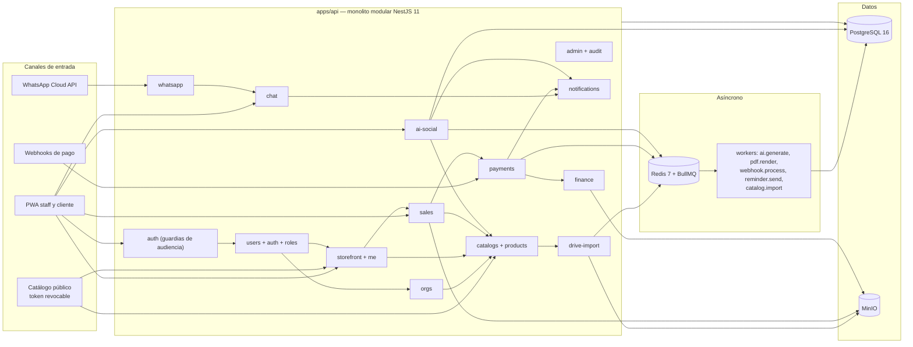

Reglas de dependencia entre módulos (MUST): `sales` no importa código de `payments` (se comunican por eventos de outbox); `ai-social` solo lee de `catalogs` mediante el puerto `ActiveCatalogReader`; `finance` nunca escribe en `payments`; `notifications` es consumidor de eventos, no emisor. Un módulo no consulta tablas de otro sin pasar por su servicio o por una vista de lectura declarada.

### 1.5 Superficies de confianza

| Superficie | Quién accede | Autenticación | Límite |
|---|---|---|---|
| `/api/v1/*` (staff) | Usuarios con membership | JWT access (`aud=staff`) + refresh rotativo | Rate limit por usuario y org |
| `/api/v1/public/*` | Cualquiera con el token del catálogo o link firmado | Token público revocable (sin JWT) | Rate limit por IP; sin datos de clientes |
| `/api/v1/storefront/*` | Visitante o cliente | Sin token o JWT `aud=customer` | Rate limit por IP; solo catálogo público |
| `/api/v1/me/*` | Cliente final (una o varias organizaciones) | JWT `aud=customer` (magic link/Google) | Solo sus propios recursos (`self`) |
| `/webhooks/*` | Pasarelas y Meta | Firma HMAC verificada + idempotencia | Rechazo 401 si firma inválida |
| Socket.IO `/chat` | Staff y clientes autenticados | JWT en handshake (audiencia validada) | Salas por `conversation_id` |
| SSE `/api/v1/ai/.../stream` | Usuario con permiso `ai:generate` | JWT (query token de un solo uso, ver §6.12) | 1 stream por job |

### 1.6 Supuestos estructurales

| ID | Supuesto | Impacto si es falso |
|---|---|---|
| SUPUESTO-01 | Stripe se usa solo en USD; los cobros en CRC se registran por SINPE Móvil/transferencia con comprobante (método manual) | Habría que añadir un adaptador CRC o cambiar de pasarela (§9.3) |
| SUPUESTO-02 | MercadoPago acepta cuentas de Costa Rica en USD; si la cuenta real no lo permite, el adaptador queda deshabilitado por configuración sin tocar código | Un canal de cobro menos; se compensa con link de pago Stripe/PayPal |
| SUPUESTO-03 | La organización ya tiene número de WhatsApp Business verificado y método de pago activo en Meta | El módulo WhatsApp no puede enviar; queda en modo solo-recepción |
| SUPUESTO-04 | DeepSeek es el proveedor IA primario (`deepseek-chat`); precios de tokens vienen de configuración versionada, no del código | Cambia el coste calculado; el `AiUsageLedger` debe recalcularse |
| SUPUESTO-05 | Cada archivo de Drive contiene una sola tabla de productos (una hoja); el mapeo elige la hoja si hay varias | Importaciones multi-hoja requerirían una entidad de hojas por job |
| SUPUESTO-06 | IVA por defecto 13 % (`tax_rate_bp=1300`), configurable por catálogo y por producto | Cambian los totales por defecto; la estructura ya lo soporta |
| SUPUESTO-07 | Un cliente final puede existir sin cuenta; solo necesita cuenta (magic link) para chat, historial y estado de pedidos | Chat público anónimo queda fuera (decisión ya tomada en 01 §11.4) |
| SUPUESTO-08 | Cada organización opera 1–3 catálogos en el MVP, aunque el modelo soporta N | Rendimiento de selector y caché; sin cambio de esquema |
| SUPUESTO-09 | La importación de PDF es best-effort (extracción de texto; OCR solo si el archivo es imagen) y se marca `confidence=low`: exige revisión humana antes de `validated` | Si se exige OCR de calidad, se necesita un servicio externo (§9.1) |
| SUPUESTO-10 | Despliegue en una sola región (US-East o similar); p95 de latencia hacia APIs externas < 300 ms | Ajusta timeouts y percepción de la generación IA |

## 2. Actores, roles y autorización

### 2.1 Actores

| Actor | Audiencia del token | Superficie | Rol de sistema | Alcance |
|---|---|---|---|---|
| Staff de plataforma | `staff` | PWA `/admin` | `superadmin` | Global (todas las orgs), con elevación auditada |
| Dueño/administrador de organización | `staff` | PWA `/panel` | `org_admin` | Toda su organización |
| Administrador de catálogo | `staff` | PWA `/panel` | `catalog_admin` | Catálogos asignados |
| Vendedor | `staff` | PWA `/panel` (móvil primero) | `vendedor` | Catálogos asignados; escribe lo suyo |
| Finanzas | `staff` | PWA `/panel` | `finanzas` | Organización (dinero) |
| Social media manager | `staff` | PWA `/panel` | `social_manager` | Organización (contenido) |
| Agente de chat/WhatsApp | `staff` | PWA `/panel` (bandeja) | `agente_chat` | Organización (conversaciones) |
| Cliente final | `customer` | Tienda `/c/{slug}` + portal `/mi-cuenta` | `customer` (fijo) | Solo sus propios recursos (`self`) |
| Visitante | sin token o `customer` | Tienda pública + catálogo `/c/{slug}` | — | Catálogo público con token revocable; compra como invitado |

**Dos caras, una identidad.** La distinción staff/cliente es de **audiencia y contexto**, no de persona: un mismo `User` puede ser colaborador de una organización y cliente de otra (ADR-17/ADR-18, §5.1 del 01). Cara A (backoffice) usa `/api/v1/*` con `aud=staff`; cara B (tienda/portal) usa `/api/v1/storefront/*` (público por token de catálogo) y `/api/v1/me/*` (con `aud=customer`). Un token de una audiencia no puede invocar la otra superficie (`ERR-119 AUTH_WRONG_AUDIENCE`).

### 2.2 Modelo de autorización

La autorización tiene **tres dimensiones**: la **audiencia** (staff o customer), el **rol** (qué acciones) y el **scope** (sobre qué datos). El rol se materializa en `RoleAssignment(role_id, scope_type, catalog_id?)` colgado de la `Membership` (ADR-18): un colaborador puede tener varios roles con alcances distintos (uno de organización y varios por catálogo). El cliente no usa `Membership`: usa `CustomerAccount(user_id, organization_id, customer_id)` y el rol fijo `customer`, cuyos permisos son todos `self:*`.

| Nivel de scope | Quién | Regla de filtrado obligatoria |
|---|---|---|
| `GLOBAL` | `superadmin` (asignación `scope='org'` en la org de plataforma) | Sin filtro por org; toda consulta exige `X-Organization-Id` explícito y escribe `audit_log` con `actor_type=superadmin` y `reason` |
| `ORG` | `org_admin`, `finanzas`, `social_manager`, `agente_chat` y roles personalizados con assignment de org | `WHERE organization_id = :orgId` en toda consulta |
| `CATALOG` | `catalog_admin`, `vendedor` y roles personalizados con assignment de catálogo | `WHERE organization_id = :orgId AND catalog_id IN (:assignedCatalogIds)`; `RoleAssignment(scope_type='catalog')` es la fuente, no un campo del token |
| `SELF` | `customer` | `WHERE customer_id = :customerId AND organization_id = :orgId`; el repositorio del portal aplica el filtro obligatoriamente, sin listados masivos |

**Reglas duras de autorización:**

- **A-R1 (deny by default)** — Un endpoint sin `@RequirePermission(...)` se rechaza con `403 AUTHZ_FORBIDDEN`. No hay "público por defecto" salvo bajo `/public/*` y `/storefront/*`, que se anotan explícitamente `@Public()`.
- **A-R2 (doble comprobación)** — El guard valida audiencia + permiso + scope; el **servicio** vuelve a validar con `AuthorizationService.assert(actor, permission, { organizationId, catalogId, customerId? })`. Un guard mal configurado no puede filtrar datos porque el repositorio recibe siempre el `TenantContext` resuelto.
- **A-R3 (no escalada)** — Nadie concede un permiso que no posee. `superadmin` crea organizaciones y `org_admin`; `org_admin` asigna como máximo roles cuyos permisos sean subconjunto de los suyos; `catalog_admin` no invita usuarios.
- **A-R4 (último admin)** — No se puede suspender, eliminar ni degradar al último `org_admin` activo de una organización (`ERR-015 ORG_LAST_ADMIN`).
- **A-R5 (histórico inmutable)** — Ningún rol puede escribir sobre `CatalogVersion` en estado `archived` ni sobre cotizaciones/pedidos que referencien una versión archivada; solo lectura.
- **A-R6 (campos sensibles)** — `costo`, `margen` y datos de pasarela se excluyen por DTO para `vendedor`, `social_manager` y `agente_chat`. La restricción es de serialización, no solo de UI.
- **A-R7 (scope explícito)** — Si una petición incluye `X-Catalog-Id`, debe pertenecer a la organización y al scope del actor; si no, `403 AUTHZ_SCOPE_DENIED`. Sin header, el scope se aplica como filtro.
- **A-R8 (auditoría)** — Toda mutación con permiso `*.approve`, `*.activate`, `*.delete`, `payment.refund_approve`, `ai.quota_manage`, `user:suspend`, `user:anonymize`, `role:*` escribe `audit_log` con `before`/`after`.
- **A-R9 (audiencias)** — Un token `aud=customer` solo ejecuta `/api/v1/me/*`, `/api/v1/storefront/*` y `/api/v1/auth/*`; un token `aud=staff` nunca consume carrito ni checkout. El cruce devuelve `403 ERR-119 AUTH_WRONG_AUDIENCE` (R8). Además, `customer` no revela existencia de recursos ajenos: 404 si el ID no es suyo.
- **A-R10 (superadmin sin impersonación)** — En el MVP `superadmin` no impersona usuarios. Para soporte usa consultas de solo lectura con `X-Support-Reason` obligatorio, registradas en `audit_log` (R10).
- **A-R11 (roles de sistema inmutables)** — `superadmin`, `org_admin`, `catalog_admin`, `vendedor`, `finanzas`, `social_manager`, `agente_chat` y `customer` no se editan ni borran; solo se crean roles personalizados de audiencia staff (RF-USR-05).
- **A-R12 (MFA)** — `org_admin` y `superadmin` requieren MFA TOTP activo para operar; sin MFA `403 ERR-121 AUTH_MFA_SETUP_REQUIRED` (excepto el propio flujo de enrolamiento).
- **A-R13 (suspensión inmediata)** — Suspender una `Membership` o `CustomerAccount` revoca sus `AuthSession` en ≤ 60 s y sus tokens en vuelo se rechazan por blocklist de `jti`.
- **A-R14 (filtro self en repositorio)** — El repositorio del portal recibe `customerId` no nulo y aplica `WHERE customer_id = :customerId` por construcción; un `customerId` ausente lanza error de programación, no devuelve todo (R9).
- **A-R15 (roles personalizados)** — Un rol personalizado solo puede incluir permisos que el `org_admin` que lo crea posee, y nunca permisos de plataforma (`admin:*`, `audit:export`) ni de otra audiencia.

### 2.3 Catálogo de permisos

Formato del código: `<recurso>:<acción>`. Acciones canónicas: `read` (L), `create`/`update`/`delete`/`send`/`export` (E), `approve`/`activate` (A), `manage` (configuración). La base de datos siembra `permissions` con estas filas y `role_permissions` con la matriz de §2.4.

| Recurso | Permisos | Descripción |
|---|---|---|
| `organization` | `organization:read`, `organization:update`, `organization:manage_members`, `organization:manage_roles` | Datos de la org, memberships y roles |
| `user` (staff) | `user:invite`, `user:read`, `user:update`, `user:suspend`, `user:reactivate`, `user:anonymize` | Colaboradores: invitación, edición, suspensión y anonimización |
| `role` | `role:read`, `role:create`, `role:update`, `role:delete` | Roles de sistema (solo lectura) y roles personalizados |
| `session` | `session:read`, `session:revoke` | Sesiones propias; `session:revoke` de terceros solo `superadmin` |
| `self` (customer) | `self:profile_read`, `self:profile_update`, `self:address_manage`, `self:consent_manage`, `self:order_read`, `self:quote_read`, `self:payment_read`, `self:chat`, `self:favorite_manage`, `self:data_export`, `self:delete` | Permisos `self` exclusivos del rol `customer` (R9); nunca se asignan a staff |
| `catalog` | `catalog:read`, `catalog:create`, `catalog:update`, `catalog:delete`, `catalog:manage_public_token` | Catálogo y su token público |
| `catalog_version` | `version:read`, `version:create`, `version:update`, `version:validate`, `version:activate`, `version:archive` | Versionado inmutable |
| `import_job` | `import:read`, `import:create`, `import:cancel`, `import:retry` | Importaciones desde Drive |
| `product` | `product:read`, `product:create`, `product:update`, `product:delete` | Productos, variantes e imágenes |
| `category` | `category:read`, `category:manage` | Categorías de una versión |
| `customer` | `customer:read`, `customer:create`, `customer:update`, `customer:delete` | Base de clientes |
| `quote` | `quote:read`, `quote:create`, `quote:update`, `quote:send`, `quote:convert`, `quote:cancel` | Cotizaciones |
| `order` | `order:read`, `order:create`, `order:update`, `order:cancel`, `order:fulfill` | Pedidos y entregas |
| `payment` | `payment:read`, `payment:create_manual`, `payment:link_create`, `payment:refund_request`, `payment:refund_approve` | Cobros |
| `gateway` | `gateway:read`, `gateway:manage` | Configuración de pasarelas |
| `expense` | `expense:read`, `expense:create`, `expense:update`, `expense:approve`, `expense:delete` | Gastos |
| `finance` | `finance:read`, `finance:export` | Reportes y exportaciones |
| `ai` | `ai:generate`, `ai:read`, `ai:cancel`, `ai:quota_manage` | Generación y cuotas |
| `social_post` | `social_post:read`, `social_post:create`, `social_post:update`, `social_post:approve`, `social_post:schedule`, `social_post:publish` | Posts generados |
| `social_template` | `social_template:read`, `social_template:manage` | Plantillas de contenido |
| `whatsapp` | `whatsapp:read`, `whatsapp:send`, `whatsapp:template_manage` | Mensajería WhatsApp |
| `chat` | `chat:read`, `chat:send`, `chat:assign`, `chat:close` | Chat en vivo |
| `notification` | `notification:read` | Notificaciones propias |
| `audit` | `audit:read`, `audit:export` | Auditoría (solo org_admin/superadmin) |
| `file` | `file:read`, `file:write` | Objetos en MinIO (URLs firmadas) |
| `admin` | `admin:jobs_read`, `admin:metrics_read`, `admin:org_manage` | Operación de plataforma |

### 2.4 Matriz RBAC rol × recurso × acción

Leyenda: `L` = lectura, `E` = escritura (crear/actualizar/ejecutar), `A` = aprobación/activación, `L*` = lectura con campos sensibles excluidos, `S` = solo sus propios registros (`self`), `—` = sin acceso. La columna **Audiencia** indica qué token puede invocar el recurso: `staff`, `customer` o `público` (sin token).

| Recurso | Audiencia | superadmin | org_admin | catalog_admin | vendedor | finanzas | social_manager | agente_chat | customer |
|---|---|---|---|---|---|---|---|---|---|
| `organization` | staff | L E A | L E | L | L | L | L | L | — |
| `user` / `session` | staff | L E A | L E A | — | — | — | — | — | — |
| `role` / `permission` | staff | L E A | L E A | — | — | — | — | — | — |
| `catalog` | staff | L E A | L E A | L E | L | L | L | L | — |
| `catalog_version` | staff | L E A | L E A | L E A | L | L | L | — | — |
| `import_job` | staff | L E | L E | L E | — | — | — | — | — |
| `product` | staff/público | L E A | L E A | L E A | L | L | L | L* | L (vitrina) |
| `category` | staff | L E A | L E A | L E A | L | L | L | — | — |
| `customer` | staff | L E A | L E A | L* | L* S | L* | — | L* | S (`self`) |
| `quote` | staff/customer | L E A | L E A | L E A | L E S | L | — | L* | S (`self`) |
| `order` | staff/customer | L E A | L E A | L E A | L E S | L | — | L* | S (`self`) |
| `payment` | staff/customer | L E A | L E A | L | L* | L E A | — | — | S (`self`) |
| `gateway` | staff | L E A | L E A | — | — | L E | — | — | — |
| `expense` | staff | L E A | L E A | — | — | L E A | — | — | — |
| `finance` | staff | L E A | L E A | L | — | L E | — | — | — |
| `ai` | staff | L E A | L E A | L E | L E | — | L E | — | — |
| `social_post` | staff | L E A | L E A | L E A | — | — | L E A | — | — |
| `social_template` | staff | L E A | L E A | L | — | — | L E A | — | — |
| `whatsapp` | staff | L E A | L E A | L | L | L | L | L E | — |
| `chat` | staff/customer | L E A | L E A | L | L | — | — | L E A | S (`self`) |
| `address` / `consent` / `favorite` | customer | — | — | — | — | — | — | — | S (`self`) |
| `notification` | staff/customer | L | L | L | L | L | L | L | L |
| `audit` | staff | L E | L E | — | — | — | — | — | — |
| `file` | staff | L E | L E | L E | L E | L E | L E | L | — |
| `admin` | staff | L E A | L | — | — | — | — | — | — |

Notas de la matriz:

1. `catalog_admin` no gestiona dinero ni miembros; `finanzas` no edita catálogo ni contenido; `social_manager` no ve costos ni márgenes (`L*` en producto excluye `cost_minor`).
2. `vendedor` lee todo su scope de catálogos y escribe `quote`/`order` donde es asignado o donde el pedido no tiene vendedor; una vez asignado a otro vendedor, solo lectura.
3. El rol `customer` **nunca** aparece en un `RoleAssignment` de columna staff ni puede invocar `/api/v1/*` (excepto `/auth/*`): sus permisos son todos `self:*` y su superficie es `/api/v1/me/*` y `/api/v1/storefront/*` (R8, R9). El catálogo público no requiere rol.
4. `superadmin` no recibe `payment:refund_approve` para sí mismo en producción: la aprobación de reembolsos exige `org_admin` o `finanzas` de la organización (segregación de funciones); si no hay ninguno, se escala por soporte con doble aprobación registrada.
5. Un permiso efectivo es `permission ∩ scope ∩ audience`. Tener `product:update` con un `RoleAssignment(scope='catalog', catalog_id=A)` no permite editar productos del catálogo B.
6. `RoleAssignment` puede ser múltiple: la unión de permisos de todos los assignments del usuario **acotada por el scope del assignment usado** en la petición; si dos assignments dan el mismo permiso con scopes distintos, prevalece el scope evaluado, nunca la unión de scopes.
7. Los roles personalizados (`is_system=false`) se comportan como cualquiera de la matriz según los permisos que contengan; la matriz anterior es la semilla de los roles de sistema y el techo de permisos que un `org_admin` puede conceder.

### 2.5 Resolución del contexto de petición

```
Access JWT (15 min, RS256) → claims { sub, sid, aud, org_id, roleKeys[], jti, exp }
Customer: { sub, sid, aud=customer, org_id, customer_id, jti, exp }
  1. JwtAuthGuard        valida firma, exp, aud ∈ {staff, customer} y jti no revocado (Redis blocklist)
  2. AudienceGuard       resuelve la superficie permitida por aud (R8) y rechaza cruces con AUTH_WRONG_AUDIENCE
  3. OrgContextGuard     X-Organization-Id ∈ organizaciones del actor y coincide con org_id del token
  4. PermissionGuard     @RequirePermission(code) contra permisos efectivos de RoleAssignment (cache 5 min)
  5. ScopeInterceptor    construye TenantContext { organizationId, audience, assignedCatalogIds[], customerId?, actorMembershipId? }
  6. Service             recibe TenantContext y lo aplica al repositorio (nunca lee IDs del body)
```

Reglas: el `organization_id` **nunca** se toma del body; se toma del contexto. El `catalog_id` de una mutación se valida contra los `RoleAssignment` de scope catálogo. Los endpoints de `/me` y `/storefront` construyen `TenantContext` con `customerId` y fuerzan `SELF` (A-R14); los de carrito/checkout exigen `aud=customer` o son públicos. `superadmin` debe enviar `X-Organization-Id` y `X-Support-Reason` (mínimo 10 caracteres) en cada petición de negocio. El token no lleva la lista de permisos completa (solo `roleKeys` para UI); los permisos reales se resuelven en servidor para que un cambio de rol aplique en ≤ 5 min (o inmediatamente al invalidar la caché).

### 2.6 Invariantes verificables (tests obligatorios de autorización)

| ID | Invariante | Test |
|---|---|---|
| AUTHZ-T01 | Un `vendedor` del catálogo A no puede leer productos del catálogo B (404/403) | integración |
| AUTHZ-T02 | Un `org_admin` de la org 1 nunca ve datos de la org 2 | integración |
| AUTHZ-T03 | `finanzas` no puede ejecutar `POST /products` ni `POST /social/posts` | integración |
| AUTHZ-T04 | `social_manager` recibe 403 en `GET /finance/summary` | integración |
| AUTHZ-T05 | Un `customer` no puede abrir conversaciones de otro `customer_id` | integración |
| AUTHZ-T06 | Un endpoint sin `@RequirePermission` responde 403 a todo rol salvo `@Public` | unitario (metadatos) |
| AUTHZ-T07 | `superadmin` sin `X-Support-Reason` recibe 400 | integración |
| AUTHZ-T08 | El último `org_admin` no puede degradarse | integración |
| AUTHZ-T09 | Un token `aud=customer` recibe 403 `AUTH_WRONG_AUDIENCE` en cualquier `/api/v1/*` de staff | integración |
| AUTHZ-T10 | Un token `aud=staff` no puede usar carrito ni checkout de la tienda | integración |
| AUTHZ-T11 | Un usuario staff en la org A y customer en la org B nunca mezcla datos entre ambas audiencias | E2E |
| AUTHZ-T12 | Un rol personalizado no puede incluir un permiso que su creador no posee | integración |
| AUTHZ-T13 | Suspender una membership invalida sus tokens en ≤ 60 s | integración |
| AUTHZ-T14 | El token no contiene permisos: revocar un permiso en BD surte efecto en ≤ 5 min aunque el token siga vigente | integración |

## 3. Requisitos funcionales

### 3.0 Plantilla y reglas comunes

Cada RF se documenta con: **descripción**, **precondiciones**, **flujo principal** (pasos numerados), **flujos alternativos/error**, **postcondiciones**, **reglas de negocio** y **criterio de aceptación** en Gherkin. Salvo que se indique lo contrario: todo endpoint exige JWT válido, permiso de §2.3 y `TenantContext` resuelto; los errores usan los códigos de §11; toda mutación escribe `audit_log` (§3.10); los listados son paginados por cursor (§6.1).

### 3.1 Usuarios, identidad, roles y dos caras (módulo RF-USR)

> Implementa ADR-17 y ADR-18 y la sección 5.1 de `docs/01-CONTEXTO-Y-DECISIONES.md`. Un mismo `User` puede ser colaborador de una organización y cliente de otra; backoffice y tienda comparten backend y modelo de permisos, con **audiencias de token separadas** (`aud=staff` / `aud=customer`) y contratos de API distintos (`/api/v1/*` vs `/api/v1/storefront/*` + `/api/v1/me/*`).

#### RF-USR-01 — Identidad única, registro de organización y registro de cliente

**Descripción.** Existe una sola entidad `User` (email normalizado y verificado, teléfono, nombre, locale, estado). El registro de staff crea organización + membership `org_admin`; el registro de cliente crea `CustomerAccount` + rol fijo `customer`. Un mismo usuario puede tener ambos roles en organizaciones distintas sin mezclar datos.
**Precondiciones.** Email no registrado o usuario existente sin verificar; contraseña con zxcvbn ≥ 3 y ≥ 12 caracteres; términos aceptados (`Consent` tipo `terms`).
**Flujo principal.**
1. `POST /api/v1/auth/register` con `{accountType: staff|customer, email, password, fullName, organizationName?, country?, defaultCurrency?, phone?, locale?}`.
2. Normaliza email, aplica Argon2id y crea `User(status=invited)`; si `staff`, crea `Organization` + `Membership(org_admin)` + `RoleAssignment(org, org_admin)`; si `customer`, crea `Customer` + `CustomerAccount(organization_id)` + `RoleAssignment(org, customer)`.
3. Crea `VerificationToken(kind=email_verify, 24 h)` y encola email; responde `201`.
4. `GET /api/v1/auth/verify-email?token=...` consume el token una vez y pasa `User.status=active` (y `email_verified_at`).
5. Si ya existía un `User` con ese email y estaba `invited` sin verificar, el registro **reutiliza** la identidad y completa el perfil (no duplica).
**Alternativas/error.**
- Email ya activo → `409 ERR-002 EMAIL_ALREADY_REGISTERED` con respuesta genérica y email de recuperación (anti-enumeración).
- Contraseña débil → `422 ERR-001 VALIDATION_ERROR` con `details`.
- Token inválido/expirado → `410 ERR-004 VERIFICATION_TOKEN_INVALID`.
- Sin verificar → `403 ERR-003 EMAIL_NOT_VERIFIED` al operar.
**Postcondiciones.** `User` activo, membership/assignment o `CustomerAccount` creados, `Consent` de términos registrado, `audit_log` `user.registered`/`organization.created`.
**Reglas.** `users.email_normalized` único global. El registro como cliente exige `organizationId` del catálogo público (token) para saber en qué organización se da de alta. El mismo usuario puede ser `org_admin` en la org A y `customer` en la B: los tokens llevan `org_id` y la audiencia; los datos se filtran por organización y por `customer_id` (R8–R10).
**Aceptación.**
```gherkin
Escenario: Un usuario es staff en una organización y cliente en otra
  Given un User activo con relación staff en la organización A
  When se registra como cliente en la organización B con el mismo email
  Then existe una CustomerAccount en B y el User no se duplica
  And su token aud=customer en B solo accede a /api/v1/me/* y /api/v1/storefront/*
```

#### RF-USR-02 — Login de backoffice, MFA TOTP y recuperación de contraseña

**Descripción.** El staff inicia sesión con email/contraseña o Google y, si su rol es `org_admin` o `superadmin`, con MFA TOTP obligatorio. El cliente usa magic link (RF-USR-06). Hay bloqueo por intentos y recuperación de contraseña por token de un solo uso.
**Precondiciones.** `User.status=active` y `email_verified_at` no nulo; membership en alguna organización.
**Flujo principal.**
1. `POST /api/v1/auth/login` con `{email, password}` (rate limit 10/15 min por IP+email).
2. Verifica Argon2id; si el rol efectivo requiere MFA y no hay segundo factor, responde `200 {mfaRequired:true, mfaToken}` (token de 5 min, no es sesión).
3. `POST /api/v1/auth/mfa/verify` con `{mfaToken, otp}` valida TOTP (ventana ±1, anti-replay por `time_step`) y emite la sesión.
4. `POST /api/v1/auth/refresh` rota el refresh; `POST /api/v1/auth/logout` revoca la sesión.
5. Google OAuth staff: `GET /api/v1/auth/google?aud=staff` + callback valida `state` y audiencia; si el rol exige MFA, se exige el segundo factor igual.
6. Recuperación: `POST /auth/password/forgot` responde `202` siempre; `POST /auth/password/reset` con `{token, newPassword}` crea `VerificationToken(kind=password_reset, 30 min)` de un solo uso y revoca todas las sesiones.
7. `POST /auth/mfa/setup` devuelve `otpauthUri` + recovery codes (10, hasheados); `POST /auth/mfa/disable` exige contraseña + OTP y no se permite al último org_admin.
**Alternativas/error.**
- Credenciales inválidas → `401 ERR-005 AUTH_INVALID_CREDENTIALS`; a los 10 fallos `locked_until=+15 min` → `429 ERR-006 AUTH_ACCOUNT_LOCKED`.
- OTP inválido o ventana vencida → `401 ERR-120 AUTH_MFA_INVALID`; 5 fallos → bloqueo 15 min.
- Cuenta sin MFA obligatorio pendiente de enrolar → `403 ERR-121 AUTH_MFA_SETUP_REQUIRED`.
- Token de reset usado/expirado → `410 ERR-122 AUTH_RESET_TOKEN_INVALID`; todas las sesiones previas quedan revocadas.
- OAuth con audiencia cruzada → `403 ERR-119 AUTH_WRONG_AUDIENCE`.
**Postcondiciones.** `AuthSession(aud=staff)` creada o revocada; `audit_log` `auth.login`, `auth.mfa_enrolled`, `auth.password_reset`.
**Reglas.** Argon2id (`m=19456,t=2,p=1`), mínimo 12 caracteres y no estar en lista de contraseñas filtradas (k-anonymity de HIBP, SUPUESTO por coste). MFA obligatorio para `org_admin` y `superadmin`; opcional para el resto. Las recovery codes son de un solo uso. Sesión: access 15 min, refresh 7 días (staff) y 30 días (customer). La respuesta de login no revela si el email existe.
**Aceptación.**
```gherkin
Escenario: Login de org_admin exige TOTP
  Given un org_admin con MFA TOTP enrolado
  When envía credenciales correctas sin OTP
  Then recibe mfaRequired=true y un mfaToken de 5 minutos
  And solo al verificar un OTP válido obtiene access y refresh tokens
```

#### RF-USR-03 — Sesiones por dispositivo, rotación y aislamiento de audiencias

**Descripción.** Cada inicio de sesión crea una `AuthSession` revocable por dispositivo con rotación de refresh y detección de reutilización; los tokens llevan `aud` y `org_id`, y una audiencia no puede llamar a la superficie de la otra.
**Precondiciones.** Usuario autenticado o refresh válido.
**Flujo principal.**
1. `POST /auth/refresh` verifica `token_hash`, `aud`, `org_id` y `AuthSession.revoked_at`; rota el token (mismo `family_id`, `rotated_from_id`) y devuelve el nuevo par.
2. `GET /api/v1/auth/sessions` lista sesiones propias con `{deviceLabel, userAgent, ipMasked, createdAt, lastUsedAt, current}`.
3. `DELETE /api/v1/auth/sessions/{id}` revoca una sesión; `DELETE /api/v1/auth/sessions?others=true` revoca todas menos la actual.
4. Un cambio de contraseña, suspensión de membership o detección de reuso revoca `family_id` completa en ≤ 60 s (Redis blocklist de `jti`).
5. La verificación de `aud` ocurre en el guard: `aud=customer` solo `/api/v1/me/*`, `/api/v1/storefront/*` y `/api/v1/auth/*`; `aud=staff` nunca consume carrito ni checkout.
**Alternativas/error.**
- Reuso de refresh ya rotado → `401 ERR-007 AUTH_REFRESH_REUSED`; revoca toda la familia y notifica (`notification` `auth.new_device`).
- Refresh de sesión revocada → `401 ERR-124 AUTH_SESSION_REVOKED`.
- Token de audiencia incorrecta → `403 ERR-119 AUTH_WRONG_AUDIENCE`.
- Fijación de sesión: el ID de sesión se regenera al autenticar; un `jti` repetido con otro `sid` → rechazo.
- Más de 5 sesiones activas → se revoca la más antigua.
**Postcondiciones.** `AuthSession` listada/revocada; `audit_log` `auth.session_revoked`.
**Reglas.** El refresh en claro nunca se guarda (solo `token_hash`). La `AuthSession` guarda `audience`, `organization_id` y `customer_id?` para que el guard valide sin consultar la membership en cada petición (cache 60 s). Los tokens de cliente no incluyen permisos de staff.
**Aceptación.**
```gherkin
Escenario: Un token de cliente no puede llamar al backoffice
  Given un token con aud=customer válido
  When llama a GET /api/v1/orders
  Then responde 403 AUTH_WRONG_AUDIENCE
  And la petición queda registrada en audit_log como acceso denegado
```

#### RF-USR-04 — Colaboradores: invitaciones, memberships y asignaciones de rol

**Descripción.** Un `org_admin` invita colaboradores y les asigna roles con alcance de organización o de un catálogo concreto (`RoleAssignment`). La membership nace `invited` y pasa a `active` al aceptar; se puede suspender y reasignar.
**Precondiciones.** Actor con `organization:manage_members`; email no invitado vigente; rol a asignar con permisos ⊆ permisos del actor (A-R3).
**Flujo principal.**
1. `POST /api/v1/organizations/{orgId}/users/invite` con `{email, fullName?, assignments:[{roleId, scope:'org'|'catalog', catalogId?}], message?}`.
2. Crea `UserInvitation(status=pending, token_hash, 72 h)` y `Membership(status=invited)` con un `RoleAssignment` por cada scope solicitado.
3. `POST /api/v1/invitations/{token}/accept` con `{fullName, password}` crea o reutiliza `User`, activa membership y assignments, y registra consentimiento de términos.
4. `PATCH /api/v1/users/{membershipId}` cambia `status` (`active|suspended`), datos de perfil del colaborador y asignaciones; `DELETE` suspende (nunca borra históricos).
5. `POST /api/v1/users/{membershipId}/assignments` y `DELETE /assignments/{id}` gestionan roles por scope; un usuario puede tener `vendedor` en el catálogo A y `catalog_admin` en el B.
6. `GET /api/v1/users?status=&role=&q=&cursor=` lista colaboradores con sus roles y scopes.
**Alternativas/error.**
- Invitación duplicada vigente → `409 ERR-016 INVITATION_PENDING`; expirada → `410 ERR-017 INVITATION_EXPIRED` (reenviar).
- Sin `RoleAssignment` de scope org → `422 ERR-130 USER_REQUIRES_ORG_ROLE` (siempre debe existir al menos uno).
- Rol inexistente o de otra org → `404 ERR-140 ROLE_NOT_FOUND`.
- Asignar rol con permisos que el actor no tiene → `403 ERR-011 AUTHZ_PRIVILEGE_ESCALATION`.
- Degradar/suspender al último `org_admin` → `409 ERR-015 ORG_LAST_ADMIN`.
- Reasignar a un catálogo fuera de la org → `422 ERR-012 AUTHZ_SCOPE_DENIED`.
**Postcondiciones.** `UserInvitation` y `Membership`/`RoleAssignment` creados o modificados; caché de permisos invalidada; `audit_log` `user.invited`/`user.role_assigned`.
**Reglas.** Roles de sistema además de los personalizados de la org (RF-USR-05). Un `RoleAssignment` con `scope='catalog'` exige `catalog_id`; con `scope='org'` lo prohíbe. El invitado no accede a nada hasta aceptar y verificar email. La invitación se puede revocar (`DELETE /invitations/{id}`).
**Aceptación.**
```gherkin
Escenario: Vendedor invitado solo ve su catálogo
  Given un org_admin con dos catálogos "Verano" e "Invierno"
  When invita a un vendedor con RoleAssignment vendedor scope=catalog "Verano"
  And el invitado acepta y verifica su email
  Then GET /api/v1/products con X-Catalog-Id "Invierno" responde 403 AUTHZ_SCOPE_DENIED
  And GET /api/v1/products con "Verano" responde 200
```

#### RF-USR-05 — Roles y permisos: sistema y personalizados

**Descripción.** `Permission` es atómico (`recurso:acción`), `Role` agrupa permisos y `RolePermission` materializa la matriz. Los roles de sistema son inmutables; cada organización puede crear roles personalizados con un subconjunto de sus propios permisos. La evaluación ocurre en el servicio (no solo en el controlador).
**Precondiciones.** Actor con `organization:manage_roles`; organización activa.
**Flujo principal.**
1. `GET /api/v1/roles` devuelve roles de sistema (visibles, no editables) + roles personalizados de la org con sus permisos.
2. `POST /api/v1/roles` con `{key, name, permissionCodes[], audience:'staff'}` crea un rol personalizado (`is_system=false`, `organization_id`). La audiencia `customer` solo admite el rol de sistema `customer`.
3. `PATCH /api/v1/roles/{id}` añade/quita permisos y renombra; `DELETE` falla si el rol está asignado (`409 ERR-141 ROLE_IN_USE`) o es de sistema (`409 ERR-142 ROLE_SYSTEM_IMMUTABLE`).
4. `GET /api/v1/permissions` lista el catálogo completo con `resource`, `action` y descripción (fuente de la UI de roles).
5. La evaluación: guard por permiso declarado y `AuthorizationService.assert(actor, permission, scope)` en cada servicio; los permisos efectivos se cachean por `(membership_id, org_id)` 5 min y se invalidan al cambiar assignments.
6. El rol `customer` es fijo (no editable) y solo concede permisos `self` sobre `profile`, `address`, `order`, `quote`, `payment`, `chat`, `consent`, `favorite`.
**Alternativas/error.**
- Permiso desconocido → `422 ERR-143 ROLE_UNKNOWN_PERMISSION`.
- Intento de editar rol de sistema → `409 ERR-142 ROLE_SYSTEM_IMMUTABLE`.
- Intento de crear un rol con permisos que el actor no tiene → `403 ERR-011 AUTHZ_PRIVILEGE_ESCALATION`.
- Rol de audiencia `customer` con permisos de backoffice → `422 ERR-144 ROLE_AUDIENCE_MISMATCH`.
**Postcondiciones.** Rol y matriz actualizados; caché invalidada; `audit_log` `role.created`/`role.updated` con diff.
**Reglas.** Un usuario con varios assignments tiene la **unión** de permisos, acotada por el scope de cada assignment. No hay herencia implícita entre roles. Los permisos de backoffice (`catalog:*`, `payment:*`, `finance:*`, `ai:*`, `social_post:*`, `whatsapp:*`) nunca se asignan a `audience=customer`. La matriz de §2.4 es la semilla de `role_permissions` y el contrato de referencia.
**Aceptación.**
```gherkin
Escenario: Rol personalizado con permisos acotados
  Given un org_admin con permiso organization:manage_roles
  When crea el rol "supervisor_ventas" con permisos quote:read, quote:create y order:read
  Then un colaborador con ese rol puede cotizar y leer pedidos
  But recibe 403 al intentar registrar un pago manual
```

#### RF-USR-06 — Cuenta de cliente: alta, magic link, checkout de invitado y consentimientos

**Descripción.** El cliente final navega y cotiza sin login; para pagar, ver historial o chatear usa sesión `aud=customer` (magic link o Google). Puede comprar como invitado y reclamar la cuenta después con el mismo email verificado. Los consentimientos son explícitos y revocables.
**Precondiciones.** Catálogo público habilitado (token vigente) o `organizationId` conocido; `storefront` habilitado en la organización.
**Flujo principal.**
1. `POST /api/v1/auth/register` con `accountType=customer` o `POST /api/v1/storefront/checkout/guest` con datos de contacto.
2. Compra de invitado: crea/actualiza `Customer` (sin `User`) y el pedido con `customer_id`; el email de confirmación incluye un enlace de un solo uso para reclamar.
3. `POST /api/v1/auth/magic-link` con `{email, organizationId}` responde `202` siempre; si existe `Customer`, envía enlace (15 min) y al consumirlo crea `User` (si falta) + `CustomerAccount` + `RoleAssignment(customer)` y vincula pedidos por email/teléfono verificados.
4. `GET /api/v1/me` devuelve perfil, `customerAccounts[]`, direcciones, consentimientos y contadores (pedidos, cotizaciones, chats).
5. `POST /api/v1/me/addresses` / `PATCH` / `DELETE` gestionan `Address` (máx. 10 activas por cuenta, una predeterminada por tipo).
6. `POST /api/v1/me/consents` registra o revoca consentimientos (`terms`, `privacy`, `marketing`, `whatsapp_opt_in`) con `timestamp`, `source` e `ip`; `GET /api/v1/me/consents` devuelve el histórico.
7. `POST /api/v1/storefront/claims/{claimToken}/claim` vincula la compra de invitado a la sesión de cliente.
**Alternativas/error.**
- Cuenta ya reclamada por otro usuario verificado → `409 ERR-125 ACCOUNT_ALREADY_CLAIMED`.
- Email del claim no coincide con el del pedido → `409 ERR-126 CLAIM_EMAIL_MISMATCH`.
- Consentimiento obligatorio ausente en checkout → `422 ERR-127 CONSENT_REQUIRED`.
- Más de 10 direcciones → `409 ERR-128 ADDRESS_LIMIT_REACHED`.
- Catálogo público revocado → `404 ERR-042 PUBLIC_CATALOG_UNAVAILABLE`.
**Postcondiciones.** `CustomerAccount`, `Address` y `Consent` persistidos; pedidos históricos vinculados; `audit_log` `account.claimed`/`consent.updated`.
**Reglas.** El checkout de invitado no exige cuenta (R11). El claim solo funciona con email verificado y no transfiere datos entre organizaciones. `marketing` requiere opt-in explícito y nunca se preselecciona. La dirección predeterminada se usa en checkout y no se puede borrar sin designar otra.
**Aceptación.**
```gherkin
Escenario: Compra como invitado y reclamo posterior
  Given un visitante sin cuenta que compra en la tienda con email "ana@correo.cr"
  When recibe el enlace de reclamo y lo consume verificando su email
  Then se crea su User y CustomerAccount con rol customer
  And ve su pedido anterior en GET /api/v1/me/orders
```

#### RF-USR-07 — Ciclo de vida del usuario, baja y anonimización (Ley 8968)

**Descripción.** Los usuarios tienen un ciclo de vida explícito; la baja solicita anonimización de datos personales preservando registros contables y de auditoría exigidos, y el acceso a datos se audita. MFA, sesiones y consentimientos se revocan en la baja.
**Precondiciones.** Actor `org_admin`/`superadmin` para suspensiones; el propio usuario para baja; `User.status` conocido.
**Flujo principal.**
1. `User`: `invited → active → suspended → deleted`; `locked` es transitorio por intentos (`locked_until`) y no sustituye a `suspended`.
2. `POST /api/v1/admin/users/{id}/suspend` con `{reason}` (org_admin/superadmin) → `suspended`, revoca `AuthSession` y memberships; no puede iniciar sesión hasta reactivación (`POST /admin/users/{id}/reactivate`).
3. `POST /api/v1/me/deletion` con `{password, reason?}` inicia baja: estado `deleted`, revoca sesiones, anonimiza `full_name`, `email`, `phone`, `id_number_hash`, direcciones y adjuntos personales; conserva `User.id` y los pedidos/pagos como registros contables con referencia anonimizada.
4. `GET /api/v1/me/data-export` genera un ZIP asíncrono con perfil, pedidos, pagos, direcciones y consentimientos (portabilidad); enlace firmado 24 h.
5. La anonimización es irreversible y se registra en `audit_log` con `actor_type` y `reason`; los usuarios anonimizados no se pueden invitar de nuevo con el mismo email (`ERR-129 USER_ANONYMIZED`).
6. Todo acceso a datos de otro usuario por `superadmin` exige `X-Support-Reason` y queda auditado (A-R10).
**Alternativas/error.**
- Suspender al último org_admin → `409 ERR-015 ORG_LAST_ADMIN`.
- Baja con membresías activas en organizaciones donde es el único admin → `409 ERR-131 USER_OWNS_ORGS` (transferir antes).
- Usuario ya anonimizado → `409 ERR-129 USER_ANONYMIZED`.
- Exportación en curso → `409 ERR-114 IDEMPOTENCY_IN_PROGRESS`.
**Postcondiciones.** `User.status` actualizado, datos anonimizados o exportados, sesiones revocadas, auditoría completa.
**Reglas.** Retención: auditoría 24 meses, pedidos/pagos 5 años (obligación contable CR, SUPUESTO), consentimientos 24 meses tras la baja. La anonimización no rompe FKs (usa placeholders y `deleted_at`). `User` no se borra físicamente en el MVP.
**Aceptación.**
```gherkin
Escenario: Baja con anonimización preserva lo contable
  Given un cliente con un pedido pagado y una cuenta activa
  When solicita la baja y confirma con su contraseña
  Then su perfil queda anonimizado y sin sesiones activas
  And su pedido sigue existiendo con referencia anonimizada en finanzas
```

### 3.2 Importación desde Google Drive

#### RF-DRV-1 — Conexión OAuth2 con Google Drive

**Descripción.** La organización conecta una cuenta de Google con scope de solo lectura para que el staff explore y descargue archivos de catálogo.
**Precondiciones.** Actor con `import:create`; proyecto de Google Cloud con OAuth configurado (variables `GOOGLE_CLIENT_ID`, `GOOGLE_CLIENT_SECRET`, `GOOGLE_REDIRECT_URI`).
**Flujo principal.**
1. `POST /api/v1/integrations/google-drive/connect` devuelve `{authUrl, state}` (state firmado, 10 min).
2. El usuario autoriza `https://www.googleapis.com/auth/drive.readonly` y Google redirige a `/api/v1/integrations/google-drive/callback?code=&state=`.
3. El backend valida `state`, intercambia el código por tokens, cifra el `refresh_token` con AES-256-GCM (KEK en entorno) y crea/actualiza `SourceConnection`.
4. La respuesta redirige a `/app/integraciones?drive=connected`; el listado de carpetas ya está disponible.
**Alternativas/error.**
- `state` inválido/expirado → `400 ERR-009 OAUTH_STATE_INVALID`.
- Usuario cancela el consentimiento → `400 ERR-018 DRIVE_AUTH_CANCELLED`.
- Token revocado por el usuario → `401 ERR-019 DRIVE_AUTH_EXPIRED`; se marca `SourceConnection.status=reauth_required` y la UI pide reconectar.
- Cuota de Drive agotada → `429 ERR-020 DRIVE_QUOTA_EXCEEDED` con reintento sugerido.
**Postcondiciones.** `SourceConnection` activa con `scopes`, `root_folder_id` y `connected_by`; `audit_log` `drive.connected`.
**Reglas.** Solo lectura: nunca se escribe en Drive. Se guarda `refresh_token_ciphertext` y `token_hint` (últimos 4 caracteres del token) para diagnóstico. La conexión es por organización y puede haber más de una (una por cuenta) en el MVP.
**Aceptación.**
```gherkin
Escenario: Conexión exitosa de Drive
  Given un org_admin sin conexión de Drive
  When completa el consentimiento OAuth con scope drive.readonly
  Then existe una SourceConnection activa en la organización
  And el refresh token se guarda cifrado (no aparece en logs ni en API)
```

#### RF-DRV-2 — Selección de fuente y snapshot de importación

**Descripción.** El staff navega carpetas de Drive, elige un archivo y lanza una importación. El archivo se descarga a MinIO como snapshot inmutable, con checksum, antes de parsear.
**Precondiciones.** `SourceConnection.status=active`; actor con `import:create`; catálogo destino existente o nombre para crearlo.
**Flujo principal.**
1. `GET /api/v1/integrations/google-drive/folders?parentId=...` lista carpetas (id, nombre, modificado) con paginación por `nextPageToken`.
2. `GET /api/v1/integrations/google-drive/files?folderId=...` lista archivos soportados (Sheets, XLSX, XLS, CSV, PDF) con `mimeType`, `size`, `modifiedTime`.
3. `POST /api/v1/catalogs/import-jobs` con `{catalogId?, newCatalogName?, driveFileId, mappingTemplateId?, idempotencyKey}`.
4. El backend verifica que el archivo no exceda 50 MB ni 20 000 filas, descarga el contenido, calcula `sha256` y lo sube a MinIO (`FileObject.kind='source_snapshot'`).
5. Crea `CatalogImportJob(status=queued)` y encola `catalog.import`; responde `202` con `jobId` y `Location`.
**Alternativas/error.**
- Archivo ya importado con el mismo `sha256` para el mismo catálogo → `409 ERR-021 IMPORT_DUPLICATE_CHECKSUM` con el `jobId` anterior.
- Formato no soportado → `415 ERR-022 IMPORT_FILE_UNSUPPORTED`.
- Archivo > 50 MB o > 20 000 filas → `413 ERR-023 IMPORT_FILE_TOO_LARGE`.
- Importación ya en curso para el catálogo → `409 ERR-024 IMPORT_ALREADY_RUNNING` (un job activo por catálogo).
**Postcondiciones.** Snapshot en MinIO con checksum, job en cola, `audit_log` `import.queued`.
**Reglas.** La importación es idempotente por `(catalog_id, file_checksum)`: reejecutar el mismo archivo devuelve el job existente si está `completed`. Se descarga el archivo completo en el worker, no en la petición HTTP.
**Aceptación.**
```gherkin
Escenario: Importación del mismo archivo dos veces
  Given una importación completada del archivo F con checksum C
  When el staff lanza otra importación del mismo archivo F
  Then responde 409 IMPORT_DUPLICATE_CHECKSUM con el jobId existente
  And no se crea una segunda versión del catálogo
```

#### RF-DRV-3 — Parseo y normalización de formatos

**Descripción.** El worker convierte el snapshot en filas normalizadas: detecta encabezados, separador, codificación, tipos de columna y valores monetarios en texto; produce `rows[]` y estadísticas.
**Precondiciones.** `CatalogImportJob.status=queued`; snapshot disponible en MinIO.
**Flujo principal.**
1. `status=downloading` → descarga el objeto y valida checksum.
2. `status=parsing` → selecciona el parser por MIME: Google Sheets (export XLSX vía API), XLSX/XLS (`exceljs`), CSV (`csv-parse`, detecta `,` `;` `\t` y BOM), PDF (`pdf-parse` para texto; si < 50 caracteres útiles, `status=failed` con `ERR-025 IMPORT_PDF_NO_TEXT`).
3. Detecta la fila de encabezado (primera fila con ≥ 3 celdas no vacías y ≥ 50 % de celdas con pinta de nombre de columna).
4. Normaliza: trim, colapsa espacios, `NFC`, elimina filas vacías y filas de totales/subtotales (heurística: SKU vacío y texto "total"), convierte `₡1.234,56`, `$1,234.56`, `1234.56`, `1 234,56` a `amount_minor`; porcentajes `13%`/`0,13` a puntos base.
5. Persiste `staging_rows` en el payload del job (JSONB comprimido) y las estadísticas base: `rowsTotal`, `rowsWithSku`, `detectedColumns`.
**Alternativas/error.**
- PDF sin texto → `422 ERR-025 IMPORT_PDF_NO_TEXT` (se sugiere convertir a Sheets/Excel).
- Encoding irreconocible → se intenta UTF-8 → Windows-1252 → falla con `ERR-026 IMPORT_ENCODING_UNSUPPORTED`.
- Hoja vacía → `409 ERR-027 IMPORT_EMPTY_FILE`.
- Timeout de parseo (> 120 s) → reintento automático 1 vez; luego `failed`.
**Postcondiciones.** Filas normalizadas en staging + `job.stats` parciales; `status=mapping_required` si no hay mapeo guardado, o `validating` si el mapeo se resolvió automáticamente por similitud de encabezados (≥ 0,85).
**Reglas.** El parseo nunca inventa columnas: las ausentes quedan `null` y se reportan en `warnings`. Las filas de totales se descartan solo si no tienen SKU y su primera celda es vacía o contiene "total/subtotal".
**Aceptación.**
```gherkin
Escenario: CSV con precios en formato costarricense
  Given un CSV cuyas celdas de precio contienen "₡12.500,50"
  When el worker parsea el archivo
  Then el precio normalizado es 1250050 en unidad menor CRC
  And el job registra una columna detectada "precio" con tipo "money"
```

#### RF-DRV-4 — Mapeo de columnas

**Descripción.** El staff asigna cada columna de origen a un campo destino obligatorio u opcional, guarda la plantilla de mapeo y previsualiza el resultado antes de importar.
**Precondiciones.** `CatalogImportJob.status=mapping_required` (o `validating` si se quiere re-mapear).
**Flujo principal.**
1. `GET /api/v1/catalogs/import-jobs/{id}` devuelve `detectedColumns[]` con `{sourceIndex, header, sampleValues[3], detectedType}` y `suggestedTarget`.
2. `PUT /api/v1/catalogs/import-jobs/{id}/mapping` con `{sheets?: [{name, headerRow}], columns: [{sourceIndex, target, transform?}]}`.
3. El backend valida: `sku`, `name`, `price` son obligatorios y únicos en el mapeo; `stock`, `cost`, `description`, `category`, `image_url`, `variant_name`, `barcode`, `brand`, `tax_rate` son opcionales; los `target` desconocidos son error.
4. Guarda `job.mapping` y, si se pide, upsert de `ColumnMappingTemplate(orgId, name, mapping)` reutilizable.
5. `POST /api/v1/catalogs/import-jobs/{id}/validate` ejecuta la validación (RF-DRV-5) y devuelve un preview de 20 filas mapeadas.
**Alternativas/error.**
- Falta campo obligatorio → `422 ERR-028 IMPORT_MAPPING_INCOMPLETE` con `details.missingTargets`.
- Dos columnas al mismo target → `422 ERR-029 IMPORT_MAPPING_DUPLICATED_TARGET`.
- `headerRow` fuera de rango → `422 ERR-001 VALIDATION_ERROR`.
- Cambio de mapeo sobre un job `completed` → `409 ERR-030 IMPORT_STATE_INVALID` (crear job nuevo).
**Postcondiciones.** `job.mapping` persistido; preview calculado; `audit_log` `import.mapping_updated`.
**Reglas.** Un mapeo guardado se reutiliza automáticamente si ≥ 80 % de los encabezados coinciden; el usuario siempre puede editarlo antes de validar. Las transformaciones permitidas en MVP: `trim`, `uppercase`, `lowercase`, `strip_currency`, `parse_boolean`, `split_variants` (por `|` o `,`).
**Aceptación.**
```gherkin
Escenario: Mapeo incompleto detectado antes de importar
  Given un archivo con columnas "Código", "Producto" y "Precio"
  When el usuario mapea solo "Código" y "Producto" y valida
  Then responde 422 IMPORT_MAPPING_INCOMPLETE con missingTargets ["price"]
  And no se crea ninguna versión del catálogo
```

#### RF-DRV-5 — Validación y cuarentena de filas

**Descripción.** Cada fila se valida contra reglas de integridad; las filas válidas pasan, las inválidas quedan en cuarentena con su motivo y no bloquean el resto, salvo que la tasa de error supere el umbral.
**Precondiciones.** Mapeo válido y `job.status=validating`.
**Flujo principal.**
1. Por fila: SKU presente y normalizado (`[A-Z0-9][A-Z0-9._-]{0,63}`), nombre no vacío, precio entero positivo, stock entero ≥ 0 si `track_stock`, `tax_rate_bp` en `{0,100,200,400,800,1300}` o valor libre 0–10000, `image_url` con esquema `https`.
2. SKU duplicado dentro del archivo → todas las apariciones de ese SKU quedan en cuarentena (`ERR-031 IMPORT_DUPLICATE_SKU`, severidad `error`).
3. Se escriben `ImportRowIssue(jobId, rowNumber, column, code, severity, rawValue, message)`; `stats = {rowsTotal, rowsValid, rowsInvalid, rowsWarned}`.
4. Si `rowsValid < 0.9 × rowsTotal` → `job.status=validation_failed`; si `rowsValid ≥ 0.9` → `job.status=ready`, y el usuario decide importar (las inválidas se descartan con reporte descargable).
5. El reporte de cuarentena se exporta en CSV (`GET /api/v1/catalogs/import-jobs/{id}/issues.csv`).
**Alternativas/error.**
- Todas las filas inválidas → `422 ERR-032 IMPORT_NO_VALID_ROWS`.
- `job.status` distinto de `validating` → `409 ERR-030 IMPORT_STATE_INVALID`.
- Cancelación durante validación → `202`; el worker termina la fila en curso y marca `cancelled`.
**Postcondiciones.** `ImportRowIssue` persistidas, stats finales, `job.status` en `ready`/`validation_failed`, `audit_log` `import.validated`.
**Reglas.** El precio se interpreta como precio de venta **con impuestos incluidos** si el catálogo tiene `default_tax_included=true` (por defecto `true` en CRC); cada fila puede sobrescribirlo con la columna `tax_included` (booleano parseado). Los `warnings` no bloquean (ej.: imagen inaccesible se importa sin imagen, `ERR-033 IMPORT_IMAGE_UNREACHABLE` como warning).
**Aceptación.**
```gherkin
Escenario: Cuarentena de SKU duplicados sin perder las filas buenas
  Given un archivo con 100 filas, de las cuales 2 comparten el SKU "ABC-1"
  When se ejecuta la validación
  Then las 2 filas del SKU "ABC-1" quedan en cuarentena con code IMPORT_DUPLICATE_SKU
  And las otras 98 filas quedan válidas y el job pasa a "ready"
```

#### RF-DRV-6 — Materialización de versión, imágenes y reintentos

**Descripción.** Las filas válidas se convierten en `CatalogVersion(draft)` con productos, categorías e imágenes copiadas a MinIO; el proceso es idempotente y reintentable, y la versión se activa solo tras revisión humana.
**Precondiciones.** `job.status=ready`; actor con `version:create`; catálogo activo o nuevo.
**Flujo principal.**
1. `POST /api/v1/catalogs/import-jobs/{id}/commit` (idempotente por `Idempotency-Key`).
2. En transacción: crea `CatalogVersion(version_number = max+1, status=draft, source='drive_import', import_job_id)`, luego `Category` (deduplicadas por nombre normalizado) y `Product`/`ProductVariant` en lotes de 500.
3. Para cada `image_url` accesible: descarga (máx. 5 MB, tipos `image/jpeg|png|webp`), calcula SHA-256, deduplica por checksum dentro de la org, sube a MinIO `org/{orgId}/catalog/{catalogId}/v{n}/{sha256}.{ext}` y crea `FileObject` + `ProductImage`. Las fallidas generan `ImportRowIssue` warning y el producto queda sin imagen.
4. `CatalogVersion.status=validated` automáticamente si `rowsInvalid=0`; si hubo warnings, queda en `draft` para revisión.
5. La activación es un paso separado (RF-CAT-4); el sistema notifica al staff (`notification` `import.completed`).
**Alternativas/error.**
- Fallo en el paso de imágenes (MinIO caído) → se reintenta hasta 3 veces con backoff 2/8/30 s; el job pasa a `completed_with_warnings` y las imágenes pendientes quedan en `retry_pending` con endpoint `POST /catalogs/import-jobs/{id}/retry-images`.
- Fallo de transacción → rollback total; `job.status=failed`, `error_code` y `traceId` expuestos.
- Reintento del mismo commit → devuelve la versión ya creada (`Idempotency-Key` con `request_hash`).
**Postcondiciones.** Versión con productos y categorías, imágenes en MinIO, `job.status=completed`, `job.version_id` seteado, `audit_log` `version.created` y `import.completed`.
**Reglas.** La versión creada nunca modifica versiones anteriores; `Product.stock_qty` se inicializa desde el archivo; los productos sin SKU válido no existen. La copia de imágenes es obligatoria para no depender de Drive (decisión de `docs/01` §11.3: imágenes a MinIO).
**Aceptación.**
```gherkin
Escenario: Importación completa deja una versión con imágenes locales
  Given un job "ready" con 1200 filas válidas y 800 URLs de imagen
  When se ejecuta el commit
  Then existe una CatalogVersion draft/validated con 1200 productos
  And las imágenes accesibles están en MinIO y referenciadas por ProductImage
  And ninguna versión anterior fue modificada
```

### 3.3 Catálogo y versionado

#### RF-CAT-1 — Catálogo, moneda y token público

**Descripción.** El staff crea y administra catálogos; cada catálogo define moneda, impuestos por defecto, política de stock y un token público revocable para compartir la vitrina sin autenticación.
**Precondiciones.** Actor con `catalog:create` (org_admin/catalog_admin); organización activa.
**Flujo principal.**
1. `POST /api/v1/catalogs` con `{name, description?, currency, defaultTaxRateBp?, defaultTaxIncluded?, allowSellWithoutStock?, lowStockThreshold?}`.
2. El backend valida `currency ∈ {CRC, USD}`, `0 ≤ defaultTaxRateBp ≤ 10000`, unicidad de `slug` por organización y crea `Catalog(status=active, public_enabled=false, public_token=null)`.
3. `PATCH /api/v1/catalogs/{id}` actualiza configuración solo si no hay versiones `active` afectadas por un cambio de moneda (moneda inmutable una vez hay productos).
4. `POST /api/v1/catalogs/{id}/public-token` genera `public_token` (32 bytes base64url) y `public_enabled=true`; `DELETE .../public-token` lo revoca (`public_token_revoked_at`) y deshabilita el acceso público.
5. `GET /api/v1/public/catalogs/{token}` sirve la vitrina: nombre, moneda, categorías, productos con precio y disponibilidad, sin datos de clientes ni costos.
**Alternativas/error.**
- Slug duplicado → `409 ERR-040 CATALOG_SLUG_EXISTS`.
- Cambio de moneda con productos → `409 ERR-041 CATALOG_CURRENCY_LOCKED`.
- Token inexistente/revocado → `404 ERR-042 PUBLIC_CATALOG_UNAVAILABLE` (mismo código para ambos: no se filtra si existió).
- Catálogo sin versión activa → el público responde `200` con `products=[]` y `notice="catálogo en preparación"`.
**Postcondiciones.** Catálogo con token opcional; `audit_log` `catalog.created`/`catalog.public_token_rotated`/`catalog.public_token_revoked`.
**Reglas.** El token es revocable en cualquier momento y no caduca por tiempo (rotación manual). La vitrina pública solo expone productos de la versión activa y nunca costos, márgenes, stock exacto (solo `inStock`/`lowStock`) ni datos de clientes. `allowSellWithoutStock` por defecto `false` (decisión de 01 §11.5).
**Aceptación.**
```gherkin
Escenario: Revocación del catálogo público
  Given un catálogo con token público vigente
  When el org_admin revoca el token
  Then GET /api/v1/public/catalogs/{token} responde 404 PUBLIC_CATALOG_UNAVAILABLE
  And el catálogo sigue accesible para el staff autenticado
```

#### RF-CAT-2 — Catálogo activo: listado, búsqueda y stock

**Descripción.** El staff explora el catálogo activo con búsqueda de texto, filtros, orden y paginación por cursor; la PWA cachea la versión activa para consulta offline de solo lectura.
**Precondiciones.** `Catalog.active_version_id` no nulo; actor con `product:read` y scope del catálogo.
**Flujo principal.**
1. `GET /api/v1/products?q=&categoryId=&stock=in|low|out&minPriceMinor=&maxPriceMinor=&sort=name|price|stock|createdAt&order=asc|desc&cursor=&limit=50`.
2. El backend fuerza `catalog_version_id = catalog.active_version_id` (regla R2) y `organization_id` del contexto.
3. Búsqueda: `to_tsvector('spanish', name || ' ' || description)` con índice GIN; prefijo de SKU y nombre con `ILIKE` sobre `sku_normalized`/`name_normalized`; límite de 200 resultados por consulta.
4. Devuelve `{items[], pageInfo:{nextCursor, hasMore, totalEstimate}}`; los campos `cost_minor` y `margin` se omiten para roles sin permiso (A-R6).
5. La PWA guarda `{versionId, products[], etag}` en IndexedDB; si no hay red, lista desde caché con marca visual "sin conexión".
**Alternativas/error.**
- Catálogo sin versión activa → `409 ERR-043 CATALOG_NO_ACTIVE_VERSION`.
- `sort` no permitido → `422 ERR-001 VALIDATION_ERROR`.
- Cursor malformado → `400 ERR-060 INVALID_CURSOR`.
- `limit > 100` → se recorta a 100 con advertencia en `pageInfo`.
**Postcondiciones.** Ninguna (lectura). Caché offline con TTL de 30 días y limpieza al cambiar de versión.
**Reglas.** Nunca se mezclan productos de dos versiones ni de dos catálogos. El stock mostrado es `stock_qty` de la versión activa; `lowStock` si `0 < stock_qty ≤ catalog.low_stock_threshold`. La caché offline es de lectura: no hay ventas offline en MVP (ADR-14).
**Aceptación.**
```gherkin
Escenario: Listado aislado por versión activa
  Given un catálogo con versión 3 activa y versión 2 archivada con productos distintos
  When se consulta GET /api/v1/products
  Then todos los productos devueltos pertenecen a catalog_version_id de la versión 3
```

#### RF-CAT-3 — Producto: detalle, variantes, imágenes y edición en borrador

**Descripción.** El staff consulta y edita productos de una versión en estado `draft` (o crea una versión nueva a partir de la activa para corregir datos), con historial de cambios y validaciones de integridad.
**Precondiciones.** Actor con `product:read` / `product:update`; la versión destino debe ser `draft`.
**Flujo principal.**
1. `GET /api/v1/products/{id}` devuelve producto, variantes, imágenes (URLs firmadas de MinIO), categoría, atributos y estado de stock.
2. `POST /api/v1/catalogs/{id}/versions` con `{basedOnVersionId}` crea una versión `draft` clonando la activa (para corregir sin tocar históricos).
3. `PATCH /api/v1/products/{id}` con `{name?, description?, priceMinor?, costMinor?, taxRateBp?, trackStock?, stockQty?, categoryId?, attributes?, tags?, status?}`.
4. `POST /api/v1/products/{id}/variants` y `PATCH /api/v1/products/{id}/variants/{variantId}` gestionan variantes (SKU propio, opciones, stock, barcode).
5. `POST /api/v1/products/{id}/images` con `{fileId}` o `multipart/form-data` (máx. 5 MB) crea `ProductImage`; `PATCH` reordena y marca primaria; `DELETE` desasocia (soft delete).
6. Cada cambio valida SKU único por versión y escribe `audit_log` con diff de campos.
**Alternativas/error.**
- Editar producto de versión `active`/`archived` → `409 ERR-044 VERSION_READ_ONLY` (debe crear versión draft).
- SKU duplicado en la versión → `409 ERR-045 PRODUCT_SKU_DUPLICATE`.
- `priceMinor < 0` o `costMinor < 0` → `422 ERR-001 VALIDATION_ERROR`.
- Imagen con MIME no permitido o > 5 MB → `415 ERR-070 FILE_TYPE_NOT_ALLOWED` / `413 ERR-071 FILE_TOO_LARGE`.
- Producto con pedidos históricos → nunca se borra físicamente; `DELETE` marca `status=inactive` (soft delete).
**Postcondiciones.** Producto actualizado en la versión draft; `audit_log` `product.updated` con `before`/`after`.
**Reglas.** El precio de un producto es inmutable una vez usado en una cotización (se copia al `QuoteItem`); el stock es editable solo en versiones `draft` (los ajustes en producción se hacen por movimientos administrativos fuera de alcance MVP, registrados como `stock.adjusted` en auditoría). Los `attributes` alimentan el generador IA (material, color, medidas, uso) y son la única fuente de hechos para la IA.
**Aceptación.**
```gherkin
Escenario: Corrección de precio sin alterar históricos
  Given un producto con precio 100000 en la versión activa y una cotización que lo referencia
  When el catalog_admin crea una versión draft desde la activa y cambia el precio a 110000
  Then la cotización existente sigue mostrando 100000
  And la versión activa anterior no cambia hasta que la nueva se active
```

#### RF-CAT-4 — Ciclo de vida de versión: validar, activar, archivar y comparar

**Descripción.** Una versión recorre `draft → validated → active → archived`; la activación es un cambio atómico de puntero y desactiva (archiva) la anterior sin modificar ningún registro histórico.
**Precondiciones.** Actor con `version:validate`, `version:activate` o `version:archive`; versión en el estado origen correcto.
**Flujo principal.**
1. `POST /api/v1/catalog-versions/{id}/validate`: valida invariantes (≥ 1 producto activo, SKUs únicos, precios > 0, categorías existentes) y pasa `draft → validated`.
2. `POST /api/v1/catalog-versions/{id}/activate`: en transacción `SELECT ... FOR UPDATE` sobre `Catalog`, verifica que la versión sea `validated` y del catálogo, archiva la versión activa anterior (`archived_at=now()`), actualiza `Catalog.active_version_id` y encola `cache.invalidate` + `notification.version_activated`.
3. `POST /api/v1/catalog-versions/{id}/archive`: `validated|draft → archived`; una versión activa no se archiva sin activar otra.
4. `GET /api/v1/catalog-versions/{id}/compare?against={otherVersionId}` devuelve diff de productos (agregados, eliminados, cambios de precio/stock/nombre) con conteos.
5. `GET /api/v1/catalog-versions?catalogId=` lista versiones con estado, conteo y fechas.
**Alternativas/error.**
- Activar una versión no `validated` → `409 ERR-046 VERSION_INVALID_TRANSITION`.
- Activar versión de otro catálogo → `404 ERR-034 VERSION_NOT_FOUND`.
- Dos activaciones concurrentes → la segunda espera el lock y revalida; si ya no es `validated`, `409`.
- Archivar la versión activa sin reemplazo → `409 ERR-047 CANNOT_ARCHIVE_ACTIVE_VERSION`.
- Intentar validar una versión sin productos → `422 ERR-048 VERSION_EMPTY`.
**Postcondiciones.** `Catalog.active_version_id` actualizado, versión anterior `archived`, evento `catalog.version_activated` en outbox, `audit_log`.
**Reglas.** Solo una `active` por catálogo (índice único parcial `WHERE status='active'`). El cambio de catálogo activo en ventas e IA es inmediato tras el commit (R3). `archived` es terminal. Activar es idempotente: si ya es la activa, `200` sin cambios.
**Aceptación.**
```gherkin
Escenario: Activación atómica de una nueva versión
  Given una versión activa V2 y una versión validada V3
  When se activa V3
  Then Catalog.active_version_id apunta a V3
  And V2 queda archived
  And las cotizaciones y pedidos que referencian V2 conservan sus precios
```

### 3.4 Ventas

#### RF-VEN-1 — Clientes y asignación de vendedor

**Descripción.** El staff gestiona la base de clientes de la organización, con deduplicación por teléfono/email, etiquetas y vendedor asignado; el cliente final puede existir sin cuenta.
**Precondiciones.** Actor con `customer:read`/`customer:create`; organización activa.
**Flujo principal.**
1. `POST /api/v1/customers` con `{type, fullName, email?, phone?, idNumber?, notes?, tags?}`.
2. Normaliza `email_normalized` y `phone_normalized` (E.164, +506 por defecto si no hay prefijo) y valida duplicados activos por `(organization_id, phone_normalized)` y `(organization_id, email_normalized)` donde `deleted_at IS NULL`.
3. `GET /api/v1/customers?q=&sellerMembershipId=&tag=&cursor=` busca por nombre/teléfono/email con índices trigram.
4. `PATCH /api/v1/customers/{id}` actualiza datos y `owner_membership_id` (vendedor asignado); el cambio se audita.
5. `DELETE /api/v1/customers/{id}` es soft delete; los pedidos históricos conservan el nombre del cliente en su snapshot.
**Alternativas/error.**
- Teléfono o email duplicado → `409 ERR-049 CUSTOMER_DUPLICATE` con `details.existingCustomerId`.
- Datos de contacto insuficientes (ni email ni teléfono) → `422 ERR-001 VALIDATION_ERROR`.
- `vendedor` intenta reasignar un cliente a otro vendedor → `403 ERR-011 AUTHZ_PRIVILEGE_ESCALATION`.
- Cliente con pedidos abiertos → `409 ERR-050 CUSTOMER_HAS_OPEN_ORDERS` al intentar desactivar sin cerrarlos.
**Postcondiciones.** Cliente con vendedor asignado; `audit_log` `customer.created`/`customer.updated`.
**Reglas.** Un cliente pertenece a una sola organización. La búsqueda por teléfono acepta sufijos (mínimo 4 dígitos) para tolerar formatos. El `idNumber` (cédula física/jurídica) se guarda cifrado o con hash para búsqueda exacta (dato sensible, RNF-13).
**Aceptación.**
```gherkin
Escenario: Deduplicación por teléfono
  Given un cliente con teléfono +50688887777
  When se intenta crear otro cliente con "8888-7777"
  Then la respuesta es 409 CUSTOMER_DUPLICATE
```

#### RF-VEN-2 — Cotización con totales, vigencia y PDF compartible

**Descripción.** Un vendedor arma una cotización con productos del catálogo activo, la envía con vigencia y PDF compartible, y puede hacer seguimiento de su estado.
**Precondiciones.** Actor con `quote:create`; catálogo con versión activa; cliente existente o creación inline; stock disponible o `allow_sell_without_stock=true`.
**Flujo principal.**
1. `POST /api/v1/quotes` con `{catalogId, customerId, items:[{productId, variantId?, qty, discountMinor?}], validUntil?, notes?, terms?}`.
2. El backend toma `catalog_version_id` de la versión activa, copia `skuSnapshot`, `nameSnapshot`, `unitPriceMinor`, `taxRateBp`, `taxIncluded` desde el producto (inmutable después) y calcula totales (RF-VEN-2 reglas de cálculo).
3. Asigna `quote_number` secuencial por organización y año (`COT-2026-000123`) mediante secuencia Postgres, no por conteo.
4. `POST /api/v1/quotes/{id}/send` renderiza el PDF (cola `pdf.render`), guarda `pdf_file_id` y envía por email/WhatsApp según canal elegido; `status=sent`, `sent_at`.
5. `GET /api/v1/quotes/{id}/pdf` devuelve URL firmada (5 min) del PDF; `GET /api/v1/public/quotes/{shareToken}` sirve HTML/PDF sin autenticación con token revocable.
**Alternativas/error.**
- Producto fuera de stock y venta sin stock deshabilitada → `409 ERR-051 PRODUCT_OUT_OF_STOCK` con `details.productId`.
- Producto de versión no activa → `409 ERR-052 PRODUCT_NOT_IN_ACTIVE_VERSION`.
- Carrito vacío o `qty ≤ 0` → `422 ERR-001 VALIDATION_ERROR`.
- `validUntil` en el pasado o > 90 días → `422 ERR-001 VALIDATION_ERROR`.
- Envío por WhatsApp sin opt-in o fuera de ventana → `409 ERR-061 WA_NOT_OPT_IN` / `ERR-062 WA_WINDOW_EXPIRED`; queda la opción email.
**Postcondiciones.** Cotización `sent` con PDF en MinIO, token de compartir emitido, `audit_log` `quote.created`/`quote.sent`.
**Reglas de cálculo (obligatorias).** `lineSubtotal = unitPriceMinor × qty` (mitad hacia arriba al entero menor); si `taxIncluded`, `lineTax = round(lineSubtotal × tax_rate_bp / (10000 + tax_rate_bp))` y `lineNet = lineSubtotal − lineTax`; si no, `lineTax = round(lineSubtotal × tax_rate_bp / 10000)`. `subtotalMinor = Σ lineNet`, `taxMinor = Σ lineTax`, `discountMinor = Σ discounts` aplicados antes de impuesto, `totalMinor = subtotalMinor + taxMinor`. Los totales se recalculan en servidor y **nunca** se aceptan del cliente. La vigencia por defecto es 15 días.
**Aceptación.**
```gherkin
Escenario: Cotización con IVA incluido
  Given un producto de ₡11.300 con tax_included=true y tax_rate_bp=1300, cantidad 2
  When se crea la cotización
  Then lineSubtotalMinor = 22600, lineTaxMinor = 2600 y totalMinor = 22600
  And el PDF muestra el desglose "Subtotal ₡20.000, IVA 13 % ₡2.600, Total ₡22.600"
```

#### RF-VEN-3 — Conversión a pedido, pedido directo, estados y entrega

**Descripción.** Una cotización aceptada se convierte en pedido sin recapturar datos; también se puede crear un pedido directo. El pedido gestiona pagos, entrega y cancelación con estados explícitos.
**Precondiciones.** Cotización en `sent`/`accepted` (para conversión) o actor con `order:create` (pedido directo); catálogo activo.
**Flujo principal.**
1. `POST /api/v1/quotes/{id}/accept` registra la aceptación (staff o cliente desde el portal) y `status=accepted`.
2. `POST /api/v1/quotes/{id}/convert` crea `Order` con los mismos ítems (snapshot), `source='quote'`, `quote_id`, `status='pending_payment'` y enlaza `quote.order_id`.
3. Pedido directo: `POST /api/v1/orders` con `{catalogId, customerId, items[], deliveryFeeMinor?, shippingAddress?, notes?}`; mismo cálculo de totales.
4. `POST /api/v1/orders/{id}/fulfill` registra entrega (`status=fulfilled`, `fulfilled_at`) y `POST /orders/{id}/deliver` confirma recepción (`delivered`); `POST /orders/{id}/complete` cierra (`completed`).
5. `POST /api/v1/orders/{id}/cancel` con `{reason}`: solo si `pending_payment` o `partially_paid`; si hubo pagos, exige reembolso previo o genera solicitud (`ERR-053 ORDER_HAS_PAYMENTS`).
6. Cada transición valida la máquina de §5.3 y escribe `OrderStatusHistory` + `audit_log`.
**Alternativas/error.**
- Cotización expirada (`valid_until < now`) → `409 ERR-054 QUOTE_EXPIRED`.
- Conversión de cotización ya convertida → `409 ERR-055 QUOTE_ALREADY_CONVERTED` (devuelve `orderId`).
- Transición inválida (p. ej. `paid → fulfilled` sin entrega) → `409 ERR-056 ORDER_INVALID_TRANSITION`.
- Pedido cancelado no se puede pagar → `409 ERR-057 ORDER_NOT_PAYABLE`.
- Entrega de pedido no pagado → permitido solo si `payment_terms='postpaid'` (configurable por org; por defecto `prepaid`).
**Postcondiciones.** Pedido creado/actualizado, historial de estados completo, evento `order.created`/`order.paid`/`order.fulfilled` en outbox.
**Reglas.** El pedido copia los precios de la cotización y no los recalcula al cambiar la versión activa. `paid_minor` y `balance_minor` se derivan de los pagos `succeeded` menos reembolsos (`balance = total − paid_minor + refunded_minor`, mínimo 0). Un cambio de versión activa no altera pedidos abiertos (R3).
**Aceptación.**
```gherkin
Escenario: Conversión de cotización aceptada en pedido
  Given una cotización aceptada con total ₡50.000
  When el vendedor la convierte
  Then existe un Order pending_payment con los mismos ítems y totales
  And el OrderStatusHistory registra pending_payment con actor y fecha
```

#### RF-VEN-4 — Control de stock y bloqueo de versiones archivadas

**Descripción.** El sistema impide vender productos sin stock cuando el catálogo no lo permite y bloquea cualquier operación de venta contra versiones archivadas.
**Precondiciones.** Ítems con `track_stock=true`; `CatalogVersion.status` conocida.
**Flujo principal.**
1. Al crear/actualizar una cotización o pedido, el servicio verifica por ítem: versión del catálogo `active` (R4), producto `status=active`, stock suficiente si `catalog.allow_sell_without_stock=false`.
2. `GET /api/v1/products/{id}/availability?qty=N` devuelve `{available, stockQty, allowSellWithoutStock, reasonCode}` para la UI.
3. Si `allow_sell_without_stock=true`, se permite la línea y se marca `stockWarning=true` en el ítem; se emite `notification` `stock.oversold` al catalog_admin si `stock_qty < 0`.
4. Un pedido pagado descuenta stock de forma lógica (`stock_qty -= qty`) dentro de la transacción de pago confirmado, con control optimista (`version` o `updated_at`) y reintento en conflicto.
5. Cualquier intento de vender sobre `archived` se rechaza incluso si el ID es correcto (defensa en profundidad: servicio + constraint de lectura).
**Alternativas/error.**
- Stock insuficiente → `409 ERR-051 PRODUCT_OUT_OF_STOCK` (`details.available`).
- Versión archivada → `409 ERR-058 CATALOG_ARCHIVED`.
- Producto inactivo → `409 ERR-059 PRODUCT_INACTIVE`.
- Conflicto de concurrencia al descontar → reintento 3 veces; si persiste `409 ERR-063 STOCK_CONFLICT`.
**Postcondiciones.** Stock actualizado o rechazo atómico; evento `stock.changed`.
**Reglas.** El stock nunca se descuenta al cotizar (solo al pagar o al crear pedido con `payment_terms=unpaid_confirmed`, configurable); la reserva de stock es post-MVP. Los descuentos manuales de stock se auditan con motivo obligatorio.
**Aceptación.**
```gherkin
Escenario: Venta bloqueada por stock
  Given un producto con stock_qty = 1 y allow_sell_without_stock = false
  When un vendedor intenta cotizar cantidad 3
  Then la respuesta es 409 PRODUCT_OUT_OF_STOCK con available = 1
  And la cotización no se crea
```

### 3.5 Cobros

#### RF-COB-1 — Configuración de pasarelas y generación de link de pago

**Descripción.** El staff configura una o varias pasarelas por organización y genera links de pago asociados a un pedido; el cliente paga sin cuenta.
**Precondiciones.** Actor con `gateway:manage`; credenciales de la pasarela disponibles; pedido en `pending_payment`/`partially_paid` con saldo > 0.
**Flujo principal.**
1. `POST /api/v1/payment-gateways` con `{provider, mode, secretKey, webhookSecret, merchantAccount?, currency}`; los secretos se cifran (AES-256-GCM) y se devuelve solo `{id, provider, mode, enabled, maskedKey}`.
2. `GET /api/v1/payment-gateways` lista configuraciones sin secretos; `PATCH` habilita/deshabilita; `DELETE` deshabilita si no hay links activos.
3. `POST /api/v1/orders/{id}/payment-link` con `{gatewayConfigId, amountMinor?, expiresInMinutes?}`; por defecto `amountMinor = balance_minor`.
4. El adaptador crea la sesión de pago en la pasarela (Stripe Checkout / MercadoPago Preference / PayPal Order), guarda `PaymentLink(status=active, externalId, url, expiresAt)` y devuelve la URL.
5. El cliente paga; el link pasa a `used` cuando el webhook confirma; expira solo a `expired`.
**Alternativas/error.**
- Pasarela no configurada o deshabilitada → `409 ERR-064 GATEWAY_NOT_CONFIGURED`.
- Monto > saldo del pedido → `422 ERR-065 PAYMENT_AMOUNT_EXCEEDS_BALANCE`.
- Moneda del pedido ≠ moneda de la pasarela → `409 ERR-066 CURRENCY_MISMATCH`.
- Pasarela no disponible / timeout → `503 ERR-067 GATEWAY_UNAVAILABLE` (reintento con backoff; se puede usar otra pasarela o pago manual).
- Pedido no pagable → `409 ERR-057 ORDER_NOT_PAYABLE`.
**Postcondiciones.** `PaymentLink` activo, `audit_log` `payment_link.created`; evento `payment_link.created`.
**Reglas.** Un pedido puede tener varios links (uno por pasarela/moneda) pero solo uno activo por pasarela. Los links expiran por defecto a 24 h. Nunca se almacenan datos de tarjeta (PCI-DSS fuera de alcance: la pasarela hospeda el formulario).
**Aceptación.**
```gherkin
Escenario: Link de pago por el saldo pendiente
  Given un pedido de $100 con $40 pagados
  When el vendedor genera un link de pago
  Then el monto enviado a la pasarela es 6000 (USD, unidad menor)
  And el link se guarda como active con expiración a 24 horas
```

#### RF-COB-2 — Webhook idempotente y conciliación

**Descripción.** Las pasarelas notifican eventos de pago; el sistema verifica la firma, deduplica por `gateway_event_id`, actualiza el pago y el pedido, y reconcilia eventos sin pago o pagos sin evento.
**Precondiciones.** `PaymentGatewayConfig` con `webhook_secret`; endpoint `/webhooks/{provider}` público.
**Flujo principal.**
1. La pasarela llama `POST /api/v1/webhooks/stripe|mercadopago|paypal` con su firma y payload crudo.
2. El receptor guarda `WebhookEvent(status=received, payload, headers)` y responde `200` en < 2 s; el procesamiento real ocurre en cola `webhook.process`.
3. El consumidor verifica firma (`Stripe-Signature` HMAC-SHA256 `t,v1`, tolerancia 300 s; `X-Signature` de MercadoPago `ts,v1`; PayPal verificación server-side) y deduplica por `(provider, externalEventId)` único.
4. Mapea estado externo → estado interno (`succeeded`, `failed`, `refunded`, `partially_refunded`, `expired`); actualiza `Payment` y recalcula `Order.paid_minor`/`balance_minor` en transacción.
5. Emite `payment.succeeded` / `payment.failed`; dispara recibo, notificación al vendedor y actualización de stock si el pedido queda pagado.
6. Job programado `reconciliation` (cada 30 min) busca `PaymentLink` usados sin `Payment` y pagos `pending` con más de 15 min, consultando el estado en la pasarela.
**Alternativas/error.**
- Firma inválida → `401 ERR-068 PAYMENT_SIGNATURE_INVALID`; se guarda el evento `ignored` con `signature_valid=false` y alerta a Sentry.
- Evento duplicado → `200` con `{duplicated:true}` y sin efectos (idempotencia por clave natural, no por header).
- Evento de otro tenant o pago inexistente → `404` interno con `WebhookEvent.status=failed, error=PAYMENT_NOT_FOUND`; reintento 3 veces y DLQ.
- Procesamiento fallido → reintentos exponenciales 30 s/5 min/30 min, luego DLQ y alerta; el evento queda consultable.
**Postcondiciones.** Pago y pedido actualizados de forma idempotente; `WebhookEvent.status=processed`.
**Reglas.** La verdad de un pago es la pasarela, no el navegador: el retorno del usuario al `success_url` **no** marca pago. Un evento `succeeded` con monto distinto al `PaymentLink.amount_minor` se registra como sospechoso (`ERR-069 PAYMENT_AMOUNT_MISMATCH`) y requiere aprobación manual de finanzas. Nunca se procesa un evento con firma inválida.
**Aceptación.**
```gherkin
Escenario: Webhook duplicado no duplica el pago
  Given un payment.succeeded procesado para el pago P con evento E
  When la pasarela reenvía el mismo evento E
  Then el webhook responde 200 con duplicated=true
  And Payment de P sigue en estado succeeded con paidAt sin cambios
```

#### RF-COB-3 — Pago manual y recibo descargable

**Descripción.** El staff registra pagos manuales (SINPE Móvil, transferencia, efectivo) con comprobante opcional, descuenta el saldo y emite un recibo PDF.
**Precondiciones.** Actor con `payment:create_manual`; pedido con saldo > 0; `Idempotency-Key` obligatorio.
**Flujo principal.**
1. `POST /api/v1/orders/{id}/payments` con `{method, amountMinor, currency, reference?, paidAt?, receiptFileId?}`; `method ∈ {sinpe, bank_transfer, cash, card_terminal, other}`.
2. El backend valida monto ≤ saldo, moneda, y que el pedido no esté cancelado; crea `Payment(status=succeeded, registered_by_membership_id)`.
3. Recalcula `Order.paid_minor`, `balance_minor` y estado (§5.3); si queda pagado, dispara `order.paid` y descuenta stock.
4. Genera recibo PDF en cola (`pdf.render`), guarda `receipt_file_id` y lo envía por email/WhatsApp si el actor lo solicita.
5. `GET /api/v1/payments/{id}/receipt` devuelve URL firmada (5 min) o `202` si el PDF aún se está generando.
**Alternativas/error.**
- Monto > saldo → `422 ERR-065 PAYMENT_AMOUNT_EXCEEDS_BALANCE`.
- Pago duplicado por reintento de red (mismo `Idempotency-Key`) → devuelve el pago ya creado con `200` y `Idempotent-Replayed: true`.
- Pedido cancelado → `409 ERR-057 ORDER_NOT_PAYABLE`.
- Comprobante > 10 MB o MIME no permitido → `413 ERR-071` / `415 ERR-070`.
**Postcondiciones.** Pago `succeeded` con lote de auditoría y recibo; `audit_log` `payment.registered`.
**Reglas.** Un pago manual nunca se edita: se corrige con reembolso (`Refund`) o pago compensatorio. Los pagos manuales requieren `reference` si el método es `sinpe` o `bank_transfer`. El recibo incluye `receipt_number` único por organización y no es factura electrónica (fuera del MVP, §12).
**Aceptación.**
```gherkin
Escenario: Pago parcial manual con SINPE
  Given un pedido de ₡80.000 con saldo ₡80.000
  When se registra un pago SINPE de ₡30.000 con referencia
  Then el pedido queda partially_paid con balance ₡50.000
  And se genera un recibo descargable
```

#### RF-COB-4 — Reembolsos y recordatorios de cobro

**Descripción.** Finanzas solicita/aprueba reembolsos totales o parciales sobre pagos confirmados y ejecuta la devolución por la pasarela; recordatorios automatizados persiguen saldos pendientes por email/WhatsApp.
**Precondiciones.** Pago `succeeded`; actor con `payment:refund_request`; aprobación de `payment:refund_approve` (segregación de funciones).
**Flujo principal.**
1. `POST /api/v1/payments/{id}/refunds` con `{amountMinor, reason, method?}`; crea `Refund(status=requested)` y notifica a finanzas.
2. `POST /api/v1/refunds/{id}/approve`: revalida `Σ refunds aprobados ≤ payment.amount_minor`, ejecuta la devolución en la pasarela si el pago fue por pasarela (o registra devolución manual si no) y marca `processed`.
3. Actualiza `Payment.status` (`partially_refunded`/`refunded`), `Order.refunded_minor` y recalcula estados (§5.3/§5.4); emite `payment.refunded`.
4. Recordatorios: job `reminder.send` evalúa pedidos con saldo > 0 y `payment_terms` con vencimiento; envía plantilla por email (siempre) y WhatsApp (si hay opt-in y plantilla aprobada), registra `PaymentReminder` y evita duplicados por `(order_id, channel, sequence)`.
5. `GET /api/v1/orders/{id}/reminders` y `POST /api/v1/orders/{id}/reminders` (manual) permiten gestionar la cadencia.
**Alternativas/error.**
- Reembolso > saldo pagado → `422 ERR-072 REFUND_EXCEEDS_PAID`.
- Reembolso sin aprobación del rol correcto → `403 ERR-011 AUTHZ_PRIVILEGE_ESCALATION`.
- Pasarela rechaza la devolución → `502 ERR-073 REFUND_GATEWAY_ERROR`; el reembolso queda `failed` y reintentable.
- Recordatorio fuera de ventana WhatsApp → cae a email automáticamente y se registra `channel_fallback`.
- Pedido pagado antes de que salga el recordatorio → se cancela la cadencia pendiente.
**Postcondiciones.** Reembolso `processed`, saldos y estados actualizados, recordatorios con historial; `audit_log` en cada aprobación.
**Reglas.** Un reembolso no puede superar el pago; la devolución se hace en la misma moneda y pasarela del pago original (no hay conversión en MVP). La cadencia por defecto es D+3, D+7 y D+14 desde `due_date`. Los recordatorios son idempotentes y tienen tope de 3 por pedido.
**Aceptación.**
```gherkin
Escenario: Reembolso parcial aprobado
  Given un pago de ₡50.000 en estado succeeded
  When finanzas solicita ₡20.000 y un org_admin lo aprueba
  Then el pago pasa a partially_refunded
  And el pedido recalcula su saldo y estado
```

### 3.6 Finanzas

#### RF-FIN-1 — Panel financiero: ingresos, egresos, margen y flujo de caja

**Descripción.** Finanzas y administración consultan el resultado del negocio por catálogo y periodo: ingresos cobrados, egresos, costo de lo vendido, margen bruto/neto, cuentas por cobrar y flujo de caja.
**Precondiciones.** Actor con `finance:read`; pagos y gastos registrados.
**Flujo principal.**
1. `GET /api/v1/finance/summary?catalogId=&from=&to=&currency=` devuelve `{revenueMinor, collectedMinor, receivableMinor, cogsMinor, grossMarginMinor, expensesMinor, netMarginMinor, ordersCount, avgTicketMinor, refundsMinor}`.
2. `revenue` = Σ `Order.total_minor` de pedidos pagados/completados en el periodo; `collected` = Σ `Payment.amount_minor` en `succeeded` (fecha `paid_at`); `cogs` = Σ `OrderItem.qty × Product.cost_minor` del snapshot de costo al momento de la venta; `receivable` = Σ `balance_minor` de pedidos abiertos.
3. `GET /api/v1/finance/cashflow?from=&to=&bucket=day|week|month` devuelve series de entradas y salidas con saldo acumulado.
4. `GET /api/v1/finance/margins?groupBy=product|category|seller` devuelve margen bruto y porcentaje por grupo, excluyendo líneas sin costo (`costMissing=true`).
5. Todas las cifras se agregan por `catalog_id` y son multi-moneda: se separan por `currency` y no se convierten (sin tipo de cambio en MVP).
**Alternativas/error.**
- Rango > 24 meses → `422 ERR-001 VALIDATION_ERROR` (usar exportación).
- Moneda no soportada → `422 ERR-001`.
- Sin datos → `200` con ceros y `hasData=false`.
- Datos de otra organización → imposible por `TenantContext` (test AUTHZ-T02).
**Postcondiciones.** Ninguna (lectura). Lecturas cacheables 60 s por organización/consulta.
**Reglas.** El costo es el del producto en la versión usada por el pedido (snapshot), no el costo actual. `revenue` usa `order.paid_at` o `completed_at` según `revenue_recognition='cash'|'accrual'` (por defecto `cash`). Los reembolsos restan de `collected`. IVA nunca cuenta como ingreso: los totales se descomponen en neto + impuesto.
**Aceptación.**
```gherkin
Escenario: Cifras de finanzas cuadran con pagos
  Given dos pagos exitosos de ₡40.000 y ₡60.000 en el periodo y un reembolso de ₡10.000
  When se consulta GET /api/v1/finance/summary
  Then collectedMinor = 9000000 y refundsMinor = 1000000
  And netMarginMinor = collected − refunds − expenses − cogs
```

#### RF-FIN-2 — Gastos con comprobante y aprobación

**Descripción.** Cualquier usuario autorizado registra gastos operativos con comprobante adjunto; finanzas o administración los aprueba o rechaza; los aprobados entran al resultado y al flujo de caja.
**Precondiciones.** Actor con `expense:create`; organización activa.
**Flujo principal.**
1. `POST /api/v1/expenses` con `{catalogId?, category, supplier?, description, amountMinor, taxMinor?, currency, expenseDate, paymentMethod}`.
2. `POST /api/v1/expenses/{id}/attachments` acepta `multipart/form-data` (JPG/PNG/PDF ≤ 10 MB), sube a MinIO y crea `ExpenseAttachment`.
3. `PATCH /api/v1/expenses/{id}` edita solo en `draft`; `POST /api/v1/expenses/{id}/submit` pasa a `pending_approval`.
4. `POST /api/v1/expenses/{id}/approve` o `/reject` con `{reason?}` requiere `expense:approve`; solo `approved` suma a egresos.
5. `GET /api/v1/expenses?catalogId=&from=&to=&status=&category=&cursor=` lista con filtros; `DELETE` es soft delete solo en `draft`.
**Alternativas/error.**
- Gasto sin comprobante y monto > ₡50.000 → `422 ERR-074 EXPENSE_RECEIPT_REQUIRED`.
- Aprobar un gasto ya aprobado → `409 ERR-075 EXPENSE_INVALID_STATE`.
- `expenseDate` futura (> 1 día) → `422 ERR-001`.
- MIME no permitido o tamaño → `415 ERR-070` / `413 ERR-071`.
**Postcondiciones.** Gasto aprobado afecta finanzas; `audit_log` `expense.approved` con `before`/`after`.
**Reglas.** Un gasto puede imputarse a un catálogo o a la organización (`catalog_id NULL`). No se puede autoaprobar: `created_by ≠ approved_by` (segregación). La categoría es un enum cerrado (`operating`, `marketing`, `payroll`, `logistics`, `taxes`, `technology`, `other`).
**Aceptación.**
```gherkin
Escenario: Aprobación de gasto por otra persona
  Given un gasto pending_approval creado por finanzas con comprobante
  When el org_admin lo aprueba
  Then el gasto pasa a approved y suma a expensesMinor
  But si el creador intenta aprobarlo él mismo recibe 403
```

#### RF-FIN-3 — Reportes por catálogo, periodo, vendedor y método; exportación

**Descripción.** Reportes tabulares y exportables a CSV/XLSX que permiten conciliar y analizar; la exportación es asíncrona para rangos grandes.
**Precondiciones.** Actor con `finance:read` (reportes) y `finance:export` (exportación).
**Flujo principal.**
1. `GET /api/v1/finance/reports/sales?groupBy=catalog|seller|product|category|day&from=&to=&catalogId=&format=json` devuelve filas agregadas con `count`, `netMinor`, `taxMinor`, `totalMinor`, `discountMinor`.
2. `GET /api/v1/finance/reports/payments?groupBy=method|gateway|day` devuelve `{method, succeededMinor, refundedMinor, count, avgTicketMinor}`.
3. `POST /api/v1/finance/exports` con `{report, filters, format:csv|xlsx}` crea `FinanceExport(status=queued)` y encola `report.export`; responde `202`.
4. `GET /api/v1/finance/exports/{id}` devuelve estado y, cuando `completed`, una URL firmada (15 min) del archivo en MinIO.
5. El archivo incluye encabezado con organización, filtros aplicados, moneda, zona horaria y `generated_at` en ISO-8601.
**Alternativas/error.**
- `groupBy` no permitido → `422 ERR-001`.
- Exportación > 100 000 filas → se pagina internamente en el worker; si supera 500 000 → `422 ERR-076 EXPORT_TOO_LARGE`.
- Exportación de otro usuario → `404 ERR-077 EXPORT_NOT_FOUND` (scope org, pero el archivo solo se firma para quien tiene `finance:export`).
- Fallo de render → `failed` con `error_code`; reintento manual `POST /finance/exports/{id}/retry`.
**Postcondiciones.** `FinanceExport` con `file_id`; `audit_log` `finance.exported`.
**Reglas.** Los montos se exportan en unidad menor y con una columna formateada; nunca se exportan datos de tarjetas ni secretos. Las exportaciones expiran a los 30 días (limpieza programada de MinIO). No se permite exportar datos personales fuera del alcance de la organización.
**Aceptación.**
```gherkin
Escenario: Exportación asíncrona de ventas
  Given 20.000 filas de ventas en el rango solicitado
  When se crea la exportación CSV
  Then responde 202 con exportId
  And al completarse el estado es completed con url firmada y las 20.000 filas
```

### 3.7 WhatsApp

#### RF-WA-1 — Plantillas y sincronización con Meta

**Descripción.** La organización administra plantillas de WhatsApp Business, las sincroniza con Meta y usa solo las aprobadas para iniciar conversaciones.
**Precondiciones.** `SourceConnection` de WhatsApp activa (WABA ID + token cifrado); actor con `whatsapp:template_manage`.
**Flujo principal.**
1. `POST /api/v1/whatsapp/templates/sync` consulta `GET /{waba-id}/message_templates` en Graph API y hace upsert por `(organization_id, name, language)` en `WhatsAppTemplate`.
2. `GET /api/v1/whatsapp/templates?status=approved` lista con `category`, `language`, `components`, `externalTemplateId`.
3. `POST /api/v1/whatsapp/templates` crea una plantilla local en `pending` y la envía a Meta (`POST /message_templates`) con categoría `MARKETING|UTILITY|AUTHENTICATION`; el estado se actualiza por webhook (`message_template_status_update`).
4. El sistema rechaza el envío con plantillas no aprobadas (`ERR-078 WA_TEMPLATE_NOT_APPROVED`).
**Alternativas/error.**
- WABA sin permisos → `403 ERR-079 WA_AUTH_INVALID`.
- Nombre de plantilla duplicado o inválido (Meta exige `^[a-z0-9_]{1,512}$`) → `422 ERR-001`.
- Sincronización en curso → `409 ERR-080 WA_SYNC_IN_PROGRESS`.
- Meta no disponible → `503 ERR-081 WA_PROVIDER_UNAVAILABLE`.
**Postcondiciones.** Plantillas con estado espejo del proveedor; `audit_log` `wa.template_synced`.
**Reglas.** Las plantillas se versionan por `name + language`; una plantilla `rejected` no se puede usar ni editar en el MVP (se crea otra). Los parámetros de plantilla se validan contra `components` antes de enviar (cantidad y tipo).
**Aceptación.**
```gherkin
Escenario: Envío bloqueado con plantilla pendiente
  Given una plantilla local en estado pending
  When un agente intenta enviarla a un cliente
  Then responde 409 WA_TEMPLATE_NOT_APPROVED
```

#### RF-WA-2 — Envío con opt-in y ventana de 24 horas

**Descripción.** El sistema envía plantillas (fuera de ventana) o mensajes libres (dentro de la ventana de 24 h), respetando opt-in, cuotas y reglas de Meta.
**Precondiciones.** Cliente con `whatsapp_opt_in_at` no nulo; número válido E.164; conversación existente o creación por plantilla.
**Flujo principal.**
1. `POST /api/v1/whatsapp/messages` con `{customerId, templateId?, body?, parameters?, orderId?, conversationId?}`.
2. Regla de ventana: si `now − last_inbound_at < 24 h` se permite mensaje libre; si no, se exige `templateId` aprobada.
3. Verifica opt-in (`Customer.whatsapp_opt_in_at`), plantilla aprobada y parámetros; encola `wa.send` y responde `202` con `messageId`.
4. El worker llama `POST /{phone-number-id}/messages`, guarda `wamid`, `WhatsAppMessage(status=sent)` y registra el coste (`pricing_category`) si Meta lo devuelve.
5. Estados `sent/delivered/read/failed` se actualizan por webhook (`RF-WA-4`) y se reflejan en la conversación.
**Alternativas/error.**
- Sin opt-in → `409 ERR-061 WA_NOT_OPT_IN` (con enlace para registrar consentimiento).
- Fuera de ventana sin plantilla → `409 ERR-062 WA_WINDOW_EXPIRED`.
- Número inválido → `422 ERR-082 WA_INVALID_NUMBER`.
- Rate limit de Meta → `429 ERR-083 WA_RATE_LIMITED`; reintento con backoff respetando `retry_after`.
- Token expirado → `503 ERR-081`; alerta a org_admin y fallback email.
**Postcondiciones.** `WhatsAppMessage` con `wamid` o `failed` con código; evento `wa.message_sent`/`wa.message_failed`.
**Reglas.** El opt-in se registra explícitamente (checkbox o respuesta "SÍ") con `timestamp`, `source` y `ip`; el opt-out (`BAJA`) bloquea envíos de marketing inmediatamente. Los mensajes de servicio (dentro de ventana) tienen prioridad sobre marketing. El contenido se registra íntegro en `payload` para auditoría; los archivos se referencian por `FileObject`.
**Aceptación.**
```gherkin
Escenario: Plantilla obligatoria fuera de la ventana de 24 h
  Given un cliente cuyo último mensaje entrante fue hace 48 horas
  When se intenta enviar un mensaje libre
  Then responde 409 WA_WINDOW_EXPIRED
  And con una plantilla aprobada el envío se acepta con 202
```

#### RF-WA-3 — Bandeja de entrada de agentes

**Descripción.** Los agentes atienden las conversaciones de WhatsApp en una bandeja unificada por organización, con asignación, historial y respuestas rápidas.
**Precondiciones.** Actor con `whatsapp:read`/`chat:*`; número WhatsApp conectado.
**Flujo principal.**
1. `GET /api/v1/whatsapp/conversations?status=open|pending|closed&assignedTo=&q=&cursor=&limit=30` lista conversaciones con `last_message_at`, `unread_count`, `customer_summary`.
2. `GET /api/v1/whatsapp/conversations/{id}/messages?cursor=` pagina el historial (50 por página) con `direction`, `status`, `sent_at`.
3. `POST /api/v1/whatsapp/conversations/{id}/assign` con `{membershipId}` (o `auto`); `POST .../read` marca leído; `POST .../close` cierra.
4. La bandeja se actualiza en tiempo real por Socket.IO (eventos `chat:*`, §6.7) y por polling de respaldo cada 30 s si el socket cae.
5. Respuestas rápidas: `GET/POST /api/v1/whatsapp/quick-replies` (texto, atajos, variables `{{customer_name}}`, `{{order_number}}`).
**Alternativas/error.**
- Conversación ya asignada a otro agente → `409 ERR-084 CHAT_ALREADY_ASSIGNED` (se permite reasignar con permiso `chat:assign`).
- Conversación cerrada → `409 ERR-085 CHAT_CONVERSATION_CLOSED`.
- Mensaje duplicado por reintento → idempotencia por `client_message_id` (`200` con el mensaje existente).
**Postcondiciones.** Conversación asignada/leída/cerrada; `audit_log` `chat.assigned`/`chat.closed`.
**Reglas.** Una conversación cerrada se reabre con el siguiente mensaje entrante del cliente (nueva `conversation` solo si pasaron > 24 h desde el cierre, configurable). El agente ve el pedido asociado (`order_id`) y el estado de pago, no los márgenes.
**Aceptación.**
```gherkin
Escenario: Asignación exclusiva de conversación
  Given una conversación abierta asignada al agente A
  When el agente B intenta asignársela sin permiso chat:assign
  Then responde 409 CHAT_ALREADY_ASSIGNED
```

#### RF-WA-4 — Webhook entrante de WhatsApp

**Descripción.** Meta notifica mensajes entrantes y estados de entrega; el sistema verifica firma, deduplica y actualiza conversaciones, clientes y métricas.
**Precondiciones.** `WHATSAPP_VERIFY_TOKEN` y `WHATSAPP_APP_SECRET` configurados; endpoint público.
**Flujo principal.**
1. `GET /api/v1/webhooks/whatsapp?hub.mode=subscribe&hub.verify_token=...&hub.challenge=...` responde el challenge si el token coincide.
2. `POST /api/v1/webhooks/whatsapp` verifica `X-Hub-Signature-256` (HMAC-SHA256 del cuerpo crudo), guarda `WebhookEvent` y responde `200` en < 2 s.
3. El worker procesa: mensajes entrantes (crea `WhatsAppMessage(direction=inbound)`, vincula/crea `Customer` por teléfono, actualiza `last_inbound_at` y opt-in si corresponde), estados (actualiza `status` de los mensajes salientes por `wamid`) y `template_status_update`.
4. Emite `wa.message_received` y, si la conversación está cerrada, la reabre; notifica al agente asignado.
**Alternativas/error.**
- Firma inválida → `401 ERR-068 PAYMENT_SIGNATURE_INVALID` (mismo código genérico de firma; el mensaje aclara el proveedor).
- `wamid` desconocido → se registra `WebhookEvent(status=ignored)` sin error.
- Payload con media no accesible → descarga diferida con reintento; si falla, `WhatsAppMessage.media_file_id=NULL` y warning.
- Duplicado → idempotente por `wamid`/`externalEventId`.
**Postcondiciones.** Mensajes y estados persistidos; métricas de conversación actualizadas.
**Reglas.** Nunca se responde a Meta con 5xx por un error de negocio (provoca reintentos): se responde `200` y se marca el evento `failed` para reproceso. El cuerpo crudo se conserva 90 días (RNF-13) y los medios se copian a MinIO.
**Aceptación.**
```gherkin
Escenario: Mensaje entrante reabre conversación cerrada
  Given una conversación cerrada hace 2 horas
  When llega un mensaje entrante del cliente por webhook
  Then la conversación pasa a open y el mensaje queda registrado como inbound
```

### 3.8 Chat en vivo

#### RF-CHT-1 — Conversación autenticada en tiempo real

**Descripción.** Un cliente con sesión de portal abre una conversación con el negocio y chatea en tiempo real con un agente; el historial queda vinculado a su `Customer` y, si aplica, a un pedido.
**Precondiciones.** Cliente autenticado (RF-USR-06); organización con chat habilitado; agente con `chat:read`.
**Flujo principal.**
1. `POST /api/v1/me/chats` con `{subject?, orderId?, catalogId?}` crea `ChatConversation(channel='web', status='open', customer_id)` o devuelve la abierta existente (única por cliente/canal).
2. El cliente y los agentes se conectan a Socket.IO con JWT; se unen a la sala `conv:{id}` tras validar que el actor puede verla.
3. `POST /api/v1/me/chats/{id}/messages` (o evento `chat:message`) con `{body, clientMessageId}` persiste `ChatMessage(sender_type='customer')`.
4. El mensaje se entrega a la sala (`chat:message`), actualiza `last_message_at`, `unread_count_agent` y notifica al agente.
5. El historial se consulta por cursor y sobrevive a reconexiones (`chat:sync` devuelve mensajes desde `lastSeenMessageId`).
**Alternativas/error.**
- Conversación de otro cliente → `404 ERR-086 CHAT_CONVERSATION_NOT_FOUND` (no 403: no se filtra existencia).
- Conversación cerrada → se reabre automáticamente si el cliente escribe (misma conversación dentro de 24 h; nueva después).
- Sin agentes disponibles → mensaje automático "fuera de horario" y la conversación queda `waiting_customer`/`open` según configuración.
- Socket caído → el cliente puede seguir enviando por HTTP (fallback REST) y recibe por polling `GET .../messages?after=`.
**Postcondiciones.** Conversación abierta con mensajes persistidos; evento `chat.conversation_opened`.
**Reglas.** Todo mensaje requiere autenticación: no hay chat anónimo (decisión de `docs/01` §11.4). Un cliente tiene como máximo una conversación abierta por canal. Se almacena `ip` y `userAgent` de la sesión de chat. `clientMessageId` (UUID v7) garantiza idempotencia en reconexiones.
**Aceptación.**
```gherkin
Escenario: Chat en tiempo real entre cliente y agente
  Given un cliente autenticado con conversación abierta y un agente conectado a la sala
  When el cliente envía "¿Tienen talla M?"
  Then el agente recibe chat:message en menos de 2 segundos
  And el mensaje queda persistido con sender_type customer
```

#### RF-CHT-2 — Asignación, etiquetas, cierre y CSAT

**Descripción.** Los agentes asignan conversaciones, las clasifican con etiquetas, las cierran y el cliente puede calificar la atención.
**Precondiciones.** Actor con `chat:assign`/`chat:close` (agente/org_admin); conversación abierta.
**Flujo principal.**
1. `POST /api/v1/chat/conversations/{id}/assign` con `{membershipId | "auto"}`; `auto` elige el agente con menos conversaciones abiertas del horario actual.
2. `POST /api/v1/chat/conversations/{id}/tags` con `{add:[], remove:[]}` (etiquetas de un catálogo configurable: `consulta`, `pedido`, `reclamo`, `pago`).
3. `POST /api/v1/chat/conversations/{id}/close` con `{resolution, csatRequested?}`; `status=closed`, `closed_at`, `closed_by`.
4. Si `csatRequested`, el cliente recibe una encuesta 1–5; se guarda `csat_score` y comentario en la conversación.
5. `GET /api/v1/chat/metrics?from=&to=` devuelve conversaciones abiertas/cerradas, tiempo de primera respuesta, tiempo medio de resolución y CSAT.
**Alternativas/error.**
- Cerrar conversación ya cerrada → `409 ERR-085 CHAT_CONVERSATION_CLOSED`.
- Asignar a membership sin permiso `chat:read` → `422 ERR-001`.
- CSAT duplicado → `409 ERR-087 CSAT_ALREADY_SUBMITTED`.
**Postcondiciones.** Conversación cerrada con etiquetas, métricas y CSAT; `audit_log` `chat.closed`.
**Reglas.** El tiempo de primera respuesta se mide desde `created_at` hasta el primer mensaje de agente. Cerrar sin respuesta no cuenta para CSAT. Las etiquetas son por organización (semilla con 4 por defecto).
**Aceptación.**
```gherkin
Escenario: Cierre con calificación
  Given una conversación atendida por el agente A
  When el agente la cierra solicitando CSAT y el cliente califica 5
  Then la conversación queda closed con csat_score = 5
  And GET /api/v1/chat/metrics refleja el cierre
```

#### RF-CHT-3 — Adjuntos, vínculo con pedido y degradación

**Descripción.** El chat admite adjuntos (imágenes/PDF), vincula la conversación con un pedido y degrada a REST/polling cuando el socket no está disponible.
**Precondiciones.** Conversación abierta; actor con permiso de escritura en la conversación.
**Flujo principal.**
1. `POST /api/v1/chat/conversations/{id}/attachments` con `multipart/form-data` (JPG/PNG/WEBP/PDF ≤ 10 MB); crea `FileObject` + `ChatMessage(type='attachment')`.
2. `POST /api/v1/chat/conversations/{id}/link-order` con `{orderId}` valida que el pedido sea del mismo `customer_id` y guarda `order_id`.
3. El agente ve en el panel lateral: cliente, pedidos recientes, estado de pago y enlaces rápidos (reabrir pedido, generar link de pago si tiene permiso).
4. Si el socket falla 2 veces, la UI cambia a modo polling (30 s) y muestra "conexión limitada"; al reconectar llama `chat:sync`.
5. Los adjuntos se sirven con URL firmada (5 min) y se escanean por MIME real (magic bytes), no por extensión.
**Alternativas/error.**
- Pedido de otro cliente → `404 ERR-088 ORDER_NOT_IN_CONVERSATION`.
- Archivo > 10 MB o MIME no permitido → `413 ERR-071` / `415 ERR-070`.
- Fallo de subida a MinIO → `502 ERR-089 FILE_STORAGE_ERROR`.
- Socket no disponible → degradación silenciosa a polling, sin pérdida de mensajes.
**Postcondiciones.** Mensaje tipo adjunto y vínculo con pedido persistidos; evento `chat.attachment_added`.
**Reglas.** Los adjuntos heredan la retención de la conversación (24 meses). No se permiten ejecutables ni SVG. El cliente solo puede adjuntar imágenes/PDF. El vínculo de pedido es de solo lectura desde el portal.
**Aceptación.**
```gherkin
Escenario: Adjunto validado por contenido real
  Given un archivo .pdf que en realidad es un ejecutable renombrado
  When se sube como adjunto del chat
  Then responde 415 FILE_TYPE_NOT_ALLOWED por magic bytes
```

### 3.9 Generador de contenido IA

#### RF-IA-1 — Configuración de una generación

**Descripción.** El social manager selecciona entre 1 y 5 productos del catálogo activo y define plataforma, tono, objetivo, idioma, longitud, emojis, CTA y número de variantes. La petición se valida y se materializa como job asíncrono con cuota reservada.
**Precondiciones.** Actor con `ai:generate`; catálogo con versión activa y productos activos; cuota IA disponible.
**Flujo principal.**
1. `POST /api/v1/ai/generations` con `{catalogId, productIds[1..5], platform, tone, objective, language, length, emojis, ctaStyle, variants, promptTemplateKey?, cacheKey?, idempotencyKey}`.
2. Valida: productos pertenecientes a la versión activa del catálogo (R6), plataforma ∈ `{instagram, facebook, tiktok, linkedin, x}`, tono ∈ `{professional, humorous, urgent, inspirational, close, premium}`, objetivo ∈ `{direct_sale, engagement, educational, launch, retention}`, idioma ∈ `{es-CR, en}`, longitud ∈ `{short, medium, long}`, variantes 1–3.
3. Verifica cuota (`AiQuotaPolicy`): si `usage + estimación > soft_limit_pct` avisa; si supera `max_generations`/`max_tokens`/`max_cost_micro_usd` y `hard_stop=true` → `429 ERR-090 AI_QUOTA_EXCEEDED`.
4. Busca en caché por `cache_key = sha256(promptTemplateKey + promptVersion + normalizedInput + model)`; si hay hit válido (< 7 días) devuelve `200` con `cached=true`.
5. Crea `AiGenerationJob(status=queued, input_json, prompt_version, model, estimated_tokens)` y encola `ai.generate`; responde `202` con `{jobId, streamUrl}`.
**Alternativas/error.**
- Producto de otra versión/catálogo → `409 ERR-091 AI_PRODUCT_NOT_IN_ACTIVE_VERSION`.
- 0 productos o > 5 → `422 ERR-001 VALIDATION_ERROR`.
- Plataforma/tono no soportado → `422 ERR-092 AI_UNSUPPORTED_OPTION`.
- `Idempotency-Key` repetida con mismo hash → devuelve el job existente (`200`).
- Cuota agotada → `429 ERR-090` con `details.resetAt`.
**Postcondiciones.** `AiGenerationJob` en cola con snapshot del input (nunca se re-consulta el producto durante el worker: el prompt se congela). `audit_log` `ai.generation_queued`.
**Reglas.** El input se congela al crear el job: un cambio de catálogo durante la generación no altera el resultado. Se reservan tokens estimados (`reserved_tokens`) y se liberan/regularizan al terminar. Máximo 5 productos por generación para acotar coste y evitar mezclas (R6).
**Aceptación.**
```gherkin
Escenario: Generación rechazada por cuota agotada
  Given una organización con max_generations = 100 y 100 generaciones en el periodo
  When se solicita una generación nueva
  Then responde 429 AI_QUOTA_EXCEEDED con resetAt del próximo periodo
  And no se crea ningún AiGenerationJob
```

#### RF-IA-2 — Generación con streaming y JSON validado

**Descripción.** El worker construye el prompt desde la plantilla versionada, llama al proveedor IA con streaming, emite deltas al cliente por SSE y valida la salida JSON contra el esquema antes de publicarla.
**Precondiciones.** `AiGenerationJob.status=queued`; proveedor IA configurado; plantilla activa (`AiPromptTemplate`).
**Flujo principal.**
1. `status=running`, `started_at`; el worker arma `messages[]` desde `AiPromptTemplate` (system + user con hechos del producto) y llama a `AiProvider.stream()` (DeepSeek `deepseek-chat`, `temperature=0.7`, `max_tokens=1200`, `response_format=json_object`).
2. Publica en Redis el canal `ai:job:{id}` los eventos SSE: `generation.started`, `generation.delta` (texto incremental), `generation.completed` (JSON final) o `generation.failed`.
3. Al recibir la respuesta completa, extrae el JSON, lo valida con el esquema Zod de §7.4 y aplica validaciones post-generación (§7.5).
4. Si es válido, guarda `output_json`, tokens (`tokens_in`, `tokens_out`, `tokens_total`), `cost_micro_usd` calculado con la tabla de precios versionada, y escribe `AiUsageLedger`.
5. `status=succeeded`, `finished_at`; emite `social.post.draft_created` si el cliente pidió materializar borradores (`materializeDrafts=true`).
**Alternativas/error.**
- JSON inválido → 1 reintento automático con instrucción correctiva (`repair`); si falla → `failed ERR-093 AI_OUTPUT_INVALID`.
- Respuesta del proveedor vacía o truncada por `max_tokens` → `failed ERR-094 AI_OUTPUT_TRUNCATED`.
- Timeout de proveedor (> 45 s sin primer token, > 120 s total) → `failed ERR-095 AI_PROVIDER_TIMEOUT` con reintento 1 vez.
- Error 429 del proveedor → reintentos con backoff 5/20/60 s y jitter; luego `failed ERR-096 AI_PROVIDER_RATE_LIMITED`.
- Cancelación del usuario → `POST /ai/generations/{id}/cancel`; el worker aborta el stream y marca `cancelled`; la cuota reservada se libera.
**Postcondiciones.** Job `succeeded` con `output_json`, tokens y coste; `AiUsageLedger` escrito; evento SSE `generation.completed`.
**Reglas.** El streaming es una comodidad de UX, no la fuente de verdad: el resultado solo cuenta cuando el JSON completo valida. Nunca se factura una generación `failed` (coste 0 salvo tokens consumidos por el proveedor, que se registran como `cost_micro_usd` real). El `traceId` viaja al proveedor como `request_id` para diagnóstico.
**Aceptación.**
```gherkin
Escenario: Streaming y validación final
  Given un job de generación en curso
  When el proveedor envía texto incremental
  Then el cliente recibe generation.delta por SSE
  And al cerrarse el JSON válido recibe generation.completed con el post estructurado
  And AiUsageLedger registra tokens_in, tokens_out y cost_micro_usd
```

#### RF-IA-3 — Reglas anti-alucinación y validación post-generación

**Descripción.** El contenido generado solo puede afirmar hechos presentes en los datos del producto; el sistema detecta y bloquea invenciones de precio, stock, material, medidas, garantías y promociones no configuradas.
**Precondiciones.** Job con `output_json`; `Product.attributes` y campos verificables disponibles.
**Flujo principal.**
1. El prompt (§7.2) incluye la lista cerrada de hechos: `name`, `description`, `attributes`, `priceMinor` formateado, `currency`, `category`, `brand`, `stockStatus`, `tags`. Instrucción explícita: "si un dato no está en HECHOS, no lo menciones ni lo inventes".
2. Post-generación, `FactValidator` compara el texto con los hechos: (a) toda cifra monetaria debe existir en los hechos; (b) todo porcentaje de descuento debe existir en una promoción activa; (c) medidas/materiales deben aparecer textualmente en `attributes`; (d) nombres de marca no presentes en `brand`/`name` se rechazan.
3. Si hay violación `hard` → descarta la variante y regenera una sola vez con el error inyectado ("no inventes X"); si vuelve a fallar → `failed ERR-097 AI_HALLUCINATION_DETECTED` y se registra el intento en `audit_log` con `violations[]`.
4. Si la violación es `soft` (p. ej. superlativo genérico "el mejor"), se mantiene y se marca `warnings[]` para revisión humana.
5. El post aprobado conserva `facts_hash` = SHA-256 de los hechos usados, para auditar qué información vio el modelo.
**Alternativas/error.**
- Precio inventado (p. ej. "₡9.999" cuando el producto cuesta ₡12.500) → `hard`, regeneración.
- Promesa de envío gratis sin promoción configurada → `hard`.
- Hashtag inventado de marca ajena → `hard` (lista negra de marcas + validación).
- Contenido que viola políticas del proveedor → `ERR-098 AI_CONTENT_REFUSED` (se muestra mensaje neutro).
**Postcondiciones.** `output_json.validations={passed, warnings[], violations[]}` persistido; `facts_hash` guardado.
**Reglas.** El sistema nunca inventa datos para "completar" un producto escaso: si falta precio o descripción, la generación se rechaza antes de llamar al proveedor (`ERR-099 AI_INSUFFICIENT_PRODUCT_DATA`) o el copy omite el dato explícitamente (`"[dato no disponible]"` prohibido: se omite). El validador es determinista y testeable con fixtures; no usa otro LLM en MVP.
**Aceptación.**
```gherkin
Escenario: El modelo inventa un precio y se regenera
  Given un producto de ₡12.500 con precio en los hechos
  When el primer intento genera un copy con "₡9.999"
  Then el validador marca una violación hard
  And se regenera una vez inyectando el error
  And si vuelve a inventar, el job falla con AI_HALLUCINATION_DETECTED
```

#### RF-IA-4 — Historial, borradores, aprobación y programación

**Descripción.** Todo contenido generado vive en un historial por catálogo; puede editarse, aprobarse, rechazarse, programarse y marcarse como publicado con enlace externo.
**Precondiciones.** Actor con `social_post:read`; para aprobar, `social_post:approve`; para programar, `social_post:schedule`.
**Flujo principal.**
1. `GET /api/v1/social/posts?catalogId=&platform=&status=&from=&to=&cursor=` lista posts con título, plataforma, estado, autor y antigüedad.
2. `POST /api/v1/social/posts` con `{generationJobId?, platform, tone, objective, title, body, hashtags[], cta, visualIdea, productIds[]}` crea `SocialPost(status=draft)` (normalmente lo hace el worker si `materializeDrafts=true`).
3. `PATCH /api/v1/social/posts/{id}` edita texto/hashtags/CTA; guarda `edited_by` y `edited_at` (el texto original queda en `ai_output_json`).
4. `POST /api/v1/social/posts/{id}/submit` → `pending_approval`; `POST .../approve` (rol aprobador) → `approved`; `POST .../reject` con `{reason}` → `rejected` (vuelve a `draft` si se pide corrección).
5. `POST /api/v1/social/posts/{id}/schedule` con `{scheduledAt}` → `scheduled`; el job `social.publish` recuerda la publicación y a la hora cambia a `published` con `externalUrl` opcional (la publicación real en redes es manual en MVP: el sistema entrega copy/asset listos).
6. `GET /api/v1/social/posts/{id}/export` devuelve un `.txt`/`.json` listo para copiar y pegar.
**Alternativas/error.**
- Aprobar post ya aprobado → `409 ERR-100 SOCIAL_POST_INVALID_STATE`.
- Programar en el pasado o > 180 días → `422 ERR-001`.
- Editar un post `published` → `409 ERR-100` (se clona como nuevo borrador).
- Aprobador sin permiso → `403 ERR-011`.
**Postcondiciones.** Post en el estado correspondiente con historial de aprobación; `audit_log` `social_post.approved`/`scheduled`/`published`.
**Reglas.** Un post pertenece a un `catalog_id` y a los `product_ids` usados; cambiar de catálogo activo no reasigna posts. El aprobador no puede ser el autor si la organización tiene `require_dual_approval=true` (configurable). La programación no publica automáticamente en redes en el MVP (§12).
**Aceptación.**
```gherkin
Escenario: Aprobación y programación de un post
  Given un post en draft generado para Instagram
  When el manager lo envía a aprobación y un aprobador lo aprueba
  Then pasa a approved
  When se programa para mañana a las 09:00 America/Costa_Rica
  Then el estado es scheduled y se crea el recordatorio de publicación
```

#### RF-IA-5 — Generación masiva y calendario editorial

**Descripción.** El manager genera un lote de posts (p. ej. 5 para la semana) a partir de criterios sobre el catálogo activo (stock alto, categoría, productos nuevos), con reparto de plataformas y tonos, y lo ve como calendario.
**Precondiciones.** Actor con `ai:generate` y `social_post:create`; cuota suficiente para el lote; al menos 1 producto candidato.
**Flujo principal.**
1. `POST /api/v1/social/calendar/generate` con `{catalogId, count[1..10], platforms[], tones[], objective, from, to, selection: {strategy: topStock|newest|category|manual, categoryId?, productIds?}, language, emojis}`.
2. El sistema selecciona productos candidatos (excluye inactivos y sin stock si `strategy=topStock`), calcula el coste estimado del lote y lo devuelve en un `preview` si `dryRun=true`.
3. Si no es dry-run, crea un `AiGenerationJob(kind='bulk')` con `items[]` (uno por post) y encola; la cuota se reserva por el total.
4. El worker genera secuencialmente con 1 s de separación para no golpear rate limits; por cada ítem crea `SocialPost(draft)` y emite progreso SSE (`bulk.progress {done,total}`).
5. Al terminar, `GET /api/v1/social/calendar?from=&to=&catalogId=` devuelve los posts agrupados por día en `America/Costa_Rica`.
**Alternativas/error.**
- `count` > 10 por lote → `422 ERR-001` (se encadenan lotes).
- Cuota insuficiente para el lote completo → `429 ERR-090` con `details.requiredTokens` (no se genera parcial).
- Un ítem falla → el lote continúa; el job termina `succeeded_with_errors` con `failedItems[]` y se devuelve al usuario.
- Sin productos candidatos → `422 ERR-101 AI_NO_CANDIDATES`.
**Postcondiciones.** N posts en `draft` con metadatos de lote (`batch_id`) y calendario actualizado; `audit_log` `ai.bulk_generated`.
**Reglas.** El lote es idempotente por `Idempotency-Key`; se reutiliza caché por producto+plataforma+tono cuando coincide. Cada post del lote conserva su propio `facts_hash` y `catalog_version_id`. Máximo 10 posts por lote y 50 por día por organización.
**Aceptación.**
```gherkin
Escenario: Calendario de 5 posts con productos de mayor stock
  Given un catálogo activo con 40 productos con stock
  When se pide un lote de 5 posts con estrategia topStock para Instagram
  Then se crean 5 SocialPost draft vinculados a 5 productos distintos
  And el calendario los muestra entre las fechas solicitadas
```

#### RF-IA-6 — Cuotas, medición de tokens, caché y fallback de proveedor

**Descripción.** Toda llamada a IA se mide y se controla por organización y periodo; existe caché para evitar repetir generaciones idénticas y un proveedor alternativo si el primario falla de forma sostenida.
**Precondiciones.** `AiQuotaPolicy` activa; `AiProvider` configurado (primario + alternativo).
**Flujo principal.**
1. Antes de encolar: `QuotaService.reserve(orgId, estimatedTokens, generations=1)` con bloqueo atómico en Postgres (`UPDATE ... WHERE used < max`); si no hay margen → `ERR-090`.
2. Al terminar: `QuotaService.settle(reservationId, realTokens, realCost)` ajusta y escribe `AiUsageLedger(orgId, jobId, period, tokens_in, tokens_out, cost_micro_usd, model, provider)`.
3. `GET /api/v1/ai/usage?period=YYYY-MM` devuelve consumo por día, modelo y tipo de job, y el % de cuota.
4. Caché: `AiGenerationJob.cache_key` único por hash de input+plantilla+modelo; `GET` de un hit devuelve `output_json` sin llamar al proveedor. Invalidación por cambio de plantilla o de hechos del producto.
5. Fallback: si el proveedor primario devuelve 5xx/429 tres veces en 5 minutos, el `AiProviderRouter` conmuta al alternativo durante 10 minutos (circuit breaker) y registra `provider_fallback=true` en el job.
6. Alertas al 80 % y 100 % de cuota (`notification` a org_admin y superadmin) y métrica `ai_cost_micro_usd` por org.
**Alternativas/error.**
- Reserva concurrente que agota la cuota → solo una gana; la otra `ERR-090`.
- Job cancelado → se libera la reserva y se registra el coste real si el proveedor ya consumió tokens.
- Ambos proveedores caídos → `503 ERR-102 AI_PROVIDER_UNAVAILABLE` y el job queda `failed` reintentable manualmente.
- Ledger duplicado por reintento → única por `job_id` (idempotente).
**Postcondiciones.** `AiUsageLedger` y contadores de cuota consistentes; alertas emitidas; `audit_log` `ai.quota_updated` cuando un admin cambia la política.
**Reglas.** La cuota no se puede saltar por rol (ni `org_admin`): solo `superadmin` la modifica con motivo y auditoría. El coste se calcula con la tabla de precios del modelo (`AiPromptTemplate`/configuración versionada) y se expresa en micro-USD (`bigint`). Se mide también `cache_hits` para el panel de unit economics.
**Aceptación.**
```gherkin
Escenario: Dos generaciones idénticas usan caché
  Given una generación exitosa con cache_key K
  When se solicita la misma generación con el mismo catálogo y parámetros
  Then la respuesta es 200 con cached=true
  And AiUsageLedger no registra una nueva llamada al proveedor
```

### 3.10 Administración, auditoría y cuotas

#### RF-ADM-1 — Auditoría append-only

**Descripción.** Toda mutación sensible queda registrada de forma inmutable con actor, acción, recurso, valores antes/después, IP, user-agent y `traceId`; solo org_admin y superadmin pueden consultarla.
**Precondiciones.** Actor con `audit:read`; organización activa.
**Flujo principal.**
1. Un interceptor de auditoría captura mutaciones marcadas `@Audited(action)`; serializa `before`/`after` con un diff de campos permitidos.
2. Escribe `AuditLog` en la misma transacción del cambio cuando es posible; si no, en el outbox (nunca se pierde).
3. `GET /api/v1/audit-logs?actorId=&action=&resourceType=&resourceId=&from=&to=&cursor=` filtra y pagina.
4. `GET /api/v1/audit-logs/export` genera CSV asíncrono (máx. 12 meses) con `audit:export`.
5. La UI muestra el detalle de cada entrada con enlace al recurso (si existe) y `traceId` copiable.
**Alternativas/error.**
- Intento de edición/borrado de `AuditLog` → prohibido a nivel de base de datos (sin `UPDATE/DELETE` para el rol de la app).
- Rango > 12 meses → `422 ERR-001`.
- Actor sin permiso → `403 AUTHZ_FORBIDDEN`.
**Postcondiciones.** Entrada de auditoría inmutable.
**Reglas.** Se auditan como mínimo: auth (login, logout, refresh, cambios de contraseña), memberships y roles, catálogos/versiones/activaciones, productos, cotizaciones/pedidos/cancelaciones, pagos/manuales/reembolsos, configuración de pasarelas, cuotas IA, aprobación de posts, cierre de chat, cambios de horario/labels. Las PII se enmascaran (`email` → `a***@dominio`, teléfono → últimos 4) salvo para `superadmin`. Retención 24 meses (RNF-13).
**Aceptación.**
```gherkin
Escenario: Activación de versión auditada
  Given un catalog_admin activa la versión V4
  When se consulta GET /api/v1/audit-logs?action=catalog.version_activated
  Then existe una entrada con actor, before.active_version_id y after.active_version_id
  And la entrada no se puede modificar
```

#### RF-ADM-2 — Organizaciones, cuotas IA y operación de plataforma

**Descripción.** El superadmin crea/suspende organizaciones, ajusta planes y cuotas IA, y opera los jobs del sistema; todo con motivo registrado.
**Precondiciones.** Actor con `admin:org_manage` y `ai:quota_manage` (solo superadmin).
**Flujo principal.**
1. `GET /api/v1/admin/organizations?status=&q=&cursor=` lista organizaciones con plan, consumo IA, usuarios y estado.
2. `POST /api/v1/admin/organizations` crea una organización con su owner y plan; `PATCH /api/v1/admin/organizations/{id}` cambia `status`, `plan` y `settings`.
3. `GET/PUT /api/v1/admin/organizations/{id}/ai-quota` consulta/actualiza `AiQuotaPolicy` (`maxGenerations`, `maxTokens`, `maxCostMicroUsd`, `softLimitPct`, `hardStop`, `modelAllowlist`); exige `X-Support-Reason` y escribe auditoría.
4. `GET /api/v1/admin/jobs?queue=&status=` lista jobs de BullMQ con conteos y errores; `POST /api/v1/admin/jobs/{id}/retry` reintenta y `DELETE` descarta de DLQ.
5. `GET /api/v1/admin/metrics` expone métricas agregadas: orgs activas, generaciones/día, coste IA, pagos procesados, errores por código.
**Alternativas/error.**
- Suspender organización con jobs activos → `409 ERR-103 ORG_HAS_ACTIVE_JOBS` (o `force=true` que los cancela).
- Cuota por debajo del consumo actual → se aplica al siguiente periodo con aviso (`409 ERR-104 QUOTA_BELOW_USAGE`).
- Sin `X-Support-Reason` → `400 ERR-105 SUPPORT_REASON_REQUIRED`.
**Postcondiciones.** Organización/cuota actualizada, jobs operados; `audit_log` con actor superadmin y motivo.
**Reglas.** Suspender una organización bloquea login de todos sus usuarios y ejecución de jobs, pero **no** borra datos. El superadmin no puede modificar datos de negocio de un tenant (solo configuración y estado). Toda acción de plataforma queda auditada con `X-Support-Reason`.
**Aceptación.**
```gherkin
Escenario: Ajuste de cuota por superadmin
  Given una organización con 100 generaciones/mes
  When el superadmin la sube a 300 con motivo "plan Pro"
  Then la nueva AiQuotaPolicy aplica al periodo vigente
  And el audit_log registra before/after y el motivo
```

#### RF-ADM-3 — Notificaciones, salud y métricas de observabilidad

**Descripción.** El sistema notifica eventos relevantes dentro de la app y por email, expone salud del servicio y métricas técnicas y de negocio para operación.
**Precondiciones.** Usuario autenticado; servicio desplegado con `OTEL_EXPORTER_OTLP_ENDPOINT` opcional.
**Flujo principal.**
1. Los eventos de outbox (`payment.succeeded`, `import.completed`, `ai.quota_80`, `stock.oversold`, `chat.assigned`, `social_post.approved`) generan `Notification(user_id, type, payload, channel)` con `dedupe_key` único.
2. `GET /api/v1/notifications?unread=true&cursor=` lista; `POST /api/v1/notifications/read` marca leídas (ids o todas); se entrega en tiempo real por Socket.IO (`notification:new`).
3. Email transaccional por Resend/SMTP para las notificaciones marcadas `email=true`, con plantilla y enlace profundo.
4. `GET /health` (público, sin datos) devuelve `{status, version, checks:{db, redis, minio, aiProvider, drive}}`; `GET /ready` para el balanceador.
5. `GET /metrics` (protegido por token de operación) expone métricas Prometheus: latencias por endpoint, errores por código, jobs por cola, coste IA acumulado, conversaciones abiertas.
**Alternativas/error.**
- Falla un chequeo de salud → `status=degraded` con el componente afectado (`503` en `/ready` solo si falla BD o Redis).
- Email rebotado → se marca `notification.email_failed` y se reintenta 2 veces; no bloquea la notificación in-app.
- Duplicado por evento repetido → `dedupe_key` lo absorbe.
**Postcondiciones.** Notificación persistida y entregada; métricas actualizadas.
**Reglas.** Las notificaciones in-app se retienen 90 días. `/health` nunca expone secretos ni versiones de dependencias con CVEs conocidas. Los logs estructurados (pino) incluyen `traceId`, `orgId`, `userId`, `route`, `latencyMs` y código de error; sin PII. Alertas mínimas: tasa de error 5xx > 2 % 5 min, cola `webhook.process` > 100 pendientes, cuota IA > 80 %, importación > 15 min.
**Aceptación.**
```gherkin
Escenario: Health degradado por Redis caído
  Given el servicio sin conexión a Redis
  When se consulta GET /health
  Then responde 200 con status "degraded" y checks.redis = "down"
  And GET /ready responde 503
```

## 4. Modelo de datos

### 4.0 Convenciones del esquema

- **Claves y columnas comunes (no se repiten por entidad)**: `id uuid PRIMARY KEY DEFAULT uuid_generate_v7()`, `created_at timestamptz NOT NULL DEFAULT now()`, `updated_at timestamptz NOT NULL DEFAULT now()` (trigger `set_updated_at`). Entidades de negocio con soft delete (R5): `organizations`, `users`, `catalogs`, `products`, `categories`, `customers`, `quotes`, `orders`, `expenses`, `social_posts`, `chat_conversations`, `catalogs_import_jobs` no (los jobs se conservan), `file_objects` (soft delete antes de borrado físico a los 30 días). `audit_logs`, `ai_usage_ledger`, `outbox_events`, `webhook_events` e `idempotency_keys` **no** usan soft delete: son append-only o efímeras.
- **Tenant**: toda entidad de negocio lleva `organization_id uuid NOT NULL REFERENCES organizations(id)` excepto `organizations`, `users`, `permissions`, `ai_prompt_templates` global y `idempotency_keys` (lleva org nullable para claves de plataforma).
- **Aislamiento**: `catalog_id` y `catalog_version_id` son `NOT NULL` en todo lo transaccional de catálogo (cotizaciones, pedidos, pagos, gastos, posts, conversaciones) y se validan contra la versión usada; nunca se derivan del cliente HTTP.
- **Índices base obligatorios** en tablas transaccionales: `(organization_id, created_at DESC)`, `(organization_id, catalog_id, created_at DESC)` y, cuando aplica, `(organization_id, status)`.
- **Enums**: se implementan como enums nativos de Postgres/Prisma; la tabla siguiente es la fuente única de valores.
- **Nombres**: tablas `snake_case` plural, columnas `snake_case`, mapeo a `camelCase` en la API.

### 4.1 Enums

| Enum | Valores | Usado en |
|---|---|---|
| `currency` | `CRC`, `USD` | catalog, product, quote, order, payment, expense, refund |
| `org_status` | `active`, `suspended`, `closed` | organizations |
| `user_status` | `invited`, `active`, `suspended`, `deleted` | users (`locked` es transitorio en `locked_until`) |
| `membership_status` | `invited`, `active`, `suspended` | memberships |
| `role_audience` | `staff`, `customer` | roles, auth_sessions |
| `assignment_scope` | `org`, `catalog` | role_assignments |
| `invitation_status` | `pending`, `accepted`, `expired`, `revoked` | user_invitations |
| `verification_kind` | `email_verify`, `password_reset`, `magic_link`, `claim_order` | verification_tokens |
| `consent_kind` | `terms`, `privacy`, `marketing`, `whatsapp_opt_in` | consents |
| `catalog_status` | `active`, `archived` | catalogs |
| `version_status` | `draft`, `validated`, `active`, `archived` | catalog_versions |
| `import_status` | `queued`, `downloading`, `parsing`, `mapping_required`, `validating`, `validation_failed`, `ready`, `committing`, `completed`, `completed_with_warnings`, `failed`, `cancelled` | catalog_import_jobs |
| `product_status` | `active`, `inactive` | products, variants |
| `quote_status` | `draft`, `sent`, `accepted`, `rejected`, `expired`, `converted`, `cancelled` | quotes |
| `order_status` | `pending_payment`, `partially_paid`, `paid`, `fulfilled`, `delivered`, `completed`, `cancelled`, `refunded` | orders |
| `payment_status` | `pending`, `processing`, `succeeded`, `failed`, `expired`, `partially_refunded`, `refunded` | payments |
| `payment_method` | `card`, `sinpe`, `bank_transfer`, `cash`, `card_terminal`, `paypal`, `other` | payments, expenses |
| `refund_status` | `requested`, `approved`, `processing`, `processed`, `failed`, `rejected` | refunds |
| `expense_status` | `draft`, `pending_approval`, `approved`, `rejected` | expenses |
| `ai_job_status` | `queued`, `running`, `succeeded`, `succeeded_with_errors`, `failed`, `cancelled` | ai_generation_jobs |
| `social_platform` | `instagram`, `facebook`, `tiktok`, `linkedin`, `x` | social_posts, social_templates, ai_generation_jobs |
| `social_tone` | `professional`, `humorous`, `urgent`, `inspirational`, `close`, `premium` | social_posts, ai_generation_jobs |
| `social_objective` | `direct_sale`, `engagement`, `educational`, `launch`, `retention` | social_posts, ai_generation_jobs |
| `post_status` | `draft`, `pending_approval`, `approved`, `rejected`, `scheduled`, `published`, `archived` | social_posts |
| `chat_status` | `open`, `assigned`, `waiting_customer`, `resolved`, `closed` | chat_conversations |
| `chat_channel` | `web`, `whatsapp` | chat_conversations |
| `wa_template_status` | `pending`, `approved`, `rejected`, `paused`, `disabled` | whatsapp_templates |
| `wa_message_status` | `queued`, `sent`, `delivered`, `read`, `failed` | whatsapp_messages |
| `webhook_status` | `received`, `processed`, `ignored`, `failed` | webhook_events |
| `outbox_status` | `pending`, `processing`, `sent`, `failed`, `dead` | outbox_events |
| `file_kind` | `product_image`, `source_snapshot`, `quote_pdf`, `receipt_pdf`, `expense_receipt`, `chat_attachment`, `export_csv`, `export_xlsx`, `avatar` | file_objects |

### 4.2 Diagramas entidad-relación

**ER-1 — Identidad, importación y catálogo**

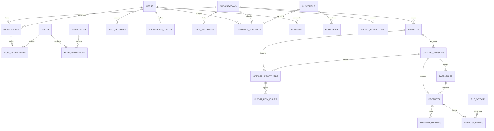

**ER-2 — Ventas, cobros, finanzas, IA, mensajería y plataforma**

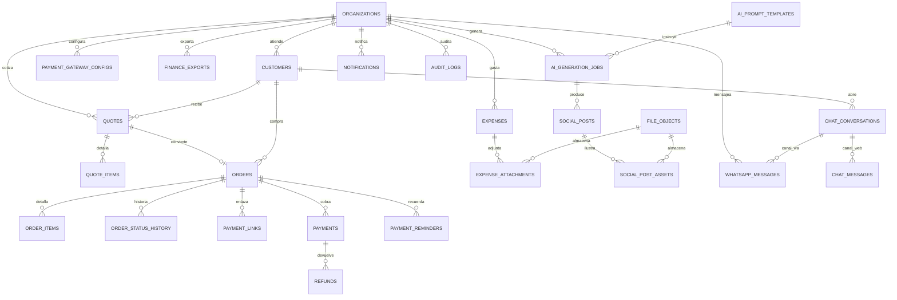

### 4.3 Identidad y acceso

#### `organizations` — Organización cliente (tenant)

| Campo | Tipo | Nulo | Default | Índice · FK | Regla |
|---|---|---|---|---|---|
| name | varchar(120) | no | — | — | 2–120 caracteres |
| legal_name | varchar(200) | sí | null | — | Razón social para documentos |
| tax_id | varchar(20) | sí | null | idx único `(tax_id)` donde no nulo | Cédula jurídica; validación CR por dígito verificador |
| country | char(2) | no | `'CR'` | — | ISO-3166-1 alpha-2 |
| default_currency | currency | no | `'CRC'` | — | Moneda por defecto de nuevos catálogos |
| timezone | varchar(64) | no | `'America/Costa_Rica'` | — | Zona IANA para UI/PDF |
| default_tax_rate_bp | int | no | 1300 | — | check 0–10000 |
| owner_user_id | uuid | no | — | fk users(id) | Propietario; debe tener membership org_admin |
| plan | varchar(20) | no | `'mvp'` | — | `mvp`, `pro` (post-MVP) |
| status | org_status | no | `'active'` | idx `(status)` | Suspender bloquea login y jobs |
| settings | jsonb | no | `'{}'` | — | `paymentTerms`, `requireDualApproval`, `chatHours` |

#### `users` — Usuario global (staff o cliente)

| Campo | Tipo | Nulo | Default | Índice · FK | Regla |
|---|---|---|---|---|---|
| email_normalized | varchar(255) | no | — | único `(email_normalized)` | lower(trim(email)); login |
| email_verified_at | timestamptz | sí | null | — | Obligatorio para login por contraseña |
| password_hash | text | sí | null | — | Argon2id; null si solo OAuth/magic link |
| full_name | varchar(160) | no | — | — | — |
| phone | varchar(20) | sí | null | idx `(phone)` | E.164 |
| google_subject | varchar(64) | sí | null | único donde no nulo | `sub` del ID token |
| locale | varchar(10) | no | `'es-CR'` | — | `es-CR`, `en` |
| avatar_file_id | uuid | sí | null | fk file_objects(id) | Imagen ≤ 2 MB |
| status | user_status | no | `'invited'` | idx `(status)` | `invited`, `active`, `suspended`, `deleted` |
| failed_login_count | int | no | 0 | — | Se reinicia en login exitoso |
| locked_until | timestamptz | sí | null | — | Bloqueo temporal (RF-USR-02) |
| mfa_totp_secret_ciphertext | text | sí | null | — | AES-256-GCM; null si no enrolado |
| mfa_enrolled_at | timestamptz | sí | null | — | Obligatorio para org_admin/superadmin |
| recovery_codes_hash | text[] | no | `'{}'` | — | 10 códigos de un solo uso (Argon2id) |
| last_password_change_at | timestamptz | sí | null | — | Revoca sesiones anteriores |
| anonymized_at | timestamptz | sí | null | — | Baja Ley 8968 (RF-USR-07); irreversible |
| last_login_at | timestamptz | sí | null | — | — |

#### `memberships` — Vínculo usuario-organización (colaborador)

| Campo | Tipo | Nulo | Default | Índice · FK | Regla |
|---|---|---|---|---|---|
| user_id | uuid | no | — | fk users(id) on delete cascade; único `(user_id, organization_id)` | Un usuario = una membership por org |
| organization_id | uuid | no | — | fk organizations(id); idx `(organization_id, status)` | Debe coincidir con el contexto |
| status | membership_status | no | `'invited'` | idx `(organization_id, status)` | `invited`, `active`, `suspended`; suspender revoca `AuthSession` |
| display_name | varchar(120) | sí | null | — | Nombre en la org (puede diferir del perfil global) |
| job_title | varchar(80) | sí | null | — | — |
| invited_by_membership_id | uuid | sí | null | fk memberships(id) | — |
| joined_at | timestamptz | sí | null | — | Se setea al aceptar la invitación |
| last_active_at | timestamptz | sí | null | — | Actividad para métricas |

#### `role_assignments` — Rol asignado a una membership con scope

| Campo | Tipo | Nulo | Default | Índice · FK | Regla |
|---|---|---|---|---|---|
| membership_id | uuid | no | — | fk memberships(id) on delete cascade; idx `(membership_id)` | — |
| organization_id | uuid | no | — | fk organizations(id) | Redundante para filtros y RLS |
| role_id | uuid | no | — | fk roles(id); único `(membership_id, role_id, scope_type, coalesce(catalog_id,'00000000-0000-0000-0000-000000000000'::uuid))` | Un rol por scope; ver C-16 |
| scope_type | varchar(10) | no | — | — | `org`, `catalog` |
| catalog_id | uuid | sí | null | fk catalogs(id); fk compuesta `(catalog_id, organization_id)` | Obligatorio si `scope_type='catalog'`; null si `org` |

#### `customer_accounts` — Cuenta de cliente final en una organización

| Campo | Tipo | Nulo | Default | Índice · FK | Regla |
|---|---|---|---|---|---|
| user_id | uuid | no | — | fk users(id) on delete cascade; único `(user_id, organization_id)` | — |
| organization_id | uuid | no | — | fk organizations(id); idx `(organization_id)` | — |
| customer_id | uuid | no | — | fk customers(id); único `(customer_id)` | Un cliente = una cuenta |
| status | varchar(12) | no | `'active'` | idx `(organization_id, status)` | `active`, `suspended`, `deleted` |
| claimed_at | timestamptz | sí | null | — | Reclamo de compra de invitado (RF-USR-06) |
| last_login_at | timestamptz | sí | null | — | — |

#### `user_invitations` — Invitación de colaborador

| Campo | Tipo | Nulo | Default | Índice · FK | Regla |
|---|---|---|---|---|---|
| organization_id | uuid | no | — | fk organizations(id); idx `(organization_id, status)` | — |
| email_normalized | varchar(255) | no | — | idx `(organization_id, email_normalized)` | — |
| invited_by_membership_id | uuid | no | — | fk memberships(id) | — |
| membership_id | uuid | sí | null | fk memberships(id) | Se enlaza al aceptar |
| role_assignments | jsonb | no | `'[]'` | — | `[{roleId, scopeType, catalogId?}]` a materializar |
| token_hash | text | no | — | único `(token_hash)` | SHA-256; un solo uso |
| status | varchar(10) | no | `'pending'` | — | `pending`, `accepted`, `expired`, `revoked` |
| expires_at | timestamptz | no | — | idx `(expires_at)` | 72 h |
| accepted_at | timestamptz | sí | null | — | — |

#### `verification_tokens` — Token de un solo uso (email, reset, magic link)

| Campo | Tipo | Nulo | Default | Índice · FK | Regla |
|---|---|---|---|---|---|
| user_id | uuid | sí | null | fk users(id) on delete cascade | Null en magic link de invitado sin User |
| organization_id | uuid | sí | null | fk organizations(id) | — |
| email_normalized | varchar(255) | sí | null | idx `(email_normalized)` | Para magic link sin User |
| kind | varchar(24) | no | — | idx `(kind, expires_at)` | `email_verify`, `password_reset`, `magic_link`, `claim_order` |
| token_hash | text | no | — | único `(token_hash)` | SHA-256; un solo uso |
| expires_at | timestamptz | no | — | idx `(expires_at)` | 24 h / 30 min / 15 min según kind |
| consumed_at | timestamptz | sí | null | — | Un segundo consumo → 410 |
| requested_ip | inet | sí | null | — | — |

#### `consents` — Consentimiento informado y revocable

| Campo | Tipo | Nulo | Default | Índice · FK | Regla |
|---|---|---|---|---|---|
| user_id | uuid | no | — | fk users(id) on delete cascade; idx `(user_id, kind)` | — |
| organization_id | uuid | no | — | fk organizations(id) | — |
| kind | varchar(24) | no | — | único `(user_id, organization_id, kind, version)` | `terms`, `privacy`, `marketing`, `whatsapp_opt_in` |
| version | varchar(16) | no | — | — | Versión del documento aceptado (semver de la política) |
| granted | boolean | no | true | — | false = revocado |
| granted_at | timestamptz | sí | null | — | — |
| revoked_at | timestamptz | sí | null | — | — |
| source | varchar(20) | no | — | — | `web_registro`, `portal`, `checkout`, `whatsapp`, `api` |
| ip | inet | sí | null | — | Evidencia (Ley 8968) |

#### `addresses` — Dirección de cliente

| Campo | Tipo | Nulo | Default | Índice · FK | Regla |
|---|---|---|---|---|---|
| customer_id | uuid | no | — | fk customers(id) on delete cascade; idx `(customer_id, is_default)` | Máx. 10 por cuenta (RF-USR-06) |
| organization_id | uuid | no | — | fk organizations(id) | — |
| label | varchar(40) | sí | null | — | "Casa", "Oficina" |
| line1 | varchar(200) | no | — | — | — |
| line2 | varchar(200) | sí | null | — | — |
| city | varchar(80) | no | — | — | — |
| province | varchar(80) | no | — | — | Provincia CR o estado |
| postal_code | varchar(12) | sí | null | — | — |
| country | char(2) | no | `'CR'` | — | — |
| phone | varchar(20) | sí | null | — | — |
| is_default_shipping | boolean | no | false | índice único parcial `(customer_id) WHERE is_default_shipping` | Una predeterminada |
| is_default_billing | boolean | no | false | índice único parcial `(customer_id) WHERE is_default_billing` | Una predeterminada |

#### `auth_sessions` — Sesión por dispositivo, rotación y audiencia

| Campo | Tipo | Nulo | Default | Índice · FK | Regla |
|---|---|---|---|---|---|
| user_id | uuid | no | — | fk users(id) on delete cascade; idx `(user_id, revoked_at)` | — |
| organization_id | uuid | sí | null | fk organizations(id) | Org del contexto de sesión |
| audience | varchar(10) | no | — | idx `(user_id, audience)` | `staff`, `customer` (R8) |
| customer_account_id | uuid | sí | null | fk customer_accounts(id) | Obligatorio si `audience='customer'` |
| refresh_token_hash | text | no | — | único `(refresh_token_hash)` | SHA-256; el token en claro nunca se guarda |
| family_id | uuid | no | — | idx `(family_id)` | Detecta reuso (revoca la familia) |
| rotated_from_id | uuid | sí | null | fk auth_sessions(id) | Cadena de rotación |
| device_label | varchar(80) | sí | null | — | "Chrome en Windows" |
| user_agent | varchar(255) | sí | null | — | Truncado |
| ip | inet | sí | null | — | — |
| mfa_verified | boolean | no | false | — | Sesión con segundo factor |
| expires_at | timestamptz | no | — | idx `(expires_at)` | Refresh 7 días staff / 30 días customer |
| last_used_at | timestamptz | sí | null | — | — |
| revoked_at | timestamptz | sí | null | — | Logout, reuso o suspensión |
| revoked_reason | varchar(40) | sí | null | — | `logout`, `reuse`, `suspension`, `password_change`, `admin` |

#### `roles` — Rol de sistema o personalizado

| Campo | Tipo | Nulo | Default | Índice · FK | Regla |
|---|---|---|---|---|---|
| key | varchar(32) | no | — | único `(key)` donde `organization_id IS NULL` | Sistema: `superadmin`, `org_admin`, `catalog_admin`, `vendedor`, `finanzas`, `social_manager`, `agente_chat`, `customer` |
| organization_id | uuid | sí | null | fk organizations(id); idx `(organization_id)` | Null = rol de sistema (global); con valor = rol personalizado |
| name | varchar(64) | no | — | — | Etiqueta es-CR |
| description | varchar(160) | sí | null | — | Para la UI de roles |
| scope_level | varchar(10) | no | — | — | `GLOBAL`, `ORG`, `CATALOG`, `SELF` |
| audience | varchar(10) | no | `'staff'` | idx `(audience)` | `staff`, `customer`; un rol personalizado solo puede ser `staff` |
| is_system | boolean | no | true | — | Los roles de sistema no se editan ni borran (A-R11) |

#### `permissions` — Permiso atómico

| Campo | Tipo | Nulo | Default | Índice · FK | Regla |
|---|---|---|---|---|---|
| code | varchar(64) | no | — | único `(code)` | Formato `<recurso>:<acción>` (§2.3) |
| resource | varchar(32) | no | — | idx `(resource)` | — |
| action | varchar(32) | no | — | — | `read`, `create`, `update`, `delete`, `send`, `export`, `approve`, `activate`, `manage` |
| description | varchar(160) | no | — | — | Texto para UI |

#### `role_permissions` — Matriz rol-permiso

| Campo | Tipo | Nulo | Default | Índice · FK | Regla |
|---|---|---|---|---|---|
| role_id | uuid | no | — | fk roles(id) on delete cascade; pk `(role_id, permission_id)` | — |
| permission_id | uuid | no | — | fk permissions(id) on delete cascade | — |

Las tablas `role_permissions`, `role_assignments` y `customer_accounts` cierran el modelo de permisos: `Role` agrupa permisos, `RoleAssignment` le da alcance a una membership y `customer_accounts` da identidad de cliente a un `User` en una organización. No existe tabla intermedia `membership_roles`: el rol siempre va con scope.

### 4.4 Importación y catálogo

#### `source_connections` — Credenciales de integración por organización

| Campo | Tipo | Nulo | Default | Índice · FK | Regla |
|---|---|---|---|---|---|
| organization_id | uuid | no | — | fk organizations(id); idx `(organization_id, provider)` | — |
| provider | varchar(20) | no | — | — | `google_drive` (MVP), `whatsapp` |
| status | varchar(20) | no | `'active'` | — | `active`, `reauth_required`, `revoked` |
| external_account_id | varchar(255) | sí | null | — | email de Google o WABA ID |
| root_folder_id | varchar(128) | sí | null | — | Carpeta raíz elegida |
| scopes | text[] | no | `'{}'` | — | Scope solicitado y concedido |
| refresh_token_ciphertext | text | sí | null | — | AES-256-GCM; nunca se serializa |
| token_hint | varchar(8) | sí | null | — | Últimos 4 caracteres para diagnóstico |
| connected_by_user_id | uuid | no | — | fk users(id) | — |
| last_used_at | timestamptz | sí | null | — | — |

#### `catalogs` — Catálogo (unidad comercial)

| Campo | Tipo | Nulo | Default | Índice · FK | Regla |
|---|---|---|---|---|---|
| organization_id | uuid | no | — | fk organizations(id); único `(organization_id, slug)` | — |
| name | varchar(120) | no | — | — | — |
| slug | varchar(80) | no | — | — | `[a-z0-9-]`, inmutable tras crear |
| description | text | sí | null | — | — |
| currency | currency | no | — | — | Inmutable si tiene versiones con productos |
| default_tax_rate_bp | int | no | 1300 | — | check 0–10000 |
| default_tax_included | boolean | no | true | — | Precios del catálogo incluyen IVA |
| allow_sell_without_stock | boolean | no | false | — | Decisión 01 §11.5 |
| low_stock_threshold | int | no | 3 | — | check ≥ 0 |
| active_version_id | uuid | sí | null | fk catalog_versions(id); idx `(active_version_id)` | Puntero único de la versión activa |
| public_token | text | sí | null | único `(public_token)` | 32 bytes base64url |
| public_enabled | boolean | no | false | — | Requiere token vigente |
| public_token_revoked_at | timestamptz | sí | null | — | Revocación explícita |
| status | catalog_status | no | `'active'` | idx `(organization_id, status)` | — |
| settings | jsonb | no | `'{}'` | — | `expiryDays`, `terms`, `sellerAssignment` |

#### `catalog_versions` — Foto inmutable de productos

| Campo | Tipo | Nulo | Default | Índice · FK | Regla |
|---|---|---|---|---|---|
| catalog_id | uuid | no | — | fk catalogs(id); único `(catalog_id, version_number)` | — |
| organization_id | uuid | no | — | fk organizations(id) | Redundante para filtros y RLS |
| version_number | int | no | — | — | Secuencial por catálogo, ≥ 1 |
| status | version_status | no | `'draft'` | índice único parcial `(catalog_id) WHERE status='active'` | Solo una activa por catálogo |
| import_job_id | uuid | sí | null | fk catalog_import_jobs(id) | Origen de importación |
| checksum | text | sí | null | — | SHA-256 del snapshot origen |
| product_count | int | no | 0 | — | Se recalcula al validar |
| notes | text | sí | null | — | Motivo de la versión |
| created_by_user_id | uuid | no | — | fk users(id) | — |
| validated_at | timestamptz | sí | null | — | — |
| activated_at | timestamptz | sí | null | — | — |
| archived_at | timestamptz | sí | null | — | Terminal (R3) |

#### `catalog_import_jobs` — Job de importación desde Drive

| Campo | Tipo | Nulo | Default | Índice · FK | Regla |
|---|---|---|---|---|---|
| organization_id | uuid | no | — | fk organizations(id) | — |
| catalog_id | uuid | sí | null | fk catalogs(id) | Null si crea catálogo nuevo |
| catalog_version_id | uuid | sí | null | fk catalog_versions(id) | Seteado al hacer commit |
| source_connection_id | uuid | no | — | fk source_connections(id) | — |
| drive_file_id | varchar(128) | no | — | — | — |
| file_name | varchar(255) | no | — | — | — |
| mime_type | varchar(100) | no | — | — | Sheets/XLSX/XLS/CSV/PDF |
| file_size_bytes | bigint | no | — | — | check ≤ 52428800 |
| file_checksum | text | no | — | único `(catalog_id, file_checksum)` donde catalog no nulo | Idempotencia (RF-DRV-2) |
| status | import_status | no | `'queued'` | idx `(organization_id, status)` | Máquina §5.1 |
| mapping | jsonb | no | `'{}'` | — | Columnas origen→destino |
| stats | jsonb | no | `'{}'` | — | `{rowsTotal, rowsValid, rowsInvalid, imagesCopied}` |
| snapshot_file_id | uuid | sí | null | fk file_objects(id) | Copia inmutable en MinIO |
| error_code | varchar(40) | sí | null | — | Código de §11 |
| error_detail | text | sí | null | — | Sin PII |
| idempotency_key | varchar(128) | sí | null | idx `(organization_id, idempotency_key)` | — |
| started_at | timestamptz | sí | null | — | — |
| finished_at | timestamptz | sí | null | — | — |

#### `import_row_issues` — Cuarentena y advertencias por fila

| Campo | Tipo | Nulo | Default | Índice · FK | Regla |
|---|---|---|---|---|---|
| job_id | uuid | no | — | fk catalog_import_jobs(id) on delete cascade; idx `(job_id, severity)` | — |
| row_number | int | no | — | — | 1-based, incluye encabezado |
| column_name | varchar(80) | sí | null | — | Null si es error de fila completa |
| code | varchar(40) | no | — | idx `(code)` | Código de §11 |
| severity | varchar(10) | no | — | — | `error`, `warning` |
| raw_value | text | sí | null | — | Truncado a 500 caracteres |
| message | varchar(255) | no | — | — | Mensaje es-CR para el reporte |

#### `categories` — Categoría de una versión

| Campo | Tipo | Nulo | Default | Índice · FK | Regla |
|---|---|---|---|---|---|
| organization_id | uuid | no | — | fk organizations(id) | — |
| catalog_version_id | uuid | no | — | fk catalog_versions(id) on delete cascade; único `(catalog_version_id, parent_id, name_normalized)` | — |
| parent_id | uuid | sí | null | fk categories(id) | Máximo 2 niveles en MVP |
| name | varchar(120) | no | — | — | — |
| name_normalized | varchar(120) | no | — | idx `(catalog_version_id, name_normalized)` | lower(trim) |
| sort_order | int | no | 0 | — | — |

#### `products` — Producto de una versión

| Campo | Tipo | Nulo | Default | Índice · FK | Regla |
|---|---|---|---|---|---|
| organization_id | uuid | no | — | fk organizations(id) | — |
| catalog_id | uuid | no | — | fk catalogs(id) | Redundante para filtros y R2 |
| catalog_version_id | uuid | no | — | fk catalog_versions(id) on delete cascade; único `(catalog_version_id, sku_normalized)` | SKU único por versión |
| category_id | uuid | sí | null | fk categories(id) | — |
| sku | varchar(64) | no | — | — | `[A-Z0-9][A-Z0-9._-]{0,63}` |
| sku_normalized | varchar(64) | no | — | idx `(catalog_version_id, sku_normalized)` | upper(trim) |
| name | varchar(200) | no | — | — | — |
| name_normalized | varchar(200) | no | — | idx gin trigram `(name_normalized)` | Para búsqueda |
| description | text | sí | null | — | Hecho verificable para IA |
| brand | varchar(80) | sí | null | — | — |
| unit | varchar(20) | no | `'unidad'` | — | unidad, caja, kg, m, par |
| price_minor | bigint | no | — | — | check ≥ 0 |
| cost_minor | bigint | sí | null | — | check ≥ 0; excluido para roles sin permiso |
| tax_rate_bp | int | no | 1300 | — | check 0–10000 |
| tax_included | boolean | no | true | — | — |
| track_stock | boolean | no | true | — | Si false, stock ilimitado |
| stock_qty | int | no | 0 | — | check ≥ 0 si track_stock |
| attributes | jsonb | no | `'{}'` | — | Material, color, medidas, uso (fuente IA) |
| tags | text[] | no | `'{}'` | gist `(tags)` | — |
| image_primary_file_id | uuid | sí | null | fk file_objects(id) | Copia rápida de la primaria |
| product_status | product_status | no | `'active'` | idx `(catalog_version_id, product_status)` | — |
| external_ref | varchar(128) | sí | null | idx `(catalog_version_id, external_ref)` | ID del sistema de origen |
| search_text | tsvector | sí | null (generado) | gin `(search_text)` | `to_tsvector('spanish', name \|\| ' ' \|\| coalesce(description,''))` |

#### `product_variants` — Variante vendible

| Campo | Tipo | Nulo | Default | Índice · FK | Regla |
|---|---|---|---|---|---|
| product_id | uuid | no | — | fk products(id) on delete cascade; único `(product_id, sku_normalized)` | — |
| organization_id | uuid | no | — | fk organizations(id) | — |
| sku | varchar(64) | no | — | — | SKU propio de la variante |
| sku_normalized | varchar(64) | no | — | idx `(product_id, sku_normalized)` | — |
| name | varchar(120) | no | — | — | "Talla M / Rojo" |
| options | jsonb | no | `'{}'` | — | `{talla:'M', color:'rojo'}` |
| price_minor | bigint | sí | null | — | null = hereda del producto |
| stock_qty | int | no | 0 | — | check ≥ 0 |
| barcode | varchar(64) | sí | null | único `(barcode)` donde no nulo | EAN-13/Code128 |
| is_default | boolean | no | false | — | Una por producto |

#### `product_images` — Imagen de producto en MinIO

| Campo | Tipo | Nulo | Default | Índice · FK | Regla |
|---|---|---|---|---|---|
| product_id | uuid | no | — | fk products(id) on delete cascade; idx `(product_id, sort_order)` | — |
| organization_id | uuid | no | — | fk organizations(id) | — |
| file_id | uuid | no | — | fk file_objects(id) | Objeto en MinIO |
| alt_text | varchar(160) | sí | null | — | Accesibilidad WCAG |
| sort_order | int | no | 0 | — | — |
| is_primary | boolean | no | false | índice único parcial `(product_id) WHERE is_primary` | — |
| source_url | text | sí | null | — | URL original de Drive (diagnóstico) |
| checksum | text | sí | null | idx `(organization_id, checksum)` | Deduplicación de imágenes |

#### `file_objects` — Objeto almacenado en MinIO

| Campo | Tipo | Nulo | Default | Índice · FK | Regla |
|---|---|---|---|---|---|
| organization_id | uuid | sí | null | fk organizations(id) | Null para objetos de plataforma |
| kind | file_kind | no | — | idx `(organization_id, kind)` | — |
| bucket | varchar(63) | no | — | — | — |
| object_key | text | no | — | único `(bucket, object_key)` | `org/{orgId}/{kind}/{sha256}.{ext}` |
| mime_type | varchar(100) | no | — | — | Validado por magic bytes |
| size_bytes | bigint | no | — | — | check 0–52428800 |
| checksum_sha256 | text | no | — | idx `(organization_id, checksum_sha256)` | Deduplicación |
| original_filename | varchar(255) | sí | null | — | — |
| uploaded_by_user_id | uuid | sí | null | fk users(id) | — |
| retention_until | timestamptz | sí | null | idx `(retention_until)` | Limpieza programada |

### 4.5 Ventas

#### `customers` — Cliente de la organización

| Campo | Tipo | Nulo | Default | Índice · FK | Regla |
|---|---|---|---|---|---|
| organization_id | uuid | no | — | fk organizations(id); único `(organization_id, phone_normalized)` y `(organization_id, email_normalized)` parciales donde `deleted_at IS NULL` | — |
| type | varchar(10) | no | `'person'` | — | `person`, `company` |
| full_name | varchar(160) | no | — | idx trigram `(full_name)` | — |
| email | varchar(255) | sí | null | — | — |
| email_normalized | varchar(255) | sí | null | — | lower(trim) |
| phone | varchar(20) | sí | null | — | E.164 con +506 por defecto |
| phone_normalized | varchar(20) | sí | null | idx `(organization_id, phone_normalized)` | Solo dígitos y `+` |
| id_number_hash | text | sí | null | único `(organization_id, id_number_hash)` donde no nulo | Hash con sal (dato sensible) |
| owner_membership_id | uuid | sí | null | fk memberships(id) | Vendedor asignado |
| tags | text[] | no | `'{}'` | gist | — |
| source | varchar(20) | no | `'staff'` | — | `staff`, `portal`, `import`, `whatsapp` |
| accepts_marketing | boolean | no | false | — | Consentimiento explícito |
| whatsapp_opt_in_at | timestamptz | sí | null | — | Requisito para enviar (RF-WA-2) |
| whatsapp_opt_out_at | timestamptz | sí | null | — | Bloquea marketing |
| notes | text | sí | null | — | — |

#### `quotes` — Cotización

| Campo | Tipo | Nulo | Default | Índice · FK | Regla |
|---|---|---|---|---|---|
| organization_id | uuid | no | — | fk organizations(id) | — |
| catalog_id | uuid | no | — | fk catalogs(id); fk compuesta `(catalog_id, organization_id)` | — |
| catalog_version_id | uuid | no | — | fk catalog_versions(id) | Versión usada; inmutable (R3) |
| customer_id | uuid | no | — | fk customers(id) | — |
| seller_membership_id | uuid | no | — | fk memberships(id); idx `(organization_id, seller_membership_id)` | Autor de la cotización |
| quote_number | varchar(24) | no | — | único `(organization_id, quote_number)` | `COT-YYYY-NNNNNN` por secuencia |
| status | quote_status | no | `'draft'` | idx `(organization_id, status)` | Máquina §5.2 |
| currency | currency | no | — | — | Igual a la del catálogo |
| subtotal_minor | bigint | no | 0 | — | Suma de netos; check ≥ 0 |
| discount_minor | bigint | no | 0 | — | check ≥ 0 |
| tax_minor | bigint | no | 0 | — | check ≥ 0 |
| total_minor | bigint | no | 0 | — | check `total_minor = subtotal_minor + tax_minor - discount_minor` |
| valid_until | timestamptz | no | — | idx `(valid_until)` | ≤ 90 días desde creación |
| notes | text | sí | null | — | Visible en PDF |
| terms | text | sí | null | — | Condiciones |
| pdf_file_id | uuid | sí | null | fk file_objects(id) | PDF generado |
| share_token | text | sí | null | único `(share_token)` | Token revocable para link sin login |
| sent_at | timestamptz | sí | null | — | — |
| accepted_at | timestamptz | sí | null | — | — |
| order_id | uuid | sí | null | fk orders(id); único donde no nulo | Una cotización → un pedido |

#### `quote_items` — Línea de cotización (snapshot)

| Campo | Tipo | Nulo | Default | Índice · FK | Regla |
|---|---|---|---|---|---|
| quote_id | uuid | no | — | fk quotes(id) on delete cascade; idx `(quote_id, sort_order)` | — |
| product_id | uuid | no | — | fk products(id) | — |
| variant_id | uuid | sí | null | fk product_variants(id) | — |
| sku_snapshot | varchar(64) | no | — | — | Copia inmutable |
| name_snapshot | varchar(200) | no | — | — | Copia inmutable |
| qty | numeric(12,3) | no | — | — | check > 0 |
| unit_price_minor | bigint | no | — | — | check ≥ 0 |
| discount_minor | bigint | no | 0 | — | check ≥ 0 |
| tax_rate_bp | int | no | 1300 | — | check 0–10000 |
| tax_included | boolean | no | true | — | — |
| line_net_minor | bigint | no | — | — | Calculado en servidor |
| line_tax_minor | bigint | no | — | — | Calculado en servidor |
| line_total_minor | bigint | no | — | — | `line_net + line_tax` |
| sort_order | int | no | 0 | — | — |

#### `orders` — Pedido

| Campo | Tipo | Nulo | Default | Índice · FK | Regla |
|---|---|---|---|---|---|
| organization_id | uuid | no | — | fk organizations(id) | — |
| catalog_id | uuid | no | — | fk catalogs(id); fk compuesta `(catalog_id, organization_id)` | — |
| catalog_version_id | uuid | no | — | fk catalog_versions(id) | — |
| customer_id | uuid | no | — | fk customers(id) | — |
| seller_membership_id | uuid | no | — | fk memberships(id) | — |
| order_number | varchar(24) | no | — | único `(organization_id, order_number)` | `PED-YYYY-NNNNNN` |
| source | varchar(10) | no | `'direct'` | — | `quote`, `direct` |
| quote_id | uuid | sí | null | fk quotes(id) | Origen si `source='quote'` |
| status | order_status | no | `'pending_payment'` | idx `(organization_id, status)`; idx `(status, due_date)` | Máquina §5.3 |
| payment_terms | varchar(10) | no | `'prepaid'` | — | `prepaid`, `postpaid` |
| currency | currency | no | — | — | — |
| subtotal_minor | bigint | no | 0 | — | check ≥ 0 |
| discount_minor | bigint | no | 0 | — | check ≥ 0 |
| tax_minor | bigint | no | 0 | — | check ≥ 0 |
| delivery_fee_minor | bigint | no | 0 | — | check ≥ 0 |
| total_minor | bigint | no | 0 | — | check `total = subtotal + tax + delivery − discount` |
| paid_minor | bigint | no | 0 | — | Derivado de pagos succeeded |
| refunded_minor | bigint | no | 0 | — | Derivado de reembolsos processed |
| balance_minor | bigint | no | 0 | — | check ≥ 0: `total − paid + refunded` |
| due_date | date | sí | null | — | Base de recordatorios |
| shipping_address | jsonb | sí | null | — | `{line1, line2, city, province, postalCode}` |
| cancellation_reason | varchar(255) | sí | null | — | Obligatorio al cancelar |
| fulfilled_at | timestamptz | sí | null | — | — |
| delivered_at | timestamptz | sí | null | — | — |
| completed_at | timestamptz | sí | null | — | — |

#### `order_items` — Línea de pedido (snapshot)

| Campo | Tipo | Nulo | Default | Índice · FK | Regla |
|---|---|---|---|---|---|
| order_id | uuid | no | — | fk orders(id) on delete cascade; idx `(order_id, sort_order)` | — |
| product_id | uuid | no | — | fk products(id) | — |
| variant_id | uuid | sí | null | fk product_variants(id) | — |
| sku_snapshot | varchar(64) | no | — | — | — |
| name_snapshot | varchar(200) | no | — | — | — |
| qty | numeric(12,3) | no | — | — | check > 0 |
| unit_price_minor | bigint | no | — | — | check ≥ 0 |
| cost_snapshot_minor | bigint | sí | null | — | Costo al vender (para margen) |
| discount_minor | bigint | no | 0 | — | — |
| tax_rate_bp | int | no | 1300 | — | — |
| tax_included | boolean | no | true | — | — |
| line_net_minor | bigint | no | — | — | — |
| line_tax_minor | bigint | no | — | — | — |
| line_total_minor | bigint | no | — | — | — |
| stock_consumed | boolean | no | false | — | Evita doble descuento |

#### `order_status_history` — Historial de estados del pedido

| Campo | Tipo | Nulo | Default | Índice · FK | Regla |
|---|---|---|---|---|---|
| order_id | uuid | no | — | fk orders(id) on delete cascade; idx `(order_id, created_at)` | — |
| from_status | order_status | sí | null | — | Null en la creación |
| to_status | order_status | no | — | — | — |
| actor_membership_id | uuid | sí | null | fk memberships(id) | Null si fue el sistema/webhook |
| reason | varchar(255) | sí | null | — | Motivo de cancelación/cambio |

### 4.6 Cobros

#### `payment_gateway_configs` — Credenciales de pasarela

| Campo | Tipo | Nulo | Default | Índice · FK | Regla |
|---|---|---|---|---|---|
| organization_id | uuid | no | — | fk organizations(id); único `(organization_id, provider, mode)` | — |
| provider | varchar(20) | no | — | — | `stripe`, `mercadopago`, `paypal` |
| mode | varchar(10) | no | `'test'` | — | `test`, `live` |
| encrypted_secret_key | text | no | — | — | AES-256-GCM; nunca se serializa |
| encrypted_webhook_secret | text | no | — | — | — |
| merchant_account | varchar(120) | sí | null | — | ID de cuenta/merchant |
| currency | currency | no | — | — | Debe coincidir con el pedido |
| enabled | boolean | no | false | — | — |
| key_last4 | varchar(8) | sí | null | — | Para mostrar en UI |

#### `payment_links` — Link de pago de una pasarela

| Campo | Tipo | Nulo | Default | Índice · FK | Regla |
|---|---|---|---|---|---|
| organization_id | uuid | no | — | fk organizations(id) | — |
| order_id | uuid | no | — | fk orders(id); idx `(order_id)` | — |
| gateway_config_id | uuid | no | — | fk payment_gateway_configs(id) | — |
| provider | varchar(20) | no | — | — | Copia del config al crear |
| external_id | varchar(255) | no | — | idx `(provider, external_id)` | ID en la pasarela |
| url | text | no | — | — | URL hospedada |
| amount_minor | bigint | no | — | — | check > 0 |
| currency | currency | no | — | — | — |
| status | varchar(12) | no | `'active'` | idx `(status, expires_at)` | `active`, `used`, `expired`, `cancelled` |
| expires_at | timestamptz | no | — | — | now+24 h por defecto |
| used_at | timestamptz | sí | null | — | — |

#### `payments` — Pago (pasarela o manual)

| Campo | Tipo | Nulo | Default | Índice · FK | Regla |
|---|---|---|---|---|---|
| organization_id | uuid | no | — | fk organizations(id); idx `(organization_id, paid_at)` | — |
| order_id | uuid | no | — | fk orders(id); idx `(order_id)` | — |
| gateway_config_id | uuid | sí | null | fk payment_gateway_configs(id) | Null en pago manual |
| payment_link_id | uuid | sí | null | fk payment_links(id) | — |
| method | payment_method | no | — | idx `(organization_id, method)` | — |
| status | payment_status | no | `'pending'` | idx `(status, created_at)` | Máquina §5.4 |
| amount_minor | bigint | no | — | — | check > 0 |
| currency | currency | no | — | — | Igual a la del pedido |
| gateway_payment_id | varchar(255) | sí | null | único `(provider, gateway_payment_id)` | ID en la pasarela |
| gateway_event_id | varchar(255) | sí | null | — | Último evento aplicado |
| reference | varchar(120) | sí | null | — | Referencia SINPE/transferencia |
| paid_at | timestamptz | sí | null | — | Obligatorio si `succeeded` |
| receipt_file_id | uuid | sí | null | fk file_objects(id) | Recibo PDF |
| receipt_number | varchar(24) | sí | null | único `(organization_id, receipt_number)` | `REC-YYYY-NNNNNN` |
| registered_by_membership_id | uuid | sí | null | fk memberships(id) | Null si fue pasarela |
| failure_code | varchar(40) | sí | null | — | Código es-CR |

#### `refunds` — Reembolso

| Campo | Tipo | Nulo | Default | Índice · FK | Regla |
|---|---|---|---|---|---|
| organization_id | uuid | no | — | fk organizations(id) | — |
| payment_id | uuid | no | — | fk payments(id); idx `(payment_id)` | — |
| order_id | uuid | no | — | fk orders(id) | — |
| amount_minor | bigint | no | — | — | check > 0 y Σ ≤ payment.amount |
| currency | currency | no | — | — | Igual al pago |
| reason | varchar(30) | no | — | — | `duplicate`, `fraudulent`, `requested_by_customer`, `product_returned`, `other` |
| note | varchar(255) | sí | null | — | — |
| status | refund_status | no | `'requested'` | idx `(organization_id, status)` | Máquina §5.4 |
| gateway_refund_id | varchar(255) | sí | null | — | — |
| requested_by_membership_id | uuid | no | — | fk memberships(id) | — |
| approved_by_membership_id | uuid | sí | null | fk memberships(id) | Distinto del solicitante |
| processed_at | timestamptz | sí | null | — | — |
| failure_code | varchar(40) | sí | null | — | — |

#### `payment_reminders` — Recordatorio de cobro

| Campo | Tipo | Nulo | Default | Índice · FK | Regla |
|---|---|---|---|---|---|
| organization_id | uuid | no | — | fk organizations(id) | — |
| order_id | uuid | no | — | fk orders(id) on delete cascade; único `(order_id, channel, sequence)` | — |
| channel | varchar(10) | no | — | — | `email`, `whatsapp` |
| sequence | int | no | — | — | 1, 2, 3 |
| scheduled_at | timestamptz | no | — | idx `(scheduled_at, status)` | — |
| status | varchar(12) | no | `'pending'` | — | `pending`, `sent`, `failed`, `cancelled` |
| sent_at | timestamptz | sí | null | — | — |
| whatsapp_template_id | uuid | sí | null | fk whatsapp_templates(id) | — |
| error_code | varchar(40) | sí | null | — | — |

#### `webhook_events` — Evento entrante de proveedor

| Campo | Tipo | Nulo | Default | Índice · FK | Regla |
|---|---|---|---|---|---|
| provider | varchar(20) | no | — | único `(provider, external_event_id)` | `stripe`, `mercadopago`, `paypal`, `whatsapp` |
| external_event_id | varchar(255) | no | — | — | ID del proveedor o `wamid`+tipo |
| signature_valid | boolean | no | false | — | Si false → `ignored` |
| payload | jsonb | no | — | — | Cuerpo crudo íntegro |
| headers | jsonb | no | `'{}'` | — | Sin secretos |
| status | webhook_status | no | `'received'` | idx `(status, received_at)` | — |
| error_code | varchar(40) | sí | null | — | — |
| processed_at | timestamptz | sí | null | — | — |

### 4.7 Finanzas

#### `expenses` — Gasto

| Campo | Tipo | Nulo | Default | Índice · FK | Regla |
|---|---|---|---|---|---|
| organization_id | uuid | no | — | fk organizations(id); idx `(organization_id, expense_date)` | — |
| catalog_id | uuid | sí | null | fk catalogs(id) | Null = gasto de la organización |
| category | varchar(20) | no | — | idx `(organization_id, category)` | `operating`, `marketing`, `payroll`, `logistics`, `taxes`, `technology`, `other` |
| supplier | varchar(160) | sí | null | — | — |
| description | varchar(255) | no | — | — | — |
| amount_minor | bigint | no | — | — | check > 0 |
| tax_minor | bigint | no | 0 | — | check ≥ 0 |
| currency | currency | no | — | — | — |
| expense_date | date | no | — | idx `(organization_id, expense_date)` | No futura (> 1 día) |
| payment_method | payment_method | no | — | — | — |
| status | expense_status | no | `'draft'` | idx `(organization_id, status)` | Máquina simple: draft→pending_approval→approved/rejected |
| created_by_membership_id | uuid | no | — | fk memberships(id) | — |
| approved_by_membership_id | uuid | sí | null | fk memberships(id) | Distinto del creador |
| approved_at | timestamptz | sí | null | — | — |
| rejection_reason | varchar(255) | sí | null | — | — |

#### `expense_attachments` — Comprobante de gasto

| Campo | Tipo | Nulo | Default | Índice · FK | Regla |
|---|---|---|---|---|---|
| expense_id | uuid | no | — | fk expenses(id) on delete cascade | — |
| file_id | uuid | no | — | fk file_objects(id) | JPG/PNG/PDF |
| kind | varchar(12) | no | `'receipt'` | — | `receipt`, `invoice`, `other` |

#### `finance_exports` — Exportación asíncrona

| Campo | Tipo | Nulo | Default | Índice · FK | Regla |
|---|---|---|---|---|---|
| organization_id | uuid | no | — | fk organizations(id) | — |
| catalog_id | uuid | sí | null | fk catalogs(id) | — |
| report | varchar(40) | no | — | — | `sales`, `payments`, `expenses`, `margins`, `cashflow` |
| filters | jsonb | no | `'{}'` | — | Rango, agrupación, moneda |
| format | varchar(6) | no | — | — | `csv`, `xlsx` |
| status | varchar(12) | no | `'queued'` | idx `(organization_id, status)` | `queued`, `running`, `completed`, `failed`, `expired` |
| file_id | uuid | sí | null | fk file_objects(id) | — |
| requested_by_membership_id | uuid | no | — | fk memberships(id) | — |
| completed_at | timestamptz | sí | null | — | — |

### 4.8 Inteligencia artificial y contenido

#### `ai_prompt_templates` — Plantilla de prompt versionada

| Campo | Tipo | Nulo | Default | Índice · FK | Regla |
|---|---|---|---|---|---|
| key | varchar(64) | no | — | único `(key, version)` | `social_post_v1` (una clave por caso de uso) |
| version | int | no | — | — | Incremental; nunca se edita una versión publicada |
| locale | varchar(10) | no | `'es-CR'` | — | — |
| system_prompt | text | no | — | — | Rol + reglas anti-alucinación (§7.2) |
| user_template | text | no | — | — | Handlebars con variables declaradas |
| variables_schema | jsonb | no | `'{}'` | — | JSON Schema de las variables |
| default_model | varchar(40) | no | `'deepseek-chat'` | — | — |
| max_tokens | int | no | 1200 | — | check 100–4000 |
| temperature | numeric(3,2) | no | 0.70 | — | check 0–1.5 |
| is_active | boolean | no | true | índice único parcial `(key) WHERE is_active` | Solo una activa por key |
| checksum | text | no | — | — | SHA-256 del contenido (invalidación de caché) |

#### `ai_quota_policies` — Cuota IA por organización y periodo

| Campo | Tipo | Nulo | Default | Índice · FK | Regla |
|---|---|---|---|---|---|
| organization_id | uuid | no | — | fk organizations(id); único `(organization_id, period)` | — |
| period | char(7) | no | — | — | `YYYY-MM` (America/Costa_Rica) |
| max_generations | int | no | 100 | — | check ≥ 0 |
| max_tokens | bigint | no | 2000000 | — | check ≥ 0 |
| max_cost_micro_usd | bigint | no | 5000000 | — | USD 5,00; check ≥ 0 |
| soft_limit_pct | int | no | 80 | — | check 1–100 |
| hard_stop | boolean | no | true | — | Si false solo alerta |
| model_allowlist | text[] | no | `'{deepseek-chat}'` | — | Modelos permitidos |
| used_generations | int | no | 0 | — | Reserva atómica (`UPDATE ... WHERE used < max`) |
| used_tokens | bigint | no | 0 | — | — |
| used_cost_micro_usd | bigint | no | 0 | — | — |

#### `ai_generation_jobs` — Job de generación

| Campo | Tipo | Nulo | Default | Índice · FK | Regla |
|---|---|---|---|---|---|
| organization_id | uuid | no | — | fk organizations(id); idx `(organization_id, created_at)` | — |
| catalog_id | uuid | no | — | fk catalogs(id) | — |
| catalog_version_id | uuid | no | — | fk catalog_versions(id) | Snapshot de aislamiento (R6) |
| prompt_template_id | uuid | no | — | fk ai_prompt_templates(id) | Versión exacta usada |
| kind | varchar(10) | no | `'single'` | — | `single`, `bulk` |
| batch_id | uuid | sí | null | idx `(batch_id)` | Agrupa lotes de calendario |
| input_json | jsonb | no | — | — | Input congelado + hechos de productos |
| output_json | jsonb | sí | null | — | Salida validada (§7.4) |
| status | ai_job_status | no | `'queued'` | idx `(status, created_at)` | Máquina §5.5 |
| provider | varchar(20) | no | `'deepseek'` | — | — |
| model | varchar(40) | no | — | — | — |
| prompt_version | int | no | — | — | Desnormalizado para auditoría |
| cache_key | text | sí | null | único `(cache_key)` donde no nulo | Hit de caché |
| facts_hash | text | sí | null | — | SHA-256 de los hechos usados |
| tokens_in | int | no | 0 | — | — |
| tokens_out | int | no | 0 | — | — |
| cost_micro_usd | bigint | no | 0 | — | check ≥ 0 |
| provider_fallback | boolean | no | false | — | Circuit breaker |
| error_code | varchar(40) | sí | null | — | §11 |
| error_detail | text | sí | null | — | Sin secretos |
| started_at | timestamptz | sí | null | — | — |
| finished_at | timestamptz | sí | null | — | — |
| created_by_membership_id | uuid | no | — | fk memberships(id) | — |

#### `ai_usage_ledger` — Consumo medido por job

| Campo | Tipo | Nulo | Default | Índice · FK | Regla |
|---|---|---|---|---|---|
| organization_id | uuid | no | — | fk organizations(id); idx `(organization_id, created_at)` | — |
| job_id | uuid | no | — | fk ai_generation_jobs(id); único `(job_id)` | Idempotencia del registro |
| period | char(7) | no | — | idx `(organization_id, period)` | — |
| provider | varchar(20) | no | — | — | — |
| model | varchar(40) | no | — | — | — |
| tokens_in | int | no | 0 | — | — |
| tokens_out | int | no | 0 | — | — |
| cost_micro_usd | bigint | no | 0 | — | — |
| cached | boolean | no | false | — | Hit de caché (coste 0) |

#### `social_templates` — Plantilla de contenido reutilizable

| Campo | Tipo | Nulo | Default | Índice · FK | Regla |
|---|---|---|---|---|---|
| organization_id | uuid | sí | null | fk organizations(id) | Null = plantilla de plataforma |
| name | varchar(120) | no | — | único `(organization_id, name)` | — |
| platform | social_platform | no | — | — | — |
| tone | social_tone | no | — | — | — |
| objective | social_objective | no | — | — | — |
| structure | jsonb | no | `'{}'` | — | Bloques y longitud sugerida |
| prompt_template_key | varchar(64) | sí | null | — | Override de plantilla de prompt |
| is_active | boolean | no | true | — | — |

#### `social_posts` — Post generado

| Campo | Tipo | Nulo | Default | Índice · FK | Regla |
|---|---|---|---|---|---|
| organization_id | uuid | no | — | fk organizations(id); idx `(organization_id, created_at)` | — |
| catalog_id | uuid | no | — | fk catalogs(id); fk compuesta `(catalog_id, organization_id)` | Vínculo obligatorio (R7) |
| catalog_version_id | uuid | no | — | fk catalog_versions(id) | — |
| ai_generation_job_id | uuid | sí | null | fk ai_generation_jobs(id) | Null si se creó manual |
| batch_id | uuid | sí | null | idx `(batch_id)` | Lote de calendario |
| platform | social_platform | no | — | idx `(organization_id, platform)` | — |
| tone | social_tone | no | — | — | — |
| objective | social_objective | no | — | — | — |
| language | varchar(10) | no | `'es-CR'` | — | — |
| title | varchar(160) | no | — | — | — |
| body | text | no | — | — | Copy final (editado o generado) |
| hashtags | text[] | no | `'{}'` | — | Sin `#` duplicado |
| cta | varchar(200) | no | — | — | — |
| visual_idea | text | sí | null | — | Idea visual sugerida |
| output_json | jsonb | sí | null | — | Salida IA original completa |
| facts_hash | text | sí | null | — | Auditoría de hechos |
| status | post_status | no | `'draft'` | idx `(organization_id, status)` | Máquina §5.5 |
| scheduled_at | timestamptz | sí | null | idx `(scheduled_at)` | Hora local CR |
| published_at | timestamptz | sí | null | — | — |
| external_url | text | sí | null | — | Enlace a la publicación |
| created_by_membership_id | uuid | no | — | fk memberships(id) | — |
| approved_by_membership_id | uuid | sí | null | fk memberships(id) | — |
| approved_at | timestamptz | sí | null | — | — |
| rejection_reason | varchar(255) | sí | null | — | — |
| edited_by_membership_id | uuid | sí | null | fk memberships(id) | — |

#### `social_post_assets` — Activo visual vinculado al post

| Campo | Tipo | Nulo | Default | Índice · FK | Regla |
|---|---|---|---|---|---|
| social_post_id | uuid | no | — | fk social_posts(id) on delete cascade; idx `(social_post_id, sort_order)` | — |
| file_id | uuid | sí | null | fk file_objects(id) | Null si es una idea, no un archivo |
| product_id | uuid | sí | null | fk products(id) | Producto de la imagen |
| role | varchar(12) | no | `'primary'` | — | `primary`, `carousel`, `video_idea` |
| sort_order | int | no | 0 | — | — |
| note | varchar(255) | sí | null | — | Idea visual textual |

### 4.9 Mensajería

#### `whatsapp_templates` — Plantilla de WhatsApp Business

| Campo | Tipo | Nulo | Default | Índice · FK | Regla |
|---|---|---|---|---|---|
| organization_id | uuid | no | — | fk organizations(id); único `(organization_id, name, language)` | — |
| name | varchar(512) | no | — | — | `^[a-z0-9_]{1,512}$` |
| language | varchar(10) | no | `'es'` | — | — |
| category | varchar(16) | no | — | — | `MARKETING`, `UTILITY`, `AUTHENTICATION` |
| status | wa_template_status | no | `'pending'` | idx `(organization_id, status)` | Espejo de Meta |
| external_template_id | varchar(64) | sí | null | único donde no nulo | — |
| components | jsonb | no | `'[]'` | — | Header/body/footer/buttons |
| rejection_reason | varchar(255) | sí | null | — | — |
| last_synced_at | timestamptz | sí | null | — | — |

#### `whatsapp_messages` — Mensaje de WhatsApp

| Campo | Tipo | Nulo | Default | Índice · FK | Regla |
|---|---|---|---|---|---|
| organization_id | uuid | no | — | fk organizations(id) | — |
| chat_conversation_id | uuid | sí | null | fk chat_conversations(id) | Null en envíos sin conversación |
| customer_id | uuid | no | — | fk customers(id) | — |
| direction | varchar(8) | no | — | idx `(customer_id, created_at)` | `outbound`, `inbound` |
| wamid | varchar(128) | sí | null | único donde no nulo | ID de Meta |
| template_id | uuid | sí | null | fk whatsapp_templates(id) | Obligatorio fuera de ventana |
| type | varchar(16) | no | `'text'` | — | `text`, `template`, `image`, `document`, `audio`, `interactive` |
| status | wa_message_status | no | `'queued'` | idx `(status, created_at)` | — |
| body | text | sí | null | — | Texto o parámetros resueltos |
| payload | jsonb | no | `'{}'` | — | JSON enviado/recibido (sin secretos) |
| media_file_id | uuid | sí | null | fk file_objects(id) | Media copiada a MinIO |
| error_code | varchar(40) | sí | null | — | — |
| pricing_category | varchar(16) | sí | null | — | `marketing`, `utility`, `service`, `authentication` |
| sent_at | timestamptz | sí | null | — | — |
| delivered_at | timestamptz | sí | null | — | — |
| read_at | timestamptz | sí | null | — | — |

#### `chat_conversations` — Conversación (web o WhatsApp)

| Campo | Tipo | Nulo | Default | Índice · FK | Regla |
|---|---|---|---|---|---|
| organization_id | uuid | no | — | fk organizations(id); idx `(organization_id, status, last_message_at)` | — |
| catalog_id | uuid | sí | null | fk catalogs(id) | Contexto del catálogo |
| customer_id | uuid | no | — | fk customers(id) | — |
| channel | chat_channel | no | — | único parcial `(customer_id, channel) WHERE status <> 'closed'` | Una abierta por cliente y canal |
| status | chat_status | no | `'open'` | idx `(status, last_message_at)` | Máquina §5.6 |
| subject | varchar(160) | sí | null | — | — |
| order_id | uuid | sí | null | fk orders(id) | Vínculo de soporte |
| assigned_membership_id | uuid | sí | null | fk memberships(id); idx `(assigned_membership_id, status)` | Agente asignado |
| last_message_at | timestamptz | no | now() | idx `(last_message_at)` | — |
| last_inbound_at | timestamptz | sí | null | — | Ventana 24 h de WhatsApp |
| unread_count_agent | int | no | 0 | — | check ≥ 0 |
| unread_count_customer | int | no | 0 | — | check ≥ 0 |
| csat_score | smallint | sí | null | — | check 1–5 |
| csat_comment | varchar(500) | sí | null | — | — |
| closed_at | timestamptz | sí | null | — | — |
| closed_by_membership_id | uuid | sí | null | fk memberships(id) | — |

#### `chat_messages` — Mensaje de chat web

| Campo | Tipo | Nulo | Default | Índice · FK | Regla |
|---|---|---|---|---|---|
| chat_conversation_id | uuid | no | — | fk chat_conversations(id) on delete cascade; idx `(chat_conversation_id, created_at)` | — |
| sender_type | varchar(10) | no | — | — | `customer`, `agent`, `system` |
| sender_user_id | uuid | sí | null | fk users(id) | — |
| sender_membership_id | uuid | sí | null | fk memberships(id) | — |
| body | text | sí | null | — | — |
| attachments | jsonb | no | `'[]'` | — | `[{fileId, mime, name, size}]` |
| client_message_id | uuid | sí | null | único `(chat_conversation_id, client_message_id)` | Idempotencia de cliente |
| read_at | timestamptz | sí | null | — | — |

### 4.10 Plataforma

#### `notifications` — Notificación in-app/email

| Campo | Tipo | Nulo | Default | Índice · FK | Regla |
|---|---|---|---|---|---|
| user_id | uuid | no | — | fk users(id) on delete cascade; idx `(user_id, read_at, created_at)` | — |
| organization_id | uuid | no | — | fk organizations(id) | — |
| type | varchar(40) | no | — | idx `(type)` | `payment.succeeded`, `import.completed`, `ai.quota_80`, `stock.oversold`, `chat.assigned`, `social_post.approved`, `auth.new_device` |
| payload | jsonb | no | `'{}'` | — | `{resourceType, resourceId, title, body, deepLink}` |
| channel | varchar(10) | no | `'in_app'` | — | `in_app`, `email`, `both` |
| dedupe_key | varchar(120) | sí | null | único donde no nulo | Evita duplicados |
| read_at | timestamptz | sí | null | — | — |
| email_sent_at | timestamptz | sí | null | — | — |

#### `audit_logs` — Auditoría append-only

| Campo | Tipo | Nulo | Default | Índice · FK | Regla |
|---|---|---|---|---|---|
| organization_id | uuid | no | — | fk organizations(id); idx `(organization_id, created_at DESC)` | — |
| actor_user_id | uuid | sí | null | fk users(id) | Null si lo hizo el sistema |
| actor_membership_id | uuid | sí | null | fk memberships(id) | — |
| actor_type | varchar(12) | no | `'user'` | — | `user`, `system`, `webhook`, `superadmin` |
| action | varchar(60) | no | — | idx `(action)` | `payment.registered`, `catalog.version_activated`, ... |
| resource_type | varchar(40) | no | — | idx `(resource_type, resource_id)` | — |
| resource_id | uuid | sí | null | — | — |
| before | jsonb | sí | null | — | Diff previo (PII enmascarada) |
| after | jsonb | sí | null | — | Diff posterior |
| reason | varchar(255) | sí | null | — | Obligatorio en acciones de superadmin |
| ip | inet | sí | null | — | — |
| user_agent | varchar(255) | sí | null | — | — |
| trace_id | varchar(32) | no | — | idx `(trace_id)` | Correlación con logs |

#### `outbox_events` — Eventos transaccionales pendientes

| Campo | Tipo | Nulo | Default | Índice · FK | Regla |
|---|---|---|---|---|---|
| organization_id | uuid | sí | null | fk organizations(id) | Null para eventos de plataforma |
| aggregate_type | varchar(40) | no | — | idx `(aggregate_type, aggregate_id)` | — |
| aggregate_id | uuid | no | — | — | — |
| event_type | varchar(60) | no | — | idx `(status, available_at)` | `payment.succeeded`, `order.paid`, ... |
| payload | jsonb | no | — | — | — |
| status | outbox_status | no | `'pending'` | — | — |
| attempts | int | no | 0 | — | check ≥ 0 |
| available_at | timestamptz | no | now() | — | Backoff |
| last_error | text | sí | null | — | — |
| dedupe_key | varchar(120) | sí | null | único donde no nulo | — |
| processed_at | timestamptz | sí | null | — | — |

#### `idempotency_keys` — Claves de idempotencia

| Campo | Tipo | Nulo | Default | Índice · FK | Regla |
|---|---|---|---|---|---|
| organization_id | uuid | sí | null | fk organizations(id) | Null en endpoints de plataforma |
| scope | varchar(80) | no | — | único `(scope, key)` | Ruta lógica del endpoint |
| key | varchar(128) | no | — | — | Valor de `Idempotency-Key` |
| request_hash | text | no | — | — | SHA-256 del cuerpo; distinto hash → 409 |
| status | varchar(12) | no | `'in_flight'` | — | `in_flight`, `completed`, `failed` |
| response_status | int | sí | null | — | — |
| response_body | jsonb | sí | null | — | Respuesta replicada |
| expires_at | timestamptz | no | — | idx `(expires_at)` | 24 h (7 días en pagos) |

### 4.11 Constraints e índices clave

| ID | Constraint / índice | Definición | Motivo |
|---|---|---|---|
| C-01 | SKU único por versión | `UNIQUE (catalog_version_id, sku_normalized)` en `products` y `UNIQUE (product_id, sku_normalized)` en `product_variants` | Error de importación clásico |
| C-02 | Una versión activa por catálogo | `CREATE UNIQUE INDEX uq_version_active ON catalog_versions (catalog_id) WHERE status = 'active'` | R3, activación atómica |
| C-03 | FK compuesta org/catálogo | `UNIQUE (id, organization_id)` en `catalogs`/`catalog_versions`; `FOREIGN KEY (catalog_id, organization_id) REFERENCES catalogs (id, organization_id)` en `products`, `quotes`, `orders`, `social_posts` | Impide cruzar catálogos entre organizaciones |
| C-04 | Totales coherentes | `CHECK (total_minor = subtotal_minor + tax_minor + delivery_fee_minor - discount_minor)` en `orders`; variante sin envío en `quotes` | Evita descuadres de dinero |
| C-05 | Montos positivos | `CHECK (amount_minor > 0)` en `payments`, `refunds`, `expenses`, `payment_links`; `CHECK (>= 0)` en precios/costos | ADR-09 |
| C-06 | Saldo no negativo | `CHECK (balance_minor >= 0)` en `orders` | Invariante de cobranza |
| C-07 | Impuesto válido | `CHECK (tax_rate_bp BETWEEN 0 AND 10000)` en productos, líneas y catálogo | Puntos base |
| C-08 | Un pago por evento de pasarela | `UNIQUE (provider, gateway_payment_id)` y `UNIQUE (provider, external_event_id)` en `webhook_events` | Idempotencia de dinero |
| C-09 | Una sola conversación abierta | `CREATE UNIQUE INDEX uq_conv_open ON chat_conversations (customer_id, channel) WHERE status <> 'closed'` | UX y orden |
| C-10 | Idempotencia de peticiones | `UNIQUE (scope, key)` en `idempotency_keys` | Pagos/IA/importación |
| C-11 | Ledger IA único | `UNIQUE (job_id)` en `ai_usage_ledger` | No duplicar coste |
| C-12 | Búsqueda de productos | `GIN (search_text)` + `GIN (name_normalized gin_trgm_ops)` | p95 < 400 ms (RNF-01) |
| C-13 | Consultas transaccionales | `(organization_id, catalog_id, created_at DESC)` en `quotes`, `orders`, `payments`, `expenses`, `social_posts` | Reportes y listados |
| C-14 | Retención y limpieza | índice `(expires_at)` en `idempotency_keys`, `(retention_until)` en `file_objects`, `(received_at)` en `webhook_events` | RNF-13 |
| C-15 | Soft delete único | índices únicos parciales `WHERE deleted_at IS NULL` en `customers`, `products`, `catalogs` | Permite recrear un registro borrado |
| C-16 | Rol único por scope | `UNIQUE (membership_id, role_id, scope_type, COALESCE(catalog_id, '00000000-0000-0000-0000-000000000000'))` en `role_assignments` | Evita duplicar el mismo rol/scope |
| C-17 | Scope coherente | `CHECK ((scope_type='catalog') = (catalog_id IS NOT NULL))` en `role_assignments`; `CHECK (audience='customer') = (customer_account_id IS NOT NULL)` en `auth_sessions` | Scope y audiencia válidos |
| C-18 | Una cuenta por cliente y org | `UNIQUE (user_id, organization_id)` y `UNIQUE (customer_id)` en `customer_accounts`; `UNIQUE (user_id, organization_id)` en `memberships` | Un cliente = una cuenta; staff y cliente pueden coexistir en orgs distintas |
| C-19 | Tokens de un solo uso | `UNIQUE (token_hash)` en `verification_tokens` y `user_invitations`; `CHECK (consumed_at IS NULL OR consumed_at >= created_at)` | No reutilizar enlaces |
| C-20 | Consentimiento versionado | `UNIQUE (user_id, organization_id, kind, version)` en `consents` | Evidencia Ley 8968 |

**Nota de integridad de estados.** Las transiciones de estado se validan en el servicio y se refuerzan con un `CHECK` de pertenencia al enum; la prohibición de transiciones inválidas se implementa en el dominio (no en triggers) para mantener mensajes de error claros, y se prueba exhaustivamente con tests de la máquina de estados (§5).

## 5. Máquinas de estado

Regla general: toda transición no listada se rechaza con el error indicado y no produce efectos. Los `side effects` se ejecutan en la misma transacción cuando tocan la base de datos y por outbox cuando publican a colas/webhooks (ADR-13). Cada transición escribe `audit_log` y, cuando el recurso lo tiene, una fila de historial.

### 5.1 `CatalogVersion`

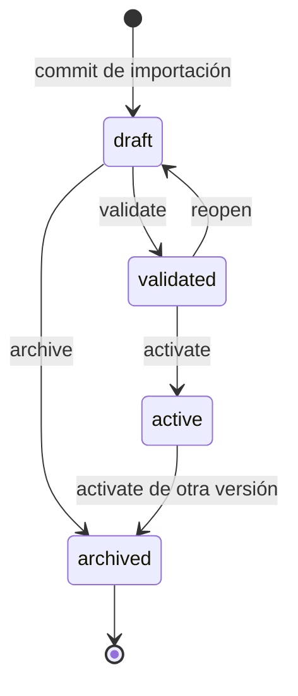

| Transición | Actor | Side effects | Evento |
|---|---|---|---|
| `draft → validated` | catalog_admin (o automática si `rowsInvalid=0`) | Recalcula `product_count`; valida SKUs únicos, precios > 0 | `catalog.version_validated` |
| `validated → active` | catalog_admin / org_admin | Lock de `catalogs`; archiva la activa anterior; actualiza puntero; invalida caché | `catalog.version_activated` |
| `draft/validated → archived` | catalog_admin / org_admin | `archived_at`; sin retorno (terminal) | `catalog.version_archived` |
| `validated → draft` | catalog_admin | Permite corregir antes de activar | `catalog.version_reopened` |
| `active → archived` | sistema (en activación de otra) | Solo vía activación de una nueva; nunca directo | — |
| Prohibidas | — | `active → draft`, `archived → *` | `ERR-046 VERSION_INVALID_TRANSITION` |

### 5.2 `Quote`

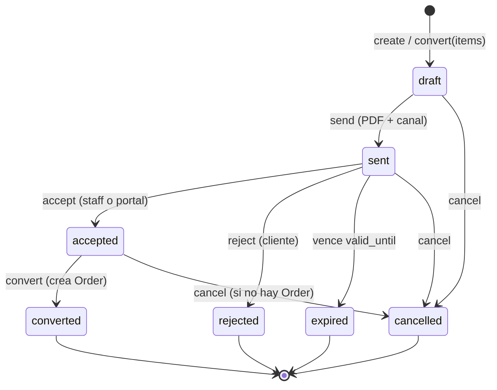

| Transición | Actor | Side effects | Error si inválida |
|---|---|---|---|
| `draft → sent` | vendedor/autor | Render PDF (cola), `sent_at`, token de compartir, envío email/WhatsApp | `ERR-110 QUOTE_EMPTY` |
| `sent → accepted` | staff con `quote:update` o cliente (portal) | `accepted_at`; notifica al vendedor | `ERR-054 QUOTE_EXPIRED` |
| `accepted → converted` | vendedor | Crea `Order` en `pending_payment`; copia ítems; enlaza `order_id` | `ERR-055 QUOTE_ALREADY_CONVERTED` |
| `* → cancelled` | `quote:cancel` | `cancel_reason`; sin efectos en pedidos (no existen) | `ERR-111 QUOTE_INVALID_STATE` |
| `sent → expired` | job `quotes.expire` (cada hora) | `expired_at`; notifica | — |

### 5.3 `Order`

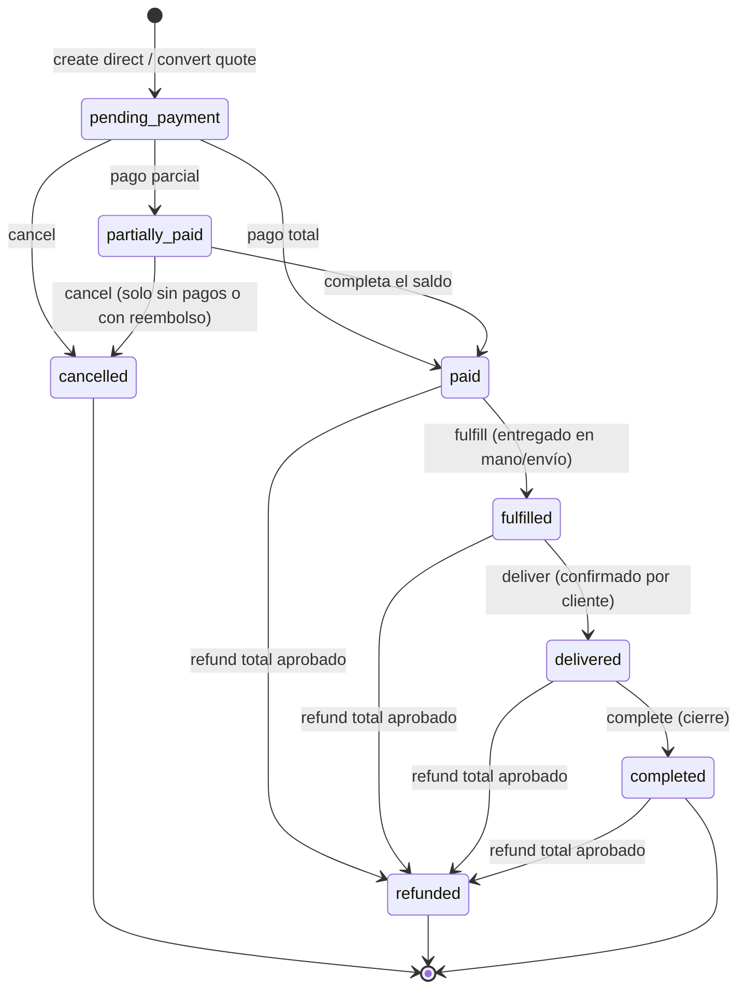

| Transición | Actor | Side effects |
|---|---|---|
| `pending_payment → partially_paid` | webhook o staff (`payment:create_manual`) | Recalcula `paid_minor`/`balance_minor`; `order.partially_paid` |
| `→ paid` | webhook/manual | Descuenta stock (idempotente por `stock_consumed`), recibo, `order.paid`, notificación |
| `paid → fulfilled` | vendedor (`order:fulfill`) | `fulfilled_at`; notifica al cliente por WhatsApp/email |
| `fulfilled → delivered` | vendedor o cliente (portal) | `delivered_at`; habilita CSAT |
| `delivered → completed` | vendedor / automático a los 7 días | `completed_at` |
| `* → refunded` | finanzas aprobado | `refunded_minor = total`; repone stock si aplica |
| `pending_payment/partially_paid → cancelled` | `order:cancel` | `cancellation_reason`; cancela recordatorios y links activos |
| Prohibidas | — | `ERR-056 ORDER_INVALID_TRANSITION`, `ERR-057 ORDER_NOT_PAYABLE` |

### 5.4 `Payment` y `Refund`

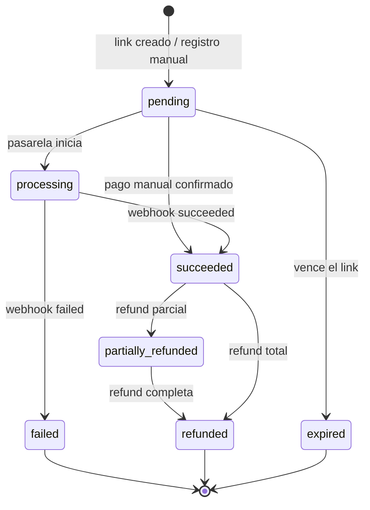

| Transición | Actor | Side effects |
|---|---|---|
| `pending → processing` | pasarela | — |
| `processing/pending → succeeded` | webhook firmado / staff manual | `paid_at`, recibo PDF, actualiza `Order`, emite `payment.succeeded` |
| `processing → failed` | webhook | `failure_code`; notifica; permite reintento con nuevo link |
| `pending → expired` | job `links.expire` | Cancela link; `payment_link.status=expired` |
| `succeeded/partially_refunded → partially_refunded/refunded` | finanzas (aprobación) | Ejecuta `Refund`; recalcula `Order`; `payment.refunded` |
| Prohibidas | — | `ERR-112 PAYMENT_INVALID_TRANSITION` |

`Refund`: `requested → approved → processing → processed`, con `requested → rejected` y `processing → failed` (reintentable). `processed` es terminal. Aprobación obligatoria de un membership distinto del solicitante; ejecución idempotente por `gateway_refund_id`.

### 5.5 `SocialPost`

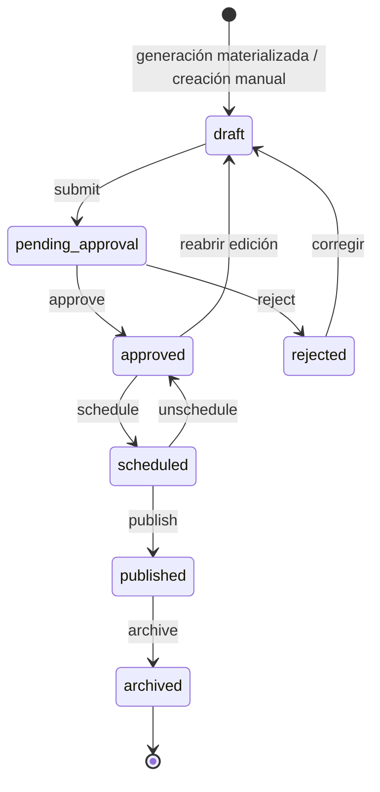

| Transición | Actor | Side effects |
|---|---|---|
| `draft → pending_approval` | social_manager | `submitted_at`; notifica aprobadores |
| `pending_approval → approved` | social_manager con `social_post:approve` | `approved_by`, `approved_at` (regla de doble aprobación si está activa) |
| `pending_approval → rejected` | aprobador | `rejection_reason`; notifica al autor |
| `approved → scheduled` | social_manager | Crea `PaymentReminder` de publicación (job `social.publish`) |
| `scheduled → published` | sistema (job) o usuario con `social_post:publish` | `published_at`, `external_url`; consume el recordatorio |
| `scheduled → approved` | autor | Cancela el recordatorio |
| Prohibidas | — | `ERR-100 SOCIAL_POST_INVALID_STATE` |

### 5.6 `ChatConversation`

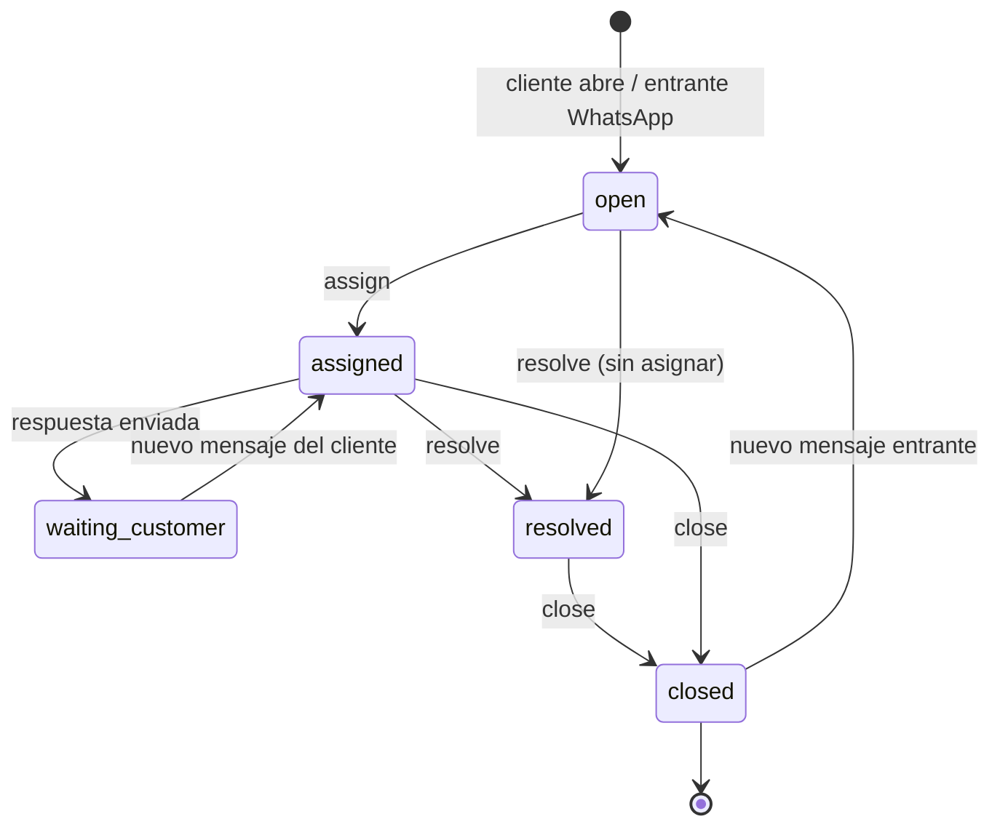

| Transición | Actor | Side effects |
|---|---|---|
| `open → assigned` | agente (`chat:assign`) | `assigned_membership_id`; `chat:assigned` por socket; notificación |
| `assigned → waiting_customer` | agente | `last_outbound_at`; recalcula `unread_count_*` |
| `waiting_customer → assigned` | cliente | Reabre la conversación si estaba resuelta (dentro de 24 h) |
| `→ resolved` | agente | `resolved_at`; solicita CSAT si está configurado |
| `→ closed` | agente / job de inactividad (24 h) | `closed_at`, `closed_by`; `chat.closed` |
| `closed → open` | mensaje entrante del cliente | Nueva rama de la misma conversación; reabre |
| Prohibidas | — | `ERR-085 CHAT_CONVERSATION_CLOSED` |

### 5.7 `User`

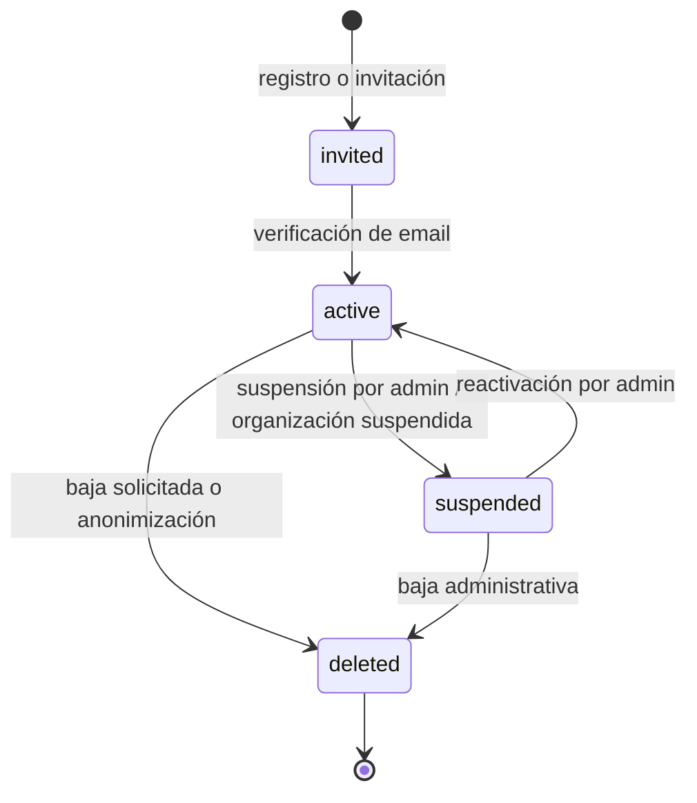

| Transición | Actor | Side effects |
|---|---|---|
| `invited → active` | el propio usuario | `email_verified_at`, `AuthSession` emitida, `audit_log` `user.activated` |
| `active → suspended` | `org_admin` (su org) / `superadmin` | Revoca `AuthSession` familia completa, memberships suspendidas, `notification`; no borra datos |
| `suspended → active` | `org_admin` / `superadmin` | Reactiva memberships y assignments; el usuario debe iniciar sesión de nuevo |
| `active/suspended → deleted` | el propio usuario (`/me/deletion`) o `superadmin` | Anonimización (RF-USR-07), revocación de sesiones y consentimientos; `audit_log` `user.anonymized` |
| Bloqueo temporal | sistema | No cambia `status`: setea `locked_until` por 10 intentos fallidos (`ERR-006`) |
| Prohibidas | — | `deleted → *`; `suspended → deleted` solo admin | 

`User.deleted` es terminal y no se puede reutilizar el email (`ERR-129 USER_ANONYMIZED`). El borrado físico de la fila no ocurre en el MVP.

### 5.8 `UserInvitation` y `AuthSession`

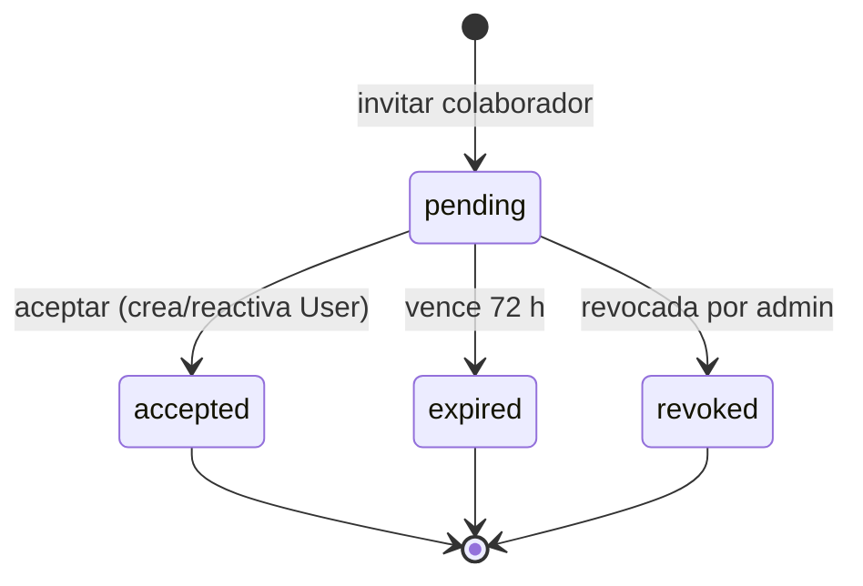

`AuthSession`: `active → revoked` (logout, reuso detectado, suspensión, cambio de contraseña, fin del periodo). No existe reactivación: se crea una sesión nueva. La detección de reuso revoca toda la `family_id` y emite `notification` `auth.new_device` al usuario, nunca a terceros.

| Evento de invitación | Actor | Side effects |
|---|---|---|
| `pending → accepted` | invitado | Crea/reutiliza `User`, activa `Membership`, materializa `RoleAssignment[]`, registra `Consent` de términos, marca `accepted_at`; invalidación de caché de permisos |
| `pending → expired` | job `invitations.expire` | `status=expired`; se permite reenviar con nueva invitación |
| `pending → revoked` | `org_admin` (`user:invite`) | `status=revoked`; el token deja de ser válido (`410 ERR-017`) |

## 6. Contratos de API

### 6.1 Convenciones

- **Base**: `https://api.ventascatalogo.cr/api/v1` (dev: `http://localhost:3001/api/v1`). JSON `camelCase`; fechas ISO-8601 con offset (`2026-10-28T14:30:00-06:00`); montos como número entero en unidad menor y `currency` aparte.
- **Auth**: `Authorization: Bearer <access>` en todo salvo `/public/*`, `/webhooks/*`, `/health` y `/auth/*` públicos. El token lleva `aud` (`staff` o `customer`), `org_id`, `sid` y `jti`; la audiencia define la superficie permitida (R8) y el cruce se rechaza con `403 ERR-119 AUTH_WRONG_AUDIENCE`.
- **Dos superficies de API**: cara A backoffice `/api/v1/*` (`aud=staff`); cara B tienda/portal `/api/v1/storefront/*` (público por token de catálogo) y `/api/v1/me/*` (`aud=customer`, solo recursos propios). Los DTOs de producto/catálogo se comparten; los de cliente nunca exponen costos ni datos de terceros.
- **Contexto**: `X-Organization-Id` obligatorio en endpoints de negocio (también para superadmin); `X-Catalog-Id` opcional para fijar el catálogo activo de la petición; `X-Request-Id` opcional (si falta lo genera el servidor).
- **Idempotencia**: `Idempotency-Key` (UUID v4/v7, ≤ 128 caracteres) obligatorio en `POST /payments`, `POST /orders/{id}/payments`, `POST /ai/generations`, `POST /social/calendar/generate`, `POST /catalogs/import-jobs` y `POST .../commit`. Mismo key + distinto `requestHash` → `409 ERR-113 IDEMPOTENCY_KEY_REUSED`; misma petición en vuelo → `409 ERR-114 IDEMPOTENCY_IN_PROGRESS`.
- **Paginación**: cursor opaco `?cursor=<base64url>&limit=<1..100>`; respuesta `{data:[], pageInfo:{nextCursor, hasMore, totalEstimate?}}`; se prohíbe `offset` en tablas grandes.
- **Filtros**: `from`/`to` (ISO-8601, inclusivos), `q` (búsqueda), `status`, `catalogId`, `sort` (solo campos declarados), `order=asc|desc`.
- **Errores**: cuerpo `{code, message, details, traceId}`; `message` en español es-CR listo para UI. `details` es objeto o array (por campo en validaciones). El `traceId` coincide con los logs.
- **Rate limit**: cabeceras `RateLimit-Limit`, `RateLimit-Remaining`, `RateLimit-Reset`; al exceder `429 ERR-152 RATE_LIMITED` con `Retry-After`. Límites: 600/min staff por org, 60/min por usuario en `/auth/*`, 30/h por org en `POST /ai/generations`, 600/min por proveedor en webhooks, 60/min por IP en `/storefront/*` y `/public/*`.
- **Versionado**: cambios incompatibles → `/api/v2`; se mantiene v1 ≥ 6 meses. Deprecaciones por cabecera `Deprecation` y `Sunset`.
- **OpenAPI 3.1** generado desde DTOs; `/api/v1/openapi.json` (solo staff) y `/docs` en entornos no productivos.
- **CORS**: origen permitido por organización (dominio del catálogo público); credenciales solo para el dominio de la app.

### 6.2 Mapeo de errores HTTP

| HTTP | Uso | Códigos típicos |
|---|---|---|
| 400 | Petición malformada / cursor inválido | `INVALID_CURSOR`, `SUPPORT_REASON_REQUIRED` |
| 401 | Sin token, token expirado o firma inválida | `AUTH_INVALID_CREDENTIALS`, `AUTH_SESSION_EXPIRED`, `PAYMENT_SIGNATURE_INVALID` |
| 403 | Permiso o scope insuficiente | `AUTHZ_FORBIDDEN`, `AUTHZ_SCOPE_DENIED`, `AUTHZ_PRIVILEGE_ESCALATION` |
| 404 | Recurso inexistente o fuera de scope | `*_NOT_FOUND` |
| 409 | Conflicto de estado o unicidad | `CATALOG_ARCHIVED`, `ORDER_INVALID_TRANSITION`, `IDEMPOTENCY_*` |
| 410 | Recurso expirado (`Gone`) | `INVITATION_EXPIRED`, `VERIFICATION_TOKEN_INVALID` |
| 413 | Archivo demasiado grande | `IMPORT_FILE_TOO_LARGE`, `FILE_TOO_LARGE` |
| 415 | Tipo no soportado | `IMPORT_FILE_UNSUPPORTED`, `FILE_TYPE_NOT_ALLOWED` |
| 422 | Validación semántica | `VALIDATION_ERROR`, `PAYMENT_AMOUNT_EXCEEDS_BALANCE` |
| 429 | Cuota o rate limit | `AI_QUOTA_EXCEEDED`, `RATE_LIMITED`, `AI_PROVIDER_RATE_LIMITED` |
| 500 | Error no controlado | `INTERNAL_ERROR` |
| 502/503 | Dependencia externa caída | `GATEWAY_UNAVAILABLE`, `AI_PROVIDER_UNAVAILABLE`, `DRIVE_QUOTA_EXCEEDED` |

### 6.3 Autenticación, usuarios, roles y administración (cara A)

| Método · ruta | Propósito · rol mínimo | Request → Response | Errores |
|---|---|---|---|
| `POST /auth/register` | Alta staff (org) o customer · público | `{accountType,email,password,fullName,organizationName?,country?,defaultCurrency?,phone?,locale?}` → `201 {user,organization?}` | 409, 422, 429 |
| `POST /auth/login` · `POST /auth/mfa/verify` | Login staff con MFA · público | `{email,password}` → `200 {accessToken,refreshToken}` o `200 {mfaRequired,mfaToken}`; `{mfaToken,otp}` → `200 tokens` | 401, 403, 429 |
| `POST /auth/refresh` · `POST /auth/logout` | Rotar / revocar sesión · autenticado | `{refreshToken}` → `200 tokens` / `204` | 401 |
| `GET /auth/sessions` · `DELETE /auth/sessions/{id}` · `DELETE /auth/sessions?others=true` | Sesiones por dispositivo · autenticado | `—` → `{data:[{deviceLabel,ipMasked,lastUsedAt,current}]}` | 401, 403 |
| `POST /auth/verify-email` · `POST /auth/password/forgot` · `POST /auth/password/reset` | Verificación y recuperación · público | `{token}` / `{email}` / `{token,newPassword}` → `200`/`202` | 410, 422, 429 |
| `GET /auth/google` · `GET /auth/google/callback` | OAuth staff (`aud=staff`) · público | `?code&state&aud` → `302` con tokens de un solo uso | 400, 401 |
| `POST /auth/mfa/setup` · `POST /auth/mfa/disable` | Enrolar/desactivar TOTP · autenticado con contraseña | `—` → `{otpauthUri,recoveryCodes[]}` | 401, 403, 409 |
| `GET /auth/me` | Perfil, memberships, roles y org activa · autenticado | `—` → `{user,memberships[],roleAssignments[],activeOrganization}` | 401 |
| `GET\|POST /organizations/{orgId}/invitations` · `DELETE /invitations/{id}` | Invitaciones de colaborador · `user:invite` | `{email,fullName?,assignments:[{roleId,scopeType,catalogId?}]}` → `201 {invitationId,expiresAt}` | 403, 409, 410 |
| `POST /invitations/{token}/accept` | Aceptar invitación · público | `{fullName,password}` → `201 {membership}` | 410, 422 |
| `GET /organizations/{orgId}/users` · `POST /organizations/{orgId}/users/invite` · `GET\|PATCH\|DELETE /users/{membershipId}` | Colaboradores · `user:read`/`user:invite`/`user:update`/`user:suspend` | `{email,fullName?,assignments:[{roleId,scopeType,catalogId?}]}` → `201 {invitationId}` | 403, 409, 410 |
| `POST\|DELETE /users/{membershipId}/assignments` | Asignar/quitar rol y scope · `user:update` | `{roleId,scopeType,catalogId?}` → `201 assignment` | 403, 409, 422 |
| `GET\|POST /roles` · `PATCH\|DELETE /roles/{id}` | Roles personalizados · `role:read`/`role:create`/`role:update`/`role:delete` | `{key,name,permissionCodes[]}` → `201 role` | 403, 409, 422 |
| `GET /permissions` | Catálogo de permisos · `role:read` | `—` → `{permissions:[{code,resource,action}]}` | 403 |
| `PATCH /organizations/{id}` | Configuración de org · `organization:update` | `{name?,legalName?,taxId?,defaultCurrency?,settings?}` → `200 org` | 403, 422 |
| `GET /audit-logs` · `GET /audit-logs/export` | Auditoría de accesos y cambios · `audit:read`/`audit:export` | filtros → `{data[]}` / `202 {exportId}` | 403, 422 |
| `GET /notifications` · `POST /notifications/read` | Notificaciones propias · `notification:read` | `{ids[]\|all:true}` → `200` | 403 |
| `GET /admin/organizations` · `POST /admin/organizations` · `PATCH /admin/organizations/{id}` | Operación de plataforma · `superadmin` | `{name,ownerEmail,plan}` → `201 org` | 403, 409 |
| `GET\|PUT /admin/organizations/{id}/ai-quota` | Cuota IA · `superadmin` | `{maxGenerations,maxTokens,maxCostMicroUsd,softLimitPct,hardStop}` → `200 quota` | 400, 409 |
| `POST /admin/users/{id}/suspend` · `POST /admin/users/{id}/reactivate` | Ciclo de vida · `superadmin` | `{reason}` → `200 user` | 403, 409 |
| `GET /admin/jobs` · `POST /admin/jobs/{id}/retry` · `GET /admin/metrics` | Operación y métricas · `superadmin` | filtros → `{queues[],metrics}` | 403 |
| `GET /health` · `GET /ready` · `GET /metrics` | Salud y métricas · público / token de operación | `—` → `{status,version,checks}` | 503 |

### 6.4 Importación desde Drive y catálogos

| Método · ruta | Propósito · rol mínimo | Request → Response | Errores |
|---|---|---|---|
| `POST /integrations/google-drive/connect` | Iniciar OAuth · `import:create` | `—` → `{authUrl,state}` | 403 |
| `GET /integrations/google-drive/callback` | Completar OAuth · público (state firmado) | `?code&state` → `302 /app/integraciones?drive=connected` | 400, 401 |
| `GET /integrations/google-drive/folders` · `.../files` | Explorar Drive · `import:read` | `?parentId&folderId&pageToken` → `{items[],nextPageToken}` | 401, 429 |
| `POST /catalogs/import-jobs` | Crear importación · `import:create` | `{catalogId?,newCatalogName?,driveFileId,mappingTemplateId?,idempotencyKey}` → `202 {jobId}` | 409, 413, 415, 429 |
| `GET /catalogs/import-jobs` · `GET /catalogs/import-jobs/{id}` | Estado y detalle · `import:read` | `—` → `{job,detectedColumns[],stats}` | 404 |
| `PUT /catalogs/import-jobs/{id}/mapping` | Mapeo de columnas · `import:create` | `{sheets?,columns:[{sourceIndex,target,transform?}]}` → `200 {preview[]}` | 422 |
| `POST /catalogs/import-jobs/{id}/validate` | Validar y cuarentena · `import:create` | `—` → `200 {stats,issuesCount}` | 422 |
| `POST /catalogs/import-jobs/{id}/commit` | Materializar versión · `version:create` | `—` → `202 {jobId,versionId}` | 409, 422 |
| `POST /catalogs/import-jobs/{id}/cancel` · `POST .../retry-images` | Cancelar / reintentar imágenes · `import:cancel` | `—` → `202` | 409 |
| `GET /catalogs/import-jobs/{id}/issues.csv` | Reporte de cuarentena · `import:read` | `—` → `text/csv` | 404 |
| `GET /catalogs` · `POST /catalogs` · `GET\|PATCH /catalogs/{id}` | CRUD de catálogo · `catalog:read`/`catalog:create`/`catalog:update` | `{name,description?,currency,...}` → `201 catalog` | 403, 409, 422 |
| `POST\|DELETE /catalogs/{id}/public-token` | Emitir/revocar token público · `catalog:manage_public_token` | `—` → `201 {publicUrl,token}` / `204` | 403, 409 |
| `GET /catalogs/{id}/versions` · `POST /catalogs/{id}/versions` | Listar/crear versión draft · `version:read`/`version:create` | `{basedOnVersionId?}` → `201 version` | 404, 409 |
| `GET /catalog-versions/{id}` · `GET /catalog-versions/{id}/compare` | Detalle y diff · `version:read` | `?against=versionId` → `{version,diff}` | 404 |
| `POST /catalog-versions/{id}/validate` · `.../activate` · `.../archive` | Ciclo de vida · `version:validate`/`version:activate`/`version:archive` | `{reason?}` → `200 version` / `422 {invariants[]}` | 409, 422 |
| `GET\|POST /catalog-versions/{id}/products` | Listar/crear productos de la versión · `product:read`/`product:create` | `{sku,name,priceMinor,...}` → `201 product` | 409, 422 |
| `GET /products` | Catálogo activo paginado · `product:read` | `?q&categoryId&stock&sort&cursor&limit` → `{data[],pageInfo}` | 400, 409 |
| `GET\|PATCH\|DELETE /products/{id}` | Detalle/edición/baja lógica · `product:read`/`product:update`/`product:delete` | `{name?,priceMinor?,stockQty?,attributes?,status?}` → `200 product` | 403, 409, 422 |
| `GET\|POST /products/{id}/variants` · `PATCH\|DELETE /products/{id}/variants/{variantId}` | Variantes · `product:update` | `{sku,name,options,priceMinor?,stockQty?}` → `200 variant` | 409, 422 |
| `POST /products/{id}/images` · `PATCH\|DELETE /products/{id}/images/{imageId}` | Imágenes · `product:update` | `{fileId}` o multipart → `201 image` | 413, 415 |
| `GET\|POST /categories` | Categorías de la versión · `category:read`/`category:manage` | `{catalogVersionId,name,parentId?,sortOrder?}` → `201 category` | 409, 422 |
| `GET /products/{id}/availability` | Disponibilidad para venta · `product:read` | `?qty=N` → `{available,stockQty,allowSellWithoutStock,reasonCode}` | 404 |
| `GET /public/catalogs/{token}` | Vitrina pública · público | `?page&limit&categoryId` → `{catalog,products[]}` | 404 |
| `GET /public/quotes/{shareToken}` · `POST /public/quotes/{shareToken}/accept` | Cotización compartida (HTML/PDF) y aceptación · público con enlace firmado | `—` → `text/html` o `{quote}` / `200 {quote}` | 404, 409, 410 |

### 6.5 Ventas

| Método · ruta | Propósito · rol mínimo | Request → Response | Errores |
|---|---|---|---|
| `GET\|POST /customers` · `GET\|PATCH\|DELETE /customers/{id}` | CRUD de clientes · `customer:read`/`customer:create` | `{type,fullName,email?,phone?,idNumber?,ownerMembershipId?}` → `201 customer` | 403, 409, 422 |
| `GET\|POST /quotes` | Listar/crear cotización · `quote:read`/`quote:create` | `{catalogId,customerId,items[],validUntil?,notes?,terms?}` → `201 quote` | 409, 422 |
| `GET\|PATCH /quotes/{id}` | Detalle/edición (solo `draft`) · `quote:read`/`quote:update` | `{items?,validUntil?,notes?}` → `200 quote` | 409 |
| `POST /quotes/{id}/send` | Enviar con PDF y canal · `quote:send` | `{channel:email\|whatsapp\|link,message?}` → `202 {pdfStatus}` | 409, 429 |
| `POST /quotes/{id}/accept` · `POST /quotes/{id}/convert` · `POST /quotes/{id}/cancel` | Ciclo de vida · `quote:update`/`quote:convert`/`quote:cancel` | `—` / `{reason?}` → `200 quote` / `201 order` | 409 |
| `GET /quotes/{id}/pdf` | PDF firmado · `quote:read` | `—` → `302` a MinIO o `202` si se genera | 404, 409 |
| `GET\|POST /orders` | Listar/crear pedido directo · `order:read`/`order:create` | `{catalogId,customerId,items[],deliveryFeeMinor?,shippingAddress?,dueDate?}` → `201 order` | 409, 422 |
| `GET\|PATCH /orders/{id}` | Detalle/edición limitada · `order:read`/`order:update` | `{shippingAddress?,notes?,dueDate?}` → `200 order` | 409 |
| `POST /orders/{id}/cancel` | Cancelar · `order:cancel` | `{reason}` → `200 order` | 409 |
| `POST /orders/{id}/fulfill` · `.../deliver` · `.../complete` | Transiciones de entrega · `order:fulfill` | `{note?}` → `200 order` | 409 |
| `GET /orders/{id}/reminders` · `POST /orders/{id}/reminders` | Recordatorios · `order:read`/`payment:create_manual` | `{channel,sequence?}` → `201 reminder` | 409 |

### 6.6 Cobros

| Método · ruta | Propósito · rol mínimo | Request → Response | Errores |
|---|---|---|---|
| `GET\|POST /payment-gateways` · `PATCH\|DELETE /payment-gateways/{id}` | Configurar pasarelas · `gateway:read`/`gateway:manage` | `{provider,mode,secretKey,webhookSecret,merchantAccount?,currency}` → `201 {id,provider,maskedKey}` | 409, 422 |
| `POST /orders/{id}/payment-link` | Generar link · `payment:link_create` | `{gatewayConfigId,amountMinor?,expiresInMinutes?}` → `201 {url,expiresAt}` | 409, 422, 503 |
| `GET /payments` · `GET /payments/{id}` | Listar/detalle de pagos · `payment:read` | filtros → `{data[]}` / `{payment}` | 403 |
| `POST /orders/{id}/payments` | Registrar pago manual · `payment:create_manual` | `{method,amountMinor,reference?,paidAt?,receiptFileId?}` + `Idempotency-Key` → `201 payment` | 409, 422 |
| `GET /payments/{id}/receipt` | Recibo PDF · `payment:read` | `—` → `302` a MinIO / `202` | 404 |
| `GET /refunds` · `POST /payments/{id}/refunds` | Reembolsos · `payment:read`/`payment:refund_request` | `{amountMinor,reason,note?}` → `201 refund` | 409, 422 |
| `POST /refunds/{id}/approve` · `POST /refunds/{id}/reject` | Aprobar/rechazar · `payment:refund_approve` | `{note?}` → `200 refund` | 403, 409, 502 |
| `POST /webhooks/stripe` · `/webhooks/mercadopago` · `/webhooks/paypal` | Eventos de pasarela · público con firma | cuerpo crudo de la pasarela → `200 {received:true}` | 401 |
| `POST /webhooks/whatsapp` · `GET /webhooks/whatsapp` | Eventos y verificación de Meta · público con firma | payload de Meta → `200` / `hub.challenge` | 401 |

### 6.7 Finanzas

| Método · ruta | Propósito · rol mínimo | Request → Response | Errores |
|---|---|---|---|
| `GET /finance/summary` · `GET /finance/cashflow` · `GET /finance/margins` | Panel, flujo y márgenes · `finance:read` | `?catalogId&from&to&currency&bucket/groupBy` → `{metrics}` | 422 |
| `GET /finance/reports/sales` · `GET /finance/reports/payments` | Reportes agregados · `finance:read` | `?groupBy&from&to&catalogId` → `{rows[]}` | 422 |
| `GET\|POST /expenses` · `GET\|PATCH\|DELETE /expenses/{id}` | Gastos · `expense:read`/`expense:create` | `{catalogId?,category,supplier?,description,amountMinor,taxMinor?,currency,expenseDate,paymentMethod}` → `201 expense` | 403, 409, 422 |
| `POST /expenses/{id}/attachments` · `POST /expenses/{id}/submit` | Comprobante y envío a aprobación · `expense:create` | multipart (JPG/PNG/PDF ≤ 10 MB) → `201 attachment` | 413, 415 |
| `POST /expenses/{id}/approve` · `POST /expenses/{id}/reject` | Aprobar/rechazar gasto · `expense:approve` | `{reason?}` → `200 expense` | 403, 409 |
| `POST /finance/exports` · `GET /finance/exports/{id}` | Exportación asíncrona · `finance:export` | `{report,filters,format:csv\|xlsx}` → `202 {exportId}` | 422 |
| `GET /finance/exports/{id}/download` | Descargar exportación · `finance:export` | `—` → `302` URL firmada | 404 |

### 6.8 WhatsApp y chat

| Método · ruta | Propósito · rol mínimo | Request → Response | Errores |
|---|---|---|---|
| `GET\|POST /whatsapp/templates` · `POST /whatsapp/templates/sync` | Plantillas y sincronización · `whatsapp:read`/`whatsapp:template_manage` | `{name,language,category,components}` → `201 template` | 409, 422, 503 |
| `POST /whatsapp/messages` | Enviar plantilla o texto · `whatsapp:send` | `{customerId,conversationId?,templateId?,body?,parameters?,orderId?}` → `202 {messageId}` | 409, 429, 503 |
| `GET /whatsapp/conversations` · `GET /whatsapp/conversations/{id}/messages` | Bandeja e historial · `whatsapp:read` | `?status&assignedTo&q&cursor` → `{data[]}` | 403 |
| `POST /whatsapp/conversations/{id}/assign` · `.../read` · `.../close` | Gestión de conversación · `chat:assign`/`chat:send`/`chat:close` | `{membershipId\|auto}` / `—` → `200 conversation` | 409 |
| `GET\|POST /whatsapp/quick-replies` | Respuestas rápidas · `whatsapp:read`/`chat:send` | `{shortcut,text}` → `201` | 422 |
| `GET\|POST /chat/conversations` | Bandeja de chat web · `chat:read`/`chat:send` | `?status&assignedTo&cursor` → `{data[]}` | 403 |
| `GET /chat/conversations/{id}` · `POST /chat/conversations/{id}/messages` | Detalle y envío de agente · `chat:read`/`chat:send` | `{body?,attachments?,clientMessageId}` → `201 message` | 409 |
| `POST /chat/conversations/{id}/assign` · `.../tags` · `.../close` · `.../link-order` | Asignación, etiquetas, cierre y vínculo · `chat:assign`/`chat:close` | `{membershipId\|auto}` / `{add[],remove[]}` / `{resolution,csatRequested?}` / `{orderId}` → `200 conversation` | 409, 422 |
| `POST /chat/conversations/{id}/attachments` | Adjunto de agente · `chat:send` | multipart (JPG/PNG/WEBP/PDF ≤ 10 MB) → `201 message` | 413, 415, 502 |
| `GET /chat/metrics` | Métricas de atención · `chat:read` | `?from&to` → `{open,closed,firstResponseAvgSec,resolutionAvgSec,csat}` | 422 |

El chat del cliente se expone en la cara B bajo `/api/v1/me/chats` (§6.10), no en `/portal/chat`: una sola ruta por recurso y siempre con audiencia `customer`.

### 6.9 IA y contenido

| Método · ruta | Propósito · rol mínimo | Request → Response | Errores |
|---|---|---|---|
| `POST /ai/generations` | Crear generación · `ai:generate` | `{catalogId,productIds[],platform,tone,objective,language,length,emojis,ctaStyle,variants,materializeDrafts?}` + `Idempotency-Key` → `202 {jobId,streamUrl}` | 409, 422, 429 |
| `GET /ai/generations` · `GET /ai/generations/{id}` | Historial y detalle · `ai:read` | `?status&from&to&cursor` → `{data[]}` | 403 |
| `GET /ai/generations/{id}/stream` | Streaming SSE · `ai:read` | `?token=<one-time>` → `text/event-stream` | 404, 410 |
| `POST /ai/generations/{id}/cancel` | Cancelar job · `ai:cancel` | `—` → `202` | 409 |
| `GET /ai/usage` | Consumo y coste · `ai:read` | `?period=YYYY-MM` → `{quota,used,byDay[],byModel[]}` | 422 |
| `GET\|POST /social/posts` | Historial y creación manual · `social_post:read`/`social_post:create` | `{platform,tone,objective,title,body,hashtags[],cta,visualIdea,productIds[]}` → `201 post` | 422 |
| `GET\|PATCH /social/posts/{id}` | Detalle/edición · `social_post:read`/`social_post:update` | `{title?,body?,hashtags?,cta?,visualIdea?}` → `200 post` | 409 |
| `POST /social/posts/{id}/submit` · `.../approve` · `.../reject` | Flujo de aprobación · `social_post:update`/`social_post:approve` | `{reason?}` → `200 post` | 403, 409 |
| `POST /social/posts/{id}/schedule` · `.../publish` · `.../archive` | Programación y publicación · `social_post:schedule`/`social_post:publish` | `{scheduledAt}`, `{externalUrl?}` → `200 post` | 409, 422 |
| `GET /social/posts/{id}/export` | Exportar copy · `social_post:read` | `?format=txt\|json` → archivo | 404 |
| `POST /social/calendar/generate` · `GET /social/calendar` | Lote y calendario · `ai:generate` | `{catalogId,count,platforms[],tones[],objective,from,to,selection,dryRun?}` → `202 {jobId,estimatedCostMicroUsd}` / `{days[]}` | 422, 429 |
| `GET\|POST /social/templates` · `PATCH\|DELETE /social/templates/{id}` | Plantillas de contenido · `social_template:read`/`social_template:manage` | `{name,platform,tone,objective,structure}` → `201 template` | 409, 422 |

### 6.10 Cara B: storefront y `/me` (audiencia customer)

| Método · ruta | Propósito · rol mínimo | Request → Response | Errores |
|---|---|---|---|
| `POST /auth/magic-link` · `POST /auth/magic-link/consume` | Acceso de cliente sin contraseña · público | `{email,organizationId}` → `202` / `{token}` → `200 {accessToken,refreshToken}` | 401, 429 |
| `GET /storefront/catalogs/{token}` · `/products?q=` | Vitrina y búsqueda del catálogo público · público | `?page&limit&categoryId&q` → `{catalog,products[]}` | 404 |
| `GET /storefront/catalogs/{token}/products/{productId}` | Detalle de producto público · público | `—` → `{product}` (sin costo) | 404 |
| `POST /storefront/catalogs/{token}/cart` · `GET\|PATCH\|DELETE .../cart` | Carrito de la tienda · público (`aud=customer` para persistir) | `{productId,variantId,qty}` → `200 cart` | 409, 422 |
| `POST /storefront/checkout/guest` · `POST /storefront/checkout` | Compra como invitado o con cuenta · público/`customer` | `{items[],customer:{fullName,email,phone},address?,consents{}}` → `201 {order,paymentLink?,claimToken?}` | 409, 422 |
| `POST /storefront/claims/{claimToken}/claim` | Reclamar compra de invitado · `customer` | `{orderNumber}` → `200 {order}` | 409, 410 |
| `POST /storefront/quotes` | Cotización pública sin cuenta · público | `{items[],customer}` → `201 {quote,shareToken}` | 409, 422 |
| `GET /me` · `PATCH /me` | Perfil y cuentas de cliente · `self:profile_read`/`self:profile_update` | `{fullName?,phone?,locale?,avatarFileId?}` → `200 me` | 403, 422 |
| `GET\|POST /me/addresses` · `PATCH\|DELETE /me/addresses/{id}` | Direcciones · `self:address_manage` | `{label,line1,city,province,postalCode,country,isDefaultShipping?}` → `201 address` | 409, 422 |
| `GET\|POST /me/consents` | Consentimientos · `self:consent_manage` | `{kind,version,granted}` → `201 consent` | 422 |
| `GET /me/orders` · `GET /me/orders/{id}` | Pedidos propios · `self:order_read` | `?cursor` → `{data[]}` | 404 |
| `GET /me/quotes` · `POST /me/quotes/{id}/accept` | Cotizaciones propias · `self:quote_read` | `—` → `{data[]}` / `200 quote` | 404, 409 |
| `GET /me/payments` · `GET /me/payments/{id}/receipt` | Pagos y recibos propios · `self:payment_read` | `—` → `{data[]}` / `302` | 404 |
| `GET /me/chats` · `POST /me/chats` · `GET\|POST /me/chats/{id}/messages` | Conversaciones y mensajes propios · `self:chat` | `{subject?,orderId?}` / `{body,clientMessageId}` → `201 conversation` / `201 message` | 404, 409 |
| `POST /me/chats/{id}/csat` | Calificación de la atención · `self:chat` | `{score,comment?}` → `200` | 409 |
| `GET\|POST\|DELETE /me/favorites` | Productos favoritos · `self:favorite_manage` | `{productId}` → `201 favorite` | 409 |
| `GET /me/data-export` · `POST /me/deletion` | Portabilidad y baja · `self:data_export`/`self:delete` | `{password,reason?}` → `202 {jobId}` | 409, 422 |

### 6.11 Eventos en tiempo real (Socket.IO)

Namespace `/chat`, autenticación JWT en `handshake.auth.token` (se valida `org_id`, rol y scope de la conversación). Salas: `conv:{conversationId}`, `org:{organizationId}:agents`, `user:{userId}`. Adapter Redis para escalar. Reconexión con `chat:sync`.

| Evento | Dirección | Payload | Notas |
|---|---|---|---|
| `chat:join` | cliente → servidor | `{conversationId}` | Valida pertenencia; une a la sala y responde `chat:joined` |
| `chat:message` | ambos | `{conversationId,body?,attachments?,clientMessageId}` | Crea `ChatMessage`; ack con `{messageId,createdAt}`; idempotente por `clientMessageId` |
| `chat:typing` | ambos | `{conversationId,typing:boolean}` | Efímero, no persiste (Redis 5 s) |
| `chat:read` | ambos | `{conversationId,lastReadMessageId}` | Actualiza contadores |
| `chat:assigned` | servidor → agentes | `{conversationId,membershipId,assignedBy}` | Sala `org:{id}:agents` |
| `chat:closed` | servidor → cliente/agente | `{conversationId,closedBy,resolution}` | — |
| `chat:sync` | cliente → servidor | `{conversationId,afterMessageId?}` | Devuelve mensajes perdidos por reconexión |
| `notification:new` | servidor → usuario | `{notificationId,type,payload}` | Sala `user:{userId}` |

### 6.12 Streaming SSE de generación IA

`GET /api/v1/ai/generations/{id}/stream?token=<one-time>` responde `text/event-stream` con `Cache-Control: no-cache`, `X-Accel-Buffering: no` y `retry: 3000`. El token de un solo uso se emite en la respuesta de `POST /ai/generations` y caduca en 5 min.

| Evento | Datos | Cuándo |
|---|---|---|
| `generation.started` | `{jobId,model,promptVersion}` | Al empezar la llamada al proveedor |
| `generation.delta` | `{index,text}` | Fragmento de texto incremental |
| `generation.progress` | `{done,total}` | Solo en jobs `bulk` |
| `generation.completed` | `{jobId,post:{...},usage:{tokensIn,tokensOut,costMicroUsd},validations}` | JSON válido y validaciones aplicadas |
| `generation.failed` | `{jobId,code,message}` | Error terminal (§11) |
| `ping` | `{}` | Cada 15 s para mantener viva la conexión |

## 7. Especificación del módulo de contenido IA

### 7.1 Entradas y validaciones

`POST /api/v1/ai/generations` recibe el siguiente contrato (Zod en `packages/contracts`, replicado en `packages/ai`):

| Campo | Tipo | Obligatorio | Validación | Default |
|---|---|---|---|---|
| `catalogId` | uuid | sí | catálogo del actor con versión activa | — |
| `productIds` | uuid[1..5] | sí | todos en la misma versión activa del catálogo (R6) | — |
| `platform` | enum | sí | `instagram`, `facebook`, `tiktok`, `linkedin`, `x` | `instagram` |
| `tone` | enum | sí | `professional`, `humorous`, `urgent`, `inspirational`, `close`, `premium` | `close` |
| `objective` | enum | sí | `direct_sale`, `engagement`, `educational`, `launch`, `retention` | `direct_sale` |
| `language` | enum | sí | `es-CR`, `en` | `es-CR` |
| `length` | enum | sí | `short` (≤ 120 car.), `medium` (121–400), `long` (401–900) | `medium` |
| `emojis` | boolean | sí | — | `true` |
| `ctaStyle` | enum | sí | `whatsapp`, `link`, `store`, `dm`, `none` | `whatsapp` |
| `variants` | int | sí | 1–3 | 2 |
| `materializeDrafts` | boolean | no | crea `SocialPost(draft)` por variante | `true` |
| `promptTemplateKey` | string | no | clave activa; default `social_post_v1` | — |
| `brandVoice` | string | no | ≤ 300 caracteres; se inyecta como guía de estilo, nunca como hecho | — |

Regla: si un producto no tiene `price_minor` o `description`/`attributes`, la generación se rechaza antes de llamar al proveedor (`ERR-099 AI_INSUFFICIENT_PRODUCT_DATA`) para no dar al modelo la tentación de inventar.

### 7.2 Plantilla de prompt versionada

La plantilla vive en `ai_prompt_templates` (`key`, `version`, `system_prompt`, `user_template`, `variables_schema`, `checksum`) y en código como `packages/ai/prompts/social-post-v1.ts`. **Versionado**: publicar una versión nueva es un cambio de código + migración de seed; una versión publicada es inmutable (checksum); los jobs guardan `prompt_version` y `prompt_template_id` para reproducir cualquier salida. La caché se invalida cuando cambia el `checksum` de la plantilla activa.

**System prompt (estructura exacta, `social_post_v1`):**

```text
Eres un copywriter senior de e-commerce para Costa Rica. Escribes para {{platform}}.
REGLAS INVIOLABLES
1. Solo puedes afirmar hechos que aparezcan en HECHOS. Si un dato no está en HECHOS,
   no lo menciones, no lo estimes y no lo inventes.
2. Nunca inventes precios, descuentos, stock, garantías, envíos, materiales, medidas ni
   promociones. Si el precio no aparece, no hables de precio.
3. No inventes marcas ni menciones competidores.
4. Escribe en {{language}} (es-CR: tuteo costarricense natural, sin modismos excesivos).
5. Devuelve EXCLUSIVAMENTE un JSON válido según el ESQUEMA. Sin texto antes ni después,
   sin bloques markdown.
6. Si HECHOS es insuficiente para el objetivo, devuelve el JSON con "warnings".
7. No prometas resultados médicos, financieros ni legales.
TONO: {{tone}}. OBJETIVO: {{objective}}. LONGITUD: {{length}}.
EMOJIS: {{emojis}} (máximo 3 por variante si está permitido). IDIOMA: {{language}}.
CTA: {{ctaStyle}}. VARIANTES: {{variants}}.
HECHOS (JSON, fuente de verdad):
{{factsJson}}
ESQUEMA (JSON Schema):
{{outputSchema}}
```

**User template:** `Genera {{variants}} variantes distintas (ángulo, hook y CTA diferentes) para la plataforma {{platform}}. Hechos: {{factsJson}}. Voz de marca: {{brandVoice}}.`

**Lista cerrada de hechos (`factsJson`)** construida por el backend: `product{id, name, description, brand, category, attributes{color,material,size,capacity,use,...}, priceFormatted, currency, stockStatus, tags}`; `promotion{active, discountPercent, endsAt}` solo si existe una promoción activa real; `catalog{name, currency, locale}`; `store{whatsappNumber, publicUrl}`. Todo lo demás está prohibido. `facts_hash = sha256(stableStringify(factsJson))` se guarda en el job y en el post.

### 7.3 Reglas anti-alucinación (obligatorias y testeables)

1. **Cifras cerradas**: toda cifra monetaria del copy debe existir en `factsJson.priceFormatted` (comparación normalizada de dígitos) o ser un descuento de una promoción activa. Cualquier otra cifra → violación `hard`.
2. **Porcentajes**: solo `promotion.discountPercent` si `promotion.active=true`; nunca inventar "2x1", "envío gratis" o "últimas unidades".
3. **Atributos**: colores, materiales, medidas y capacidades deben aparecer textualmente en `attributes` (normalizado, sin sinónimos inventados).
4. **Stock**: solo se afirma `disponible` si `stockStatus != out`; nunca "últimas unidades" si `stock_qty > low_stock_threshold`.
5. **Marca y competencia**: nombres de marca solo de `brand`/`name`; lista negra configurable de competidores.
6. **Promesas**: prohibidas garantías, plazos de entrega no configurados, resultados clínicos/financieros y superlativos absolutos ("el mejor del mercado") → violación `soft`.
7. **Idioma**: la salida debe estar íntegramente en `language`; si detecta otro idioma → `hard`.
8. **Formato**: JSON válido contra §7.4; texto fuera del JSON, bloques markdown o placeholders (`[...]`, `{{...}}`) → `hard`.
9. **Autocontención**: cada variante debe usar al menos 2 hechos verificables (producto + atributo) para no ser genérica.
10. **Regeneración**: una violación `hard` dispara 1 reintento con el error inyectado en el prompt; una segunda falla → `ERR-097 AI_HALLUCINATION_DETECTED` y no se materializa borrador.

### 7.4 Formato de salida JSON

```json
{
  "$schema": "https://ventascatalogo.cr/schemas/social-post.v1.json",
  "type": "object",
  "required": ["schemaVersion", "language", "platform", "posts", "warnings"],
  "additionalProperties": false,
  "properties": {
    "schemaVersion": { "const": "1.0" },
    "language": { "enum": ["es-CR", "en"] },
    "platform": { "enum": ["instagram", "facebook", "tiktok", "linkedin", "x"] },
    "posts": {
      "type": "array", "minItems": 1, "maxItems": 3,
      "items": {
        "type": "object",
        "required": ["title", "body", "hashtags", "cta", "visualIdea", "factsUsed"],
        "additionalProperties": false,
        "properties": {
          "title": { "type": "string", "minLength": 10, "maxLength": 120 },
          "body": { "type": "string", "minLength": 40, "maxLength": 900 },
          "hashtags": { "type": "array", "minItems": 3, "maxItems": 12, "items": { "type": "string", "pattern": "^[A-Za-z0-9ÁÉÍÓÚáéíóúÑñ_]{2,40}$" } },
          "cta": { "type": "string", "minLength": 5, "maxLength": 120 },
          "visualIdea": {
            "type": "object",
            "required": ["description", "assetType"],
            "properties": {
              "description": { "type": "string", "maxLength": 400 },
              "assetType": { "enum": ["primary_image", "carousel", "video", "story"] },
              "shotList": { "type": "array", "maxItems": 5, "items": { "type": "string" } }
            }
          },
          "factsUsed": { "type": "array", "minItems": 2, "items": { "type": "string" } }
        }
      }
    },
    "warnings": { "type": "array", "items": { "type": "string" }, "maxItems": 5 }
  }
}
```

Ejemplo mínimo válido: `{"schemaVersion":"1.0","language":"es-CR","platform":"instagram","posts":[{"title":"...","body":"...","hashtags":["..."],"cta":"...","visualIdea":{"description":"...","assetType":"primary_image"},"factsUsed":["price","material"]}],"warnings":[]}`.

### 7.5 Validaciones post-generación (pipeline determinista)

| # | Validación | Regla | Acción |
|---|---|---|---|
| V1 | JSON Schema | Zod contra §7.4 | `hard` → reparación (1 intento) |
| V2 | Hechos | Las 10 reglas de §7.3 | `hard`/`soft` según regla |
| V3 | Longitud | `body` ≤ 900; por plataforma: X ≤ 280, TikTok ≤ 300, IG ≤ 2200, LinkedIn ≤ 3000 | `soft` recorta y avisa |
| V4 | Hashtags | 3–12, sin `#`, sin duplicados, sin marcas ajenas, idioma coherente | `hard` si < 3 o duplicado exacto |
| V5 | CTA | Presente si `ctaStyle != none`; contiene verbo de acción; coherente con el canal (WhatsApp → número/link real del catálogo) | `soft` |
| V6 | Emojis | 0 si `emojis=false`; ≤ 3 si `true`; sin reemplazar caracteres necesarios | `soft` |
| V7 | Variantes | Distintas entre sí (similitud Jaccard < 0,85) | `hard` → regenerar variante |
| V8 | Idioma | Detección de idioma (`franc`/heurística) coincide con `language` | `hard` |
| V9 | Prohibidos | Palabras de §7.3.6 y lista negra de competidores | `hard`/`soft` |
| V10 | Longitud de título | 10–120 caracteres; sin todo en mayúsculas | `soft` |

El resultado de las validaciones se persiste en `output_json.validations = {passed:boolean, warnings[], violations[{rule, severity, detail}]}` y se muestra en la UI antes de aprobar.

### 7.6 Errores, streaming, caché y cuotas

- **Errores**: `ERR-090 AI_QUOTA_EXCEEDED` (429, cuota), `ERR-091 AI_PRODUCT_NOT_IN_ACTIVE_VERSION` (409), `ERR-092 AI_UNSUPPORTED_OPTION` (422), `ERR-093 AI_OUTPUT_INVALID` (502, JSON inválido tras reparación), `ERR-094 AI_OUTPUT_TRUNCATED` (502), `ERR-095 AI_PROVIDER_TIMEOUT` (504), `ERR-096 AI_PROVIDER_RATE_LIMITED` (429), `ERR-097 AI_HALLUCINATION_DETECTED` (422), `ERR-098 AI_CONTENT_REFUSED` (422, política del proveedor), `ERR-099 AI_INSUFFICIENT_PRODUCT_DATA` (422), `ERR-101 AI_NO_CANDIDATES` (422, lote), `ERR-102 AI_PROVIDER_UNAVAILABLE` (503). Todos mapeados en §11 con mensaje es-CR.
- **Streaming**: SSE (§6.12) con `generation.delta`; el cliente puede cerrar la conexión sin cancelar el job (se consulta por `GET /ai/generations/{id}`). Cancelación explícita con `POST .../cancel`.
- **Caché**: `cache_key = sha256(promptTemplateKey + promptVersion + stableStringify(input) + model)`; hit válido si `finished_at > now() - 7 días` y `facts_hash` coincide. Los hits no consumen cuota de tokens (solo una generación lógica si `hard_stop` mide generaciones). `cache_hit=true` en el ledger.
- **Cuotas**: reserva atómica antes de encolar (RF-IA-6), liquidación al terminar, alerta al 80 % y bloqueo al 100 % si `hard_stop=true`. La cuota es por organización y periodo mensual en `America/Costa_Rica`.
- **Coste**: `cost_micro_usd = round(tokens_in/1e6 * price_in + tokens_out/1e6 * price_out)` con precios por modelo en configuración versionada; se registra siempre, incluso en fallos (coste real consumido).
- **Fallback**: `AiProviderRouter` con circuit breaker (5 fallos en 5 min → abre 10 min) y proveedor alternativo OpenAI-compatible; `provider_fallback=true` en el job.

### 7.7 Ejemplo completo 1 — Producto único, Instagram, tono humorístico

**Request** (resumen): `{catalogId:"cat_verano", productIds:["p_termo_1l"], platform:"instagram", tone:"humorous", objective:"direct_sale", language:"es-CR", length:"short", emojis:true, ctaStyle:"whatsapp", variants:1}`.

**Hechos enviados al modelo** (`factsJson`, literal):

```json
{"catalog":{"name":"Verano 2026","currency":"CRC","locale":"es-CR"},
 "store":{"whatsappNumber":"+50688887777","publicUrl":"https://tienda.ventascatalogo.cr/c/verano-2026"},
 "products":[{"id":"p_termo_1l","name":"Termo Acero 1 L","description":"Termo de acero inoxidable con tapa hermética y asa plegable. Mantiene frío 24 h y caliente 12 h.","brand":"Cumbre","category":"Hidratación","attributes":{"material":"acero inoxidable","capacidad":"1 litro","colores":["negro","verde"],"uso":"playa, montaña y oficina"},"priceFormatted":"₡18.500","currency":"CRC","stockStatus":"in_stock","tags":["termo","acero","1L"]}],
 "promotion":{"active":false}}
```

**Prompt renderizado (extracto del user prompt):** `Genera 1 variante distinta para la plataforma instagram. Hechos: {...factsJson...}. Voz de marca: cercana, tica, sin exagerar.`

**Salida esperada (JSON válido, `output_json`):**

```json
{"schemaVersion":"1.0","language":"es-CR","platform":"instagram",
 "posts":[{"title":"El termo que sí aguanta la playa 🏖️",
   "body":"Un litro de agua fría hasta 24 horas después. Acero inoxidable, tapa hermética y asa plegable para llevarlo donde sea: playa, montaña u oficina. Disponible en negro y verde.",
   "hashtags":["TermoAcero","Hidratacion","Verano2026","CostaRica","VidaAlAireLibre"],
   "cta":"Escribinos por WhatsApp y te lo apartamos",
   "visualIdea":{"description":"Foto del termo abierto sobre arena, con hielo visible y el mar de fondo al atardecer.","assetType":"primary_image","shotList":["Plano cenital del termo abierto con hielo","Detalle de la tapa hermética","Termo en mano frente al mar"]},
   "factsUsed":["material=acero inoxidable","capacidad=1 litro","frío 24 h","colores negro y verde"]}],
 "warnings":[]}
```

Validaciones: V1 ✓; V2 ✓ (18.500 no se menciona, no hay promoción); V3 ✓ (173 caracteres); V4 ✓ (5 hashtags, sin `#`); V5 ✓ (CTA con verbo y canal real); V6 ✓ (1 emoji); V7 n/a; V8 ✓; V9 ✓; V10 ✓. Resultado: `validations.passed=true`, se materializa `SocialPost(draft)`.

### 7.8 Ejemplo completo 2 — Tres productos, LinkedIn, educativo

**Request** (resumen): `{catalogId:"cat_verano", productIds:["p_termo_1l","p_mochila_20l","p_gorra_trucker"], platform:"linkedin", tone:"professional", objective:"educational", language:"es-CR", length:"long", emojis:false, ctaStyle:"link", variants:1, brandVoice:"Experta, directa, sin jerga de marketing"}`.

**Hechos enviados** (resumen literal de 3 productos): termo acero 1 L ₡18.500; mochila 20 L ripstop ₡32.900 con compartimento para laptop de 15"; gorra trucker malla transpirable ₡9.900; los tres `stockStatus:"in_stock"`, sin promoción activa.

**Salida esperada (JSON válido, `output_json`):**

```json
{"schemaVersion":"1.0","language":"es-CR","platform":"linkedin",
 "posts":[{"title":"Cómo armar un kit de campo que dure más de una temporada",
   "body":"Tres criterios prácticos para elegir equipo de campo sin sobrecomprar: 1) materiales que resistan UV y salitre (acero inoxidable y ripstop, no plásticos rígidos); 2) capacidad real de uso diario, no la máxima teórica; 3) repuestos y cierres reemplazables. Nuestro kit de temporada combina un termo de acero de 1 litro, una mochila de 20 litros con compartimento para laptop de 15 pulgadas y una gorra trucker de malla transpirable. Los tres están disponibles en el catálogo Verano 2026.",
   "hashtags":["EquipoDeCampo","ComprasInteligentes","Pymes","Verano2026"],
   "cta":"Ver el catálogo completo: https://tienda.ventascatalogo.cr/c/verano-2026",
   "visualIdea":{"description":"Flat lay de los tres productos sobre madera clara, con etiquetas de material y capacidad.","assetType":"carousel","shotList":["Flat lay completo","Detalle acero del termo","Detalle compartimento laptop","Detalle malla de la gorra"]},
   "factsUsed":["termo=acero inoxidable 1 L","mochila=20 L ripstop","compartimento laptop=15 pulgadas","gorra=malla transpirable","precio no mencionado"]}],
 "warnings":[]}
```

Validaciones: V1–V10 ✓ salvo V3 ajustado a LinkedIn (≤ 3000); `hashtags` sin `#`; sin emojis por `emojis=false`; no se mencionan precios (correcto: el objetivo es educativo y no se pidió precio); `factsUsed` cita 5 hechos y `visualIdea.assetType=carousel` para reutilizar imágenes existentes.

## 8. Requisitos no funcionales (medibles)

| ID | Categoría | Requisito medible | Verificación |
|---|---|---|---|
| RNF-01 | Rendimiento | Listado de productos del catálogo activo: p95 < 400 ms y p99 < 900 ms con 5 000 productos y 50 req/s | k6 + Testcontainers con dataset semilla |
| RNF-02 | Rendimiento | Detalle de producto y disponibilidad: p95 < 150 ms | k6 |
| RNF-03 | Rendimiento | Generación IA individual: p95 < 12 s y p99 < 25 s; primer token SSE < 2,5 s p95 | métricas de cola `ai.generate` |
| RNF-04 | Rendimiento | Importación de 5 000 filas (sin imágenes): p95 < 5 min; con 1 000 imágenes < 12 min | job de benchmark |
| RNF-05 | Rendimiento | Generación de PDF (cotización/recibo de 1–30 líneas): p95 < 5 s | métrica `pdf.render` |
| RNF-06 | Disponibilidad | 99,5 % mensual en horario comercial CR (≤ 3 h 39 min de caída/mes); mantenimientos fuera de 08:00–20:00 | uptime monitor externo |
| RNF-07 | Escalabilidad | 200 organizaciones, 50 000 productos, 1 000 000 pedidos/pagos, 100 usuarios concurrentes, 200 req/s sostenidos; API stateless escalable horizontalmente | prueba de carga F4 |
| RNF-08 | Seguridad | OWASP ASVS 2.0 nivel 2 completo; sin hallazgos altos en pentest previo a producción | checklist ASVS + pentest |
| RNF-09 | Seguridad | Contraseñas con Argon2id (`m=19456,t=2,p=1`), mínimo 12 caracteres, zxcvbn ≥ 3, comparación contra HIBP por k-anonymity | tests unitarios + revisión |
| RNF-10 | Seguridad | Access token 15 min (RS256); refresh staff 7 días y customer 30 días; rotación por uso y detección de reutilización que revoca la familia; regeneración de `sid` al autenticar (anti-fijación) | AUTHZ-T13 + tests de sesión |
| RNF-11 | Seguridad | Rate limit: login 10/15 min por IP+email, MFA 5/15 min, API 600/min por organización, IA 30/h por org, `/storefront/*` 60/min por IP; bloqueo temporal a los 10 fallos | tests de límites |
| RNF-12 | Seguridad | Cifrado: TLS 1.2+ (obligado 1.3 en producción), AES-256-GCM para secretos en reposo con KEK en entorno y rotación anual; hashes de tokens con SHA-256; nunca PII ni secretos en logs | revisión de configuración |
| RNF-13 | Privacidad | Ley 8968 (CR): consentimiento explícito y revocable, minimización, derecho de acceso/rectificación/supresión (RF-USR-07), registro de tratamiento y contacto de DPO; datos personales no se comparten con terceros sin base legal | revisión legal + tests de exportación/anonimización |
| RNF-14 | Retención | Auditoría 24 meses; conversaciones 24 meses; webhooks 90 días; idempotencia 24 h (7 días en pagos); archivos temporales 30 días; contabilidad 5 años (SUPUESTO) | job de limpieza + verificación |
| RNF-15 | Accesibilidad | WCAG 2.1 AA en backoffice y tienda: contraste, foco visible, navegación por teclado, formularios etiquetados, `aria-live` en chat | axe + revisión manual |
| RNF-16 | i18n | `es-CR` por defecto y `en` completo; fechas/horas en `America/Costa_Rica`; moneda y números con `Intl`; sin texto hardcodeado en componentes | tests de snapshot + revisión |
| RNF-17 | Observabilidad | Logs JSON (pino) con `traceId`, `orgId`, `userId`, `route`, `latencyMs`, `code`; OpenTelemetry; Sentry con 100 % de excepciones; métricas RED y de negocio | dashboards y alertas |
| RNF-18 | Respaldo | Postgres: backup diario (`pg_dump`/PITR) con RPO 24 h y RTO 4 h; MinIO replicado diario; prueba de restauración trimestral documentada | runbook + simulacro |
| RNF-19 | Coste | Coste IA por organización y por job visible; alertas al 80 % y 100 % de cuota; panel de unit economics; coste de infra < USD 60/mes en MVP | panel admin (`/admin/metrics`) |
| RNF-20 | Compatibilidad | Chrome/Edge/Safari últimas 2 versiones, iOS 15+, Android 10+; PWA instalable; catálogo offline de solo lectura por 30 días | Lighthouse + pruebas en dispositivos |
| RNF-21 | Calidad | Cobertura ≥ 70 % en dominio (servicios) y ≥ 50 % global; lint y typecheck sin errores; complejidad ciclomática ≤ 15 por función | CI gates |
| RNF-22 | API | OpenAPI 3.1 generado y versionado; errores uniformes `{code,message,details,traceId}`; deprecación con `Deprecation`/`Sunset` ≥ 6 meses | contrato en CI (spectral) |
| RNF-23 | Aislamiento | 0 fugas entre organizaciones/catálogos/audiencias; toda consulta pasa por `TenantContext`; pruebas AUTHZ-T01..T14 obligatorias en CI | suite de integración |
| RNF-24 | Idempotencia | Webhooks, pagos, generación IA e importación idempotentes; 0 duplicados de dinero; reintentos seguros | tests de doble entrega |
| RNF-25 | Resiliencia | Timeouts 10 s (30 s IA), 3 reintentos con backoff exponencial y jitter, circuit breaker por integración; degradación con mensaje claro | chaos tests de dependencias |
| RNF-26 | Operación | Colas BullMQ con 5 reintentos, DLQ visible y reproceso manual; ninguna tarea programada se pierde al reiniciar | runbook + tests de reinicio |
| RNF-27 | Despliegue | Migraciones `prisma migrate deploy` compatibles hacia atrás; despliegue < 2 min; rollback documentado; cero downtime en releases normales | pipeline + checklist |
| RNF-28 | Mantenibilidad | Módulos con límites explícitos (§1.4), sin dependencias circulares; ADR para cambios costosos; documentación de operación en `docs/04` | revisión de PR |

**Políticas de autenticación obligatorias (resumen normativo).** Argon2id y política de contraseñas (RNF-09); bloqueo temporal y rate limit de login (RNF-11); MFA TOTP obligatorio para `org_admin`/`superadmin` (A-R12); refresh rotativo con detección de reutilización y revocación de familia (RNF-10); revocación de sesiones por dispositivo y por suspensión en ≤ 60 s (A-R13); anti-fijación de sesión (regeneración de `sid`); auditoría de todo login, logout, refresh, cambio de contraseña, MFA y acceso de `superadmin` (A-R8, §3.10); respuestas genéricas contra enumeración de cuentas; tokens y secretos nunca en logs ni en URLs permanentes (RNF-12).

## 9. Integraciones externas

| Integración | Datos que se envían / reciben | Límites y supuestos | Riesgo | Fallback |
|---|---|---|---|---|
| **Google Drive** (OAuth2) | Envía: `code`, `state`, `refresh_token` (cifrado). Recibe: metadatos de carpetas/archivos, contenido exportado de Sheets, bytes de XLSX/CSV/PDF | Scope `drive.readonly`; 10 000 req/100 s por proyecto; archivos ≤ 50 MB y ≤ 20 000 filas; SUPUESTO-05 (una tabla por archivo) | Token revocado, cuota agotada, archivo cambiado entre preview e import | Snapshot a MinIO al importar (no se depende de Drive después); reintentos con backoff; `reauth_required` en UI |
| **WhatsApp Cloud API** (Meta) | Envía: mensajes, plantillas, parámetros. Recibe: `wamid`, estados `sent/delivered/read/failed`, mensajes entrantes, `pricing_category` | Ventana de 24 h; solo plantillas aprobadas fuera de ventana; opt-in obligatorio; tier inicial 1 000 conversaciones/día por número (SUPUESTO-03) | Plantilla rechazada, cuenta restringida, cambios de precio de conversación | Cola con reintentos y backoff; email como canal de respaldo; plantillas versionadas y `ERR-078`/`ERR-083` visibles |
| **Stripe** (Checkout) | Envía: monto, moneda, `orderId` en metadata, URLs de retorno. Recibe: webhooks `checkout.session.completed`, `payment_intent.succeeded/failed`, `charge.refunded` | Solo USD (SUPUESTO-01); comisión 2,9 % + USD 0,30 por transacción (SUPUESTO, verificar plan); firma `Stripe-Signature` | Webhook perdido, pago duplicado, disputa | Webhook idempotente + conciliación cada 30 min; link alternativo; pago manual |
| **MercadoPago** (Checkout Pro) | Envía: preferencia con ítems y `external_reference`. Recibe: webhooks de pago y reembolso con `x-signature` | Disponibilidad para cuentas CR en USD por verificar (SUPUESTO-02); si no está disponible, la pasarela queda deshabilitada por configuración | Cuenta no habilitada, API cambiante | Adaptador aislado; se deshabilita sin afectar a las demás pasarelas |
| **PayPal** (Orders API) | Envía: orden con monto y `custom_id`. Recibe: webhooks verificados server-side (`/v1/notifications/verify-webhook-signature`) | Solo USD; comisión ~3,49 % + fijo (SUPUESTO); cuenta business | Verificación de firma caída, retención de fondos | Webhook idempotente; conciliación; deshabilitable por organización |
| **Proveedor IA** (DeepSeek `deepseek-chat`, fallback OpenAI-compatible) | Envía: `system_prompt`, `user_prompt` con hechos, `response_format=json_object`, `max_tokens`, `temperature`. Recibe: texto/JSON, `usage{prompt_tokens,completion_tokens}` | Rate limit y precios por modelo en configuración versionada (SUPUESTO-04); latencia p95 < 12 s; sin retención de datos de entrenamiento (verificar términos) | 429/5xx, timeout, cambios de precio o de modelo | Circuit breaker + proveedor alternativo; reintentos 5/20/60 s; caché; cuota por org |
| **Email transaccional** (Resend o SMTP) | Envía: verificación, magic link, reset, invitaciones, cotizaciones, recibos, recordatorios. Recibe: eventos de entrega/rebote | Límite del plan (SUPUESTO: 3 000 emails/mes en MVP); dominio verificado con SPF/DKIM/DMARC | Rebotes, spam, caída del proveedor | Reintento 2 veces; cola de outbox; proveedor SMTP alternativo configurable |
| **MinIO** (interno) | Almacena: imágenes de producto, snapshots, PDFs, comprobantes, adjuntos, exportaciones. Entrega: URLs firmadas (5–15 min) | 50 MB por objeto; retención por tipo; bucket privado | Disco lleno, objeto huérfano | Alertas de capacidad; limpieza por `retention_until`; respaldo diario |

**Contrato común de integración.** Todo cliente externo implementa `timeout`, `retry` (3 con backoff y jitter), `circuit breaker`, `tracing` con `traceId` propagado y `metrics` (latencia, errores). Las credenciales viven cifradas en `source_connections`/`payment_gateway_configs`; ninguna clave se expone a la web. Los webhooks entrantes se guardan crudos antes de procesar (auditoría y reproceso) y se responden en < 2 s.

## 10. Criterios de aceptación globales y trazabilidad

### 10.1 Criterios de aceptación del MVP

| ID | Criterio verificable |
|---|---|
| AC-01 | Dos organizaciones con catálogos homónimos no comparten ningún dato en ninguna API ni reporte (test AUTHZ-T02) |
| AC-02 | Un usuario staff puede pertenecer a 2 organizaciones y alternar con `X-Organization-Id` sin ver datos de la otra |
| AC-03 | Un `User` puede ser staff en una org y customer en otra: ambas audiencias funcionan y no se mezclan (AUTHZ-T11) |
| AC-04 | Un token `aud=customer` recibe 403 `AUTH_WRONG_AUDIENCE` en todos los endpoints de backoffice (AUTHZ-T09) |
| AC-05 | Un catálogo importado desde Google Sheets queda `validated` y sus productos son visibles en la versión activa |
| AC-06 | Una importación con SKUs duplicados pone esas filas en cuarentena y no bloquea las filas válidas |
| AC-07 | Reimportar el mismo archivo (mismo checksum) no crea una segunda versión (`ERR-021`) |
| AC-08 | Las imágenes importadas se sirven desde MinIO aunque Drive esté desconectado |
| AC-09 | Activar una versión nueva no altera cotizaciones ni pedidos existentes, que conservan precios de su versión |
| AC-10 | No se puede cotizar contra una versión `archived` ni contra un producto sin stock cuando `allow_sell_without_stock=false` |
| AC-11 | Los totales de una cotización/pedido respetan la fórmula de §3.4 con IVA incluido y redondeo documentado (test de 100 combinaciones) |
| AC-12 | El PDF de cotización se genera en < 5 s y es accesible por URL firmada y por `shareToken` revocable |
| AC-13 | Un pago de pasarela confirmado por webhook actualiza el pedido una sola vez aunque el evento llegue 3 veces |
| AC-14 | Un pago manual parcial deja el pedido `partially_paid` con saldo correcto y recibo descargable |
| AC-15 | Un reembolso aprobado por una persona distinta del solicitante actualiza pago y pedido y no supera el monto pagado |
| AC-16 | Los recordatorios de cobro no se duplican y respetan el máximo de 3 por pedido |
| AC-17 | El panel de finanzas cuadra con los pagos y reembolsos del periodo (test de invariante contable) |
| AC-18 | Un gasto sin comprobante y monto > ₡50 000 no se puede aprobar |
| AC-19 | La exportación de 20 000 filas termina en CSV y XLSX con los filtros aplicados |
| AC-20 | Una plantilla de WhatsApp no aprobada no se puede enviar (`ERR-078`) |
| AC-21 | Un mensaje fuera de la ventana de 24 h sin plantilla se rechaza y el flujo cae a email |
| AC-22 | Un cliente autenticado chatea en tiempo real: mensaje recibido por el agente en < 2 s |
| AC-23 | El historial de chat sobrevive a reconexión y no duplica mensajes (`clientMessageId`) |
| AC-24 | Una generación IA devuelve JSON válido con título, copy, hashtags, CTA e idea visual, y se materializa como borrador |
| AC-25 | El validador detecta un precio inventado y regenera o falla con `ERR-097` (test con fixture) |
| AC-26 | Una generación con cuota agotada responde 429 `AI_QUOTA_EXCEEDED` y no crea job |
| AC-27 | Dos generaciones idénticas producen un `cache_hit` sin consumo de tokens |
| AC-28 | Un lote de 5 posts crea 5 borradores vinculados a 5 productos distintos del catálogo activo |
| AC-29 | Un post sigue el flujo `draft→pending_approval→approved→scheduled→published` y queda auditado |
| AC-30 | Toda mutación sensible aparece en `audit_log` con actor, `before`/`after` y `traceId` |
| AC-31 | Una invitación de colaborador con scope de un catálogo solo da acceso a ese catálogo (RF-USR-04) |
| AC-32 | Un cliente compra como invitado, reclama su cuenta y ve el pedido en `/me/orders` (RF-USR-06) |
| AC-33 | La baja de un usuario anonimiza sus datos personales y conserva sus pedidos en finanzas (RF-USR-07) |
| AC-34 | Un usuario suspendido no puede iniciar sesión y sus sesiones se revocan en ≤ 60 s |
| AC-35 | El sistema arranca con `docker compose up` y `/health` reporta `ok` con sus 5 dependencias |

### 10.2 Matriz de trazabilidad

| RF | Módulo | Endpoints principales | Entidades | Caso de prueba |
|---|---|---|---|---|
| RF-USR-01 | Usuarios | `POST /auth/register`, `POST /auth/verify-email` | users, organizations, memberships, customer_accounts, consents | AC-02, AC-03, RF-USR-01-Gherkin |
| RF-USR-02 | Usuarios | `POST /auth/login`, `/auth/mfa/verify`, `/auth/password/reset` | users, auth_sessions, verification_tokens | AC-34, RNF-09, RNF-10 |
| RF-USR-03 | Usuarios | `/auth/refresh`, `/auth/sessions*` | auth_sessions | AUTHZ-T09, AUTHZ-T13, AC-04 |
| RF-USR-04 | Usuarios | `/organizations/{id}/invitations`, `/invitations/{token}/accept`, `/users/*` | user_invitations, memberships, role_assignments | AC-31, AUTHZ-T12 |
| RF-USR-05 | Usuarios | `/roles*`, `/permissions`, `/users/{id}/assignments` | roles, permissions, role_permissions, role_assignments | AUTHZ-T12, AUTHZ-T14 |
| RF-USR-06 | Usuarios | `/auth/magic-link`, `/storefront/checkout/guest`, `/storefront/claims/*`, `/me/addresses`, `/me/consents` | customer_accounts, customers, addresses, consents | AC-32 |
| RF-USR-07 | Usuarios | `/me/deletion`, `/me/data-export`, `/admin/users/*` | users, auth_sessions, consents | AC-33, RNF-13 |
| RF-DRV-1 | Drive | `/integrations/google-drive/connect`, `/callback` | source_connections | AC-05, RNF-25 |
| RF-DRV-2 | Drive | `/catalogs/import-jobs` | catalog_import_jobs, file_objects | AC-07 |
| RF-DRV-3 | Drive | `GET /catalogs/import-jobs/{id}` | catalog_import_jobs | AC-05 |
| RF-DRV-4 | Drive | `PUT .../mapping` | catalog_import_jobs | AC-05 |
| RF-DRV-5 | Drive | `POST .../validate`, `GET .../issues.csv` | import_row_issues | AC-06 |
| RF-DRV-6 | Drive | `POST .../commit` | catalog_versions, products, product_images, file_objects | AC-08 |
| RF-CAT-1 | Catálogo | `/catalogs*`, `/public-token` | catalogs | AC-09 |
| RF-CAT-2 | Catálogo | `GET /products` | products, product_variants, categories | AC-09, RNF-01 |
| RF-CAT-3 | Catálogo | `/products/{id}*`, `/variants*`, `/images*` | products, product_variants, product_images | AC-09 |
| RF-CAT-4 | Catálogo | `/catalog-versions/*/validate\|activate\|archive\|compare` | catalog_versions, catalogs | AC-09, AC-30 |
| RF-VEN-1 | Ventas | `/customers*` | customers | AC-11 |
| RF-VEN-2 | Ventas | `/quotes*`, `/quotes/{id}/pdf` | quotes, quote_items, file_objects | AC-11, AC-12 |
| RF-VEN-3 | Ventas | `/quotes/{id}/convert`, `/orders*` | orders, order_items, order_status_history | AC-11 |
| RF-VEN-4 | Ventas | `/products/{id}/availability`, `POST /quotes` | products, catalog_versions | AC-10 |
| RF-COB-1 | Cobros | `/payment-gateways*`, `/orders/{id}/payment-link` | payment_gateway_configs, payment_links | AC-13 |
| RF-COB-2 | Cobros | `/webhooks/stripe\|mercadopago\|paypal` | webhook_events, payments, orders | AC-13, RNF-24 |
| RF-COB-3 | Cobros | `POST /orders/{id}/payments`, `/payments/{id}/receipt` | payments, order_status_history | AC-14 |
| RF-COB-4 | Cobros | `/refunds*`, `/orders/{id}/reminders` | refunds, payment_reminders | AC-15, AC-16 |
| RF-FIN-1 | Finanzas | `/finance/summary\|cashflow\|margins` | orders, payments, expenses | AC-17 |
| RF-FIN-2 | Finanzas | `/expenses*` | expenses, expense_attachments | AC-18 |
| RF-FIN-3 | Finanzas | `/finance/reports/*`, `/finance/exports*` | finance_exports | AC-19 |
| RF-WA-1 | WhatsApp | `/whatsapp/templates*` | whatsapp_templates | AC-20 |
| RF-WA-2 | WhatsApp | `POST /whatsapp/messages` | whatsapp_messages, consents | AC-21 |
| RF-WA-3 | WhatsApp | `/whatsapp/conversations*` | chat_conversations, whatsapp_messages | AC-22 |
| RF-WA-4 | WhatsApp | `/webhooks/whatsapp` | webhook_events, whatsapp_messages | AC-23, RNF-24 |
| RF-CHT-1 | Chat | `/me/chats`, `/chat/conversations` | chat_conversations, chat_messages | AC-22, AC-23 |
| RF-CHT-2 | Chat | `/chat/conversations/{id}/assign\|tags\|close`, `/chat/metrics` | chat_conversations | AC-23 |
| RF-CHT-3 | Chat | `/chat/conversations/{id}/attachments\|link-order` | chat_messages, file_objects, orders | AC-23 |
| RF-IA-1 | IA social | `POST /ai/generations` | ai_generation_jobs, ai_quota_policies | AC-24, AC-26 |
| RF-IA-2 | IA social | `/ai/generations/{id}`, `/stream` | ai_generation_jobs, ai_usage_ledger | AC-24, RNF-03 |
| RF-IA-3 | IA social | `POST /ai/generations` (validaciones) | ai_generation_jobs, products | AC-25 |
| RF-IA-4 | IA social | `/social/posts*` | social_posts, social_post_assets | AC-29 |
| RF-IA-5 | IA social | `/social/calendar/generate`, `/social/calendar` | ai_generation_jobs, social_posts | AC-28 |
| RF-IA-6 | IA social | `/ai/usage`, `/admin/organizations/{id}/ai-quota` | ai_usage_ledger, ai_quota_policies | AC-26, AC-27 |
| RF-ADM-1 | Admin | `/audit-logs*` | audit_logs | AC-30 |
| RF-ADM-2 | Admin | `/admin/*` | organizations, ai_quota_policies, outbox_events | RNF-19 |
| RF-ADM-3 | Admin | `/notifications*`, `/health`, `/metrics` | notifications, outbox_events | AC-35 |

**Estrategia de pruebas (resumen):** unitarias de dominio (máquinas de estado, cálculos de dinero, validador de hechos, permisos); integración con Testcontainers (Postgres real, Redis, MinIO) para aislamiento, webhooks, idempotencia e importación; E2E con Playwright de los 4 flujos de `docs/00-BRIEF.md` §flujos + los 4 flujos de dos caras del nuevo requisito; contract tests de OpenAPI; pruebas de carga de RNF-01/03/04.

## 11. Catálogo de errores

Formato: `ERR-nnn · CÓDIGO` — HTTP — mensaje UI (es-CR) — causa — acción esperada. Los códigos son estables y forman parte del contrato de API.

| ID · Código | HTTP | Mensaje UI | Causa · acción |
|---|---|---|---|
| ERR-001 `VALIDATION_ERROR` | 422 | "Revisá los campos marcados." | Datos inválidos; `details` por campo |
| ERR-002 `EMAIL_ALREADY_REGISTERED` | 409 | "Si ese correo ya existe, te enviamos un enlace." | Email activo; respuesta genérica anti-enumeración |
| ERR-003 `EMAIL_NOT_VERIFIED` | 403 | "Verificá tu correo para continuar." | Falta verificación; ofrecer reenvío |
| ERR-004 `VERIFICATION_TOKEN_INVALID` | 410 | "El enlace venció o ya se usó." | Token usado/expirado; pedir uno nuevo |
| ERR-005 `AUTH_INVALID_CREDENTIALS` | 401 | "Correo o contraseña incorrectos." | Credenciales malas; incrementar contador |
| ERR-006 `AUTH_ACCOUNT_LOCKED` | 429 | "Demasiados intentos. Probá en 15 minutos." | 10 fallos; `Retry-After` |
| ERR-007 `AUTH_REFRESH_REUSED` | 401 | "Tu sesión se cerró por seguridad." | Refresh rotado reutilizado; revocar familia |
| ERR-008 `AUTH_SESSION_EXPIRED` | 401 | "Tu sesión venció. Iniciá sesión de nuevo." | Access/refresh expirado |
| ERR-009 `OAUTH_STATE_INVALID` | 400 | "No pudimos completar la conexión." | `state` inválido/expirado; reintentar |
| ERR-010 `PORTAL_MAGIC_LINK_INVALID` | 401 | "El enlace no es válido o venció." | Magic link usado/expirado |
| ERR-011 `AUTHZ_PRIVILEGE_ESCALATION` | 403 | "No podés asignar más permisos de los que tenés." | Escalada de privilegios |
| ERR-012 `AUTHZ_SCOPE_DENIED` | 422 | "Ese catálogo no está en tu alcance." | Scope inválido |
| ERR-013 `AUTHZ_FORBIDDEN` | 403 | "No tenés permiso para esta acción." | Sin permiso (deny by default) |
| ERR-014 `ROLE_NOT_FOUND` | 404 | "El rol no existe." | Rol inexistente/de otra org |
| ERR-015 `ORG_LAST_ADMIN` | 409 | "La organización necesita al menos un administrador." | Degradar/suspender al último admin |
| ERR-016 `INVITATION_PENDING` | 409 | "Ya hay una invitación vigente para ese correo." | Invitación duplicada |
| ERR-017 `INVITATION_EXPIRED` | 410 | "La invitación venció. Pedí una nueva." | > 72 h o revocada |
| ERR-018 `DRIVE_AUTH_CANCELLED` | 400 | "Cancelaste la conexión con Google Drive." | Consentimiento cancelado |
| ERR-019 `DRIVE_AUTH_EXPIRED` | 401 | "Volvé a conectar Google Drive." | Token revocado |
| ERR-020 `DRIVE_QUOTA_EXCEEDED` | 429 | "Google Drive está limitando las solicitudes. Reintentá en unos minutos." | Cuota de Drive |
| ERR-021 `IMPORT_DUPLICATE_CHECKSUM` | 409 | "Ese archivo ya fue importado." | Mismo `sha256` en el catálogo |
| ERR-022 `IMPORT_FILE_UNSUPPORTED` | 415 | "Formato no soportado. Usá Sheets, Excel, CSV o PDF." | MIME no permitido |
| ERR-023 `IMPORT_FILE_TOO_LARGE` | 413 | "El archivo supera el límite de 50 MB o 20 000 filas." | Tamaño excedido |
| ERR-024 `IMPORT_ALREADY_RUNNING` | 409 | "Ya hay una importación en curso para este catálogo." | Job activo |
| ERR-025 `IMPORT_PDF_NO_TEXT` | 422 | "El PDF no tiene texto reconocible. Convertilo a Excel o Sheets." | PDF escaneado sin OCR |
| ERR-026 `IMPORT_ENCODING_UNSUPPORTED` | 422 | "No pudimos leer la codificación del archivo." | Encoding no reconocido |
| ERR-027 `IMPORT_EMPTY_FILE` | 409 | "El archivo no tiene datos." | Hoja vacía |
| ERR-028 `IMPORT_MAPPING_INCOMPLETE` | 422 | "Faltan columnas obligatorias: {campos}." | Mapeo sin sku/name/price |
| ERR-029 `IMPORT_MAPPING_DUPLICATED_TARGET` | 422 | "Dos columnas apuntan al mismo campo." | Mapeo duplicado |
| ERR-030 `IMPORT_STATE_INVALID` | 409 | "La importación no está en un estado válido para esa acción." | Transición inválida |
| ERR-031 `IMPORT_DUPLICATE_SKU` | 409 | "Hay SKU repetidos en el archivo." | Duplicados; cuarentena |
| ERR-032 `IMPORT_NO_VALID_ROWS` | 422 | "Ninguna fila pasó la validación." | 0 filas válidas |
| ERR-033 `IMPORT_IMAGE_UNREACHABLE` | 409 | "No pudimos descargar {n} imágenes; se importó sin ellas." | URL inaccesible (warning) |
| ERR-034 `VERSION_NOT_FOUND` | 404 | "La versión no existe." | ID inválido/otra org |
| ERR-040 `CATALOG_SLUG_EXISTS` | 409 | "Ya existe un catálogo con ese nombre corto." | Slug duplicado |
| ERR-041 `CATALOG_CURRENCY_LOCKED` | 409 | "No podés cambiar la moneda de un catálogo con productos." | Moneda bloqueada |
| ERR-042 `PUBLIC_CATALOG_UNAVAILABLE` | 404 | "Este catálogo no está disponible." | Token revocado/inexistente |
| ERR-043 `CATALOG_NO_ACTIVE_VERSION` | 409 | "El catálogo todavía no tiene una versión activa." | Sin activar |
| ERR-044 `VERSION_READ_ONLY` | 409 | "Esta versión es de solo lectura. Creá un borrador." | Editar activa/archivada |
| ERR-045 `PRODUCT_SKU_DUPLICATE` | 409 | "Ese SKU ya existe en esta versión." | Unicidad SKU |
| ERR-046 `VERSION_INVALID_TRANSITION` | 409 | "La versión no puede pasar a ese estado." | Máquina §5.1 |
| ERR-047 `CANNOT_ARCHIVE_ACTIVE_VERSION` | 409 | "Activá otra versión antes de archivar esta." | Archivar la activa |
| ERR-048 `VERSION_EMPTY` | 422 | "La versión necesita al menos un producto activo." | Validación |
| ERR-049 `CUSTOMER_DUPLICATE` | 409 | "Ya existe un cliente con ese contacto." | Teléfono/email duplicado |
| ERR-050 `CUSTOMER_HAS_OPEN_ORDERS` | 409 | "El cliente tiene pedidos abiertos." | Desactivar con pedidos |
| ERR-051 `PRODUCT_OUT_OF_STOCK` | 409 | "No hay stock suficiente (disponible: {n})." | Stock insuficiente |
| ERR-052 `PRODUCT_NOT_IN_ACTIVE_VERSION` | 409 | "Ese producto no está en el catálogo activo." | Versión incorrecta |
| ERR-053 `ORDER_HAS_PAYMENTS` | 409 | "El pedido tiene pagos: reembolsá antes de cancelar." | Cancelar con pagos |
| ERR-054 `QUOTE_EXPIRED` | 409 | "La cotización venció." | `valid_until` pasado |
| ERR-055 `QUOTE_ALREADY_CONVERTED` | 409 | "La cotización ya tiene un pedido." | Conversión doble |
| ERR-056 `ORDER_INVALID_TRANSITION` | 409 | "El pedido no puede pasar a ese estado." | Máquina §5.3 |
| ERR-057 `ORDER_NOT_PAYABLE` | 409 | "Este pedido no se puede pagar." | Cancelado/refundido |
| ERR-058 `CATALOG_ARCHIVED` | 409 | "El catálogo está archivado y no permite ventas." | R4 |
| ERR-059 `PRODUCT_INACTIVE` | 409 | "El producto está inactivo." | `status=inactive` |
| ERR-060 `INVALID_CURSOR` | 400 | "La página solicitada no es válida." | Cursor malformado o expirado |
| ERR-061 `WA_NOT_OPT_IN` | 409 | "El cliente no autorizó mensajes de WhatsApp." | Sin opt-in |
| ERR-062 `WA_WINDOW_EXPIRED` | 409 | "Pasaron más de 24 h: usá una plantilla aprobada." | Ventana cerrada |
| ERR-063 `STOCK_CONFLICT` | 409 | "Otro proceso cambió el stock. Reintentá." | Concurrencia optimista |
| ERR-064 `GATEWAY_NOT_CONFIGURED` | 409 | "Configurá una pasarela de pago primero." | Sin credenciales |
| ERR-065 `PAYMENT_AMOUNT_EXCEEDS_BALANCE` | 422 | "El monto supera el saldo del pedido." | Monto > saldo |
| ERR-066 `CURRENCY_MISMATCH` | 409 | "La moneda no coincide con la del pedido." | CRC vs USD |
| ERR-067 `GATEWAY_UNAVAILABLE` | 503 | "La pasarela no responde. Probá otro medio." | Pasarela caída |
| ERR-068 `PAYMENT_SIGNATURE_INVALID` | 401 | "No pudimos validar la notificación." | Firma HMAC inválida |
| ERR-069 `PAYMENT_AMOUNT_MISMATCH` | 409 | "El monto confirmado no coincide. Revisión manual." | Evento sospechoso |
| ERR-070 `FILE_TYPE_NOT_ALLOWED` | 415 | "Tipo de archivo no permitido." | MIME real no permitido |
| ERR-071 `FILE_TOO_LARGE` | 413 | "El archivo supera el tamaño máximo." | Tamaño excedido |
| ERR-072 `REFUND_EXCEEDS_PAID` | 422 | "El reembolso supera lo pagado." | Σ reembolsos > pago |
| ERR-073 `REFUND_GATEWAY_ERROR` | 502 | "La pasarela rechazó el reembolso." | Error del proveedor |
| ERR-074 `EXPENSE_RECEIPT_REQUIRED` | 422 | "Adjuntá el comprobante para gastos mayores a ₡50 000." | Falta comprobante |
| ERR-075 `EXPENSE_INVALID_STATE` | 409 | "El gasto no está en un estado válido." | Transición inválida |
| ERR-076 `EXPORT_TOO_LARGE` | 422 | "La exportación supera 500 000 filas. Reducí el rango." | Rango excesivo |
| ERR-077 `EXPORT_NOT_FOUND` | 404 | "La exportación no existe." | ID inválido |
| ERR-078 `WA_TEMPLATE_NOT_APPROVED` | 409 | "La plantilla no está aprobada por Meta." | `status != approved` |
| ERR-079 `WA_AUTH_INVALID` | 403 | "La cuenta de WhatsApp no tiene permisos." | Token/WABA |
| ERR-080 `WA_SYNC_IN_PROGRESS` | 409 | "Ya hay una sincronización en curso." | Job activo |
| ERR-081 `WA_PROVIDER_UNAVAILABLE` | 503 | "WhatsApp no responde. Reintentamos en breve." | Meta caído |
| ERR-082 `WA_INVALID_NUMBER` | 422 | "El número no es válido." | E.164 inválido |
| ERR-083 `WA_RATE_LIMITED` | 429 | "Meta limitó los envíos. Reintentá más tarde." | Rate limit |
| ERR-084 `CHAT_ALREADY_ASSIGNED` | 409 | "La conversación ya la atiende otro agente." | Asignación exclusiva |
| ERR-085 `CHAT_CONVERSATION_CLOSED` | 409 | "La conversación está cerrada." | Máquina §5.6 |
| ERR-086 `CHAT_CONVERSATION_NOT_FOUND` | 404 | "La conversación no existe." | Sin acceso/ID inválido |
| ERR-087 `CSAT_ALREADY_SUBMITTED` | 409 | "Ya calificaste esta conversación." | CSAT duplicado |
| ERR-088 `ORDER_NOT_IN_CONVERSATION` | 404 | "Ese pedido no pertenece a este cliente." | Vínculo inválido |
| ERR-089 `FILE_STORAGE_ERROR` | 502 | "No pudimos guardar el archivo." | MinIO caído |
| ERR-090 `AI_QUOTA_EXCEEDED` | 429 | "Agotaste la cuota de IA de este mes (reinicia el {fecha})." | Cuota IA |
| ERR-091 `AI_PRODUCT_NOT_IN_ACTIVE_VERSION` | 409 | "Uno de los productos no está en el catálogo activo." | R6 |
| ERR-092 `AI_UNSUPPORTED_OPTION` | 422 | "Combinación de plataforma/tono no soportada." | Opción inválida |
| ERR-093 `AI_OUTPUT_INVALID` | 502 | "La IA devolvió un formato inválido. Reintentá." | JSON inválido tras reparación |
| ERR-094 `AI_OUTPUT_TRUNCATED` | 502 | "La respuesta quedó incompleta. Reintentá." | `max_tokens` |
| ERR-095 `AI_PROVIDER_TIMEOUT` | 504 | "La IA tardó demasiado. Reintentá." | Timeout |
| ERR-096 `AI_PROVIDER_RATE_LIMITED` | 429 | "La IA está saturada. Reintentá en un minuto." | 429 del proveedor |
| ERR-097 `AI_HALLUCINATION_DETECTED` | 422 | "El contenido inventó datos. Regenerá otra variante." | Validador de hechos |
| ERR-098 `AI_CONTENT_REFUSED` | 422 | "No podemos generar ese contenido con esas instrucciones." | Política del proveedor |
| ERR-099 `AI_INSUFFICIENT_PRODUCT_DATA` | 422 | "Faltan datos del producto (precio o descripción)." | Hechos insuficientes |
| ERR-100 `SOCIAL_POST_INVALID_STATE` | 409 | "El post no está en un estado válido." | Máquina §5.5 |
| ERR-101 `AI_NO_CANDIDATES` | 422 | "No hay productos candidatos para el calendario." | Estrategia sin resultados |
| ERR-102 `AI_PROVIDER_UNAVAILABLE` | 503 | "La IA no está disponible. Reintentá en unos minutos." | Ambos proveedores caídos |
| ERR-103 `ORG_HAS_ACTIVE_JOBS` | 409 | "La organización tiene jobs activos. Usá force." | Suspensión |
| ERR-104 `QUOTA_BELOW_USAGE` | 409 | "La nueva cuota es menor al consumo actual." | Ajuste de cuota |
| ERR-105 `SUPPORT_REASON_REQUIRED` | 400 | "Indicá el motivo de la acción de soporte." | Falta `X-Support-Reason` |
| ERR-110 `QUOTE_EMPTY` | 422 | "La cotización necesita al menos un producto." | 0 ítems |
| ERR-111 `QUOTE_INVALID_STATE` | 409 | "La cotización no permite esa acción." | Máquina §5.2 |
| ERR-112 `PAYMENT_INVALID_TRANSITION` | 409 | "El pago no permite esa transición." | Máquina §5.4 |
| ERR-113 `IDEMPOTENCY_KEY_REUSED` | 409 | "La clave de idempotencia ya se usó con otros datos." | Hash distinto |
| ERR-114 `IDEMPOTENCY_IN_PROGRESS` | 409 | "La operación está en curso. Esperá un momento." | Petición en vuelo |
| ERR-119 `AUTH_WRONG_AUDIENCE` | 403 | "Esta sesión no puede acceder a esta sección." | R8: aud cruzada |
| ERR-120 `AUTH_MFA_INVALID` | 401 | "El código de verificación no es válido." | TOTP inválido/usado |
| ERR-121 `AUTH_MFA_SETUP_REQUIRED` | 403 | "Activá la verificación en dos pasos para continuar." | Rol exige MFA |
| ERR-122 `AUTH_RESET_TOKEN_INVALID` | 410 | "El enlace de recuperación venció." | Token usado/expirado |
| ERR-124 `AUTH_SESSION_REVOKED` | 401 | "Tu sesión fue cerrada." | Sesión revocada |
| ERR-125 `ACCOUNT_ALREADY_CLAIMED` | 409 | "Esa cuenta ya fue reclamada." | Claim duplicado |
| ERR-126 `CLAIM_EMAIL_MISMATCH` | 409 | "El correo no coincide con el de la compra." | Claim inválido |
| ERR-127 `CONSENT_REQUIRED` | 422 | "Necesitamos tu consentimiento para continuar." | Checkout sin consentimiento |
| ERR-128 `ADDRESS_LIMIT_REACHED` | 409 | "Llegaste al máximo de 10 direcciones." | Límite |
| ERR-129 `USER_ANONYMIZED` | 409 | "Ese usuario fue dado de baja." | Anonimizado |
| ERR-130 `USER_REQUIRES_ORG_ROLE` | 422 | "Todo colaborador necesita al menos un rol de organización." | Sin assignment org |
| ERR-131 `USER_OWNS_ORGS` | 409 | "Transferí la administración antes de darte de baja." | Único admin |
| ERR-140 `ROLE_NOT_FOUND` | 404 | "El rol no existe." | Rol inexistente o de otra organización |
| ERR-141 `ROLE_IN_USE` | 409 | "El rol está asignado a colaboradores." | DELETE con assignments |
| ERR-142 `ROLE_SYSTEM_IMMUTABLE` | 409 | "Los roles del sistema no se pueden modificar." | Rol `is_system` |
| ERR-143 `ROLE_UNKNOWN_PERMISSION` | 422 | "Alguno de los permisos no existe." | Código inválido |
| ERR-144 `ROLE_AUDIENCE_MISMATCH` | 422 | "Ese permiso no corresponde a la audiencia del rol." | customer + backoffice |
| ERR-152 `RATE_LIMITED` | 429 | "Demasiadas solicitudes. Esperá un momento." | Rate limit por usuario, IP u organización |
| ERR-150 `INTERNAL_ERROR` | 500 | "Algo salió mal. Ya lo estamos revisando." | Excepción no controlada; `traceId` |
| ERR-151 `NOT_FOUND` | 404 | "No encontramos ese recurso." | Ruta/recurso inexistente |

## 12. Fuera de alcance y supuestos abiertos

### 12.1 Fuera del alcance del MVP

| Excluido | Motivo | Fase sugerida |
|---|---|---|
| Facturación electrónica de Costa Rica (Hacienda v4.4) | Requiere certificado, XML firmado y homologación; el MVP emite recibos internos | Fase 3 (`docs/05-IDEAS.md`) |
| SSO empresarial (SAML/OIDC con IdP propio) y SCIM | Ningún cliente del MVP lo exige; auth local + Google cubre el 100 % | Fase 3 |
| Editor visual avanzado de roles (constructor drag-and-drop, plantillas por industria) | La UI de roles del MVP es una matriz de checkboxes sobre permisos atómicos | Fase 3 |
| Roles jerárquicos con herencia y reglas condicionales (ABAC) | RBAC + scope cubre el MVP; ABAC multiplica la complejidad de auditoría | Fase 4 |
| Ventas offline con resolución de conflictos | ADR-14: solo lectura offline del catálogo | Fase 3 |
| Multi-moneda con tipo de cambio y conversión | ADR-09: CRC y USD conviven sin conversión; reportes separados por moneda | Fase 3 |
| Reserva de stock y apartados | El MVP descuenta al pagar; reservas requieren expiración y liberación | Fase 2 |
| Publicación automática en redes sociales | El MVP entrega copy/imagen listos; publicar vía API de Meta/TikTok requiere apps aprobadas | Fase 3 |
| Pagos con tarjeta guardados / tokenización propia | PCI-DSS: la pasarela hospeda el formulario; no se almacenan tarjetas | Nunca (por diseño) |
| OCR de catálogo impreso como flujo principal | SUPUESTO-09: PDF es best-effort con revisión humana | Fase 3 |
| App nativa iOS/Android | PWA instalable cubre el requisito | Fase 4 |
| Marketplace multi-vendor, white-label con dominio propio, API pública para terceros | Foco MVP en PYMES de un solo negocio por organización | Fase 5 |
| Facturación recurrente / suscripciones a clientes finales | No está en el brief; requiere motor de cobros recurrentes | Fase 4 |
| Chat anónimo sin cuenta | Decisión de `docs/01` §11.4: chat solo autenticado | Fase 4 |
| Editor de plantillas de PDF por el usuario | Plantillas fijas versionadas; personalización post-MVP | Fase 3 |
| Facturación de impuestos por línea con excepciones | MVP: una tasa por producto y documento | Fase 3 |
| Traducción automática de catálogos a otros idiomas | El generador IA produce `en` para contenido, no para datos de producto | Fase 4 |

### 12.2 Supuestos abiertos (a validar con negocio)

| ID | Supuesto abierto | Impacto | Cuándo se valida |
|---|---|---|---|
| SA-01 | Disponibilidad real de MercadoPago para cuentas de Costa Rica en USD (SUPUESTO-02) | Canal de cobro | Semana 7, con la cuenta real |
| SA-02 | Precios vigentes de DeepSeek y límites de tokens por minuto (SUPUESTO-04) | Coste y cuota IA | Semana 10, al integrar |
| SA-03 | Límite diario de conversaciones de WhatsApp según tier de la cuenta | Capacidad de mensajería | Semana 11 |
| SA-04 | Obligación de conservar comprobantes/pedidos 5 años según normativa CR | Retención y anonimización | Semana 13, revisión legal |
| SA-05 | ¿El cliente final espera pago con tarjeta en colones o SINPE es suficiente? | Pasarelas y UX de checkout | Semana 8, entrevistas |
| SA-06 | Volumen real por catálogo (¿5 000 SKU es el techo del MVP?) | Índices y límites de importación | Semana 6, con datos reales |
| SA-07 | Si se requiere aprobación dual de contenido en todas las organizaciones o solo en planes Pro | Flujo de aprobación de posts | Semana 12 |

> **Fin del documento.** Cualquier cambio de alcance que afecte RF, entidades, endpoints o RNF debe actualizar este archivo y `docs/01-CONTEXTO-Y-DECISIONES.md` en el mismo PR (convención 14 de `docs/01` §4).
