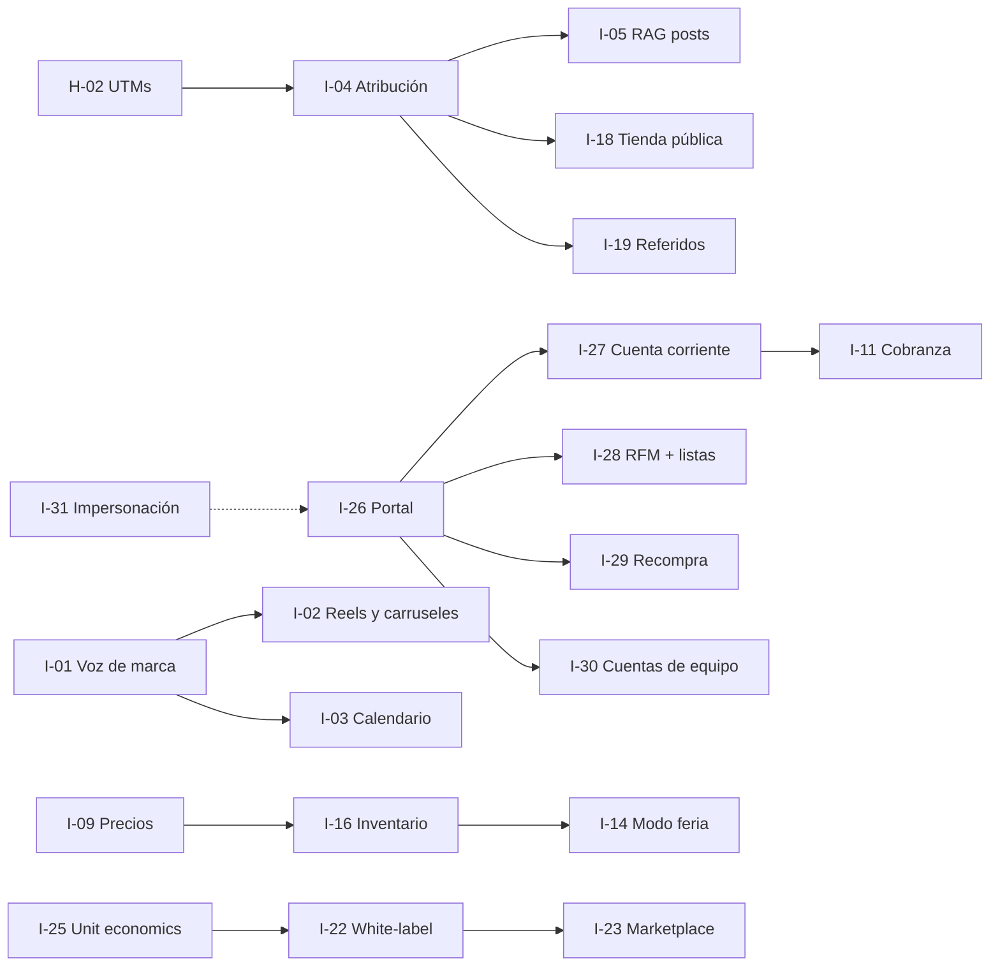

<!-- markdownlint-disable MD013 -->

# 05 — Ideas de valor, priorización y roadmap de 12 meses

> **Qué es este documento.** Un backlog razonado de 31 ideas específicas de
> VentasCatálogo, con ficha convertible en épica, scoring por ratio impacto/esfuerzo,
> roadmap de 12 meses, ideas descartadas, experimentos baratos de validación y
> guardrails económicos y técnicos.
>
> **Qué NO es.** No cambia el MVP de `docs/01-CONTEXTO-Y-DECISIONES.md` ni la
> `docs/03-SPEC.md`. Las **dos caras (ADR-17) y el módulo de usuarios con RBAC (ADR-18)
> son BASE del producto**, no ideas de este documento: la familia G propone valor adicional
> sobre esa base. Lo que necesita una decisión nueva se propone en el anexo C
> (ADR-19..ADR-24); nada se cambia en silencio.

---

## 0. Resumen ejecutivo

| Dato | Valor |
|---|---|
| Ideas evaluadas | 31, en 7 familias (25 de la v1.0 + 6 de dos caras) |
| Esfuerzo total del backlog | 391 dp |
| Ideas en los primeros 12 meses | 9 ideas (92 dp) + 6 habilitadores absorbidos en el MVP |
| Ideas que esperan al año 2 | 22 |
| Ideas descartadas ahora | 10 |
| Experimentos de validación | 3, por ≤ 9 dp y ≤ USD 76 |
| Autoridad | `docs/01-CONTEXTO-Y-DECISIONES.md` (ADR-01..ADR-18) |

**Top 5 por ratio impacto/esfuerzo:**

| Puesto | ID | Idea | I/E | Esfuerzo |
|---|---|---|---|---|
| 1 | I-20 | Resumen diario por WhatsApp al dueño | 3,00 | 4 dp |
| 2 | I-04 | Atribución con UTMs y A/B de copies | 2,50 | 7 dp |
| 3 | I-03 | Calendario editorial con aprobación | 2,00 | 8 dp |
| 4 | I-29 | Recompra en 1 clic | 2,00 | 6 dp |
| 5 | I-01 | Voz de marca y biblioteca de hashtags | 2,00 | 7 dp |

**Top 5 por impacto declarado (I=5):** I-04, I-09, I-18, I-07, I-14, I-05, I-26 e I-27; el
desempate lo dan el ratio y las dependencias. El ranking por ratio premia *quick wins*; el
roadmap (§4) los corrige con dependencias y capacidad.

**Decisión del trimestre 1:** el T1 es el MVP (F0–F1) más la base de dos caras que ya exige
ADR-17/18. No se construyen ideas de contenido; entran solo los tres datos habilitadores y
**I-29 Recompra en 1 clic** (6 dp), que aprovecha el historial que produce F1 y demuestra el
valor de la cara B desde el primer día. Sin los habilitadores, I-04, I-09 e I-25 cuestan
entre 1,5 y 3 veces más.

---

## 1. Tesis de producto

### 1.1 El foso defensivo: el ciclo cerrado y las dos caras

VentasCatálogo no compite por "tener IA". Compite por ser el único sistema donde **el
contenido que se publica y la venta que se cobra son el mismo dato**:

```
Catálogo versionado → Contenido → Clic medible → Pedido → Cobro → Datos → mejor contenido
        ▲                                                                       │
        └────────────────── catálogo activo (versión inmutable) ◄────────────────┘
```

**El foso de las dos caras.** ADR-17/18 no son una función: son la arquitectura del
producto. El activo no es que el staff tenga panel ni que el cliente tenga tienda, sino que
**ambas caras escriben en la misma base y se leen entre sí**:

- El backoffice ve la **conversión real** de cada post: el `SocialPost` se atribuye a un
  `Order` de un `CustomerAccount` identificado en el portal.
- La tienda y el portal alimentan el **historial del cliente**: RFM, límite de crédito,
  favoritos y recompra salen de las mismas tablas con las que el staff vende y cobra.
- El chat **conecta las dos caras**: la misma `ChatConversation` la atiende el agente y la
  continúa el cliente; el pedido nace en la conversación y se cobra en el portal.

| Capacidad | Sin cara B (solo backoffice) | Con dos caras y datos compartidos |
|---|---|---|
| Atribución de contenido | El post no se puede atar a un comprador | Post → clic → cuenta → pedido medible |
| Historial y LTV | Solo pedidos cargados por el vendedor | Historial completo del cliente y de su empresa |
| Crédito B2B | Excel paralelo al sistema | Cupo, estado de cuenta y vencimientos en el portal |
| Precios B2B | Un precio para todos | Lista de precios por cliente o segmento |
| Soporte | WhatsApp manual por cada consulta | Autoservicio + impersonación auditada |

Sin cara B, VentasCatálogo es un ERP interno con generador de posts: no atribuye contenido
a compradores, no conoce el LTV ni el crédito del cliente y compite por funciones, no por
datos. Con dos caras, **cada venta del portal entrena el contenido y cada contenido genera
una venta medible**.

| Competidor típico | Qué tiene | Qué no tiene | Consecuencia |
|---|---|---|---|
| Canva / plantillas | Diseño y copys genéricos | Precio, stock y pedidos del catálogo | El copy no sabe a qué precio se vende |
| Buffer / Hootsuite | Programación multicanal | Datos de venta ni versionado | Mide likes, no pedidos |
| Shopify + apps | Catálogo y venta | WhatsApp-first, CRC, facturación CR, importación desde Drive | Fricción para la PYME de feria |
| ERP / CRM tradicional | Operación interna | Cara de cliente con datos compartidos y contenido medible | El cliente no compra dentro: se pierde el ciclo |
| Excel + WhatsApp | Coste cero | Trazabilidad, medición, versiones | Es el statu quo que se reemplaza |

La ventaja se refuerza con cuatro costes de cambio reales: el **histórico versionado** (cada
venta queda atada a la versión con la que se vendió), los **datos de atribución** (qué copy
generó qué pedido), la **cuenta del cliente** (historial, crédito, precios propios) y la
**distribución por WhatsApp**, canal real del mercado inicial.

### 1.2 Qué NO es una idea válida

Se rechaza sin pasar a scoring si: (1) no toca el ciclo catálogo→contenido→venta→cobro;
(2) es una función genérica de IA sin dato de catálogo, entidad ni métrica; (3) exige otro
producto (app nativa, ERP, logística, marketplace de consumidores); (4) rompe el aislamiento
por `organization_id`/`catalog_version_id`, "aunque sea solo para reportes"; (5) no se puede
medir en 90 días; (6) **mezcla las dos caras en una sola superficie o salta la audiencia del
token** (`aud=staff` vs `aud=customer`, R8 de `docs/01 §5.1`).

### 1.3 Cinco principios de decisión

| ID | Principio | Aplicación práctica |
|---|---|---|
| P1 | **Primero medir, después generar** | Ninguna idea de contenido entra antes de la atribución (I-04) |
| P2 | **Reutilizar el stack, no ampliarlo** | NestJS, Postgres, Redis/BullMQ, MinIO, Socket.IO; nada de otro runtime ni microservicios |
| P3 | **El humano aprueba y envía** | La IA propone; el humano aprueba y envía (redes, WhatsApp, precios) |
| P4 | **Coste marginal decreciente** | Cuota por org, caché, modelo económico por defecto; coste IA ≤ 10 % del ingreso |
| P5 | **Aislar por org, catálogo y audiencia** | `organization_id` en todo; `catalog_id` + `catalog_version_id` en lo transaccional; shell y token separados por cara (ADR-17) |

Desempate entre ideas de igual ratio: (1) mayor impacto, (2) menor riesgo, (3) menos
dependencias de terceros, (4) la que reutilice entidades existentes de la base.

### 1.4 Supuestos económicos de partida

| ID | Supuesto | Valor usado | Estado |
|---|---|---|---|
| S-01 | Tipo de cambio CRC/USD | ₡515 por USD | **SUPUESTO** (BCCR) |
| S-02 | IVA Costa Rica | 13 % (`tax_rate=1300` pb) | Dato normativo (Ley 9635) |
| S-03 | DeepSeek `deepseek-chat` | USD 0,27 / M entrada; USD 1,10 / M salida | **SUPUESTO** (verificar tarifa) |
| S-04 | Set de copy (1 generación) | 1 400 tok in + 2 700 tok out ≈ USD 0,0034; con 1,2× reintentos ≈ **USD 0,0040** | Cálculo sobre S-03 |
| S-05 | Imagen generada | USD 0,02–0,06 por imagen | **SUPUESTO** |
| S-06 | Transcripción de voz | USD 0,006 por minuto | **SUPUESTO** |
| S-07 | OCR de comprobante/catálogo | USD 0,002–0,01 por página | **SUPUESTO** |
| S-08 | Plantilla de WhatsApp | USD 0,03–0,09 por mensaje | **SUPUESTO** (Meta Business) |
| S-09 | Comisión Stripe | 2,9 % + USD 0,30 | **SUPUESTO** |
| S-10 | Comisión MercadoPago CR | 3,49 % + USD 0,30 | **SUPUESTO** |
| S-11 | Comisión PayPal | 3,49 % + USD 0,49 | **SUPUESTO** |
| S-12 | SINPE Móvil | 0 % (P2P); conciliación manual/OCR | **SUPUESTO** |
| S-13 | Ticket promedio | ₡25 000 (≈ USD 48,5) | **SUPUESTO** |
| S-14 | Mercado objetivo | ~12 000 PYMES con catálogo digital en CR | **SUPUESTO** de orden de magnitud |
| S-15 | Capacidad | 2 devs ≈ 40 dp/mes; 25 % a ideas = **10 dp/mes = 30 dp/trimestre** | Supuesto de planificación |
| S-16 | Precios de venta | Inicial 19; Pro 49; Negocio 99; Agencia 199 (USD/mes) | **SUPUESTO** de pricing |
| S-17 | Meta a 12 meses | 150 orgs pagando, MRR ≈ USD 5 700 | **SUPUESTO** de escenario |

**Coste de IA por plan al límite de cuota (con S-04):**

| Plan | USD/mes | ₡/mes | Catálogos | Usuarios | Generaciones/mes | Coste IA | % del ingreso |
|---|---|---|---|---|---|---|---|
| Inicial | 19 | ₡9 785 | 1 | 2 | 200 | USD 0,80 | 4,2 % |
| Pro | 49 | ₡25 235 | 3 | 5 | 800 | USD 3,20 | 6,5 % |
| Negocio | 99 | ₡50 985 | 10 | 15 | 2 000 | USD 8,00 | 8,1 % |
| Agencia | 199 | ₡102 485 | 30 sub-orgs | 40 | 4 000 | USD 16,00 | 8,0 % |

**"Generación" = un set de copy completo (título + cuerpo + hashtags + CTA) para 1 producto
× 1 plataforma.** Imágenes, transcripciones y OCR consumen unidades de cuota separadas, con
contador propio en `AiUsageLedger`.

### 1.5 Unidad de esfuerzo y capacidad

- **1 dp** = 6 horas productivas de un dev full-stack senior (incluye pruebas y revisión).
- Escala: `1` ≤ 4 dp · `2` 5–8 dp · `3` 9–15 dp · `4` 16–25 dp · `5` 26–40 dp.
- Capacidad de ideas: **30 dp por trimestre**; el resto es MVP, base de dos caras, soporte y
  deuda. El backlog de 391 dp **no cabe en 12 meses**: entran 92 dp de ideas y el resto es
  año 2 o descarte.

---

## 2. Scoring de ideas

### 2.1 Reglas de scoring

| Campo | Escala | Definición operativa |
|---|---|---|
| Impacto (I) | 1–5 | 5 = mueve ingreso o retención de forma directa y medible en ≤ 90 días; 3 = mejora indirecta; 1 = cosmético |
| Esfuerzo (E) | 1–5 | Escala de §1.5, incluye backend, UI, pruebas, migración y documentación |
| Riesgo | Bajo / Medio / Alto | Bajo = tecnología conocida y reversible; Medio = depende de datos o tercero estable; Alto = tercero crítico, regulación, crédito o datos no controlados |
| Fase sugerida | F1..F5 | **Fase mínima habilitante** según dependencias (`docs/01 §7`): no es la ola de construcción, eso lo fija la columna Ola. F5 = diferenciación post-MVP |
| Tipo | ingreso / retención / diferenciación / eficiencia | Un tipo dominante por idea |
| Ratio I/E | I ÷ E | Dos decimales; ordena la tabla |

Orden: ratio descendente → impacto descendente → riesgo ascendente (Bajo < Medio < Alto)
→ ID ascendente.

> **Fase ≠ Ola.** Una idea `F2` significa que no puede existir antes de F2 (necesita portal,
> pagos o cuenta de cliente); puede construirse en T3 o en el año 2 si el trimestre está
> lleno. La columna **Ola** es la que compromete calendario.

### 2.2 Ranking completo (31 ideas)

Familias: **A** contenido IA · **B** ventas/chat IA · **C** dinero y rentabilidad ·
**D** operación · **E** crecimiento · **F** plataforma/SaaS · **G** dos caras
(staff + cliente).

| # | ID | Idea | Fam. | Tipo | I | E | dp | I/E | Riesgo | Fase | Ola |
|---|---|---|---|---|---|---|---|---|---|---|---|
| 1 | I-20 | Resumen diario por WhatsApp al dueño | E | retención | 3 | 1 | 4 | 3,00 | Bajo | F4 | T3 |
| 2 | I-04 | Atribución con UTMs y A/B de copies | A | diferenciación | 5 | 2 | 7 | 2,50 | Medio | F2 | T3 |
| 3 | I-03 | Calendario editorial con aprobación | A | retención | 4 | 2 | 8 | 2,00 | Bajo | F5 | Año 2 |
| 4 | I-29 | Recompra en 1 clic | G | retención | 4 | 2 | 6 | 2,00 | Bajo | F1 | T1 |
| 5 | I-01 | Voz de marca y biblioteca de hashtags | A | diferenciación | 4 | 2 | 7 | 2,00 | Medio | F5 | Año 2 |
| 6 | I-11 | Cobranza inteligente | C | ingreso | 4 | 2 | 7 | 2,00 | Medio | F2 | Año 2 |
| 7 | I-09 | Inteligencia de precios y margen | C | ingreso | 5 | 3 | 14 | 1,67 | Medio | F5 | T4 |
| 8 | I-18 | Tienda pública con SEO, QR y feed | E | ingreso | 5 | 3 | 13 | 1,67 | Medio | F2 | T4 |
| 9 | I-07 | Copiloto de WhatsApp | B | ingreso | 5 | 3 | 13 | 1,67 | Alto | F5 | Año 2 |
| 10 | I-27 | Cuenta corriente y crédito B2B | G | ingreso | 5 | 3 | 13 | 1,67 | Alto | F2 | T2 |
| 11 | I-17 | Gastos por foto de comprobante (OCR) | D | eficiencia | 3 | 2 | 6 | 1,50 | Bajo | F5 | Año 2 |
| 12 | I-25 | Panel de unit economics | F | eficiencia | 3 | 2 | 6 | 1,50 | Bajo | F4 | T3 |
| 13 | I-31 | Impersonación auditada y soporte de acceso | G | eficiencia | 3 | 2 | 7 | 1,50 | Medio | F4 | Año 2 |
| 14 | I-13 | Multi-moneda con tipo de cambio | C | eficiencia | 3 | 2 | 6 | 1,50 | Medio | F5 | Año 2 |
| 15 | I-21 | Gamificación de vendedores | E | retención | 3 | 2 | 8 | 1,50 | Medio | F5 | Año 2 |
| 16 | I-24 | API pública y webhooks | F | ingreso | 4 | 3 | 14 | 1,33 | Bajo | F5 | Año 2 |
| 17 | I-02 | Guiones de Reels y carruseles | A | diferenciación | 4 | 3 | 14 | 1,33 | Medio | F5 | Año 2 |
| 18 | I-08 | Bandeja asistida: voz, resumen e intención | B | eficiencia | 4 | 3 | 12 | 1,33 | Medio | F5 | Año 2 |
| 19 | I-10 | Conciliación bancaria automática | C | eficiencia | 4 | 3 | 13 | 1,33 | Medio | F5 | Año 2 |
| 20 | I-16 | Inventario y reabastecimiento | D | retención | 4 | 3 | 12 | 1,33 | Medio | F5 | Año 2 |
| 21 | I-22 | Modo agencia white-label | F | ingreso | 4 | 3 | 15 | 1,33 | Medio | F5 | Año 2 |
| 22 | I-28 | Segmentación RFM y listas de precios | G | ingreso | 4 | 3 | 12 | 1,33 | Medio | F2 | T3 |
| 23 | I-30 | Cuentas de equipo de cliente empresa | G | ingreso | 4 | 3 | 13 | 1,33 | Medio | F2 | Año 2 |
| 24 | I-26 | Portal de autoservicio del cliente | G | retención | 5 | 4 | 17 | 1,25 | Medio | F2 | T2 |
| 25 | I-05 | RAG de posts que sí vendieron | A | diferenciación | 5 | 4 | 20 | 1,25 | Alto | F5 | Año 2 |
| 26 | I-14 | Modo feria con código de barras | D | retención | 5 | 4 | 20 | 1,25 | Alto | F5 | Año 2 |
| 27 | I-23 | Marketplace de plantillas por vertical | F | ingreso | 3 | 3 | 12 | 1,00 | Medio | F5 | Año 2 |
| 28 | I-06 | Estudio visual: fondos y mejora de fotos | A | diferenciación | 4 | 4 | 18 | 1,00 | Alto | F5 | Año 2 |
| 29 | I-12 | Facturación electrónica CR (Hacienda v4.4) | C | ingreso | 5 | 5 | 35 | 1,00 | Alto | F5 | Año 2 |
| 30 | I-19 | Referidos y afiliados con links medibles | E | ingreso | 3 | 3 | 9 | 1,00 | Alto | F3 | Año 2 |
| 31 | I-15 | Importación por foto de catálogo impreso | D | diferenciación | 4 | 5 | 30 | 0,80 | Alto | F5 | Año 2 |

### 2.3 Lectura del ranking

| Familia | Ideas | dp | % backlog | Lectura |
|---|---|---|---|---|
| A — Contenido IA | 6 | 74 | 18,9 % | Corazón del producto, pero sin atribución no se puede optimizar |
| B — Ventas/chat IA | 2 | 25 | 6,4 % | Bajo esfuerzo, alto impacto por conversación |
| C — Dinero y rentabilidad | 5 | 75 | 19,2 % | El eslabón que más duele a la PYME; I-12 concentra 35 dp |
| D — Operación | 4 | 68 | 17,4 % | Feria/OCR son diferenciadores de campo, de fase avanzada |
| E — Crecimiento | 4 | 34 | 8,7 % | La familia más barata y la que más rápido se nota |
| F — Plataforma/SaaS | 4 | 47 | 12,0 % | Habilita precio y escala; no antes de 50+ orgs |
| G — Dos caras | 6 | 68 | 17,4 % | Máximo retorno: el valor de las dos caras ya está construido |
| **Total** | **31** | **391** | **100 %** | |

Por tipo: ingreso 12 ideas (170 dp), diferenciación 6 (96), retención 7 (75), eficiencia 6
(50). Por riesgo: 8 ideas de riesgo Alto concentran 158 dp (40,4 %); solo **I-27** entra
antes del mes 9 (con cupo conservador, aprobación humana y límites iniciales) y el resto se
resuelve con experimentos (§6) o se reduce el alcance.

### 2.4 Cambios respecto a la versión 1.0

| Idea | v1.0 | v2.0 | Motivo |
|---|---|---|---|
| 25 fichas previas | I/E sin cambios | I/E sin cambios | El requisito de dos caras no altera impacto ni esfuerzo de lo ya evaluado |
| I-04 | F3 | **F2** | El checkout y la cuenta del cliente hacen medible la atribución antes |
| I-11 | F5 | **F2** | Estado de cuenta y vencimientos viven en el portal (I-26) |
| I-18 | F5 | **F2** | La tienda es cara B base; la idea (SEO/QR/feed) se apoya en ella desde F2 |
| I-19 | F5 | **F3** | Referidos necesitan cuenta de cliente y atribución (I-04) |
| I-26..I-31 | no existían | fichas nuevas | Valor que solo existe con las dos caras (familia G) |

El backlog pasa de 25 a 31 fichas como consecuencia directa de ADR-17/18. La disciplina no
cambia: sigue habiendo **máximo 30 dp de ideas por trimestre** y todo lo que no cabe es
año 2 o descarte.

---

## 3. Fichas de ideas

> Agrupadas por familia. "Ranking" remite a §2.2. El formato es una tabla de cabecera y los
> campos exigidos para abrir una épica.

### 3.1 Familia A — IA de contenido avanzada

#### I-01 · Voz de marca y biblioteca de hashtags

| Ranking | Tipo | Fase · Ola | I/E | dp | Ratio | Riesgo |
|---|---|---|---|---|---|---|
| 5 | diferenciación | F5 · Año 2 | 4/2 | 7 | 2,00 | Medio |

**Problema.** Cada post suena distinto y el *social manager* reescribe el 50–60 % del texto; además usa hashtags genéricos (#love, #instagood) que no posicionan en Costa Rica ni en el vertical, sin memoria de cuáles trajeron clics.
**Propuesta.** Un perfil de voz por catálogo y plataforma, más un banco de hashtags por país/idioma/vertical con rendimiento medido, inyectado como contexto versionado en cada generación.
**Flujo.** 1) El admin define hasta 3 muestras aprobadas, 5 adjetivos, términos prohibidos y nivel de formalidad. 2) El compositor de prompt arma voz + restricciones + hashtags (máx. 8) + producto de la versión activa. 3) El manager califica cada variante (útil/editada/descartada). 4) Un job nocturno cruza hashtags con `ClickEvent`/`Order` y actualiza `HashtagStat`. 5) La biblioteca sugiere los 8 con mejor ratio clic/impresión.
**Datos y entidades.** `BrandVoice(organization_id, catalog_id?, platform, samples[3], tone_params jsonb, forbidden_terms[], version)`, `HashtagSet(country, language, platform, vertical, hashtags[])`, `HashtagStat(hashtag, country, clicks, orders, impressions, last_used_at)`.
**Dependencias.** Módulo `ai` (F3), prompts versionados, cola `ai.generate`, `SocialPost` e **I-04** (sin datos de clic no hay rendimiento).
**Métrica.** ≥ 60 % de orgs con `BrandVoice` a 30 días; tasa de edición del copy de ~55 % a ≤ 30 %; CTR con banco de hashtags ≥ +15 % sobre el baseline.
**Riesgos y mitigación.** Voz estereotipada → mínimo 3 muestras reales y temperatura 0,7; hashtags en inglés para CR → banco local curado y validación de idioma; deriva al cambiar de versión → la voz vive en la org/catálogo, no en la versión.
**Esfuerzo.** 7 dp (backend 4, UI 2, evaluación de prompts 1).
**Modelo de ingreso.** Incluido en Pro/Negocio/Agencia; argumento de upgrade desde Inicial.

#### I-02 · Guiones de Reels y carruseles multi-producto

| Ranking | Tipo | Fase · Ola | I/E | dp | Ratio | Riesgo |
|---|---|---|---|---|---|---|
| 17 | diferenciación | F5 · Año 2 | 4/3 | 14 | 1,33 | Medio |

**Problema.** El catálogo genera posts de texto, pero vende el formato corto: la PYME no graba porque "no sabe qué decir en 15 segundos". Un Reel con agencia cuesta USD 50–150 por pieza (**SUPUESTO**).
**Propuesta.** A partir de 1–3 productos del catálogo activo, generar un guion de Reel escena por escena (hook, desarrollo, CTA) o un carrusel de 5–8 slides con texto y sugerencia visual, exportable a PDF o teleprompter.
**Flujo.** 1) Se eligen 1–3 productos y el formato (Reel 15/30 s, carrusel 5 u 8). 2) La IA produce `Storyboard` con escenas, duración, texto en pantalla, voz en off y foto sugerida. 3) La UI muestra preview por escena/slide y permite editar un campo sin regenerar todo. 4) Se exporta a PDF con `pdf.render` o modo teleprompter. 5) Se guarda como `SocialPost(format=reel|carousel)` listo para I-03.
**Datos y entidades.** `Storyboard(organization_id, catalog_id, catalog_version_id, format, duration_seconds)`, `StoryboardScene(order, duration, on_screen_text, voice_over, media_asset_id)`, `CarouselSlide(order, copy, media_asset_id)`; se extiende `SocialPost.format` a `single|carousel|reel|story`.
**Dependencias.** I-01 (recomendable), módulo `ai`, `pdf.render`, MinIO. No requiere generar video: produce **guiones**.
**Métrica.** ≥ 3 guiones/semana por org activa; ≥ 40 % marcados como publicados; tiempo de producción de una pieza −40 % (10 orgs piloto).
**Riesgos y mitigación.** Guiones genéricos que no se graban → validar con 20 guiones reales antes de construir; formatos que cambian → plantillas versionadas; expectativa de "video automático" → la función se llama "Guion para Reel".
**Esfuerzo.** 14 dp (generación 5, PDF/preview 4, UI 3, plantillas por formato 2).
**Modelo de ingreso.** Negocio/Agencia; add-on de contenido +USD 12/mes en Pro.

#### I-03 · Calendario editorial con aprobación

| Ranking | Tipo | Fase · Ola | I/E | dp | Ratio | Riesgo |
|---|---|---|---|---|---|---|
| 3 | retención | F5 · Año 2 | 4/2 | 8 | 2,00 | Bajo |

**Problema.** El generador produce posts sueltos cuando el usuario se acuerda; no hay cadencia ni aprobación del dueño y el contenido se queda en borradores (~70 % de los generados nunca se publica, **SUPUESTO** a validar con uso real).
**Propuesta.** Calendario por catálogo con capacidad semanal, generación masiva nocturna, flujo `draft → in_review → approved → scheduled → published` y recordatorio por WhatsApp con el texto listo.
**Flujo.** 1) Se configura cadencia (p. ej. 5/semana), mix (producto/educativo/prueba social) y aprobador. 2) Un job nocturno propone slots con productos de mayor stock o margen y genera drafts en `ai.generate`. 3) El aprobador revisa en lote. 4) Una hora antes se envía recordatorio por WhatsApp con el copy y el enlace. 5) Al marcar "publicado" se mide cumplimiento.
**Datos y entidades.** `EditorialCalendar(organization_id, catalog_id, cadence_json, approver_user_id)`, `EditorialSlot(calendar_id, scheduled_at_utc, platform, status, social_post_id)`, `Approval(social_post_id, actor, decision, reason, decided_at)`; reutiliza `SocialPost` y `OutboxEvent`.
**Dependencias.** `ai` (F3), WhatsApp (F3) para recordatorios, colas `ai.generate` y `reminder.send`. No depende de I-01.
**Métrica.** ≥ 70 % de slots aprobados y publicados; orgs con calendario publican 2× por semana; retención mensual +8 pp frente a cohorte sin calendario.
**Riesgos y mitigación.** Spam de baja calidad → mix obligatorio y tope semanal; aprobación estancada → recordatorio a 24 h y delegado; coste IA → cuota reservada y generación solo al aprobar el plan semanal.
**Esfuerzo.** 8 dp (modelo y estados 2, generación masiva 2, UI 3, recordatorios 1).
**Modelo de ingreso.** Pro/Negocio; principal argumento de retención frente a "ChatGPT suelto".

#### I-04 · Atribución con UTMs y A/B de copies

| Ranking | Tipo | Fase · Ola | I/E | dp | Ratio | Riesgo |
|---|---|---|---|---|---|---|
| 2 | diferenciación | F2 · T3 | 5/2 | 7 | 2,50 | Medio |

**Problema.** Nadie sabe qué post generó qué venta. Sin esa señal la IA no mejora y el dueño no justifica la suscripción; los likes no son una métrica de negocio.
**Propuesta.** Todo link que sale del sistema (post, bio, PDF, WhatsApp, link de pago, **portal del cliente**) lleva UTMs firmados; el clic y el pedido se registran; los A/B de copy se deciden por pedidos, no por impresiones.
**Flujo.** 1) Al publicar se crea `UtmLink` con `utm_source/medium/campaign/content` y token corto propio (`/r/:token`). 2) El endpoint registra clic (IP hasheada, UA, referrer) y redirige 302. 3) Al crear cotización/pedido se guarda `attribution` first-touch y last-touch con ventana de 30 días, ligado a `CustomerAccount` cuando exista. 4) Un panel muestra post → clic → cotización → pedido pagado. 5) A/B reparte 50/50 y declara ganador con ≥ 30 clics por variante.
**Datos y entidades.** `UtmLink(token, organization_id, catalog_id, catalog_version_id, post_id?, params jsonb)`, `ClickEvent(utm_link_id, occurred_at, ip_hash, ua, referrer)`, `AttributionTouch(order_id, utm_link_id, model, touched_at)`, `AbTest(social_post_id, metric, status, winner_variant)`, `CopyVariant(label, prompt_hash, text)`; `Order.attribution_json`.
**Dependencias.** `sales` y `payments` (cerrar el embudo), `social` (F3), Redis para rate limit y caché; con ADR-17 la tienda y el portal permiten atribuir a una cuenta. Sin terceros; consentimiento de cookies (guardrail §7).
**Métrica.** ≥ 60 % de pedidos con atribución a ≤ 30 días; error < 10 % en auditoría de 50 pedidos; el panel se usa ≥ 2 veces/semana por el dueño.
**Riesgos y mitigación.** Adblockers/ITP → links propios, last-touch y pregunta "¿cómo nos encontró?" en checkout; atribución sobrevalorada → mostrar first-touch y last-touch con sus límites; cookies/Ley 8968 → banner de consentimiento, sin PII y retención 90 días.
**Esfuerzo.** 7 dp (links y redirección 2, eventos y atribución 2, panel 2, A/B 1).
**Modelo de ingreso.** Diferenciador de Pro; prerrequisito de I-05, I-19 y del argumento de renovación.

#### I-05 · RAG de posts que sí vendieron

| Ranking | Tipo | Fase · Ola | I/E | dp | Ratio | Riesgo |
|---|---|---|---|---|---|---|
| 25 | diferenciación | F5 · Año 2 | 5/4 | 20 | 1,25 | Alto |

**Problema.** El generador no aprende de la propia cuenta: repite fórmulas y no sabe que en este catálogo el copy con precio explícito convierte 3× más que el aspiracional.
**Propuesta.** Indexar los posts publicados con su rendimiento y recuperar los 3–5 mejores ejemplos del mismo catálogo/vertical como *few-shot* en cada generación.
**Flujo.** 1) Cada post recibe `PostPerformance` calculada por job (pedidos, ingreso, clics; alcance manual si no hay API de red). 2) Se generan embeddings y se guardan con `pgvector`. 3) Al generar se recupera top-k filtrado **por `catalog_id` y plataforma** (nunca cruza catálogos). 4) El prompt versionado inyecta los ejemplos con instrucción de no copiarlos. 5) Un A/B de 6 semanas compara con/sin RAG; si el uplift < 10 % se apaga por flag.
**Datos y entidades.** `PostPerformance(social_post_id, impressions?, clicks, orders, revenue_minor, score)`, `Embedding(owner_type, owner_id, vector, model, created_at)`, `RetrievalLog(request_id, catalog_id, top_k, scores jsonb)`.
**Dependencias.** **I-04** (sin atribución no hay señal), `pgvector` en Postgres 16 (anexo C, ADR-22), módulo `ai`, cola.
**Métrica.** Uplift ≥ 10 % en pedidos/clics por post en A/B de 6 semanas; ≥ 70 % de generaciones con ≥ 3 ejemplos recuperados.
**Riesgos y mitigación.** Sobreajuste a un post viral → diversidad mínima (3 posts, 2 formatos) y penalización de duplicados; cold start → fallback a plantillas y activación con ≥ 20 posts medidos; privacidad → solo se indexan posts propios, nunca conversaciones.
**Esfuerzo.** 20 dp (performance 5, embeddings/retrieve 6, integración 4, A/B y evaluación 5).
**Modelo de ingreso.** Negocio/Agencia; se vende como "contenido que mejora con tus ventas".

#### I-06 · Estudio visual: fondos generados y mejora de fotos

| Ranking | Tipo | Fase · Ola | I/E | dp | Ratio | Riesgo |
|---|---|---|---|---|---|---|
| 28 | diferenciación | F5 · Año 2 | 4/4 | 18 | 1,00 | Alto |

**Problema.** Las fotos del catálogo de Drive tienen fondo de mesa, luz de oficina y baja resolución; un producto con foto mala convierte menos y contratar fotógrafo para 200 SKU es inviable.
**Propuesta.** Pipeline que limpia la foto (recorte, fondo neutro, luz, upscale 2×) y genera 2–3 fondos/escenas con el estilo de marca, con aprobación humana y coste visible por imagen.
**Flujo.** 1) La foto va a MinIO y un job de visión detecta y recorta el producto. 2) Se aplican operaciones deterministas y, opcionalmente, fondo generado con `ImageProvider`. 3) Se generan 2–3 variantes. 4) El usuario aprueba una y descarta el resto. 5) La aprobada se asocia a `ProductImage` y a los posts; el coste va a `AiUsageLedger` en cuota de imágenes.
**Datos y entidades.** `ImageJob(organization_id, product_id, source_asset_id, operation, provider, cost_minor, status)`, `ImageVariant(image_job_id, asset_id, approved_by, approved_at)`; reutiliza `MediaAsset`/`ImageObject`.
**Dependencias.** MinIO, cola, **ImageProvider** (anexo C, ADR-20), presupuesto de imágenes separado del de texto, UI comparativa antes/después.
**Métrica.** ≥ 50 % de los productos top-20 con imagen mejorada; uplift de CTR ≥ 12 % en posts con imagen tratada; coste medio ≤ USD 0,05/imagen.
**Riesgos y mitigación.** La IA inventa detalles del producto → solo se genera fondo/entorno, nunca el producto, y revisión humana obligatoria; coste 15–20× el texto → cuota separada, preview de coste y tope mensual; derechos de imagen → términos y consentimiento del cliente.
**Esfuerzo.** 18 dp (pipeline 6, proveedor 5, UI de aprobación 4, cuotas y coste 3).
**Modelo de ingreso.** Add-on USD 9/mes por 200 imágenes; 50/mes incluidas en Negocio.

### 3.2 Familia B — IA de ventas y chat

#### I-07 · Copiloto de WhatsApp

| Ranking | Tipo | Fase · Ola | I/E | dp | Ratio | Riesgo |
|---|---|---|---|---|---|---|
| 9 | ingreso | F5 · Año 2 | 5/3 | 13 | 1,67 | Alto |

**Problema.** El 70 % de los mensajes son "precio", "¿hay?", "¿cómo pago?"; el agente tarda, responde de memoria y no ofrece complementos. Cada minuto de demora baja la conversión.
**Propuesta.** En la bandeja, para cada conversación, 3 respuestas sugeridas con **datos reales del catálogo activo** (precio exacto, stock, estado del pedido), más upsell/cross-sell y resumen; el humano edita y envía. Con ADR-17 el mismo copiloto conoce el historial del `CustomerAccount`.
**Flujo.** 1) Entra el mensaje por el webhook de WhatsApp Cloud API o chat interno. 2) Se clasifica intención y se resuelve contexto: `catalog_version_id` activa, cliente, pedidos abiertos y saldo. 3) Se recuperan productos por texto/embedding solo de la versión activa. 4) El LLM compone 3 respuestas con precio y stock inyectados literalmente y CTA con link de pago. 5) El agente envía; se registra aceptación/edición y se mide venta.
**Datos y entidades.** `Suggestion(conversation_id, kind, text, price_snapshot jsonb, accepted, edited_ratio)`, `ProductRecommendation(conversation_id, product_id, reason, score)`, `ConversationSummary`; reutiliza `WhatsAppMessage`, `ChatConversation`, `ChatMessage`, `Order`, `CustomerAccount`.
**Dependencias.** WhatsApp/chat (F3), `ai`, catálogo versionado, cola y `OutboxEvent`; la intención puede venir de I-08 (opcional).
**Métrica.** Tiempo de primera respuesta −50 %; ≥ 35 % de sugerencias enviadas con < 20 % de edición; ticket promedio +8 % en piloto.
**Riesgos y mitigación.** Alucinación de precio/stock → datos deterministas inyectados y validación post-generación contra la BD; ventana de 24 h → solo dentro de ventana, fuera plantilla o email; privacidad → no se entrena con conversaciones y acceso por rol.
**Esfuerzo.** 13 dp (contexto y retrieve 4, generación y validación 4, UI 3, métricas 2).
**Modelo de ingreso.** Pro/Negocio; ahorro de horas que justifica el salto de plan.

#### I-08 · Bandeja asistida: voz, resumen e intención

| Ranking | Tipo | Fase · Ola | I/E | dp | Ratio | Riesgo |
|---|---|---|---|---|---|---|
| 18 | eficiencia | F5 · Año 2 | 4/3 | 12 | 1,33 | Medio |

**Problema.** Gran parte de los mensajes son notas de voz: el agente las escucha una a una, no puede buscarlas y no sabe a quién atender primero; con 80 conversaciones/día pierde 1–2 h solo escuchando (**SUPUESTO**).
**Propuesta.** Transcripción automática de notas de voz, resumen por conversación y señal de intención de compra (0–100) que ordena la bandeja por urgencia y valor.
**Flujo.** 1) La nota llega como media y se descarga a MinIO. 2) Un job la transcribe vía `AiProvider` (audio) con idioma y confianza. 3) Cada 10 mensajes o al cerrar se genera `ConversationSummary` (qué quiere, qué se ofreció, próximo paso). 4) Se calcula `IntentScore` con reglas + LLM (precio, link, urgencia, presupuesto). 5) La bandeja ordena por score y SLA.
**Datos y entidades.** `Transcription(chat_message_id, text, language, confidence, provider, cost_minor)`, `ConversationSummary(conversation_id, summary, next_step, generated_at)`, `IntentScore(conversation_id, score, signals jsonb, model_version)`.
**Dependencias.** Chat/WhatsApp (F3), `AiProvider` con audio, MinIO, cola y consentimiento de grabación.
**Métrica.** 95 % de notas transcritas en < 30 s; conversión de conversaciones +10 % al priorizar top-10 de intención; tiempo de lectura por conversación −40 %.
**Riesgos y mitigación.** Coste STT → tope por org, notas < 5 min y caché por hash de audio; PII → cifrado, retención 30 días y borrado por solicitud; ruido/idioma mezclado → modelo multilingüe y botón de reintento.
**Esfuerzo.** 12 dp (ingesta/transcripción 4, resumen 3, scoring 2, UI 3).
**Modelo de ingreso.** Pro/Negocio; eficiencia que reduce el número de agentes necesarios.

### 3.3 Familia C — Dinero y rentabilidad

#### I-09 · Inteligencia de precios y margen

| Ranking | Tipo | Fase · Ola | I/E | dp | Ratio | Riesgo |
|---|---|---|---|---|---|---|
| 7 | ingreso | F5 · T4 | 5/3 | 14 | 1,67 | Medio |

**Problema.** Los precios vienen heredados del Excel y nadie los revisa: hay SKU con margen negativo que se descubre a fin de mes, y las promociones se deciden a ojo sin saber cuánto margen se sacrifica.
**Propuesta.** Banco de trabajo de precios: precio sugerido por margen objetivo y elasticidad observada, alertas de margen negativo y simulador *what-if* de promociones. **Nunca edita la versión activa**: propone una `CatalogVersion(draft)`.
**Flujo.** 1) Se captura `cost_minor` y gastos directos (si falta se marca "estimado" y baja la confianza). 2) Se calcula margen por SKU, categoría y versión. 3) El motor sugiere precio con margen objetivo (25–40 %), banda por categoría y elasticidad de ventas históricas. 4) El simulador "−15 % en categoría X" muestra margen, punto de equilibrio y caja. 5) Aplicar crea una versión `draft`; el admin valida y activa (ADR-08).
**Datos y entidades.** `PriceSuggestion(product_id, catalog_version_id, current_minor, suggested_minor, margin_current_bp, margin_target_bp, confidence)`, `MarginAlert(product_id, catalog_version_id, margin_bp, threshold_bp, created_at)`, `PromotionScenario(name, rules jsonb, expected_units, expected_margin_bp, created_by)`. Las listas de precios por cliente se proponen en I-28.
**Dependencias.** Versionado (ADR-08) para escribir precios, `finance` (F2) y ventas (F1). Sin scraping de competencia (descartado por legal, §5).
**Métrica.** ≥ 80 % de SKU con coste cargado; margen bruto +3 pp en orgs que aplican ≥ 5 sugerencias; 0 ventas con margen negativo sin alerta previa.
**Riesgos y mitigación.** Costes sucios → validación en importación y "coste estimado" separado; elasticidad con pocos datos → reglas por categoría en v1 y ML con ≥ 50 ventas/SKU; miedo a subir precios → simulación por escenarios, nunca aplicación automática.
**Esfuerzo.** 14 dp (costes/márgenes 3, motor 4, simulador 4, UI y versionado 3).
**Modelo de ingreso.** Negocio; add-on "Rentabilidad" USD 19/mes en Pro.

#### I-10 · Conciliación bancaria automática

| Ranking | Tipo | Fase · Ola | I/E | dp | Ratio | Riesgo |
|---|---|---|---|---|---|---|
| 19 | eficiencia | F5 · Año 2 | 4/3 | 13 | 1,33 | Medio |

**Problema.** El dinero entra por SINPE, transferencia, Stripe y MercadoPago y se concilia a mano en Excel: se duplican pagos, se pierden referencias y el cierre de mes toma días.
**Propuesta.** Importar extractos CSV/OFX de bancos CR y movimientos de pasarelas, hacer *matching* difuso contra pagos/pedidos y proponer la conciliación con un clic; bandeja de excepciones.
**Flujo.** 1) Se sube el extracto (CSV/OFX) o se conecta la API del banco si existe. 2) Se normaliza a fecha, monto, moneda, referencia, contraparte y descripción. 3) *Matching* por monto + fecha ± 2 días + referencia/nombre con score de confianza. 4) Score ≥ 0,90 se propone automático; el resto va a revisión con candidatos ordenados. 5) Al confirmar, el `Payment` queda conciliado y se asienta en finanzas.
**Datos y entidades.** `BankAccount(organization_id, bank, currency, alias)`, `BankStatement(account_id, period, source_file_id, imported_at)`, `BankTransaction(...)`, `ReconciliationMatch(bank_tx_id, payment_id, score, status, matched_by)`; reutiliza `Payment`, `Expense` y MinIO.
**Dependencias.** Payments (F2), finance (F2), parsers bancarios versionados, `OutboxEvent`; I-17 como apoyo para SINPE sin extracto.
**Métrica.** ≥ 85 % de transacciones auto-conciliadas; cierre mensual de 2 días a ≤ 4 h; diferencias no explicadas < 1 % del monto conciliado.
**Riesgos y mitigación.** Formatos que cambian → parser por banco versionado y plantilla editable; SINPE sin referencia → matching monto/hora y confirmación manual, nunca automático; seguridad → solo lectura, CSV por defecto, sin guardar claves bancarias.
**Esfuerzo.** 13 dp (parsers 4, matching 4, UI 3, asientos 2).
**Modelo de ingreso.** Negocio/Agencia; ahorra horas de contador, un argumento medible en colones.

#### I-11 · Cobranza inteligente

| Ranking | Tipo | Fase · Ola | I/E | dp | Ratio | Riesgo |
|---|---|---|---|---|---|---|
| 6 | ingreso | F2 · Año 2 | 4/2 | 7 | 2,00 | Medio |

**Problema.** El dueño cobra tarde y con vergüenza: manda recordatorios genéricos o no los manda; la cartera vencida crece y el flujo de caja se rompe aunque las ventas existan.
**Propuesta.** Scoring de probabilidad de pago por cliente/factura y una secuencia de recordatorios con tono adaptativo (suave → firme) por WhatsApp/email, con estado de cuenta visible en el portal (I-26).
**Flujo.** 1) Un job diario calcula el score (historial, días de atraso, monto, canal, cliente nuevo/recurrente). 2) Elige secuencia: D+1 suave, D+7 firme, D+15 llamada. 3) Envía plantilla aprobada por WhatsApp (con opt-in) y email de respaldo. 4) Registra respuesta y promesa; si paga, cancela la cadencia. 5) Dashboard de *aging* (30/60/90) y DSO.
**Datos y entidades.** `CollectionCase(order_id, organization_id, catalog_id, due_at, score_bp, status)`, `DunningSequence(case_id, step, channel, tone, sent_at, response)`, `PaymentPromise(case_id, amount_minor, promised_for, kept)`; reutiliza `PaymentReminder`, `Customer`, `CustomerAccount` y `OutboxEvent`; se integra con la cuenta corriente de I-27.
**Dependencias.** Payments/finance (F2), WhatsApp templates y opt-in (F3), cola `reminder.send`, outbox.
**Métrica.** DSO −25 % a 3 meses en orgs con cartera; ≥ 50 % de recordatorios con respuesta; CxC > 30 días −30 %.
**Riesgos y mitigación.** Bloqueo de WhatsApp → frecuencia máxima y opt-out; tono ofensivo → límites por Ley 7472/8968, plantillas revisadas y escalado humano antes del tono firme; cobrar a quien ya pagó → validar saldo conciliado antes de cada envío e idempotencia.
**Esfuerzo.** 7 dp (scoring 2, secuencias y tono 2, envío y registro 2, dashboard 1).
**Modelo de ingreso.** Negocio; justificado por caja liberada (≈ ₡500 000/año con cartera de ₡2 M, **SUPUESTO**).

#### I-12 · Facturación electrónica de Costa Rica (Hacienda v4.4)

| Ranking | Tipo | Fase · Ola | I/E | dp | Ratio | Riesgo |
|---|---|---|---|---|---|---|
| 29 | ingreso | F5 (alcance fase 3) · Año 2 | 5/5 | 35 | 1,00 | Alto |

**Problema.** Muchos clientes exigen factura electrónica; facturar fuera del sistema rompe el ciclo: se duplican datos, se pierde el vínculo pedido–factura y aparecen descuadres de IVA.
**Propuesta (alcance acotado de fase 3, en dos incrementos).** Generar el comprobante v4.4 desde el pedido pagado, firmarlo, enviarlo a Hacienda, guardar el acuse y emitir el PDF con clave numérica y QR descargable desde el portal del cliente (I-26).
**Flujo.** 1) Pedido pagado → se construye `TaxInvoice` con líneas, IVA 13 %, moneda y cliente. 2) Se genera el XML v4.4 con clave numérica y se firma con el certificado de la org (cifrado). 3) Se envía a la API de Hacienda y se hace *polling* del acuse. 4) Se guarda el acuse y se emite PDF con QR. 5) Notas de crédito/débito y contingencia ante caídas del servicio.
**Datos y entidades.** `TaxInvoice(order_id, organization_id, catalog_id, clave_numerica, xml_asset_id, status, hacienda_message)`, `InvoiceLine(invoice_id, product_id, quantity, unit_price_minor, tax_bp)`, `HaciendaSubmission(invoice_id, attempt, request_id, response_code, response_at)`, `TaxCertificate(organization_id, expires_at, encrypted)`.
**Dependencias.** Ventas/pagos/finanzas (F2), certificado por org, credenciales de Hacienda, cola con reintentos y asesoría fiscal; anexo C, ADR-21.
**Métrica.** ≥ 98 % de comprobantes aceptados al primer envío; emisión < 60 s; 0 facturas duplicadas (idempotencia por `order_id` + versión).
**Riesgos y mitigación.** Cambio v4.4 → v4.5 → capa de mapeo versionada; certificados vencidos → alerta 30 días y bloqueo con mensaje claro; rechazos → bandeja con motivo y reintento guiado; alcance 35 dp → dos incrementos (primero XML+firma+PDF; después envío y acuses).
**Esfuerzo.** 35 dp (fiscal 6, XML/firma 10, envío/acuses 8, PDF/QR 4, contingencia y pruebas 7).
**Modelo de ingreso.** Add-on USD 25/mes + 0,5 % por comprobante, solo para orgs que facturan.
> **Pregunta abierta §11.2 de `docs/01` resuelta:** no entra en el MVP; se propone para el año 2 (F5) por incrementos y se valida la demanda antes de comprometerla.

#### I-13 · Multi-moneda con tipo de cambio

| Ranking | Tipo | Fase · Ola | I/E | dp | Ratio | Riesgo |
|---|---|---|---|---|---|---|
| 14 | eficiencia | F5 · Año 2 | 3/2 | 6 | 1,50 | Medio |

**Problema.** El catálogo está en USD y el cliente paga en CRC; la conversión se hace a ojo, se pierde margen por tipo de cambio y los reportes mezclan monedas sin explicar la diferencia.
**Propuesta.** Doble precio por catálogo (CRC/USD), tipo de cambio de referencia diario (BCCR) con margen configurable, tasa fijada al emitir la cotización y reporte de diferencia cambiaria realizada; el portal muestra el precio en la moneda del `CustomerAccount`.
**Flujo.** 1) Se configuran monedas y margen FX por organización. 2) Un job diario actualiza `FxRate` desde BCCR (o entrada manual si falla). 3) La cotización guarda la tasa usada. 4) El pago se aplica a esa tasa, no a la del día de pago. 5) Se registra ganancia/pérdida realizada y se reporta la exposición por moneda.
**Datos y entidades.** `FxRate(base, quote, rate, source, fetched_at)`, `CurrencyPrice(product_id, currency, amount_minor)`, `Quote.fx_rate`, `Payment.fx_rate`, `FxGainLoss(payment_id, amount_minor, reason)`; respeta ADR-09 (`amount_minor` + `currency` ISO-4217).
**Dependencias.** Payments (F2), finance (F2), fuente BCCR y caché. No cambia ADR-09.
**Métrica.** 100 % de cotizaciones con tasa registrada; ≥ 95 % de la diferencia cambiaria explicada; 0 conversiones manuales en Excel.
**Riesgos y mitigación.** Fuente caída → caché del último valor y entrada manual auditada; redondeo → reglas por unidad menor y redondeo bancario documentado; impuestos → IVA en la moneda de emisión y validación con contador.
**Esfuerzo.** 6 dp (tasas 2, precios duales 2, reporte 2).
**Modelo de ingreso.** Incluido en todos los planes; habilita vender a clientes que facturan en USD.

### 3.4 Familia D — Operación

#### I-14 · Modo feria con código de barras y offline de lectura

| Ranking | Tipo | Fase · Ola | I/E | dp | Ratio | Riesgo |
|---|---|---|---|---|---|---|
| 26 | retención | F5 · Año 2 | 5/4 | 20 | 1,25 | Alto |

**Problema.** En ferias y ventas de campo no hay señal, el vendedor no recuerda precios y buscar el SKU en el móvil es lento; cada venta perdida en feria es el dolor más recordado.
**Propuesta.** Venta rápida en móvil con lector de código de barras (cámara o Bluetooth), carrito optimizado y catálogo precargado de solo lectura (ADR-14), más una cola de pedidos **borrador** que se confirman al reconectar (ADR-19, anexo C).
**Flujo.** 1) Abrir "Modo feria": descarga el catálogo activo a IndexedDB con su `catalog_version_id` y fecha de snapshot. 2) Escanear código o buscar por nombre; el carrito calcula localmente. 3) Se crea un pedido draft local con `Idempotency-Key` por dispositivo. 4) Al reconectar se envía; el servidor valida stock y precios contra la versión activa y el vendedor ajusta si algo cambió. 5) Se cobra con link de pago o registro manual y el pedido queda auditado.
**Datos y entidades.** `ScanSession(user_id, device_id, started_at, ended_at)`, `BarcodeMap(sku, ean13, catalog_id, catalog_version_id)`, `OfflineCatalogSnapshot(catalog_version_id, device_id, downloaded_at, checksum)`, `DraftOrder(client_id, idempotency_key, payload_json, synced_at)`.
**Dependencias.** PWA/service worker (ADR-14), versionado, ventas, outbox e IndexedDB; **decisión propuesta ADR-19** para venta offline en modo borrador.
**Métrica.** ≥ 70 % de vendedores de orgs con ferias usan el modo; 0 sobreventas tras sincronizar; tiempo por venta < 60 s.
**Riesgos y mitigación.** Conflictos de stock → el pedido offline es borrador y el stock se valida al confirmar; snapshot viejo → bloqueo si > 24 h o si la versión quedó archivada; dispositivo perdido → PIN local, caducidad y borrado remoto del cache.
**Esfuerzo.** 20 dp (IndexedDB/sync 7, escáner 4, carrito y cobro 5, conflictos 4).
**Modelo de ingreso.** Diferenciador de Negocio/Agencia: "vender en feria sin señal".

#### I-15 · Importación por foto de catálogo impreso

| Ranking | Tipo | Fase · Ola | I/E | dp | Ratio | Riesgo |
|---|---|---|---|---|---|---|
| 31 | diferenciación | F5 · Año 2 | 4/5 | 30 | 0,80 | Alto |

**Problema.** Muchos clientes tienen el catálogo en PDF impreso o en una foto de WhatsApp; cargarlo a mano son 4–8 h y decenas de errores de precio.
**Propuesta.** OCR + visión que detecta la tabla de productos (nombre, precio, código) desde foto o PDF escaneado, produce filas con confianza por celda y un asistente de corrección antes de crear la versión.
**Flujo.** 1) Se sube la foto/PDF a MinIO. 2) Un job de visión detecta bloques, tablas y celdas. 3) Se normaliza moneda, separadores, SKU y categorías. 4) UI de revisión con confianza por celda y cuarentena de filas dudosas. 5) Se crea `CatalogVersion(draft)` y sigue el flujo de validación de la importación de Drive (RF-DRV-5).
**Datos y entidades.** `PhotoImport(organization_id, source_asset_id, pages, status, provider, cost_minor)`, `ExtractedRow(photo_import_id, raw_json, confidence, status)`, `CellConfidence(row_id, column, score)`; reutiliza `CatalogVersion`, `Product` y `Quarantine`.
**Dependencias.** Importación (F1), MinIO, `AiProvider` con visión, cola.
**Métrica.** ≥ 90 % de filas con ≤ 1 corrección manual en catálogos de 50–200 SKU; tiempo de carga de 4 h a ≤ 45 min; coste OCR ≤ USD 0,01/página.
**Riesgos y mitigación.** Foto torcida o con poca luz → guía de captura y detección de calidad antes de gastar OCR; precios ambiguos (oferta/mayoreo) → cuarentena obligatoria, nunca auto-validar precios; coste de visión → preview de coste y tope por org.
**Esfuerzo.** 30 dp (visión/extracción 12, normalización 6, UI de corrección 7, pruebas con 20 catálogos 5).
**Modelo de ingreso.** Add-on USD 10 por catálogo importado, o incluido en Negocio.

#### I-16 · Inventario y alertas de reabastecimiento

| Ranking | Tipo | Fase · Ola | I/E | dp | Ratio | Riesgo |
|---|---|---|---|---|---|---|
| 20 | retención | F5 · Año 2 | 4/3 | 12 | 1,33 | Medio |

**Problema.** El stock vive en el Excel de la importación y se desactualiza el primer día; se vende lo que no hay, se pierde la venta de lo que sí y nadie sabe qué reordenar.
**Propuesta.** Movimientos de stock (entrada, salida por venta, ajuste, devolución) con stock derivado por versión, alertas de punto de reorden y sugerencia de compra por velocidad de venta.
**Flujo.** 1) La importación carga el stock inicial por SKU/variante. 2) La venta confirmada descuenta en la misma transacción + evento en outbox. 3) Un job calcula velocidad (7/30 días) y punto de reorden. 4) Cuando stock ≤ reorder point, alerta in-app y en el digest (I-20). 5) Sugerencia de orden de compra exportable a CSV/PDF.
**Datos y entidades.** `StockMovement(organization_id, catalog_id, product_id, variant_id, type, quantity, reference_type, reference_id, occurred_at)`, `StockLevel(product_id, variant_id, on_hand, reserved, updated_at)`, `ReorderPolicy(product_id, reorder_point, target_stock, lead_time_days)`, `PurchaseSuggestion(product_id, quantity, rationale)`.
**Dependencias.** Ventas (F1/F2), versionado y finance para compras. Sin terceros.
**Métrica.** ≥ 95 % de ventas con stock consistente (auditoría diaria); quiebres −30 %; 80 % de SKU críticos con reorder point configurado.
**Riesgos y mitigación.** Stock inicial sucio → stock opcional, ajuste auditado y conciliación con conteo físico; sobreventa concurrente → reserva con lock/transacción y validación al confirmar pago; alertas ignoradas → digest con top-5 críticos y acción en un clic.
**Esfuerzo.** 12 dp (movimientos/stock 4, reorden 3, alertas 2, UI 3).
**Modelo de ingreso.** Negocio; reduce quiebres y aumenta recompra.

#### I-17 · Gastos por foto de comprobante (OCR)

| Ranking | Tipo | Fase · Ola | I/E | dp | Ratio | Riesgo |
|---|---|---|---|---|---|---|
| 11 | eficiencia | F5 · Año 2 | 3/2 | 6 | 1,50 | Bajo |

**Problema.** Los gastos se registran tarde, sin comprobante y sin IVA crédito; al cierre el dueño no sabe su margen real porque faltan costos.
**Propuesta.** Foto del comprobante → OCR extrae emisor, fecha, monto, IVA y moneda → crea `ExpenseDraft` con líneas, categoría y catálogo; el comprobante queda en MinIO.
**Flujo.** 1) Se toma la foto desde el móvil o se sube PDF. 2) Un job de visión devuelve JSON con emisor, fecha, total, IVA y líneas. 3) Se valida el cuadre (suma de líneas = total; IVA 13 % cuando aplique). 4) El usuario revisa en una pantalla y asigna categoría/catálogo. 5) Se guarda `Expense` y se actualiza caja/margen con auditoría.
**Datos y entidades.** `ExpenseDraft(organization_id, media_asset_id, ocr_json, confidence, status)`, `OcrLine(draft_id, description, amount_minor, tax_bp)`; reutiliza `Expense`, `MediaAsset` y `AiUsageLedger`.
**Dependencias.** Finance (F2), MinIO, `AiProvider` visión, cola.
**Métrica.** ≥ 80 % de gastos con comprobante adjunto; tiempo de registro < 20 s; IVA crédito capturado ≥ 90 %.
**Riesgos y mitigación.** OCR erróneo en totales → validación de suma y edición obligatoria de campos dudosos; comprobante ilegible → fallback manual sin bloquear; PII del comprador → acceso por rol, retención y borrado por solicitud.
**Esfuerzo.** 6 dp (OCR/validación 3, UI 2, cuotas 1).
**Modelo de ingreso.** Incluido en todos los planes (eficiencia que reduce churn).

### 3.5 Familia E — Crecimiento

#### I-18 · Tienda pública con SEO, QR y feed

| Ranking | Tipo | Fase · Ola | I/E | dp | Ratio | Riesgo |
|---|---|---|---|---|---|---|
| 8 | ingreso | F2 · T4 | 5/3 | 13 | 1,67 | Medio |

**Problema.** El catálogo solo vive en Drive y en el chat; no hay link indexable ni tienda compartible y el vendedor repite la misma ficha 40 veces al día. La tienda es base (ADR-17); lo que falta es que **capte demanda**.
**Propuesta.** Tienda pública por catálogo versionado con SEO real (SSR, sitemap, JSON-LD `Product`/`Offer`), etiquetas QR por producto que abren el link de pago y feed XML para WhatsApp Business/Instagram Shopping, con checkout en 3 pasos como cara B.
**Flujo.** 1) Se activa la tienda con slug y, en Agencia, dominio propio. 2) Next.js renderiza SSR la versión activa (solo productos visibles); al archivar, la tienda se despublica. 3) Se generan QR imprimibles por producto/lote. 4) El feed XML se regenera al activar versión y se valida contra Meta. 5) Cada página tiene "pedir por WhatsApp" y checkout que crea sesión `aud=customer`.
**Datos y entidades.** `PublicStore(organization_id, catalog_id, slug, domain, theme, is_published)`, `SeoMeta(page_type, entity_id, title, description, og_image)`, `QrCode(entity_type, entity_id, token, generated_at)`, `ProductFeed(catalog_version_id, format, asset_id, validated_at)`.
**Dependencias.** Next.js SSR (ADR-03), base de dos caras (ADR-17), versionado, payments, WhatsApp; I-04 para medir el canal orgánico.
**Métrica.** ≥ 40 % de orgs con tienda activa; sesiones orgánicas +25 % a 90 días; ≥ 15 % de pedidos originados en la tienda; indexación < 14 días.
**Riesgos y mitigación.** Catálogo desactualizado → solo se sirve la versión activa y se despublica al archivar; SEO lento → medir a 90 días y complementar con QR/WhatsApp; feed rechazado → validación de campos y reporte legible.
**Esfuerzo.** 13 dp (SSR/SEO 4, tienda y carrito 3, QR 2, feed 3, publicación 1).
**Modelo de ingreso.** Pro/Negocio; dominio propio como diferenciador de Agencia.

#### I-19 · Referidos y afiliados con links medibles

| Ranking | Tipo | Fase · Ola | I/E | dp | Ratio | Riesgo |
|---|---|---|---|---|---|---|
| 30 | ingreso | F3 · Año 2 | 3/3 | 9 | 1,00 | Alto |

**Problema.** El boca a boca existe pero no se mide ni se premia: los clientes recomiendan por WhatsApp sin link y el vendedor no puede demostrar de dónde vino la venta.
**Propuesta.** Programa de referidos/afiliados con link/código medible, comisión configurable y liquidación trazable por catálogo, apoyado en la atribución de I-04 y en la cuenta del cliente.
**Flujo.** 1) Se crea el programa (comisión %, ventana de atribución, tope por margen). 2) El cliente o afiliado recibe link/código único. 3) El clic y el pedido se atribuyen con I-04; la comisión se devenga al **cobrar**, no al cotizar. 4) Se registra `Commission` y se liquida por link de pago o crédito. 5) Reporte de afiliados top y ROI.
**Datos y entidades.** `ReferralProgram(organization_id, catalog_id, commission_bp, attribution_window_days, cap_bp)`, `ReferralCode(code, owner_customer_id?, partner_id?, program_id)`, `AffiliatePartner(...)`, `Commission(order_id, program_id, amount_minor, status)`, `Payout(partner_id, period, amount_minor, status)`; reutiliza `UtmLink` y `AttributionTouch`.
**Dependencias.** I-04, payments para payouts, finance; anexo C, ADR-23.
**Métrica.** ≥ 10 % de orgs activan programa en 3 meses; 8 % de pedidos referidos; CAC −20 % frente a pauta.
**Riesgos y mitigación.** Auto-referidos/fraude → reglas (mismo cliente, misma IP, pago real), revisión y topes; comisión sobre margen negativo → tope por margen y bloqueo bajo umbral; regulación de publicidad → términos claros y consentimiento.
**Esfuerzo.** 9 dp (programa/códigos 3, comisiones 3, liquidación 2, reporte 1).
**Modelo de ingreso.** Incluido en Pro/Negocio; canal de adquisición de bajo coste.

#### I-20 · Resumen diario por WhatsApp al dueño

| Ranking | Tipo | Fase · Ola | I/E | dp | Ratio | Riesgo |
|---|---|---|---|---|---|---|
| 1 | retención | F4 · T3 | 3/1 | 4 | 3,00 | Bajo |

**Problema.** El dueño no abre el dashboard y se entera tarde de las ventas, la cartera vencida o un quiebre; la app existe pero no entra en su rutina.
**Propuesta.** Un mensaje diario a las 7:00 por WhatsApp con lo que importa (ventas de ayer, CxC vencida, stock crítico, rendimiento de los posts y cuota IA) y acciones en un clic.
**Flujo.** 1) Un job diario agrega métricas por org y catálogo activo. 2) Compone un mensaje corto (< 600 caracteres) compatible con plantilla. 3) Envía plantilla aprobada; las respuestas abren *deep link* a la vista. 4) Registra apertura/acción y respeta opt-in/opt-out. 5) Si no hay datos, envía resumen mínimo ("sin ventas ayer, 3 cotizaciones abiertas").
**Datos y entidades.** `DailyDigest(organization_id, user_id, date, metrics_json, sent_at, opened_at, action_taken)`, `NotificationPreference(user_id, channel, digest_slot, opt_in)`; reutiliza `Order`, `Payment`, `StockLevel`, `AiUsageLedger`, `SocialPost`.
**Dependencias.** WhatsApp (F3), ventas/finance (F1/F2), agregaciones y outbox. No usa IA generativa (datos deterministas, ≈ USD 0,03/org/día).
**Métrica.** ≥ 60 % de días con al menos 1 acción desde el digest; DAU del dueño +20 %; churn −3 pp en cohortes con digest.
**Riesgos y mitigación.** Percepción de spam → 1 mensaje/día, horario configurable y opt-out visible; dato erróneo → cálculo server-side, ventana de corte y link al detalle; coste de plantillas → ≈ USD 0,9/mes/org, absorbido en el plan.
**Esfuerzo.** 4 dp (agregación 2, composición/envío 1, preferencias 1).
**Modelo de ingreso.** Retención pura, sin add-on; *quick win* que financia la confianza para vender las ideas de mayor ticket.

#### I-21 · Gamificación de vendedores

| Ranking | Tipo | Fase · Ola | I/E | dp | Ratio | Riesgo |
|---|---|---|---|---|---|---|
| 15 | retención | F5 · Año 2 | 3/2 | 8 | 1,50 | Medio |

**Problema.** Los vendedores no ven metas ni progreso; las comisiones se calculan a mano y generan discusiones; no hay competencia sana en el equipo.
**Propuesta.** Metas por vendedor/catálogo, ranking en tiempo real, comisiones sobre ventas **cobradas** y recompensas configurables.
**Flujo.** 1) El admin define meta mensual por vendedor y catálogo. 2) El vendedor ve progreso en el móvil. 3) Ranking semanal configurable público o privado. 4) La comisión se calcula al conciliar el pago con reglas auditadas. 5) Finanzas aprueba y cierra el período con reporte exportable.
**Datos y entidades.** `SalesTarget(user_id, catalog_id, period, target_minor)`, `LeaderboardEntry(period, user_id, rank, amount_minor, privacy)`, `CommissionRule(catalog_id, role, rate_bp, base)`.
**Dependencias.** Ventas/pagos (F1/F2), RBAC y finance.
**Métrica.** Ventas por org +10 % en orgs con metas; 90 % de comisiones calculadas sin Excel; adopción semanal ≥ 70 % de vendedores.
**Riesgos y mitigación.** *Gaming* (vender sin cobrar) → comisión sobre cobrado y clawback por reembolso; presión de equipo → ranking privado por defecto y metas colectivas opcionales; reglas mal configuradas → simulador previo y auditoría.
**Esfuerzo.** 8 dp (metas 2, ranking 2, comisiones 3, cierre 1).
**Modelo de ingreso.** Negocio.

### 3.6 Familia F — Plataforma/SaaS

#### I-22 · Modo agencia white-label

| Ranking | Tipo | Fase · Ola | I/E | dp | Ratio | Riesgo |
|---|---|---|---|---|---|---|
| 21 | ingreso | F5 · Año 2 | 4/3 | 15 | 1,33 | Medio |

**Problema.** Las agencias gestionan 10–30 PYMES, pero no pueden revender con su marca ni facturar consolidado; hoy lo hacen con hojas de cálculo y accesos compartidos.
**Propuesta.** Organizaciones tipo agencia con sub-organizaciones, theming (logo/colores), dominio propio para las dos caras, roles de agencia, facturación consolidada y soporte con impersonación auditada (I-31).
**Flujo.** 1) Se crea la org "agencia" y se marcan las sub-orgs. 2) Se configura tema, logo y dominio (TLS automático) para backoffice y tienda. 3) Panel multi-cliente con salud de cada org (actividad, cuota IA, CxC, incidencias). 4) Roles de agencia con acceso delegado y auditoría. 5) Facturación consolidada con límites por sub-org.
**Datos y entidades.** `Agency(organization_id, name, plan)`, `Organization.parent_id` (extiende ADR-06 sin romperlo), `Theme(organization_id, logo_asset_id, colors_json)`, `CustomDomain(organization_id, domain, verified_at, tls_status)`, `ConsolidatedInvoice(agency_id, period, amount_minor)`.
**Dependencias.** Multi-org (F0), RBAC completo (F4), DNS/TLS, billing y I-25 para margen. R1 se mantiene: toda consulta filtra por organización.
**Métrica.** 5 agencias con ≥ 5 sub-orgs a 9 meses; ARPU agencia ≥ USD 199; churn de sub-orgs −30 % frente a directas.
**Riesgos y mitigación.** Fuga entre sub-orgs → R1 reforzada, tests de aislamiento y revisión obligatoria; soporte multi-cliente → panel de salud y logs por org; TLS automático → verificación DNS, reintentos y estado visible.
**Esfuerzo.** 15 dp (jerarquía/permisos 5, theming 3, dominio/TLS 3, panel 4).
**Modelo de ingreso.** Plan Agencia USD 199 + USD 9 por sub-org adicional.

#### I-23 · Marketplace de plantillas por vertical

| Ranking | Tipo | Fase · Ola | I/E | dp | Ratio | Riesgo |
|---|---|---|---|---|---|---|
| 27 | ingreso | F5 · Año 2 | 3/3 | 12 | 1,00 | Medio |

**Problema.** Cada org empieza de cero y repite los mismos prompts; las mejores plantillas por vertical se descubren a mano y no se comparten.
**Propuesta.** Catálogo de plantillas de contenido por vertical y plataforma, instalables en un clic, con prompts versionados y ejemplos; gratuitas y premium con revenue share para autores.
**Flujo.** 1) El equipo o un aliado publica la plantilla (prompt, ejemplos, vertical, plataforma). 2) La org navega, previsualiza e instala; se copia a su organización. 3) Genera con sus productos y su voz (I-01). 4) Rating y uso alimentan el ranking. 5) Se liquida el revenue share al autor.
**Datos y entidades.** `Template(author_id, vertical, platform, is_premium, price_minor, status)`, `TemplateVersion(template_id, prompt_template, examples, version)`, `TemplateInstall(organization_id, template_version_id, installed_at)`, `TemplateRating(template_id, organization_id, score)`, `TemplatePayout(author_id, period, amount_minor)`.
**Dependencias.** Prompts versionados de `ai` (F3), UI de marketplace, payouts e I-01 (opcional).
**Métrica.** ≥ 30 % de orgs instalan ≥ 1 plantilla en 90 días; generaciones/org +25 %; 10 plantillas con rating ≥ 4.
**Riesgos y mitigación.** Calidad variable → curaduría, A/B y rating mínimo para publicar; propiedad intelectual → términos, revisión y retiro inmediato; marketplace vacío → lanzar con 12 plantillas propias antes de abrir a terceros.
**Esfuerzo.** 12 dp (modelo 3, UI 4, curaduría 2, payouts 3).
**Modelo de ingreso.** Comisión 30 % sobre plantillas premium (USD 5–19).

#### I-24 · API pública y webhooks

| Ranking | Tipo | Fase · Ola | I/E | dp | Ratio | Riesgo |
|---|---|---|---|---|---|---|
| 16 | ingreso | F5 · Año 2 | 4/3 | 14 | 1,33 | Bajo |

**Problema.** Agencias y ERPs piden datos y la única vía es exportar CSV; sin integración, VentasCatálogo no puede ser el sistema de registro de un negocio con otros sistemas.
**Propuesta.** API pública v1 con API keys por organización, scopes, rate limits y webhooks firmados (`order.paid`, `post.generated`, `stock.low`, `invoice.accepted`, `customer.updated`), más portal de documentación.
**Flujo.** 1) El admin crea una API key con scopes mínimos. 2) El integrador llama a endpoints versionados (`/api/v1/public/...`). 3) Los eventos salen por webhooks firmados con HMAC y reintentos con backoff. 4) Se registran entregas, respuestas y *replay* manual. 5) Cuotas por key y alertas de abuso.
**Datos y entidades.** `ApiKey(organization_id, name, hashed_key, scopes[], last_used_at)`, `WebhookEndpoint(organization_id, url, secret, events[], is_active)`, `WebhookDelivery(endpoint_id, event_id, attempt, status_code, next_retry_at)`; reutiliza `OutboxEvent`, Redis y OpenAPI generado de DTOs.
**Dependencias.** Outbox (ADR-13), rate limit Redis, auth/API keys y OpenAPI. No cambia ADR-01.
**Métrica.** 5 integradores activos a 12 meses; ≥ 99,5 % de webhooks entregados en < 60 s; 0 incidentes de cruce de organización.
**Riesgos y mitigación.** Key comprometida → scopes mínimos, rotación, HMAC, IP allowlist opcional y revocación inmediata; abuso/scraping → rate limit por key/org y cuotas de plan; cambios incompatibles → versionado `/v1`, deprecación con 90 días y changelog.
**Esfuerzo.** 14 dp (keys/scopes 4, endpoints 4, webhooks 4, docs 2).
**Modelo de ingreso.** Incluido en Agencia/Negocio; add-on de integraciones USD 29/mes.

#### I-25 · Panel de unit economics

| Ranking | Tipo | Fase · Ola | I/E | dp | Ratio | Riesgo |
|---|---|---|---|---|---|---|
| 12 | eficiencia | F4 · T3 | 3/2 | 6 | 1,50 | Bajo |

**Problema.** No se sabe si una organización es rentable: el coste de IA, WhatsApp, almacenamiento y pasarela crece con el uso y el plan se fijó a ojo. Sin este dato no hay SaaS sostenible (ADR-15).
**Propuesta.** Panel por organización con ingreso, coste variable por unidad (generación, mensaje, imagen, GB) y margen contributivo; alertas cuando el margen cae por debajo del 30 %.
**Flujo.** 1) `AiUsageLedger` registra tokens/imágenes/minutos y tarifa versionada por proveedor. 2) Se suman costes de WhatsApp, almacenamiento y comisión de pasarela. 3) Se cruza con ingreso del plan y add-ons. 4) Snapshot mensual por org y catálogo. 5) Alerta y acción sugerida (bajar cuota, subir plan, revisar precio).
**Datos y entidades.** `UnitEconomicsSnapshot(organization_id, period, revenue_minor, ai_cost_minor, messaging_cost_minor, storage_cost_minor, gateway_cost_minor, margin_bp)`, `CostLedger(unit_type, quantity, unit_cost_minor, provider, occurred_at)`, `PlanPrice(plan, period, amount_minor, included_units_json)`; extiende `AiUsageLedger`.
**Dependencias.** Observabilidad y cuotas IA (F4), billing y agregaciones; es la extensión natural del panel de coste IA que exige ADR-15.
**Métrica.** 100 % de orgs con margen calculado mensualmente; 0 orgs con margen < 20 % sin acción en 30 días; coste IA ≤ 10 % del ingreso.
**Riesgos y mitigación.** Costes ocultos (soporte, infra compartida) → asignación por reglas y etiqueta "estimado"; tarifas del proveedor que cambian → tarifas versionadas por fecha con recálculo histórico; uso para bajar cuotas sin criterio → alertas con acciones y aprobación de superadmin.
**Esfuerzo.** 6 dp (ledger 2, agregación 2, panel y alertas 2).
**Modelo de ingreso.** No se vende como función; habilita pricing y evita vender con margen negativo.

### 3.7 Familia G — Dos caras: valor sobre staff + cliente

> **Base, no idea:** ADR-17 (dos caras, shells y audiencias de token separadas) y ADR-18
> (`User`, `Membership`, `Role`, `Permission`, `CustomerAccount`) ya están en el MVP. Las
> fichas de esta familia son **valor adicional que solo existe porque la base existe**; cada
> una indica qué parte es base y qué parte añade.

#### I-26 · Portal de autoservicio del cliente

| Ranking | Tipo | Fase · Ola | I/E | dp | Ratio | Riesgo |
|---|---|---|---|---|---|---|
| 24 | retención | F2 · T2 | 5/4 | 17 | 1,25 | Medio |

**Problema.** El cliente pide estado de pedido, cotización o factura por WhatsApp y el staff responde a mano: ~40 % de los mensajes de soporte son consultas que el cliente podría resolver solo (**SUPUESTO**). Sin portal, la cara B es un escaparate que no retiene.
**Propuesta.** `/mi-cuenta` con pedidos, cotizaciones con vigencia, pagos y saldos, facturas y PDFs descargables, direcciones, favoritos y métodos de pago; el cliente opera sin llamar y el staff deja de copiar datos.
**Flujo.** 1) Login `aud=customer` por magic link o Google (base ADR-17/18). 2) Dashboard con pedidos abiertos, cotizaciones, saldo y vencimientos. 3) Detalle con PDFs firmados y botón "pagar" (link de pago). 4) Direcciones y favoritos reutilizables en el checkout. 5) Notificaciones in-app/email cuando cambia el estado; el pedido pagado actualiza el historial.
**Datos y entidades.** Base: `CustomerAccount`, `AuthSession`. Nuevas: `SavedAddress(customer_account_id, alias, ...)`, `FavoriteProduct(customer_account_id, product_id)`, `PortalDocument(kind, entity_id, asset_id, expires_at)`, `PortalPreference(customer_account_id, channel, locale)`. Reutiliza `Order`, `Quote`, `Payment`, `Expense`/`TaxInvoice` y `FileObject`.
**Dependencias.** Base de dos caras (ADR-17/18), ventas/pagos (F1/F2), MinIO para PDFs, I-12 para facturas (opcional). Sin terceros.
**Métrica.** ≥ 60 % de pedidos consultados al menos una vez por el cliente sin contacto humano; tickets de soporte por pedido −30 %; recompra +10 %.
**Riesgos y mitigación.** Confundir caras → shells y audiencias separadas (R8), nunca navegación de backoffice en el portal; fuga de datos → R9 (`customer_id` obligatorio en repositorio) y PDFs con URL firmada de corta vida; cuenta compartida → alerta de sesiones simultáneas y cierre remoto.
**Esfuerzo.** 17 dp (vistas de historial 4, documentos/PDF 4, direcciones y favoritos 3, pagos y estados 3, notificaciones 2, pruebas de autorización 1).
**Modelo de ingreso.** Retención y upgrade Pro/Negocio; reduce el coste de soporte, que es un gasto medible para el dueño.

#### I-27 · Cuenta corriente y crédito para clientes empresa

| Ranking | Tipo | Fase · Ola | I/E | dp | Ratio | Riesgo |
|---|---|---|---|---|---|---|
| 10 | ingreso | F2 · T2 | 5/3 | 13 | 1,67 | Alto |

**Problema.** Los clientes B2B compran a crédito 30/60 días; hoy el cupo se lleva en Excel, nadie bloquea al que se pasa y el vencimiento se descubre cuando el cobrador llama.
**Propuesta.** Límite de crédito por `CustomerAccount` empresa, estado de cuenta con vencimientos, compromiso de pago y **bloqueo automático** de nuevos pedidos al exceder el cupo; integrado con la cobranza (I-11). El SaaS no presta dinero: gestiona el crédito que el dueño otorga.
**Flujo.** 1) Finanzas define cupo y plazo por cliente (30/60/90 días). 2) Cada pedido compromete cupo y genera vencimiento. 3) El portal muestra saldo, movimientos y próximos vencimientos. 4) Los pagos liberan cupo automáticamente al conciliarse. 5) Al exceder, el pedido requiere aprobación o prepago; la excepción queda auditada.
**Datos y entidades.** `CreditProfile(customer_account_id, limit_minor, terms_days, status, approved_by)`, `CreditLedger(customer_account_id, order_id, delta_minor, reason, occurred_at)`, `AccountStatement(customer_account_id, period, opening_minor, closing_minor, due_minor)`, `CreditHold(order_id, reason, released_by, released_at)`; reutiliza `PaymentPromise` (I-11), `Order` y `Payment`.
**Dependencias.** Base dos caras, sales/payments/finance (F2), I-26 para exponer el estado de cuenta e I-11 para el cobro.
**Métrica.** ≥ 90 % de CxC B2B con vencimiento en sistema; DSO −20 % en orgs con cartera; 0 pedidos sobre cupo sin aprobación registrada.
**Riesgos y mitigación.** Crédito mal otorgado → scoring simple + aprobación humana y límites conservadores al inicio; cliente no ve su saldo → portal y conciliación diaria; impago → suspensión configurable con aviso y registro legal; confusión con facturación → el cupo no genera asientos contables, solo exposiciones.
**Esfuerzo.** 13 dp (modelo de crédito 4, bloqueo y liberación 3, estado de cuenta 3, UI finanzas y portal 3).
**Modelo de ingreso.** Negocio/Agencia; sustituye el Excel de cartera y habilita vender a empresas que no pagan de contado.

#### I-28 · Segmentación RFM y listas de precios por cliente

| Ranking | Tipo | Fase · Ola | I/E | dp | Ratio | Riesgo |
|---|---|---|---|---|---|---|
| 22 | ingreso | F2 · T3 | 4/3 | 12 | 1,33 | Medio |

**Problema.** Todos los clientes reciben el mismo precio y el mismo mensaje: el mayorista paga igual que el minorista y el dueño no sabe quién compra, cuándo ni cuánto. En B2B el precio es por cliente, no por catálogo.
**Propuesta.** Segmentación RFM (recencia, frecuencia, monto) sobre el historial del portal y **listas de precios por cliente o segmento** (mayorista, empleado, VIP), aplicadas automáticamente en cotización, pedido y tienda.
**Flujo.** 1) Un job calcula RFM por `CustomerAccount` con el historial de pedidos. 2) El admin crea listas (máx. 5 en la primera versión) con reglas de prioridad. 3) Se asigna lista por cliente o por segmento. 4) Cotización, pedido y tienda aplican: cliente > segmento > precio de catálogo. 5) El margen por segmento se reporta y alimenta I-09.
**Datos y entidades.** `PriceList(organization_id, name, priority, status)`, `PriceListItem(price_list_id, product_id, amount_minor, currency)`, `PriceListAssignment(customer_account_id?, segment_id?, price_list_id)`, `RfmSegment(organization_id, name, rule_json)`, `RfmSnapshot(customer_account_id, period, recency, frequency, monetary_minor, segment_id)`.
**Dependencias.** Sales y versionado (el precio se congela en la cotización), base dos caras, finance; I-04/I-26 para historial.
**Métrica.** 100 % de cotizaciones B2B con la lista correcta; margen por segmento visible; ≥ 3 segmentos activos en orgs con > 100 clientes.
**Riesgos y mitigación.** Precios inconsistentes → prioridad explícita y snapshot de lista en `Quote`/`Order`; fuga de listas → R9 y campos sin exponer al cliente; complejidad → 5 listas y sin herencia anidada en la primera versión.
**Esfuerzo.** 12 dp (modelo de listas 4, motor de prioridad 3, RFM 3, UI 2).
**Modelo de ingreso.** Negocio/Agencia; es la puerta de entrada del pricing B2B.

#### I-29 · Recompra en 1 clic

| Ranking | Tipo | Fase · Ola | I/E | dp | Ratio | Riesgo |
|---|---|---|---|---|---|---|
| 4 | retención | F1 · T1 | 4/2 | 6 | 2,00 | Bajo |

**Problema.** El cliente recurrente vuelve a pedir lo mismo y el vendedor arma el pedido desde cero; el cliente del portal no encuentra su compra anterior y termina escribiendo por WhatsApp.
**Propuesta.** Desde el historial (portal o backoffice), "pedir otra vez" clona un pedido o cotización anterior, valida precios y stock contra la versión activa y deja un borrador editable con las diferencias señaladas.
**Flujo.** 1) El cliente abre un pedido anterior en `/mi-cuenta` o el vendedor lo abre en el backoffice. 2) Clic "pedir otra vez". 3) El sistema valida SKU, precios y stock contra la versión activa y muestra subidas/bajadas y faltantes. 4) Genera un borrador editable (carrito) con `Idempotency-Key`. 5) Confirmar y pagar; el pedido nuevo queda vinculado al anterior.
**Datos y entidades.** `ReorderDraft(source_order_id, customer_account_id, items_json, price_delta_json, status, idempotency_key)`; reutiliza `Order`, `Quote`, `Product` de la versión activa.
**Dependencias.** Ventas (F1) y versionado; la cara B usa la base de sesión `aud=customer` (ADR-17/18), pero la primera versión puede vivir en backoffice.
**Métrica.** ≥ 25 % de pedidos recurrentes por recompra; tiempo de armado < 30 s; ticket igual o mayor al pedido de origen.
**Riesgos y mitigación.** Precios cambiados → mostrar deltas y confirmar; productos archivados o sin stock → excluir y sugerir equivalente; abuso → rate limit por cuenta y validación de stock al confirmar.
**Esfuerzo.** 6 dp (validación de versión 2, borrador y deltas 2, UI en portal y backoffice 2).
**Modelo de ingreso.** Retención; Pro/Negocio.

#### I-30 · Cuentas de equipo de cliente empresa y aprobación de pedidos

| Ranking | Tipo | Fase · Ola | I/E | dp | Ratio | Riesgo |
|---|---|---|---|---|---|---|
| 23 | ingreso | F2 · Año 2 | 4/3 | 13 | 1,33 | Medio |

**Problema.** En una empresa cliente varias personas compran y una sola aprueba; hoy comparten contraseña o el dueño reenvía el link de pago, y nadie sabe quién autorizó cada pedido.
**Propuesta.** `CustomerAccount` de tipo empresa con varios usuarios, roles de compra (comprador, aprobador, pagador) y flujo de aprobación de pedidos por monto.
**Flujo.** 1) El administrador de la cuenta invita usuarios por email con rol de compra. 2) El comprador arma el pedido en la tienda/portal. 3) Si el monto supera el umbral, el pedido queda `pending_approval`. 4) El aprobador recibe aviso y aprueba o rechaza con motivo. 5) Se genera link de pago y se registra quién aprobó y quién pagó.
**Datos y entidades.** `CustomerAccount.type = person|business`, `CustomerTeamMember(account_id, user_id, role, status)`, `CustomerRole(code: buyer|approver|payer|admin)`, `OrderApproval(order_id, approver_user_id, decision, reason, decided_at, amount_threshold_minor)`, `ApprovalPolicy(customer_account_id, threshold_minor, required_roles)`. Reutiliza `User`, `Membership` (staff) con namespace separado.
**Dependencias.** ADR-18 (`CustomerAccount`, permisos `self`), auth, sales, portal (I-26) y notificaciones (I-20 opcional).
**Métrica.** ≥ 30 % de cuentas empresa con ≥ 2 usuarios activos; ≥ 90 % de pedidos sobre umbral aprobados dentro del portal; −50 % de pedidos rechazados después de facturar.
**Riesgos y mitigación.** Confundir roles de cliente con RBAC staff → namespace `customer:*` separado y tests de autorización; aprobación que bloquea la venta → recordatorio y delegación con vencimiento; invitaciones inseguras → tokens de un solo uso con caducidad y auditoría.
**Esfuerzo.** 13 dp (modelo de equipo 3, permisos de cliente 3, flujo de aprobación 4, UI y notificaciones 3).
**Modelo de ingreso.** Negocio/Agencia; las cuentas empresa son las que más pagan.

#### I-31 · Impersonación auditada y bandeja de soporte de acceso

| Ranking | Tipo | Fase · Ola | I/E | dp | Ratio | Riesgo |
|---|---|---|---|---|---|---|
| 13 | eficiencia | F4 · Año 2 | 3/2 | 7 | 1,50 | Medio |

**Problema.** Soporte no puede reproducir un problema del cliente sin pedir contraseña o capturas; el cliente se frustra, el equipo pierde horas y se comparten credenciales (riesgo de seguridad).
**Propuesta.** "Ver como cliente" con sesión efímera **read-only**, motivo obligatorio, banner visible, auditoría completa y una bandeja de solicitudes de acceso con aprobación del cliente o por política.
**Flujo.** 1) El agente pide acceso con motivo y ticket. 2) El cliente aprueba desde el portal (o la política de la org lo permite). 3) Se abre sesión `aud=customer` impersonada, read-only, TTL 15–30 min y banner visible. 4) Se registra en `AuditLog` qué se vio y qué se intentó. 5) Al terminar se revoca; queda un ticket de soporte con el historial.
**Datos y entidades.** `SupportAccessTicket(organization_id, customer_account_id, requested_by, reason, status)`, `ImpersonationSession(ticket_id, actor_user_id, aud, scope, started_at, expires_at, revoked_at, read_only)`, `ImpersonationAudit` (extiende `AuditLog`). Reutiliza `AuthSession` y `AuditLog`.
**Dependencias.** ADR-18 (audiencias y permisos), `AuditLog` (F4), notificaciones; **decisión propuesta ADR-24** para fijar el alcance de la impersonación.
**Métrica.** Tiempo de resolución de tickets de acceso −40 %; 100 % de sesiones con motivo y auditoría; 0 accesos sin aprobación o política.
**Riesgos y mitigación.** Privacidad → read-only por defecto, aviso al cliente, TTL corto y prohibición de ver datos sensibles (tarjetas, documentos completos); escalado de privilegios → solo rol de soporte con scope de org y doble control; abuso → alertas y revisión semanal de sesiones.
**Esfuerzo.** 7 dp (solicitud/aprobación 2, sesión y TTL 2, banners y auditoría 2, UI de bandeja 1).
**Modelo de ingreso.** Eficiencia de soporte; se incluye en Agencia y reduce el coste operativo del SaaS.

---

## 4. Roadmap de 12 meses

### 4.1 Supuesto de planificación

- Capacidad de ideas: **30 dp/trimestre** (S-15); el resto es MVP, base de dos caras, soporte
  y deuda.
- **La base de las dos caras (ADR-17/18) es alcance del MVP F1/F2**, no consume el
  presupuesto de ideas: `RF-USR`, shells separados, audiencias `staff`/`customer`, portal
  mínimo y RBAC. Las fichas I-26..I-30 son valor adicional sobre esa base.
- El MVP (F0–F4, 15 semanas con 1,5 dev; 14 con 2 devs) se ejecuta según `docs/01 §7`;
  ninguna idea lo retrasa.
- Una idea que supere 15 dp requiere aprobación explícita y **desplaza a otra** del mismo
  trimestre: no se suma capacidad.

### 4.2 Trimestre 1 (meses 1–3) — F0/F1: fundaciones, catálogo y primera cara B

| Entra | dp | Por qué |
|---|---|---|
| H-01: `cost_minor` validado en importación y editable en borrador | 1 | Sin coste no hay margen (I-09, I-25) |
| H-02: UTMs firmados en todos los links generados (pago, PDF, catálogo) | 2 | Hace que I-04 cueste 7 dp y no 15 |
| H-03: `AiUsageLedger` desde la primera generación (aunque el generador llegue en F3) | 1 | Base de cuotas y de I-25 |
| I-29 Recompra en 1 clic (backoffice; enciende en portal en F2) | 6 | Aprovecha el historial de pedidos de F1 y prueba la cara B temprano |
| **Total del trimestre** | **10** | 4 dp de habilitadores + 6 dp de idea; el resto se reserva a la base de dos caras |

**No entra (y por qué):** ninguna idea de contenido. Desviar al equipo del MVP cuesta más
que cualquier *quick win*: sin catálogo versionado no hay ciclo que mejorar.
**Criterio de salida:** catálogo importado y versionado, `cost_minor` en ≥ 80 % de SKU de
los pilotos, UTMs activos, ledger escribiendo, recompra operando desde el backoffice.

### 4.3 Trimestre 2 (meses 4–6) — F2/F3: dinero, IA y portal

| Entra | dp | Por qué |
|---|---|---|
| I-26 Portal de autoservicio del cliente | 17 | Convierte la cara B base en retención y quita soporte manual |
| I-27 Cuenta corriente y crédito B2B | 13 | Es el dolor de caja de la PYME y depende de I-26 |
| H-02b: registro de clic y atribución last-touch (parte de I-04) | 3 | Mínimo para medir contenido |
| H-04: recordatorios de cobro base (parte de I-11) | 2 | Ya está en el MVP de cobros; deja el dato para el scoring |
| H-05: tarifas versionadas de proveedor IA | 1 | Necesario para coste real y para I-25 |
| **Total** | **36** | 30 dp de ideas + 6 dp de habilitadores absorbidos por los módulos del MVP |

**No entra (y por qué):** I-04 completo, I-28 e I-03 pasan a T3; F2/F3 son los módulos más
cargados del MVP (pagos, webhooks, WhatsApp, chat) y la base de dos caras ya consume foco.
**Criterio de salida:** primer pago real conciliado, primer post generado con
`catalog_version_id`, primer evento de atribución y ≥ 40 % de clientes activos del portal
con al menos un pedido consultado.

### 4.4 Trimestre 3 (meses 7–9) — F4 + ola 1: cerrar el ciclo y segmentar

| Entra | dp | Depende de | Resultado |
|---|---|---|---|
| I-28 Segmentación RFM y listas de precios | 12 | Portal e historial | Precio B2B correcto y margen por segmento |
| I-04 Atribución con UTMs y A/B | 7 | H-02b | Embudo post → clic → pedido y A/B de copies |
| I-25 Panel de unit economics | 6 | H-03, H-05, billing | Margen por org antes de escalar ventas |
| I-20 Resumen diario por WhatsApp | 4 | WhatsApp F3 | Dueño activo a diario; quick win de retención |
| **Total** | **29** | | 1 dp de colchón |

**No entra (y por qué):** I-03 (8 dp; el calendario mejora contenido, pero T3 prioriza las
dos caras y la medición; pasa a año 2), I-31 (7 dp; la impersonación es F4 y no cabe), I-30
(13 dp; aún no hay masa de cuentas empresa), I-07 (13 dp y riesgo Alto; necesita ≥ 8 semanas
de conversaciones), I-12 e I-14 (fuera de capacidad y con decisiones pendientes).
**Criterio de salida:** ≥ 60 % de pedidos con atribución; 100 % de cotizaciones B2B con
lista correcta; margen por org calculado; el dueño abre el digest ≥ 3 días/semana.

### 4.5 Trimestre 4 (meses 10–12) — F5 ola 2: monetizar

| Entra | dp | Depende de | Resultado |
|---|---|---|---|
| I-09 Inteligencia de precios y margen | 14 | Coste por SKU, versionado, ventas | Subir margen promedio y justificar Negocio |
| I-18 Tienda pública con SEO, QR y feed | 13 | Versionado, pagos, base de dos caras | Nuevo canal de demanda medible con I-04 |
| **Total** | **27** | | 3 dp de colchón |

**No entra (y por qué):** I-01/I-02 (21 dp; sin tienda ni precios el ciclo aún no monetiza lo
suficiente, entran en año 2); I-11 (7 dp; su ROI depende del volumen de cartera, con < 30
orgs con CxC el impacto medible es bajo; primera del año 2); I-05 (20 dp; necesita ≥ 20 posts
medidos por org); I-30 e I-31 (13 y 7 dp; se validan con las primeras agencias); I-06, I-10,
I-15, I-22, I-23 e I-24 (plataforma y operación pesada, año 2).
**Criterio de salida:** margen bruto +3 pp en orgs que aplican sugerencias; ≥ 15 % de pedidos
originados en la tienda; MRR ≥ USD 3 000 (escenario conservador de S-17).

### 4.6 Dependencias entre ideas



**Lectura:** I-04 e I-26 son las ideas bisagra. Sin I-04, I-05, I-18 e I-19 pierden señal;
sin I-26, la cara B queda como escaparate, I-27/I-28/I-29 no se monetizan y el soporte sigue
siendo manual. Por eso entran antes que su ratio sugeriría.

### 4.7 Después del mes 12 (año 2, sin compromiso)

Orden propuesto por ratio y dependencias resueltas: I-11 (7), I-01 (7), I-03 (8), I-31 (7),
I-13 (6), I-17 (6), I-21 (8), I-30 (13), I-08 (12), I-24 (14), I-02 (14), I-10 (13), I-16
(12), I-22 (15), I-06 (18), I-05 (20), I-07 (13), I-19 (9), I-14 (20), I-23 (12), I-12 (35),
I-15 (30). El orden exacto lo deciden los datos del año 1; lo que no se negocia es que
**I-12 e I-15 no entran sin demanda y coste validados**, y que **I-30/I-31 entran cuando haya
≥ 20 cuentas empresa y ≥ 3 agencias**.

---

## 5. Ideas descartadas (anti-scope-creep)

| # | Idea | Fam. | Por qué se descarta ahora | Disparador para reconsiderar | Coste de oportunidad |
|---|---|---|---|---|---|
| D-01 | Generador de video con IA (texto→video) | A | USD 0,50–2,00/min (**SUPUESTO**), calidad inconsistente y riesgo de marca; el equipo no opera GPU | I-02 con ≥ 100 guiones publicados y clientes pidiendo producción | 2–3× el coste de todo el backlog de contenido |
| D-02 | App móvil nativa (backoffice o tienda separada) | Plataforma | La PWA cubre instalación, cámara y offline de lectura (ADR-14); dos tiendas duplican el release y parten la audiencia | 30 % de usuarios pidiendo push, biometría o cámara avanzada | 20–30 dp + mantenimiento permanente |
| D-03 | Chatbot autónomo que cierra ventas sin humano | B | Viola P3; riesgo de alucinación de precio/stock, bloqueo de WhatsApp y responsabilidad legal | I-07 con ≥ 1 000 sugerencias y edición < 10 % | Reputación y posible bloqueo del canal principal |
| D-04 | Marketplace público de catálogos (consumidores) | E | Los *network effects* de dos lados exigen marketing inexistente y compiten con el foco B2B | ≥ 500 orgs y 1 000 productos públicos de calidad | Desvía el 100 % del foco de producto |
| D-05 | Fidelización con tokens/blockchain | C | No resuelve un dolor validado y añade complejidad regulatoria y contable | Un cliente grande lo exige por contrato y paga el desarrollo | Confusión y riesgo legal |
| D-06 | Integración TikTok Shop / Amazon Seller | E | APIs restringidas por país, requisitos de *seller* y logística fuera del MVP | 20 orgs con demanda demostrada de vender allí | Integraciones frágiles que se rompen cada trimestre |
| D-07 | Logística y guías de envío (Correos CR, Uber Flash) | D | Otra categoría de producto; el valor está en catálogo→contenido→cobro, no en la última milla | Con API pública (I-24) y un aliado integrador, sin construirlo en casa | 15–25 dp + soporte operativo |
| D-08 | Facturación multi-país (CFDI México, FEL Guatemala) | C | Solo CR en el año 1; cada país es un proyecto regulatorio independiente | Expansión regional validada con ≥ 20 orgs en el país destino | Multiplica por 3 el esfuerzo de I-12 |
| D-09 | SSO empresarial (SAML/OIDC corporativo) | Plataforma | No hay demanda antes de 20 cuentas empresa; Google OAuth y magic link cubren el caso y el equipo no puede mantener IdPs | ≥ 5 clientes enterprise que exijan SAML como condición de compra | 8–12 dp + soporte de integraciones por cliente |
| D-10 | Marketplace de apps/integraciones de terceros | Plataforma | Sin masa de orgs ni API pública madura (I-24); el soporte de terceros se come el margen | I-24 con ≥ 10 integradores y 100 orgs | Distrae del core y crea dependencias de terceros |

**Criterio de descarte formal:** una idea descartada solo vuelve si (a) se cumple el
disparador, (b) hay capacidad en el trimestre y (c) **sustituye** a otra de igual o menor
ratio; nunca se suma.

---

## 6. Experimentos de validación (antes de construir)

Se ejecutan antes de abrir las épicas del top 3 (I-20, I-04, I-03) y cuestan en conjunto
**≤ 9 dp y ≤ USD 76**. Todos son *concierge* (manual), sin construir producto.

### 6.1 E-01 · Resumen diario manual (valida I-20)

| Campo | Detalle |
|---|---|
| Hipótesis | Si el dueño recibe cada mañana ventas, CxC y stock, abre la app y actúa más que sin el mensaje |
| Diseño | 10 orgs piloto; 10 días hábiles enviando a mano un WhatsApp con 5 datos y un enlace; sin construir el job |
| Métrica | Tasa de respuesta al mensaje, días activos en la app y encuesta de 3 preguntas |
| Criterio de éxito | ≥ 40 % de los dueños responde al menos 4 de 10 días y pide continuar |
| Coste | 3 dp + USD 6 de plantillas/mensajes |
| Decisión | Éxito → construir I-20 (4 dp); parcial → rediseñar formato; fallo → descartar y priorizar otro quick win |

### 6.2 E-02 · Atribución manual con UTMs (valida I-04)

| Campo | Detalle |
|---|---|
| Hipótesis | Los dueños valoran y usan el dato "este post generó estos pedidos" aunque se entregue a mano |
| Diseño | 5 orgs; 30 posts con links UTM creados a mano (acortador gratuito); 4 semanas; reporte semanal en hoja |
| Métrica | % de pedidos con UTM, consultas al reporte y decisiones tomadas (cambiar copy, repetir formato) |
| Criterio de éxito | ≥ 15 % de pedidos atribuidos y ≥ 3 de 5 orgs usan el reporte para decidir |
| Coste | 2 dp + USD 0–20 |
| Decisión | Éxito → construir I-04 (7 dp) en T3; fallo → reformular hacia "ventas por canal" |

### 6.3 E-03 · Calendario editorial manual (valida I-03)

| Campo | Detalle |
|---|---|
| Hipótesis | Si alguien arma y recuerda el calendario, la org publica más y valora la aprobación del dueño |
| Diseño | 5 orgs; 3 semanas; el PM arma el calendario en una hoja, envía recordatorios por WhatsApp y mide publicaciones |
| Métrica | % de slots publicados, tiempo del aprobador y satisfacción (1–5) |
| Criterio de éxito | ≥ 60 % de slots publicados y ≥ 4/5 orgs piden continuar |
| Coste | 4 dp + USD 0–50 (herramientas) |
| Decisión | Éxito → construir I-03 (8 dp) en el año 2; fallo → el problema es producción, no planificación: priorizar I-02 |

**Regla común:** si dos de los tres experimentos fallan, **no se abre ninguna épica de
ideas en T3** y la capacidad va a reducir deuda del MVP. El roadmap es una hipótesis, no un
contrato.

---

## 7. Riesgos de la cartera y guardrails

### 7.1 Riesgos principales

| ID | Riesgo | Prob. | Impacto | Ideas afectadas | Mitigación |
|---|---|---|---|---|---|
| R-01 | Coste de IA descontrolado | Alta | Alto | A, B, I-17 | Cuotas por org, caché, modelo económico, alerta al 80 %, cap mensual |
| R-02 | Alucinación de precio/stock/condiciones | Media | Alto | I-07, I-05, I-02 | Datos deterministas inyectados, validador post-generación, revisión humana |
| R-03 | Atribución falsa o subatribución | Alta | Medio | I-04, I-05, I-19 | Links propios, first+last touch, encuesta en checkout, límites en UI |
| R-04 | PII en transcripciones, chats y comprobantes | Media | Alto | I-07, I-08, I-10, I-17 | Consentimiento, cifrado, retención 30–90 días, sin PII en logs |
| R-05 | Dependencia de Meta/WhatsApp | Media | Alto | I-07, I-11, I-18, I-20 | Reintentos, email de respaldo, plantillas versionadas, monitoreo |
| R-06 | Regulación fiscal (Hacienda v4.4) | Media | Alto | I-12 | Mapeo versionado, asesoría contable, incrementos, contingencia |
| R-07 | Conflictos de stock en modo offline | Baja | Alto | I-14 | Pedido offline borrador, confirmación server-side, ADR-19, traza |
| R-08 | Scope creep del backlog | Alta | Medio | todas | Capacidad fija del 25 %, gate de scoring, descarte formal §5 |
| R-09 | Fraude en referidos/afiliados | Media | Medio | I-19 | Reglas anti-auto-referido, comisión sobre cobrado, topes por margen |
| R-10 | Coste de imágenes 15–20× el de texto | Media | Medio | I-06 | Cuota separada, preview de coste, tope mensual |
| R-11 | Fuga de datos entre organizaciones | Baja | Crítico | I-22, I-24 | R1 de `docs/01 §5`, tests de aislamiento en CI, revisión obligatoria |
| R-12 | Calidad de OCR en fotos reales | Alta | Medio | I-15, I-17 | Cuarentena, confianza por celda, revisión obligatoria de precios |
| R-13 | Formatos bancarios cambiantes | Media | Medio | I-10 | Parser por banco versionado y plantilla editable |
| R-14 | Cambio de tarifas del proveedor IA | Alta | Medio | todas las de IA | Tarifas versionadas, modelo alternativo (ADR-11), simulador de coste |
| R-15 | Escalado de privilegios entre las dos caras | Media | Crítico | I-26..I-31 | Guard de audiencia (`aud=staff/customer`) + `PermissionsGuard` en servicio + R8–R11 + suite de autorización por endpoint |
| R-16 | Privacidad al impersonar al cliente | Media | Alto | I-31 | Read-only por defecto, consentimiento o política, TTL ≤ 30 min, banner visible, auditoría y aviso al cliente |
| R-17 | Coste de soporte de accesos y cuentas | Alta | Medio | I-26, I-30, I-31 | Self-service, magic link, documentación, métricas de tickets y límite de usuarios por plan |

### 7.2 Guardrails técnicos

1. **Aislamiento primero:** `organization_id` en toda entidad; `catalog_id` +
   `catalog_version_id` en lo transaccional; test de aislamiento obligatorio en la épica.
2. **Audiencias de token:** `aud=staff` y `aud=customer` no se mezclan (R8); ningún endpoint
   se autoriza solo por UI ni por ocultar un botón; el permiso se evalúa en el servicio.
3. **Datos del cliente:** filtro por `customer_id` obligatorio en el repositorio (R9); el
   backoffice no ve clientes de otra org (R10); la tienda navega sin login (R11).
4. **Idempotencia:** pagos, generación IA, importación, webhooks y pedidos offline usan
   `Idempotency-Key` (convención 10 de `docs/01 §4`).
5. **Feature flags por organización:** ninguna idea se enciende global; se activa por cohorte.
6. **Cuotas separadas por unidad:** texto, imagen, audio, OCR y WhatsApp con contadores
   independientes en `AiUsageLedger`.
7. **Caché agresiva:** hash de `(prompt_version, catalog_version_id, producto, plataforma)`,
   TTL 30 días.
8. **Degradación:** si el proveedor IA falla, plantilla determinista y aviso; el flujo de
   venta y el portal nunca dependen de la IA.
9. **Reversibilidad:** toda migración de datos de una idea tiene rollback; toda acción que
   crea una `CatalogVersion` es reversible (la versión anterior sigue intacta).

### 7.3 Guardrails de negocio y legales

1. **Precio de IA:** coste ≤ 10 % del ingreso del plan; si una org lo excede 2 meses se le
   propone upgrade o se limita cuota con aviso.
2. **Consentimiento:** notas de voz, grabaciones y cookies requieren opt-in explícito;
   retención máxima 90 días salvo obligación legal.
3. **Impersonación:** solo read-only, con motivo, TTL, banner y auditoría; nunca para
   modificar datos ni para ver tarjetas o documentos completos.
4. **Publicidad y precios:** no prometer descuentos ni stock que no estén en el catálogo
   (Ley 7472); la IA no inventa condiciones comerciales.
5. **WhatsApp:** ventana de 24 h, plantillas aprobadas, opt-out y frecuencia máxima por
   cliente para evitar el bloqueo de la cuenta.
6. **Datos sensibles:** no se procesan; si aparecen, se enmascaran y se excluyen de
   indexación y entrenamiento.
7. **Salida fácil:** exportación completa (CSV/API) y borrado por solicitud; el dato del
   cliente no es rehén del producto.

### 7.4 Señales de parada (*kill criteria*)

- Una idea de riesgo Alto que no reduce su incertidumbre con un experimento en 4 semanas
  **no pasa a construcción**.
- Si el coste real de IA supera el 15 % del ingreso durante 2 meses, se congelan las ideas
  que consumen IA hasta renegociar plan o proveedor.
- Si el ratio de edición del contenido no baja del 40 % en 3 meses, el problema es el
  contexto (catálogo/voz): se prioriza I-01 antes que I-02/I-05.
- Si la atribución no alcanza el 40 % de pedidos medidos al mes 6, se pausa I-05 y se
  invierte en la calidad del enlace y del checkout.
- Si la cara B no alcanza 30 % de clientes activos al mes 6, no se abren más fichas de la
  familia G hasta entender el embudo del portal.

---

## 8. Anexos

### A. Entidades nuevas por idea (resumen para el modelo de datos)

| Idea | Entidad(es) nueva(s) | Aislamiento |
|---|---|---|
| I-01 | `BrandVoice`, `HashtagSet`, `HashtagStat` | Voz por org/catálogo; stats globales de referencia |
| I-02 | `Storyboard`, `StoryboardScene`, `CarouselSlide` | Con `catalog_version_id` |
| I-03 | `EditorialCalendar`, `EditorialSlot`, `Approval` | Por org + catálogo |
| I-04 | `UtmLink`, `ClickEvent`, `AttributionTouch`, `AbTest`, `CopyVariant` | `UtmLink` con org/catálogo/versión; touch con `order_id` |
| I-05 | `PostPerformance`, `Embedding`, `RetrievalLog` | Retrieve filtrado por `catalog_id` |
| I-06 | `ImageJob`, `ImageVariant` | Por org + `product_id` de una versión |
| I-07 | `Suggestion`, `ProductRecommendation` | Contexto solo de la versión activa |
| I-08 | `Transcription`, `ConversationSummary`, `IntentScore` | Por org; sin cruce |
| I-09 | `PriceSuggestion`, `MarginAlert`, `PromotionScenario` | Asociadas a `catalog_version_id` |
| I-10 | `BankAccount`, `BankStatement`, `BankTransaction`, `ReconciliationMatch` | Por org |
| I-11 | `CollectionCase`, `DunningSequence`, `PaymentPromise` | Por org/catálogo; referencia `order_id` |
| I-12 | `TaxInvoice`, `InvoiceLine`, `HaciendaSubmission`, `TaxCertificate` | Por org; numeración por org |
| I-13 | `FxRate`, `CurrencyPrice`, `FxGainLoss` | `FxRate` global; precios por org |
| I-14 | `ScanSession`, `BarcodeMap`, `OfflineCatalogSnapshot`, `DraftOrder` | Snapshot por versión y dispositivo |
| I-15 | `PhotoImport`, `ExtractedRow`, `CellConfidence` | Por org; cuarentena de filas |
| I-16 | `StockMovement`, `StockLevel`, `ReorderPolicy`, `PurchaseSuggestion` | Por org/catálogo/producto |
| I-17 | `ExpenseDraft`, `OcrLine` | Por org; comprobante con acceso por rol |
| I-18 | `PublicStore`, `SeoMeta`, `QrCode`, `ProductFeed` | Público solo de la versión activa |
| I-19 | `ReferralProgram`, `ReferralCode`, `AffiliatePartner`, `Commission`, `Payout` | Comisión ligada a `order_id` |
| I-20 | `DailyDigest`, `NotificationPreference` | Por usuario y org |
| I-21 | `SalesTarget`, `LeaderboardEntry`, `CommissionRule` | Por org/catálogo/vendedor |
| I-22 | `Agency`, `Theme`, `CustomDomain`, `ConsolidatedInvoice` | `Organization.parent_id`; R1 intacta |
| I-23 | `Template`, `TemplateVersion`, `TemplateInstall`, `TemplateRating`, `TemplatePayout` | Instalación copia a la org; no comparte datos |
| I-24 | `ApiKey`, `WebhookEndpoint`, `WebhookDelivery` | Scopes por org; logs sin PII |
| I-25 | `UnitEconomicsSnapshot`, `CostLedger`, `PlanPrice` | Por org y periodo; tarifas versionadas |
| I-26 | `SavedAddress`, `FavoriteProduct`, `PortalDocument`, `PortalPreference` | Por `customer_account_id`; R9 en repositorio |
| I-27 | `CreditProfile`, `CreditLedger`, `AccountStatement`, `CreditHold` | Por `customer_account_id` + org |
| I-28 | `PriceList`, `PriceListItem`, `PriceListAssignment`, `RfmSegment`, `RfmSnapshot` | Por org; precio congelado en `Quote`/`Order` |
| I-29 | `ReorderDraft` | Por `customer_account_id`; idempotente |
| I-30 | `CustomerTeamMember`, `CustomerRole`, `OrderApproval`, `ApprovalPolicy` | Namespace `customer:*` separado del staff |
| I-31 | `SupportAccessTicket`, `ImpersonationSession`, `ImpersonationAudit` | Por org y `customer_account_id`; auditado |

### B. Supuestos a verificar antes de comprometer un trimestre

| Supuesto | Dónde se usa | Verificación | Fecha límite |
|---|---|---|---|
| Precios de tokens del proveedor IA (S-03) | Toda la economía de IA | Panel y factura del primer mes | Antes de T3 |
| Comisiones reales de pasarelas en CR (S-09..S-11) | Unit economics y precios | Contrato/consola del proveedor | Antes de T2 |
| Tipo de cambio (S-01) | Precios y reportes | BCCR | Mensual |
| Ticket promedio (S-13) | Proyección de ingreso | Primeros 100 pedidos | Fin de T2 |
| Coste de plantilla de WhatsApp (S-08) | Unit economics | Consola de Meta | Antes de T3 |
| Tasa de edición del copy generado | Calidad de IA | Medición sobre 200 generaciones | Antes de I-01 |
| % de consultas de soporte repetitivas | Valor de I-26 | Conteo en 3 orgs del piloto | Antes de T2 |
| % de CxC B2B y plazo real | Valor de I-27 | Cartera de 10 orgs | Antes de T2 |
| Disposición a pagar por planes (S-16) | Pricing y roadmap | 15 entrevistas + 3 pilotos pagos | Antes de T2 |
| Demanda de facturación electrónica (I-12) | Decisión de año 2 | Entrevistas con 20 orgs | Antes de T4 |

### C. Decisiones propuestas de cambio (no modifican ADR-01..ADR-18 en silencio)

> **ADR-17 y ADR-18 ya están tomados** por el requisito de dos caras y el módulo de usuarios
> (`docs/01 §5.1`). Las propuestas de esta cartera empiezan en ADR-19.

| Propuesta | Qué cambiaría | Por qué | Alternativa si no se aprueba |
|---|---|---|---|
| **ADR-19** — Venta offline en modo *borrador* | Extiende ADR-14 para crear borradores de pedido sin señal y confirmarlos al reconectar | Es el dolor más fuerte de las ferias; el borrador evita conflictos porque el stock se valida al confirmar | Solo lectura offline: el vendedor anota el pedido y lo carga después |
| **ADR-20** — `ImageProvider` abstracto | Extiende ADR-11 con una interfaz para generación/edición de imágenes | I-06 necesita cambiar de proveedor sin tocar features; el coste por imagen es 20× el de texto | Diferir I-06 o hacer solo limpieza determinista sin generación |
| **ADR-21** — Módulo fiscal opcional | Módulo `fiscal` activable por org, con capa de mapeo versionada del XML de Hacienda | I-12 es requisito de venta en verticales formales, pero no debe cargar el MVP | No ofrecer facturación y exportar al sistema contable del cliente |
| **ADR-22** — `pgvector` en Postgres | Habilita búsqueda semántica para I-05 e I-07 sin otro motor de BD | Mantiene ADR-04 (un solo Postgres) y evita un vector DB externo | Búsqueda por `tsvector`/trigram, de menor calidad semántica |
| **ADR-23** — Atribución de primera parte | Define cookies propias, UTMs firmados y retención de clics (90 días) con consentimiento | I-04, I-05 e I-19 dependen de medir; hay que fijar privacidad antes de construir | No medir atribución y competir solo por calidad de contenido |
| **ADR-24** — Impersonación auditada de soporte | Fija alcance, consentimiento, TTL y auditoría de "ver como cliente" sobre ADR-18 | I-31 lo necesita y no puede quedar a criterio de cada implementación | Soporte sin impersonación: screenshots o acceso presencial del cliente |

### D. Checklist para convertir una idea en épica

- [ ] Ficha aprobada con métrica de éxito y presupuesto de esfuerzo.
- [ ] Entidades nuevas identificadas con su `organization_id`/`catalog_id`/`catalog_version_id`.
- [ ] ¿Respeta las audiencias `staff`/`customer` y tiene prueba de autorización cruzada?
- [ ] Feature flag y cohorte de activación definidos.
- [ ] Evento de medición (analítica y/o `AuditLog`) y panel donde se ve.
- [ ] Código de error de dominio definido en el catálogo (`AI_QUOTA_EXCEEDED`, etc.).
- [ ] Tercero externo identificado y plan de fallback (si aplica).
- [ ] Coste unitario calculado y su impacto en el margen del plan.
- [ ] Tests de aislamiento, idempotencia y audiencia escritos.
- [ ] `docs/03-SPEC.md` actualizado (RF nuevo) y OpenAPI regenerado.
- [ ] Criterio de *kill* definido si la métrica no se cumple en 90 días.

### E. Glosario de la cartera

- **Atribución:** asignación de un pedido a la pieza de contenido o canal que lo originó.
- **Cara A / Cara B:** backoffice staff y tienda/portal del cliente (ADR-17); shells,
  dominios y audiencias de token separados, misma base de datos.
- **Ciclo cerrado:** catálogo → contenido → clic → venta → cobro → dato → mejor contenido.
- **Cuota IA:** límite de unidades (generaciones, imágenes, minutos, OCR) por org y periodo.
- **`CustomerAccount`:** cuenta del cliente en la cara B; puede ser persona o empresa (ADR-18).
- **dp:** día-persona de 6 horas productivas, incluye pruebas y revisión.
- **Generación:** set de copy para 1 producto × 1 plataforma (unidad de cuota de texto).
- **Guardrail:** límite automático que evita dañar margen, aislamiento o legalidad.
- **Impersonación:** sesión de soporte read-only que ve lo mismo que el cliente, auditada.
- **Ratio I/E:** impacto dividido por esfuerzo; ordena el backlog, no decide solo el roadmap.
- **RAG:** recuperación de ejemplos reales (posts con rendimiento) para inyectarlos en el prompt.
- **Unit economics:** ingreso menos costes variables por organización; mide si el SaaS gana.
- **White-label:** producto con la marca del revendedor (agencia), no la de VentasCatálogo.

---

**Fin del documento.** Cualquier idea nueva entra por §1.2 (filtro), §2 (scoring) y §5
(criterio de descarte). Este documento y `docs/01-CONTEXTO-Y-DECISIONES.md` son la base de
priorización; el MVP —incluidas las dos caras de ADR-17/18— manda sobre las ideas hasta que
F4 esté en producción.
