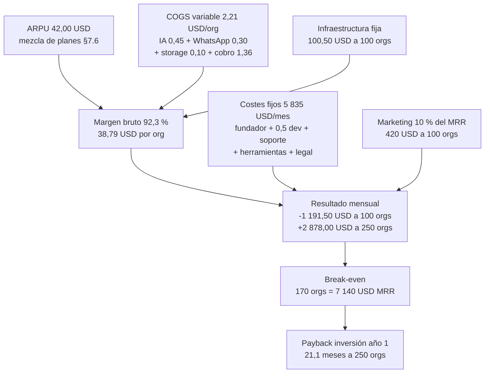
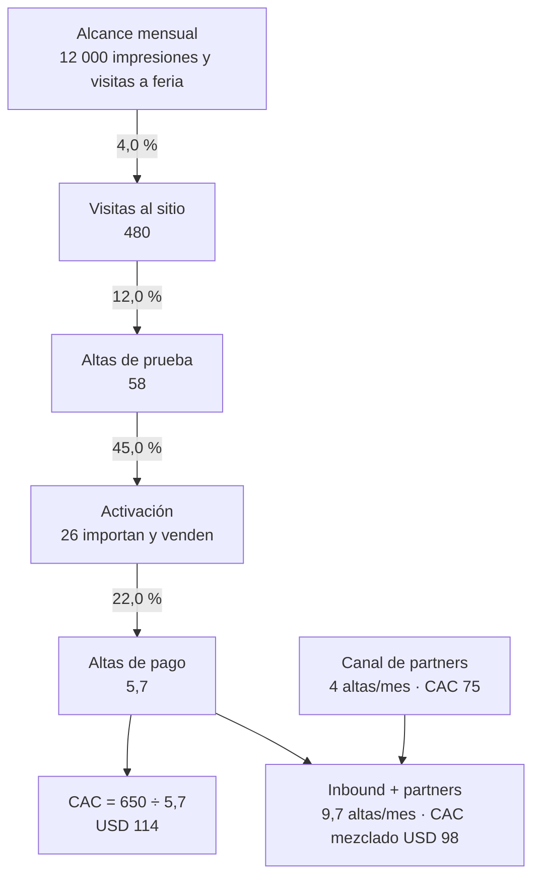

# Costos de implementación y modelo de precios

> Este documento responde una sola pregunta de negocio: **cuánto cuesta construir VentasCatálogo,
> cuánto cuesta operarlo, cuánto vale y a qué precio se vende masivamente**. No redefine producto
> ni arquitectura: acepta como vinculantes el esfuerzo ya calculado en `docs/02-ANALISIS.md` §10
> (Must 106,5 dp; Should 27,5 dp) y el cronograma de 15 semanas de `docs/01` §2 y §7. Lo que
> aporta es la traducción de días-persona a dinero, de funcionalidad a planes y de supuestos a
> un modelo que se pueda rebatir línea por línea.

## 0. Cómo leer este documento

### 0.1 Convenciones

| Convención | Regla aplicada |
|---|---|
| Divisas | USD como moneda de decisión; CRC a **₡510/USD** (`S-C01`) para la lista de precios. Se declara la divergencia con `docs/02` §0.2 en §2.1 |
| Separadores | Miles con espacio (`USD 47 064,50`, `₡10 950`), decimales con coma. Formato es-CR |
| Redondeo | Los dp se conservan con 2 decimales; los importes se redondean a 2 decimales; las tablas de decisión se presentan redondeadas a USD enteros **y se indica el valor exacto en la fórmula** |
| Periodo | Mensual salvo indicación contraria |
| Marca de confianza | `SUPUESTO S-Cnn` = estimación declarada y con sensibilidad; `[DOC]` = cifra tomada de otro documento del paquete con su sección |
| Alcances | **MVP** = 134 dp (F0–F5 inmediato, ver §3.2); **MVP + 12 meses** = 226 dp; **producto completo** = 525 dp |

### 0.2 Qué se distingue siempre

Cinco conceptos que este documento **no** mezcla, porque mezclarlos es el error más caro en un
plan de negocio de software:

| Concepto | Definición operativa | Dónde está |
|---|---|---|
| **Inversión (CAPEX de construcción)** | Días-persona × tarifa para poner el producto en el mercado. En un equipo propio es valor de oportunidad; en una agencia es factura | §3 |
| **Operación (OPEX)** | Infraestructura, servicios, herramientas, administración y nómina de operación | §4 y §8 |
| **Ingreso (MRR/ARR)** | Orgs de pago × ARPU. Es precio, no coste | §7 y §8 |
| **Margen bruto** | (MRR − COGS variables − infraestructura) ÷ MRR | §6 |
| **Resultado neto** | Margen bruto − costes fijos − marketing | §8 |

> Una advertencia de lectura: **este documento no promete resultados**. Presenta rangos, fórmulas
> y las condiciones bajo las cuales el negocio funciona. El escenario central (ARPU USD 42) es
> una hipótesis de mezcla de planes, no un pronóstico; el escenario conservador (ARPU USD 19,
> `[DOC] docs/02` §9.5 y `S-12`) es el que debe usarse para comprometer gasto.

---

## 1. Resumen ejecutivo

### 1.1 La respuesta en una tabla

| Pregunta | Escenario A<br/>Founder-led | Escenario B<br/>Equipo local CR | Escenario C<br/>Agencia | Base del cálculo |
|---|---|---|---|---|
| **Inversión de implementación del MVP** | **USD 44 183** | **USD 54 124** | **USD 101 621** | 192,10 dp × tarifa [S-C01..S-C11] |
| Inversión de implementación sin contingencia | USD 38 420,00 | USD 47 064,50 | USD 88 366,00 | 192,10 dp × 200 / 245 / 460 |
| **Inversión del año 1 (CAPEX + OPEX + marketing)** | **USD 50 857** | **USD 60 798** | **USD 108 295** | §5.1 |
| Necesidad de caja del año 1 (rampa de 6 orgs netas/mes) | ≈ USD 50 300 | USD 87 526 | — | §5.2 |
| **Precio de entrada** | USD 19/mes | USD 19/mes | USD 19/mes | ₡10 950 con IVA 13 % |
| **Plan principal recomendado** | **USD 39/mes** | USD 39/mes | USD 39/mes | ₡22 476 con IVA 13 % |
| Plan multi-catálogo | USD 79/mes | USD 79/mes | USD 79/mes | ₡45 528 con IVA 13 % |
| Plan agencia | USD 199/mes + USD 29/subcuenta | ídem | ídem | ₡114 684 con IVA 13 % |
| Enterprise | desde USD 399/mes | ídem | ídem | ₡229 944 con IVA 13 % |
| **ARPU de trabajo** | USD 42,00 (mezcla) / USD 19 (conservador) | ídem | ídem | §7.6 |
| **Margen bruto** | 89,4 % a 10 orgs → 93,3 % a 1 000 orgs | ídem | ídem | §6.4 |
| **COGS por organización/mes** | USD 4,46 a 10 orgs → USD 2,83 a 1 000 orgs | ídem | ídem | §6.3 |
| **Break-even operativo** | **≈ 170 orgs** (ARPU 42) · **≈ 123** (ARPU 58) · **≈ 581** (ARPU 19) | ídem | ídem | §8.4 |
| **Payback de la inversión** | 17,7 meses a 250 orgs · 5,7 a 500 orgs · sin payback a 50/100 | 21,1 / 6,9 / sin payback | 37,6 / 12,2 / sin payback | §5.3 |
| **LTV** (churn 3 % / 5 % / 8 %) | USD 1 326 / 796 / 497 | ídem | ídem | §9.3 |
| **CAC** | USD 63 en régimen · USD 98 mezcla año 1 · USD 170–250 el primer trimestre | ídem | ídem | §9.2 |
| **LTV/CAC** | 21,1 / 12,6 / 7,9 con CAC 63 | ídem | ídem | §9.4 |
| **MRR a 100 organizaciones** | **USD 4 200** (ARR USD 50 400) | ídem | ídem | §8.3 |

### 1.2 Las siete cifras que hay que recordar

1. **Construir el MVP cuesta entre USD 38 420 y USD 88 366** según quién lo construya (sin
   contingencia), o **USD 44 183–101 621** con la reserva del 15 % que este documento considera
   obligatoria. El rango no es indecisión: es la diferencia entre valorar el tiempo propio a
   USD 200/dp y comprar el mismo trabajo a una agencia a USD 460/dp.
2. **Cada día-persona de producto cuesta USD 351,23 en el escenario B, no USD 245.** El 43 %
   de sobrecoste son las 58,10 dp de diseño, QA, DevOps, PM y documentación que el análisis de
   producto no incluye en su MoSCoW (`[DOC] docs/02` §10.2–§10.3 solo mide desarrollo).
3. **El marginal por organización es excelente: 89–93 % de margen bruto.** Con ARPU 42 y
   100 orgs, cada organización deja USD 38,79 antes de costes fijos.
4. **El negocio pierde dinero hasta ~170 organizaciones.** Con 100 orgs el resultado mensual es
   −USD 1 191,50; con 170 orgs cruza a +USD 30,80/mes. La inversión no se paga con 50 ni con
   100 clientes.
5. **El precio es la variable que decide la viabilidad, más que el coste.** Con ARPU 19 el
   break-even sube a **581 orgs**, por encima del SAM bajo de `S-03` (400–1 000 organizaciones).
   Con ARPU 42 baja a 170 y con ARPU 58 a 123. **La mezcla de planes no es un detalle comercial:
   es la condición de viabilidad del proyecto.**
6. **La infraestructura es irrelevante en el presupuesto (USD 22,50–332,50/mes) y decisiva en la
   credibilidad del margen.** Para 500 orgs el gasto fijo de infraestructura es USD 332,50: el
   1,6 % del MRR. El coste real del proyecto es el tiempo del equipo.
7. **El MVP no es un negocio: es una opción de compra del derecho a intentarlo.** Coincide con
   `[DOC] docs/02` §1.7, que calcula 142 orgs para sostener un sueldo con ARPU 19; aquí, con
   1,5 personas y marketing, la cifra realista es 170 orgs con ARPU 42. La decisión de seguir
   es G3 (`[DOC] docs/02` §11.3), no el payback.

### 1.3 Qué NO dice este documento

| Límite | Consecuencia práctica |
|---|---|
| No hay investigación primaria de precio ni de tarifas | Todo precio es una hipótesis con su test definido en §7.7; toda tarifa es `SUPUESTO` con banda ±20 % (§2.5) |
| No hay compromiso de disponibilidad ni de SLA | El modelo asume el VPS único de `[DOC] docs/02` §9.1 y el 99,5 % aceptado en `[DOC] docs/02` §7.5 |
| No incluye facturación electrónica de Costa Rica | Es fase 3 (`A-02`); se cotiza como add-on en §7.5 sin construirla |
| No incluye coste de capital ni descuento financiero | El payback es nominal; con descuento al 12 % anual los plazos de §5.3 crecen ~8 % |
| No modela impuestos sobre la renta | El resultado de §8 es antes de impuestos; Costa Rica aplica escala progresiva a la renta de personas jurídicas |

---

## 2. Supuestos macro y de tarifa

### 2.1 Tipo de cambio: divergencia declarada

| Fuente | Valor | Uso |
|---|---|---|
| `[DOC] docs/02` §0.2 y anexo A `S-01` | ₡535/USD | Todos los cálculos de coste del análisis |
| `[DOC] docs/05` §1.4 `S-01` | ₡515/USD | Supuestos económicos de la cartera de ideas |
| `[DOC] docs/01` §2 | No fija TC | Solo menciona CRC y USD |
| **Este documento** `S-C01` | **₡510/USD** | Lista de precios en CRC y conversión de nómina |

La divergencia es deliberada y se declara: el encargo de esta tarea fija ₡510/USD y este
documento lo respeta para que sus precios en colones sean reproducibles. **No se corrige
`docs/02`**: se registra la diferencia en el reporte final. Consecuencias numéricas:

| Efecto | A ₡510 (este documento) | A ₡535 (`docs/02`) | A ₡515 (`docs/05`) |
|---|---|---|---|
| Coste empresa del dev senior | USD 3 950,00/mes | USD 3 765,42/mes | USD 3 911,65/mes |
| Tarifa E-B derivada | USD 244,52/dp | USD 233,08/dp | USD 242,14/dp |
| Precio Principal en CRC (con IVA) | ₡22 476 | ₡23 578 | ₡22 700 |

Un TC más alto abarata el coste en USD del equipo local (que se paga en colones) y encarece el
precio en colones de un precio anclado en USD. Es la única variable que mueve **ambos lados** del
modelo a la vez; por eso la sensibilidad de §2.5 la trata primero.

### 2.2 Unidades de esfuerzo y de tiempo

| Concepto | Valor | Fuente / cálculo |
|---|---|---|
| 1 dp (día-persona) | 6 horas productivas, incluye pruebas y revisión | `[DOC] docs/05` §1.5 |
| Días hábiles por mes | 21 | Calendario CR, sin feriados descontados (conservador) |
| dp por dev y mes | **21 dp** | 21 días × 1 dp/día |
| Capacidad de un dev en 15 semanas | 75 dp | 15 × 5 × 1,0 |
| Capacidad de 1,5 dev en 15 semanas | 112,5 dp | 15 × 5 × 1,5 (`[DOC] docs/02` §10.6) |
| Coste empresa mensual del senior | ₡2 014 500 | ₡1 500 000 × (1 + 26,3 % + 8 %) `S-C03` |
| Horas facturables de un dp en agencia | 8 h (día-persona completo) | La agencia factura el día, no las 6 h productivas |

> **Nota de coherencia**: `[DOC] docs/05` §1.4 `S-15` usa **20 dp/dev/mes** (2 devs ≈ 40 dp/mes).
> Aquí se usa **21** porque la tarifa se deriva de un mes de 21 días hábiles. La diferencia es del
> 5 % y queda dentro de la banda de sensibilidad de §2.5; no cambia ninguna conclusión. Se
> registra para que el lector que compare ambos documentos no crea que hay un error.

### 2.3 Tarifas: derivación de los tres escenarios

**Escenario A — Founder-led / equipo propio (`S-C05`).** Tarifa = **USD 200/dp** = valor de
oportunidad del fundador. Derivación: un fundador que podría cobrar USD 3 950/mes en el mercado y
produce 21 dp/mes tiene un coste de oportunidad de USD 188,10/dp; se redondea a 200 por el
sobrecoste de contexto (decisiones de negocio, ventas, soporte) que no produce dp visibles.

**Escenario B — Equipo local Costa Rica (`S-C03`, `S-C04`, `S-C06`).** Derivación completa:

```
Salario bruto senior                     ₡1 500 000,00 /mes
+ Cargas sociales (26,3 %)                 ₡  394 500,00      (CCSS, INS, aguinaldo, cesantía)
+ Provisiones (8 %)                        ₡  120 000,00      (vacaciones, liquidación, formación)
= Coste empresa                            ₡2 014 500,00
÷ TC 510                                   USD 3 950,00 /mes
÷ 21 dp/mes                                USD   188,10 /dp
× overhead 1,30                            USD   244,52 /dp   → redondeado a USD 245,00
```

El **overhead ×1,3** cubre lo que no es salario del dev pero se consume para que produzca: equipo
y licencias (USD 25/mes), gestión y coordinación no facturable, oficina o coworking, formación y
el tiempo de entrevistas. Referencia de control: un mid-level cargado queda en **USD 170/dp**
(`S-C06`) y un equipo mixto 60 % senior / 40 % mid-level en **USD 215/dp**; el escenario B usa la
tarifa senior como caso conservador de coste.

**Escenario C — Agencia o consultora (`S-C07`).** **USD 360–560/dp**, central **USD 460/dp**.
Derivación: USD 45–70/h × 8 h de día-persona facturado. Nótese que la agencia factura 8 h para
producir 6 h productivas: el dp equivalente cuesta entre 270 y 420 USD de trabajo efectivo, pero
se paga como día completo. El central 460 es el punto medio de la banda declarada.

| Escenario | Tarifa USD/dp | Banda −20 % | Banda +20 % | Qué incluye | Cuándo aplica |
|---|---|---|---|---|---|
| A · Founder-led | 200,00 | 160,00 | 240,00 | Tiempo del socio, sin factura | El caso base de un proyecto bootstrapped |
| B · Equipo local | **245,00** | 196,00 | 294,00 | Salario cargado + overhead | El caso de contratar en Costa Rica |
| C · Agencia | 460,00 | 368,00 | 552,00 | Factura con margen y garantía | Comparación «comprar en vez de construir» |

### 2.4 Tabla consolidada de supuestos

| ID | Supuesto | Valor usado | Fórmula o fuente | Sensibilidad |
|---|---|---|---|---|
| `S-C01` | Tipo de cambio CRC/USD | ₡510 | Encargo de la tarea; medición BCCR mensual | ±20 % (§2.5) |
| `S-C02` | 1 dp = 6 h productivas; 21 dp/dev/mes | 21 | `[DOC] docs/05` §1.5 | ±10 % en plazo |
| `S-C03` | Salario senior bruto + cargas 26,3 % + provisiones 8 % | ₡2 014 500/mes | Cálculo en §2.3 | ±10 % |
| `S-C04` | Overhead de equipo sobre el coste empresa | ×1,30 | Equipo, licencias, gestión, oficina | ±10 % |
| `S-C05` | Tarifa founder-led | USD 200/dp | Valor de oportunidad | ±20 % |
| `S-C06` | Tarifa equipo local (senior cargado) | USD 245/dp | §2.3 | ±20 % |
| `S-C07` | Tarifa agencia | USD 460/dp | Banda 360–560 declarada | ±20 % |
| `S-C08` | Esfuerzo no-dev fijo del MVP | 38 dp | 15 diseño + 12 QA + 6 DevOps + 5 documentación | ±20 % |
| `S-C09` | PM y coordinación | 15 % del dev | Encargo; práctica de proyectos de 1–2 devs | ±5 pp |
| `S-C10` | Escala del no-dev en alcances mayores | pro-rata `38 × dev/134` | §3.3 | ±20 % |
| `S-C11` | Contingencia de estimación | 15 % | Cubre los 13 dp de imprevistos de §3.6 (6,8 %) | 10–25 % |
| `S-C12` | Imprevistos típicos identificados | 13 dp | Importación sucia 6 + pasarela 4 + WhatsApp 3 | Se materializan o no |
| `S-C13` | Coste de IA por millón de tokens | USD 0,3804/M | 0,000 951 USD/gen ÷ 2 500 tokens/gen (`[DOC] docs/02` §9.2) | ±30 % (`S-27`) |
| `S-C14` | Utilización media de la cuota de IA | 50 % | Ninguna org agota cuota todos los meses | 35–70 % |
| `S-C15` | WhatsApp utility | USD 0,015/mensaje | `[DOC] docs/02` `S-15` | ±50 % (`QA-11`) |
| `S-C16` | Mezcla de cobro de la suscripción | 70 % pasarela / 30 % SINPE | `[DOC] docs/02` §9.4 trasladado a nuestro cobro | ±20 pp |
| `S-C17` | Comisión de pasarela sobre la suscripción | 3,9 % + USD 0,30 | Stripe `[DOC] docs/02` §9.4 | 3,5–4,5 % |
| `S-C18` | Mezcla de planes y ARPU | USD 42,00 | §7.6 | 19 / 42 / 58 |
| `S-C19` | Churn de logos mensual | 5 % | `[DOC] docs/02` KPI-B02 | 3 / 5 / 8 % |
| `S-C20` | CAC objetivo en régimen | USD 63 | §9.2 | 60–200 |
| `S-C21` | Marketing sobre MRR | 10 % | Política de gasto de §8.1 | 5–15 % |
| `S-C22` | Estructura de costes fijos | ver §8.2 | Fundador 2 500 + 0,5 dev 1 975 + soporte + herramientas + legal | ±15 % |
| `S-C23` | Rampa de adopción | 6 orgs netas/mes (base) · 12 (con canal) | §8.5 | 6 / 12 / 20 |
| `S-C24` | Conversión prueba → pago | 22 % | §10.4 | 12–30 % |
| `S-C25` | Comisión de canal de agencias | 25 % recurrente | §10.3 | 20–30 % |
| `S-C26` | Inflación anual de tarifas | 6 % | Mercado laboral TI en CR | 4–8 % |
| `S-C27` | Almacenamiento incremental por org | USD 0,10/mes | `[DOC] docs/02` §9.5 | ±50 % |
| `S-C28` | Conversión de plan gratis a pago | 10 % | §7.4 | 5–15 % |
| `S-C29` | NRR (expansión neta) | 100 % | +8 % upgrade −3 % downgrade −5 % churn | 95–110 % |
| `S-C30` | Recaudación: 20 % de las orgs pagan anual | 20 % | §7.5 | 10–35 % |

### 2.5 Sensibilidad ±20 % de las tres variables críticas

Base: inversión MVP escenario B = **USD 54 124** (47 064,50 + 15 %).

| Variable | −20 % | Base | +20 % | Fórmula | Lectura |
|---|---|---|---|---|---|
| **Tipo de cambio** | ₡408 → **USD 67 655** | ₡510 → **USD 54 124** | ₡612 → **USD 45 103** | MVP × (510 / TC) | Un colón débil encarece el MVP hasta un 25 % porque el equipo se paga en colones |
| **Tarifa** | USD 196 → **USD 43 299** | USD 245 → **USD 54 124** | USD 294 → **USD 64 949** | MVP × (1 ± 0,20) | Lineal por definición: no hay economías de escala en la tarifa |
| **Churn** | 4 % → LTV **USD 995** | 5 % → LTV **USD 796** | 6 % → LTV **USD 663** | 39,79 ÷ churn | El churn no toca el MVP: toca el LTV y, con él, el LTV/CAC |
| **Utilización de IA** | 35 % → COGS 2,08 | 50 % → COGS 2,21 | 70 % → COGS 2,39 | 1,76 + 0,903 × uso | Mueve el margen bruto 0,7 pp |
| **Conversión prueba→pago** | 12 % → CAC 180 | 22 % → CAC 98 | 30 % → CAC 72 | 98 × (22 % ÷ conversión) | Es el supuesto que más mueve el CAC |

**Conclusión de la sensibilidad**: el modelo es **robusto en coste** (infraestructura y COGS son
inmunes a casi todo) y **frágil en precio, churn y conversión**. Un plan de negocio que se apoye
en «bajamos el precio y vendemos más» está apostando exactamente a la variable que rompe el
modelo (§11.4).

---

## 3. Costo de implementación

### 3.1 Base de esfuerzo: la que ya está calculada

Este documento **no re-deriva** el esfuerzo. Toma la base de `docs/02-ANALISIS.md` y de
`docs/05-IDEAS.md` §4 y solo la convierte a dinero.

| Alcance | Composición | dp dev | Fuente |
|---|---|---|---|
| MVP F0–F4 (Must + Should, sin diferidos) | 98,5 + 27,5 (ver nota) | **126,0** | `[DOC] docs/02` §10.2, §10.3, §10.6 |
| Diferidos a F5 por capacidad | chat 4,0 + XLSX 2,0 + reparación de imágenes 2,0 | **8,0** | `[DOC] docs/02` §10.6 opción 2; `docs/01` §7 |
| **MVP completo (F0–F4 + F5 inmediato)** | 126,0 + 8,0 | **134,0** | Base de coste de este documento |
| Roadmap de 12 meses de ideas | 9 ideas + 6 habilitadores | **92,0** | `[DOC] docs/05` §4.2–§4.5 |
| **MVP + 12 meses** | 134,0 + 92,0 | **226,0** | — |
| Cartera completa de 31 ideas (incluye año 2) | — | **391,0** | `[DOC] docs/05` §2.2 |
| **Producto completo** | 134,0 + 391,0 | **525,0** | — |

**Verificación de coherencia (la cifra que hay que vigilar).** El total de 134 dp es invariante:
suma de Must 106,5 + Should 27,5 = 134,0. Sin embargo, hay una **inconsistencia de descomposición**
entre `[DOC] docs/02` §10.2/§10.3 y §10.6 que conviene registrar sin «corregirla» en silencio:

| Lectura | Must F0–F4 | Should F0–F4 | Diferido a F5 | Total MVP completo |
|---|---|---|---|---|
| Estricta: §10.2 (106,5) + §10.3 (27,5), quitando chat (4,0, Must) y XLSX + imágenes (4,0, Should) | **102,5** | **23,5** | 8,0 | **134,0** |
| La que declara `docs/02` §10.6 («Must 98,5 dp») y la que usa el encargo de esta tarea | **98,5** | **27,5** | 8,0 | **134,0** |

Las dos lecturas dan **el mismo total (134 dp) y el mismo MVP F0–F4 (126 dp)**, de modo que
**ninguna cifra de coste de este documento cambia**. La diferencia es solo de etiqueta: §10.6
resta los 8 dp diferidos de la columna Must, pero 4 de esos dp (XLSX de M4 y reparación de
imágenes de M1) viven en §10.3 (Should), no en §10.2. Se señala en el reporte final y **se
mantiene la cifra adoptada por el Lead** (`docs/01` §2: 15 semanas, Must 98,5 dp) porque el
total que manda para coste y cronograma es el mismo.

### 3.2 Esfuerzo por fase

| Fase | Semanas | Dev dp (Must + Should) | De los cuales diferido a F5 | Dev dp ejecutado en F0–F4 | Foco |
|---|---|---|---|---|---|
| F0 — Fundaciones | 1–2 | 21,0 | 0,0 | 21,0 | Monorepo, auth, orgs, RBAC, auditoría, identidad única, dos shells |
| F1 — Catálogo y ventas | 3–6 | 34,0 | 0,0 | 34,0 | M1 importación, M2 ventas, PDF, catálogo público |
| F2 — Dinero | 7–9 | 25,5 | 2,0 (XLSX) | 23,5 | M3 cobros, M4 finanzas, portal `/mi-cuenta` |
| F3 — IA y canales | 10–12 | 25,0 | 4,0 (chat) | 21,0 | M7 IA, M5 WhatsApp |
| F4 — Endurecimiento | 13–15 | 28,5 | 2,0 (imágenes) | 26,5 | RBAC completo, cuotas, observabilidad, E2E |
| **Subtotal F0–F4** | **1–15** | **134,0** | **8,0** | **126,0** | — |
| F5 — Diferenciación | 16+ | (8,0) | — | 8,0 | Chat, XLSX, reparación de imágenes |
| **Total MVP completo** | — | **134,0** | **8,0** | **134,0** | — |

**Coste por fase en el escenario B (USD 245/dp), solo desarrollo:**

| Fase | dp | USD | % del total |
|---|---|---|---|
| F0 | 21,0 | 5 145,00 | 15,7 % |
| F1 | 34,0 | 8 330,00 | 25,4 % |
| F2 | 23,5 | 5 757,50 | 17,5 % |
| F3 | 21,0 | 5 145,00 | 15,7 % |
| F4 | 26,5 | 6 492,50 | 19,8 % |
| F5 | 8,0 | 1 960,00 | 6,0 % |
| **Total** | **134,0** | **32 830,00** | **100 %** |

Lectura: **F1 (importación + ventas) es el 25,4 % del desarrollo** y coincide con lo que
`[DOC] docs/02` §1.5 llama «el producto en sí». Si el presupuesto se recorta, recortar F1 es la
peor decisión posible: es la fase que decide si el resto sirve.

#### 3.2.1 Esfuerzo por módulo (M0–M8)

Reparto de los mismos 134 dp según los módulos de `[DOC] docs/02` §3.1. La columna «Transversal»
recoge las épicas que no pertenecen a un módulo de negocio: fundaciones del monorepo (3,0), auth
(5,0), organizaciones (2,0) y calidad/E2E (2,0).

| Módulo | Alcance | Must §10.2 | Should §10.3 | **Total dp** | USD en escenario B | % del total |
|---|---|---|---|---|---|---|
| **M0 Usuarios y dos caras** | Identidad única, roles por permiso, shell de dos caras, portal, MFA | 14,5 | 5,5 | **20,0** | 4 900,00 | 14,9 % |
| **M1 Importación Drive** | OAuth, parsers, mapeo, normalización, cuarentena, versiones | 17,0 | 2,0 | **19,0** | 4 655,00 | 14,2 % |
| **M2 Ventas** | Catálogo activo, carrito, cotización, pedido, PDF | 14,0 | 2,0 | **16,0** | 3 920,00 | 11,9 % |
| **M3 Cobros** | Pasarelas, webhooks, SINPE con comprobante, recibos | 10,0 | 4,0 | **14,0** | 3 430,00 | 10,4 % |
| **M4 Finanzas** | Ingresos, egresos, margen, cartera, reportes, exportación | 8,0 | 2,0 | **10,0** | 2 450,00 | 7,5 % |
| **M5 WhatsApp** | WABA, plantillas, opt-in, bandeja de agente | 7,0 | 3,0 | **10,0** | 2 450,00 | 7,5 % |
| **M6 Chat en vivo** | Socket.IO, historial, widget con identificación | 4,0 | 3,0 | **7,0** | 1 715,00 | 5,2 % |
| **M7 Generador IA** | Adaptador, plantillas, streaming, cuotas, historial | 12,0 | 4,0 | **16,0** | 3 920,00 | 11,9 % |
| **M8 Admin y seguridad** | RBAC, auditoría, cuotas, observabilidad, superadmin | 8,0 | 2,0 | **10,0** | 2 450,00 | 7,5 % |
| **Transversal** | Monorepo, auth, organizaciones, calidad/E2E | 12,0 | 0,0 | **12,0** | 2 940,00 | 9,0 % |
| **Total** | — | **106,5** | **27,5** | **134,0** | **32 830,00** | **100 %** |

Verificación: `14,5 + 17 + 14 + 10 + 8 + 7 + 4 + 12 + 8 + 12 = 106,5` (Must);
`5,5 + 2 + 2 + 4 + 2 + 3 + 3 + 4 + 2 + 0 = 27,5` (Should); `106,5 + 27,5 = 134,0`.

**Dónde está de verdad el dinero**: M0 + M1 concentran el **29,1 %** del desarrollo (39,0 dp) y son
las dos únicas piezas que, si fallan, invalidan el producto completo — la identidad porque sin ella
no hay dos caras (`[DOC] docs/01` ADR-17/18) y la importación porque es la puerta de entrada del
catálogo (`[DOC] docs/02` §1.4). M6 chat, el módulo más visible en una demo, es solo el 5,2 %.

### 3.3 Esfuerzo no-dev: lo que el MoSCoW no cuenta

`docs/02` §10.2–§10.3 mide **desarrollo**. Un MVP no se entrega solo con desarrollo:

| Partida no-dev | dp | Qué incluye | Cuándo se consume |
|---|---|---|---|
| Diseño de producto y UX | 15,0 | Flujos de importación, shell de dos caras, checkout móvil, sistema de componentes, estados vacíos y de error | F0–F3, continuo |
| QA manual + automatización | 12,0 | Matriz de pruebas de importación con archivos reales, pruebas de aislamiento, E2E Playwright, regresión | F1–F4 |
| DevOps e infraestructura inicial | 6,0 | Docker Compose de producción, CI/CD, backups probados, TLS, observabilidad, runbook | F0 y F4 |
| Documentación y formación | 5,0 | Manual de usuario, FAQ, videos de onboarding, guion de demo, documentación de soporte | F3–F5 |
| **Subtotal fijo** | **38,0** | | |
| PM y coordinación | 15 % del dev | Planificación, revisión de alcance, gestión de terceros (Meta, Google, pasarelas), comunicación con pilotos | Todo el proyecto |

**Escala para alcances mayores (`S-C10`).** Las 38 dp fijas corresponden al MVP. Para alcances
mayores se escalan pro-rata con el desarrollo, porque un producto de 525 dp no se diseña,
prueba y documenta con el mismo esfuerzo que uno de 134:

```
no-dev(alcance) = 38,0 × (dev dp ÷ 134,0)
pm(alcance)     = 0,15 × dev dp
dp totales      = dev dp + no-dev + pm
```

| Alcance | Dev dp | No-dev dp | PM dp | **dp totales** | Factor sobre el dev |
|---|---|---|---|---|---|
| MVP completo | 134,00 | 38,00 | 20,10 | **192,10** | ×1,4336 |
| MVP + 12 meses | 226,00 | 64,09 | 33,90 | **323,99** | ×1,4336 |
| Producto completo | 525,00 | 148,88 | 78,75 | **752,63** | ×1,4336 |

**La cifra incómoda**: el factor ×1,4336 significa que **cada dp de desarrollo cuesta 1,43 dp
reales de presupuesto**. En el escenario B eso es **USD 351,23 por dp de producto** frente a los
USD 245 de tarifa. Cualquier plan que presupueste solo el desarrollo se queda corto en un 43 %.

### 3.4 Matriz de inversión: 3 escenarios × 3 alcances

Fórmula de cada celda: `inversión = dp totales × tarifa`. Sin contingencia:

| Alcance | dp totales | A · USD 200/dp | B · USD 245/dp | C · USD 460/dp |
|---|---|---|---|---|
| MVP completo (134 dp) | 192,10 | **USD 38 420,00** | **USD 47 064,50** | **USD 88 366,00** |
| MVP + 12 meses (226 dp) | 323,99 | **USD 64 798,00** | **USD 79 377,55** | **USD 149 035,40** |
| Producto completo (525 dp) | 752,63 | **USD 150 526,00** | **USD 184 394,35** | **USD 346 209,80** |

Con contingencia del 15 % (`S-C11`), que es la cifra que debe presupuestarse:

| Alcance | A · Founder-led | B · Equipo local | C · Agencia |
|---|---|---|---|
| **MVP completo** | **USD 44 183** | **USD 54 124** | **USD 101 621** |
| **MVP + 12 meses** | **USD 74 518** | **USD 91 284** | **USD 171 391** |
| **Producto completo** | **USD 173 105** | **USD 212 054** | **USD 398 141** |

Verificación de dos celdas: `192,10 × 245 = 47 064,50`; `47 064,50 × 1,15 = 54 124,18 → USD 54 124`.
`323,99 × 460 = 149 035,40`; `× 1,15 = 171 390,71 → USD 171 391`.

**Tres lecturas que cambian decisiones:**

1. **El MVP+12 meses cuesta ≈1,7× el MVP, no 3×.** La segunda tanda de esfuerzo (92 dp de ideas)
   es más barata por dp que la primera porque reutiliza toda la base. El coste del año 2 está
   dominado por la operación, no por el desarrollo.
2. **El producto completo cuesta ≈3,9× el MVP** (525 vs 134 dp de desarrollo; 752,63 vs 192,10 dp
   totales). Es la cifra que hay que tener en la cabeza cuando alguien propone «hacerlo todo»: no
   es un sprint más, es el proyecto entero casi cuatro veces.
3. **La elección de escenario mueve el MVP entre USD 44 183 y USD 101 621: un factor de 2,3.**
   El escenario no es un detalle de presentación; es la decisión de financiación principal.

### 3.5 Sensibilidad de la inversión del MVP

| Variación | A · Founder-led | B · Equipo local | C · Agencia |
|---|---|---|---|
| −20 % en tarifa | USD 35 346 | USD 43 299 | USD 81 297 |
| **Base (contingencia 15 %)** | **USD 44 183** | **USD 54 124** | **USD 101 621** |
| +20 % en tarifa | USD 53 020 | USD 64 949 | USD 121 945 |
| PM al 22 % del dev en vez de 15 % (+7 pp) | USD 46 340 | USD 56 767 | USD 106 583 |
| Inflación de 6 % anual durante 2,5 años (`S-C26`) | — | USD 243 862 para el producto completo | — |

### 3.6 Imprevistos típicos: por qué el 15 % no es un colchón decorativo

La contingencia del 15 % cubre el error de estimación, y este es el contenido concreto que
justifica su tamaño (`S-C12`):

| Imprevisto | dp | USD en escenario B | Por qué es previsible | Fase |
|---|---|---|---|---|
| **Importación sucia**: los archivos reales exigen 2–3 iteraciones del normalizador | 6,0 | 1 470,00 | `[DOC] docs/02` §3.2: «el 70–80 % del esfuerzo está en datos sucios»; RG-03 | F1 |
| **Cambio o adelanto de pasarela** (segunda pasarela antes de lo previsto, cambio de firma de webhook) | 4,0 | 980,00 | `E-M3-04` está en Should por 4 dp exactos | F2 |
| **Revisión y rechazo de plantillas de WhatsApp** más re-verificación de la WABA | 3,0 | 735,00 | `QA-04` y RG-22: la categoría `utility` no está garantizada | F3 |
| **Total identificado** | **13,0** | **3 185,00** | = 6,8 % de la base del MVP | — |

La contingencia del 15 % equivale a **USD 7 060** en el escenario B: cubre los USD 3 185
identificados y deja **USD 3 875** para lo que no se puede enumerar (una semana de enfermedad, un
proveedor que cambia de precio, una migración de base de datos que se atasca). Bajarla de 10 % es
una decisión consciente de asumir riesgo de alcance; subirla de 25 % encarece el MVP sin cambiar
la probabilidad de éxito.

---

## 4. Costo de infraestructura y servicios

### 4.1 Principio: la infraestructura escala por escalones, no por cliente

El error de presupuestación más común en un SaaS de este tamaño es linealizar la infraestructura
(`coste por org × orgs`). La realidad de `[DOC] docs/02` §9.1 es otra: hay un **coste fijo** que
salta por escalones y un **coste variable** pequeño por organización. Se modelan por separado.

```
coste_infra(orgs)    = A(escalón) + 0,85 × orgs
A(escalón)           = suma de las partidas fijas de la tabla 4.2
0,85 USD/org         = IA 0,45 + WhatsApp 0,30 + almacenamiento 0,10   (§3.6 y §6.2)
```

### 4.2 Coste mensual por componente

| Componente | 10 orgs | 50 orgs | 100 orgs | 250 orgs | 500 orgs | Nota |
|---|---|---|---|---|---|---|
| VPS de aplicación (Caddy, API, web, workers) | 14,00 | 14,00 | 28,00 | 56,00 | 56,00 | `S-14`: 4 vCPU/8 GB → 8/16 → 2 nodos |
| PostgreSQL gestionado | — | 25,00 | 50,00 | 100,00 | 100,00 | Se contrata al superar 30 orgs (§4.3) |
| Redis gestionado | — | — | 10,00 | 20,00 | 20,00 | Se contrata al superar 60 orgs |
| Almacenamiento de objetos (imágenes, PDFs, comprobantes) | 4,00 | 8,00 | 12,00 | 25,00 | 25,00 | Backups externos incluidos |
| Snapshot del VPS | 3,00 | 6,00 | 12,00 | 24,00 | 24,00 | ≈20 % del VPS |
| CDN | — | — | 10,00 | 20,00 | 20,00 | Al servir catálogos públicos con imágenes |
| Dominio y DNS | 1,50 | 1,50 | 1,50 | 1,50 | 1,50 | USD 18/año |
| Email transaccional | — | 20,00 | 35,00 | 60,00 | 60,00 | Free tier hasta 3 000 correos/mes |
| Sentry (errores) | — | 26,00 | 26,00 | 26,00 | 26,00 | Free tier hasta 5 000 eventos/mes |
| **Subtotal fijo A** | **22,50** | **100,50** | **184,50** | **332,50** | **332,50** | |
| Coste variable (IA + WhatsApp + storage) | 8,50 | 42,50 | 85,00 | 212,50 | 425,00 | 0,85 × orgs |
| **Total infraestructura** | **31,00** | **143,00** | **269,50** | **545,00** | **757,50** | |
| Infraestructura por organización | 3,10 | 2,86 | 2,70 | 2,18 | 1,52 | Total ÷ orgs |

Verificación de una columna: 100 orgs → 28 + 50 + 10 + 12 + 12 + 10 + 1,50 + 35 + 26 = **184,50**;
más 0,85 × 100 = 85,00 → **269,50**.

### 4.3 Escalones y disparadores de migración

| Escalón | Rango de orgs | Configuración | A (USD/mes) | Disparador que obliga a subir |
|---|---|---|---|---|
| **E0** | 1–30 | 1 VPS con Postgres, Redis y MinIO en el mismo host | 22,50 | Uso de CPU >70 % sostenido, disco >80 %, o el primer cliente con expectativa de disponibilidad |
| **E1** | 31–100 | VPS de app + Postgres gestionado + backup externo + email y Sentry de pago | 100,50 | Restore que tarda más de 4 h (RTO de `[DOC] docs/02` KPI-T08) o acercarse a las 100 orgs |
| **E2** | 101–250 | VPS 8/16, Redis gestionado, CDN | 184,50 | p95 de listado >400 ms (`[DOC] docs/02` KPI-T01) o saturación de la cola de IA |
| **E3** | 251–500 | 2 nodos de aplicación + balanceador + Postgres 4–8 GB | 332,50 | Necesidad de despliegue sin corte o de aislamiento de workers |
| **E4** | 501–1 000 | Clúster de aplicación, Postgres 8–16 GB, almacenamiento dedicado | 619,50 | Contratos con SLA o clientes que exigen residencia de datos |

El salto de E0 a E1 **multiplica el coste fijo por 4,5** (22,50 → 100,50) y se paga con **2
organizaciones adicionales** (78 ÷ 39,79 = 1,96). Es el escalón más caro en términos relativos y
el único que **no** conviene retrasar: llegar a 100 orgs con la base de datos en el mismo VPS es
el riesgo RG-20 de `docs/02` §7.2.

### 4.4 Reconciliación con `docs/02` §9.1

| Concepto | `[DOC] docs/02` §9.1 (10 orgs) | Este documento (§4.2, 10 orgs) | Diferencia | Explicación |
|---|---|---|---|---|
| Fijo de infraestructura | 22,50 | 22,50 | 0,00 | Idéntico: VPS 14 + snapshot 3 + backup 4 + dominio 1,50 |
| IA | 1,00 (techo de 100 generaciones) | 4,50 (0,45 × 10) | +3,50 | Aquí se usa consumo medio por org con cuota de plan, no el arranque con 100 generaciones totales |
| WhatsApp | 3,00 | 3,00 | 0,00 | 20 plantillas × USD 0,015 × 10 orgs |
| Almacenamiento incremental | — | 1,00 | +1,00 | `[DOC] docs/02` §9.5 lo imputa por org; §9.1 no lo desglosa |
| **Total** | **26,50** | **31,00** | **+4,50** | Ninguna partida de precio cambia: cambia el supuesto de consumo de IA |

### 4.5 Herramientas de equipo: coste del negocio, no del producto

| Partida | USD/mes | Imputable a COGS |
|---|---|---|
| GitHub Team, Figma, gestor de contraseñas, monitoreo de uptime | 25,00 | No (gasto de estructura) |
| Legal, contable y fiscal prorrateado | 150,00 | No (gasto de estructura) |
| Consulta legal de Ley 8968 (`[DOC] docs/02` `S-20`) | 200–400 una vez | No (puesta en marcha) |
| Verificación OAuth de Google con scope restringido (`[DOC] docs/02` `S-16`) | 0 → se evita con `drive.file` + Picker | No |
| Verificación de Meta Business y WABA | 0,00 (trámite de 1–3 semanas) | No |

Estas partidas **no entran en el COGS** y por eso no aparecen en el margen bruto de §6: se
imputan a los costes fijos de §8.2. Es la distinción que evita el error de creer que el margen
bruto del 93 % es el margen del negocio: **el margen del negocio es el resultado neto de §8.3.**

---

## 5. Costo total del año 1 y punto de equilibrio de la inversión

### 5.1 Inversión del año 1: CAPEX + OPEX + marketing

| Partida | A · Founder-led | B · Equipo local | C · Agencia | Fórmula / nota |
|---|---|---|---|---|
| CAPEX de construcción del MVP | 44 183 | 54 124 | 101 621 | §3.4 con contingencia 15 % |
| Infraestructura de 12 meses | 894 | 894 | 894 | 22,50 × 4 (meses 1–4) + 100,50 × 8 (meses 5–12) |
| Herramientas de equipo (12 meses) | 300 | 300 | 300 | 25 × 12 |
| Legal, contable y fiscal (12 meses) | 1 800 | 1 800 | 1 800 | 150 × 12 |
| Dominio y verificaciones únicos | 30 | 30 | 30 | `[DOC] docs/02` §9.6 |
| **Subtotal OPEX año 1** | **3 024** | **3 024** | **3 024** | |
| Marketing de lanzamiento y canal | 3 650 | 3 650 | 3 650 | 2 400 (90 días) + 250 × 5 (§10.5) |
| **Inversión total año 1** | **50 857** | **60 798** | **108 295** | CAPEX + OPEX + marketing |

Verificación: `44 183 + 3 024 + 3 650 = 50 857`; `54 124,18 + 3 024 + 3 650 = 60 798,18`;
`101 620,90 + 3 024 + 3 650 = 108 294,90`.

> **Qué no incluye esta tabla y por qué.** No incluye la nómina del equipo durante la operación
> (meses 5–12): en el escenario B la construcción ya está pagada dentro del CAPEX, y a partir del
> mes 5 el equipo pasa a ser coste fijo operativo de §8.2. La tabla 5.2 sí la incluye, porque mide
> **desembolso de caja**, no inversión contable. Confundir ambas cosas produce dos errores
> simétricos: creer que el proyecto necesita USD 60 798 (subestima, porque falta la nómina de
> operación) o sumar 5.1 y 5.2 y creer que necesita USD 148 324 (duplica el CAPEX, que ya está
> contado dentro de la necesidad de caja).

### 5.2 Necesidad de caja del año 1

Escenario B (equipo local, rampa de 6 orgs netas/mes desde el mes 5):

| Partida | USD | Cálculo |
|---|---|---|
| CAPEX de construcción (meses 1–4) | 54 124 | §3.4 |
| Infraestructura meses 1–4 | 90 | 22,50 × 4 |
| Herramientas y administración meses 1–4 | 700 | (25 + 150) × 4 |
| Nómina de operación meses 5–12 | 37 200 | 4 650 × 8 (§8.2) |
| Infraestructura meses 5–12 | 804 | 100,50 × 8 |
| Marketing de lanzamiento | 3 650 | 2 400 + 250 × 5 |
| Dominio y verificaciones | 30 | — |
| − Ingresos de los meses 5–12 | −9 072 | ARPU 42 × 6 orgs × 36 (suma 1..8) |
| **Necesidad de caja del año 1** | **87 526** | |

Con rampa de 12 orgs/mes el desembolso baja a **USD 78 454** porque los ingresos del año 1 suben
a USD 18 144. En el escenario A el desembolso cae a **≈ USD 50 300**: el fundador no se paga un
salario de mercado y su tiempo ya está valorado dentro del CAPEX como coste de oportunidad.

**Lectura de caja**: el proyecto necesita **entre USD 50 000 y USD 88 000 de caja disponible**
para llegar al mes 12 sin quedarse sin operación. Ese es el número que se negocia con un socio o
con un fondo, no el CAPEX de la tabla 5.1.

### 5.3 Punto de equilibrio de la inversión (payback)

Definición: meses de resultado neto mensual (tabla §8.3) necesarios para recuperar la inversión
del año 1. `payback = inversión año 1 ÷ resultado mensual neto`.

| Nivel de adopción | MRR | Resultado mensual neto | A · Founder-led | B · Equipo local | C · Agencia |
|---|---|---|---|---|---|
| 50 orgs | 2 100 | −2 971,00 | No recupera | No recupera | No recupera |
| 100 orgs | 4 200 | −1 191,50 | No recupera | No recupera | No recupera |
| 250 orgs | 10 500 | +2 878,00 | **17,7 meses** | **21,1 meses** | **37,6 meses** |
| 500 orgs | 21 000 | +8 862,50 | **5,7 meses** | **6,9 meses** | **12,2 meses** |
| 1 000 orgs | 42 000 | +26 370,50 | **1,9 meses** | **2,3 meses** | **4,1 meses** |

Verificación: `50 857 ÷ 2 878 = 17,67`; `60 798,18 ÷ 2 878 = 21,13`; `108 294,90 ÷ 8 862,50 = 12,22`.

**¿Qué nivel de adopción hace falta para un payback razonable?**

| Payback objetivo | Organizaciones necesarias | MRR necesario | Comentario |
|---|---|---|---|
| 36 meses | ≈ 217 | ≈ USD 9 114 | Dentro del SAM bajo de `S-03` (400–1 000) pero por encima del objetivo de `S-04` (40–60 a 12 meses) |
| 24 meses | ≈ 240 | ≈ USD 10 080 | — |
| 18 meses | ≈ 264 | ≈ USD 11 088 | — |
| 12 meses | ≈ 393 | ≈ USD 16 506 | Al límite del SAM bajo completo |

Fórmula usada: `N = (inversión ÷ meses + costes fijos + A(N)) ÷ 35,59`, donde 35,59 =
ARPU 42 − COGS 2,21 − marketing 10 %.

### 5.4 La conclusión incómoda de la sección 5

**La inversión no se recupera con clientes pequeños ni en el horizonte de 12 meses.** A 50 y a
100 organizaciones el resultado mensual es negativo (−USD 2 971 y −USD 1 191,50): el payback no
existe porque no hay resultado que descontar. Se recupera a partir de ~250 organizaciones, un
nivel que el propio análisis considera fuera del objetivo de 12 meses (`S-04`: 40–60 orgs).

Esto no invalida el proyecto: lo **redefine**. Coincide exactamente con
`[DOC] docs/02` §1.7 y §9.5, que calculan 142 orgs para sostener un sueldo con ARPU 19. La
diferencia es que aquí se paga además 0,5 dev de mantenimiento, soporte y marketing, por lo que la
cifra sube a 170 con ARPU 42 y a 581 con ARPU 19. La consecuencia estratégica es una:

> **El MVP no se justifica por su retorno financiero. Se justifica por ser la opción más barata
> de comprar información sobre si existe un negocio.** El coste de la información es
> USD 44 183–101 621 de inversión y USD 50 300–87 526 de caja; el retorno de esa información se
> materializa en la puerta G3 (`[DOC] docs/02` §11.3), no en el payback.

---

## 6. Coste unitario por organización y margen bruto por plan

### 6.1 Definiciones que se usan en toda la sección

| Término | Fórmula | Por qué importa |
|---|---|---|
| **COGS variable** | IA + WhatsApp + almacenamiento + comisión de cobro | Es el coste que desaparece si la org se va |
| **COGS total** | COGS variable + A(escalón) ÷ orgs | Es lo que hay que restar al precio para saber si la org aporta |
| **Margen de contribución** | (ARPU − COGS variable) ÷ ARPU | Decide si conviene crecer |
| **Margen bruto** | (MRR − COGS variable − infraestructura) ÷ MRR | Es el indicador que compara `[DOC] docs/02` KPI-B03 (≥60 %) |

### 6.2 COGS por plan

Cuota de IA al 50 % de utilización (`S-C14`) y comisión de cobro al 70 %/30 % pasarela/SINPE
(`S-C16`). Todos los valores en USD por organización y mes.

| Plan | Precio | IA | WhatsApp | Almacenamiento | Cobro | **COGS variable** | IA al 100 % | **COGS con cuota agotada** |
|---|---|---|---|---|---|---|---|---|
| Entrada | 19,00 | 0,095 | 0,300 | 0,100 | 0,729 | **1,224** | 0,190 | **1,319** |
| Principal | 39,00 | 0,380 | 0,300 | 0,100 | 1,275 | **2,055** | 0,761 | **2,436** |
| Multi-catálogo | 79,00 | 1,141 | 0,300 | 0,150 | 2,367 | **3,958** | 2,282 | **5,099** |
| Agencia | 199,00 | 2,853 | 0,600 | 0,500 | 5,643 | **9,596** | 5,706 | **12,449** |
| Enterprise | 399,00 | 5,706 | 1,200 | 1,000 | 11,103 | **19,009** | 11,412 | **24,715** |

Fórmulas: `IA = tokens_cuota ÷ 1 000 000 × 0,3804 × 0,50` (`S-C13`, `S-C14`);
`cobro = 0,70 × (0,039 × precio + 0,30)` (`S-C16`, `S-C17`).

Dos lecturas que justifican el diseño de planes:

1. **Incluso con la cuota de IA agotada, ningún plan baja del 93 % de margen bruto** (93,1 %–93,8 %).
   Vender IA como *pass-through* sería regalar el margen de un producto que no cuesta: la cuota
   incluida es un límite de abuso (ADR-15, RG-02), no un centro de coste.
2. **La comisión de cobro es el mayor coste variable de todos los planes**: representa el
   58–62 % del COGS de cualquiera de los cinco planes (`0,729 ÷ 1,224 = 59,6 %` en Entrada,
   `1,275 ÷ 2,055 = 62,0 %` en Principal). Ese es el argumento económico para incentivar SINPE
   Móvil en el cobro de la suscripción (`[DOC] docs/02` DPC-02, §9.4), igual que se incentiva en el
   cobro del cliente final.

### 6.3 COGS total por organización según escala

| Organizaciones | COGS variable | A ÷ orgs | **COGS total/org** | Margen bruto (ARPU 42) |
|---|---|---|---|---|
| 10 | 2,21 | 2,25 | **4,46** | **89,4 %** |
| 50 | 2,21 | 2,01 | **4,22** | **90,0 %** |
| 100 | 2,21 | 1,005 | **3,22** | **92,3 %** |
| 250 | 2,21 | 0,738 | **2,95** | **93,0 %** |
| 500 | 2,21 | 0,665 | **2,88** | **93,2 %** |
| 1 000 | 2,21 | 0,620 | **2,83** | **93,3 %** |

### 6.4 Margen bruto por plan y por escala

| Plan | COGS total/org (a 100 orgs) | Margen USD | Margen bruto |
|---|---|---|---|
| Entrada | 2,229 | 16,771 | **88,3 %** |
| Principal | 3,060 | 35,940 | **92,2 %** |
| Multi-catálogo | 4,963 | 74,037 | **93,7 %** |
| Agencia | 10,601 | 188,399 | **94,7 %** |
| Enterprise | 20,014 | 378,986 | **95,0 %** |
| **Mezcla de planes (`S-C18`)** | **3,215** | **38,785** | **92,3 %** |

Cálculo de la fila de mezcla: COGS 2,21 + 1,005 = 3,215; `(42,00 − 3,215) ÷ 42,00 = 92,35 %`.

### 6.5 El flujo de unit economics



**Lo que el diagrama dice en una frase**: el margen por organización es alto y crece con la
escala, pero los costes fijos del equipo más el marketing (USD 5 070 a 100 orgs) **superan en un
31 %** el margen bruto que generan esas 100 organizaciones (USD 3 878,50). Todo el modelo depende
de la cantidad de organizaciones, no del precio por organización.

### 6.6 Reconciliación con `docs/02` §9.5

| Concepto | `[DOC] docs/02` §9.5 | Este documento | Diferencia | Por qué |
|---|---|---|---|---|
| ARPU | 19,00 (`S-12`) | 42,00 (mezcla) | +23,00 | `S-12` sigue siendo el plan de entrada; aquí se modela la mezcla recomendada de §7.6 |
| COGS variable | 1,16 (IA 0,76 + WA 0,30 + storage 0,10) | 2,21 (IA 0,45 + WA 0,30 + storage 0,10 + cobro 1,36) | +1,05 | Se imputa la comisión de cobro (+1,36) y se usa consumo medio de IA en lugar de cuota agotada (−0,31) |
| Contribución neta | 15,59 | 38,79 | — | Diferencia de ARPU y de composición |
| Margen bruto | 82,1 % | 92,3 % (a 100 orgs) | +10,2 pp | ARPU mayor y menos fijo por org |
| Punto de equilibrio | 142 orgs (un sueldo, ARPU 19) | 170 orgs (1,5 personas, ARPU 42) | +28 | Aquí se paga 0,5 dev de mantenimiento y marketing |

**El margen del 82,1 % de §9.5 se reproduce exactamente con sus supuestos**:
`(19,00 − 1,16 − 2,25) ÷ 19,00 = 15,59 ÷ 19,00 = 82,05 %`. Si se le añade solo la comisión de
cobro (USD 0,73 a ARPU 19), el margen baja a **78,2 %**: `(19,00 − 1,16 − 0,73 − 2,25) ÷ 19,00`.
Se registra la observación en el reporte final: **§9.5 no imputa la comisión de cobro de la
suscripción**, lo que sobreestima el margen en ~4 pp si el cobro se hace por pasarela y no por
SINPE. No es un error aritmético; es una partida ausente.

---

## 7. Modelo de precios

### 7.1 Cinco principios que gobiernan la lista

| # | Principio | Consecuencia concreta |
|---|---|---|
| 1 | **Se cobra por catálogo operado, no por usuario** | El límite que crece con el valor es el número de catálogos/temporadas y el volumen de SKU; los usuarios son baratos y limitar por usuario reproduce el problema de las cuentas compartidas (`[DOC] docs/02` `S-24`) |
| 2 | **La IA se incluye en cuota, nunca «ilimitada»** | Una cuota de tokens (DPC-01) protege el margen del 93 % (§6.2) y es el único límite que un cliente entiende sin explicación |
| 3 | **El precio de entrada se ancla contra el status quo, no contra Shopify** | El ICP compara con «Excel gratis» y con Treinta (USD 10–20): USD 19 es la puerta; el valor se cobra en los planes que reemplazan varias herramientas |
| 4 | **El cobro (pasarela) no es nuestro negocio** | No se cobra comisión por transacción al comerciante: se cobra por el software. La comisión se traslada como *pass-through* solo en WhatsApp |
| 5 | **Un plan gratis que hace marketing** | Cada catálogo público compartido lleva la marca: el producto gratuito es el canal de adquisición (§7.4), no una pérdida |

### 7.2 Benchmarks de mercado y valor sustituido

Precios publicados por los proveedores; son datos externos, sujetos a cambio y a verificación
trimestral (`[DOC] docs/02` `S-10`).

| Referencia | Precio publicado | Qué entrega | Comparación con nuestro escalón |
|---|---|---|---|
| [Treinta Esencial](https://treinta.co/planes-y-precios) | ≈ USD 10/mes (COP 39 900) | Inventario, ventas y catálogo básico | Por debajo de nuestro plan Entrada |
| [Treinta Pro](https://treinta.co/planes-y-precios) | ≈ USD 20/mes (COP 79 900); anual −25 % | Reportes y multitenda | Espejo directo de nuestro plan Entrada (USD 19) |
| [Loyverse](https://loyverse.com/en-us/pricing) | POS gratis + add-ons USD 7–25/mes por tienda | POS de local, inventario, empleados | No comparable: es POS de mostrador, no catálogo de temporada |
| Shopify Basic | ≈ USD 39/mes (referencia aproximada) | Tienda + admin + apps aparte | Mismo precio que nuestro plan Principal, sin SINPE ni IA |
| Tienda Nube | ≈ USD 25–90/mes según plan (referencia aproximada) | Tienda online + admin | Nuestro Multi-catálogo (79) compite contra su tramo medio |
| **Stack sustituido** | **≈ USD 85/mes** (POS/ERP 20 + tienda 30 + programador social 20 + herramienta WhatsApp 15) | Cuatro herramientas, cuatro facturas, datos que no se hablan | Es el techo de disposición a pagar del ICP |
| Pasarelas (Stripe, MercadoPago) | 3,5–4,5 % + fijo por transacción | Cobro con tarjeta | No es ingreso nuestro; es coste del comerciante |
| SINPE Móvil manual | 0 % (validación humana) | Cobro dominante del ICP | Ventaja que ningún competidor extranjero replica |

**Valor sustituido frente al precio** (la prueba de que el precio es defendible):

| Concepto | Valor mensual | Fuente |
|---|---|---|
| Coste evitado del stack de cuatro herramientas | USD 85 | Tabla anterior |
| Valor del tiempo ahorrado (3–6 h/semana) | USD 71–141 | `[DOC] docs/02` `S-13`; 12–24 h/mes × USD 5,88/h |
| **Valor total sustituido** | **USD 156–226** | Suma |
| Precio del plan Principal | **USD 39** | 17–25 % del valor total |
| Precio del plan Multi-catálogo | USD 79 | 35–51 % del valor total |

**El argumento de venta no es «somos baratos»: es «cuesta entre el 17 % y el 25 % de lo que ya
pagas y de lo que ya pierdes en horas»**. Un precio de USD 39 sobre un valor de USD 156–226 deja
un excedente del cliente de USD 117–187, margen suficiente para que la decisión sea fácil y para
subir el precio después con evidencia.

### 7.3 Escalera de planes

Cinco planes de pago y uno gratuito. Precios en USD/mes; CRC con IVA 13 % al TC de `S-C01`.

| Plan | USD/mes | CRC sin IVA | **CRC con IVA 13 %** | Catálogos | SKU por catálogo | Usuarios staff | Cuota IA/mes | ≈ generaciones | Cuentas de cliente |
|---|---|---|---|---|---|---|---|---|---|
| **Gratis** | 0 | ₡0 | **₡0** | 1 | 30 | 1 | 0 | 0 | Ilimitadas (público) |
| **Entrada** | 19 | ₡9 690 | **₡10 950** | 1 | 500 | 3 | 500 000 tokens | 200 | 100 |
| **Principal** | 39 | ₡19 890 | **₡22 476** | 3 | 3 000 | 6 | 2 000 000 tokens | 800 | 500 |
| **Multi-catálogo** | 79 | ₡40 290 | **₡45 528** | 10 | 10 000 | 15 | 6 000 000 tokens | 2 400 | 2 000 |
| **Agencia** | 199 | ₡101 490 | **₡114 684** | 30 subcuentas | 30 000 | 40 | 15 000 000 tokens | 6 000 | 10 000 |
| **Enterprise** | desde 399 | ₡203 490 | **₡229 944** | 50 | 100 000 | Ilimitados | 30 000 000 tokens | 12 000 | Ilimitadas |

Fórmulas: `CRC sin IVA = USD × 510`; `CRC con IVA = CRC sin IVA × 1,13`;
`generaciones ≈ tokens ÷ 2 500` (composición de `[DOC] docs/02` §9.2).

#### 7.3.1 Qué incluye y qué no incluye cada plan

| Capacidad | Gratis | Entrada | Principal | Multi-catálogo | Agencia | Enterprise |
|---|---|---|---|---|---|---|
| Catálogo público compartible | ✓ | ✓ | ✓ | ✓ | ✓ | ✓ |
| Importación desde Drive (Sheets, xlsx, CSV, PDF con texto) | — | ✓ | ✓ | ✓ | ✓ | ✓ |
| Cotización y pedido con PDF | — | ✓ | ✓ | ✓ | ✓ | ✓ |
| Cobro por link de pago | — | ✓ | ✓ | ✓ | ✓ | ✓ |
| SINPE con comprobante validado | — | ✓ | ✓ | ✓ | ✓ | ✓ |
| Finanzas, margen y cartera por catálogo | Solo lectura | ✓ | ✓ | ✓ | ✓ | ✓ |
| Generador de contenido con IA | — | 200 gen | 800 gen | 2 400 gen | 6 000 gen | 12 000 gen |
| Generación por lote (calendario) | — | — | ✓ | ✓ | ✓ | ✓ |
| WhatsApp con plantillas `utility` | — | 1 número | 1 número | 1 número | 1 número por subcuenta | Números |
| Chat en vivo (F5) | — | — | ✓ | ✓ | ✓ | ✓ |
| Exportación XLSX (F5) | — | — | ✓ | ✓ | ✓ | ✓ |
| Usuarios con roles y permisos | 1 | 3 | 6 | 15 | 40 | Ilimitados |
| Panel multi-catálogo consolidado | — | — | ✓ | ✓ | ✓ | ✓ |
| API pública y webhooks (año 2) | — | — | — | — | ✓ | ✓ |
| Marca blanca en catálogo público (F5) | — | — | — | Add-on | ✓ | ✓ |
| Soporte | Comunidad | Email 48 h | Email 24 h | Email 24 h + WhatsApp | Prioritario 8 h | SLA a medida |
| Onboarding asistido | — | — | Add-on | Incluido 1 h | Incluido 4 h | Incluido |

**Lo que ningún plan incluye, y se dice en el sitio de venta**:
facturación electrónica de Hacienda (fase 3, `A-02`), OCR de PDF escaneado (`A-07`),
publicación automática en redes (`A-09`), venta offline (`W-04`) y conciliación bancaria (`W-02`).
Prometerlas sería vender lo que `[DOC] docs/02` §10.5 descarta explícitamente.

### 7.4 El plan gratuito como canal, no como pérdida

| Dimensión | Diseño | Razón |
|---|---|---|
| Qué incluye | 1 catálogo público con marca, hasta 30 SKU, sin cobros y sin IA | Suficiente para que un revendedor de feria comparta su catálogo; insuficiente para operar |
| Qué no incluye | Cobros, IA, importación desde Drive, finanzas | Son las tres razones por las que alguien paga (§7.2) |
| Coste marginal | < USD 0,05/org/mes (30 SKU, sin IA, sin WhatsApp) | Despreciable frente al valor de marketing |
| Mecanismo viral | Pie de página «Hecho con VentasCatálogo» en cada catálogo público, con enlace de registro | El catálogo lo ve el cliente final del cliente: es el público correcto |
| Conversión objetivo | **10 %** a plan de pago en 90 días (`S-C28`) | Referencia de freemium B2B LatAm: 5–15 % |
| Límite de abuso | 30 SKU, 1 usuario, sin API, rate limit por IP | Evita que el plan gratis sustituya al de pago |
| Métrica de control | Altas gratis → altas de pago por cohorte mensual | Si la conversión cae de 5 %, el plan gratis es un centro de coste |

**Decisión de precio del plan gratis: USD 0 para siempre, no «14 días».**
La prueba de 14 días es para los planes de pago (§10.2); el plan gratis es permanente porque su
función es distribuir marca, no convertir por urgencia.

### 7.5 Add-ons, descuentos y política de moneda

#### 7.5.1 Add-ons

| Add-on | Precio | Coste | Margen | Cuándo se vende |
|---|---|---|---|---|
| Pack IA +2 000 000 tokens (≈800 generaciones) | USD 15/mes | 0,38 (50 % de uso) | 97,5 % | Cuando la org agota la cuota antes de fin de mes |
| Usuario adicional | USD 5/mes | ≈0,10 | 98,0 % | Equipos que superan el límite del plan |
| Catálogo adicional | USD 9/mes | ≈0,15 | 98,3 % | Temporadas simultáneas por encima del plan |
| Subcuenta de agencia | USD 29/mes | ≈0,59 | 98,0 % | Agencia que gestiona marcas de terceros |
| WhatsApp *pass-through* (1 000 plantillas `utility`) | USD 18 | 15,00 | 16,7 % | Solo para quien envía volumen; se factura con 20 % de margen |
| Setup y migración asistida (2 h) | USD 149 una vez | 81,67 (2 h × 40,83) | 45,2 % | Cliente con catálogo sucio que no quiere importarlo solo |
| Facturación electrónica CR (fase 3, con proveedor externo) | USD 29/mes | ≈12,00 | 58,6 % | Solo cuando exista el enlace (C-07), no antes |
| Marca blanca y dominio propio (F5) | USD 49/mes | ≈5,00 | 89,8 % | Agencias y distribuidores con marca propia |

#### 7.5.2 Descuentos

| Descuento | Condición | Precio efectivo (Principal) | Efecto en margen | Regla de gobierno |
|---|---|---|---|---|
| **Anual: 2 meses gratis** | Pago de 12 meses por adelantado | USD 390/año = 32,50/mes (−16,7 %) | Margen 90,6 % | Es el descuento por defecto; mejora la caja del año 1 en USD 390 por cliente |
| ONG y educación | Acreditación documental | USD 23,40/mes (−40 %) | Margen 86,9 % | Máximo 10 % de la base |
| Lanzamiento | Primeras 50 organizaciones | USD 27,30/mes (−30 %) **por 12 meses** | Margen 88,8 % | No es «de por vida»: el precio vuelve a lista en el mes 13 |
| Partner (contadores, agencias) | Contrato de canal | Comisión 25 % recurrente sobre el plan que vende | Coste de canal, no descuento | Se paga mientras el cliente pague |
| Prepago de 24 meses | Pago único | USD 780 = 32,50/mes | Margen 90,6 % | Solo para clientes con riesgo de churn alto |

Precios anuales en CRC con IVA: Principal **₡224 757**; Entrada ₡109 497; Multi-catálogo ₡455 277;
Agencia ₡1 146 837; Enterprise ₡2 299 437.

#### 7.5.3 Política de precio en USD vs CRC

| Regla | Definición |
|---|---|
| **Moneda ancla** | El precio de lista se define en **USD**; el CRC es una conversión publicada |
| **Publicación** | La página de precios muestra ambos: USD como referencia y CRC con IVA incluido como precio de cobro local |
| **Recálculo** | El CRC se recalcula **una vez por trimestre** con el TC de referencia del BCCR del primer día hábil del trimestre |
| **Banda de protección** | Si el TC se mueve más de ±10 % dentro del trimestre, se recalcula al mes siguiente y se avisa con 30 días |
| **Compromiso al cliente** | El precio en CRC de un cliente activo no sube más de una vez por año, y nunca más de 15 % |
| **IVA** | Siempre incluido en el precio mostrado y desglosado en la factura; el precio USD no incluye IVA |
| **Clientes en USD** | Se les factura en USD con el precio de lista, sin conversión |
| **Redondeo** | CRC al colón más cercano; nunca se redondea hacia arriba el precio mostrado |

Ejemplo de la banda: si el TC pasa de ₡510 a ₡561 (+10 %), el Principal en CRC pasa de ₡22 476 a
₡24 723 a igualdad de USD; el cliente lo ve con 30 días de aviso y con la opción de pasarse a
facturación en USD.

### 7.6 Mezcla de planes y ARPU

El ARPU no se decide: se **observa**. Estas son las tres mezclas que se usan en el modelo, y la
mezcla base es una hipótesis con test definido en §7.7.

| Plan | Precio | Mezcla conservadora | Mezcla base | Mezcla optimista |
|---|---|---|---|---|
| Entrada | 19 | 100 % | 55 % | 45 % |
| Principal | 39 | — | 30 % | 30 % |
| Multi-catálogo | 79 | — | 10 % | 15 % |
| Agencia | 199 | — | 4 % | 7 % |
| Enterprise | 399 | — | 1 % | 3 % |
| **ARPU resultante** | — | **USD 19,00** | **USD 42,00** | **USD 58,00** |

Cálculo de la mezcla base: `0,55 × 19 + 0,30 × 39 + 0,10 × 79 + 0,04 × 199 + 0,01 × 399 =
10,45 + 11,70 + 7,90 + 7,96 + 3,99 = 42,00`.

Cálculo de la mezcla optimista: `0,45 × 19 + 0,30 × 39 + 0,15 × 79 + 0,07 × 199 + 0,03 × 399 =
8,55 + 11,70 + 11,85 + 13,93 + 11,97 = 58,00`.

**Por qué la mezcla base pone el 55 % en el plan de entrada y aun así da USD 42**: porque el 15 %
de las organizaciones que están en Multi-catálogo, Agencia o Enterprise aportan el 47 % del MRR
(`(7,90 + 7,96 + 3,99) ÷ 42,00 = 47,3 %`). **La venta de los planes altos es la que paga el
negocio, no el volumen de los planes bajos.** Esa es la conclusión comercial más importante de
esta sección y la que debe gobernar el guion de ventas.

### 7.7 Test de disposición a pagar

| Elemento | Diseño |
|---|---|
| **Método** | Oferta real con tarjeta, no encuesta de intención (una encuesta sobreestima 2–3× la disposición a pagar) |
| **Precios probados** | **USD 29 / 39 / 49** para el plan Principal, asignados al azar entre las primeras 30 entrevistas (`QA-02`) |
| **Muestra** | 30 entrevistas = 10 por precio, todas con el perfil del ICP de `[DOC] docs/02` §1.3 |
| **Guion** | 5 min de contexto, 10 min de demo sobre el catálogo real del entrevistado, cierre con la oferta y tarjeta |
| **Métrica primaria** | % de entrevistados que **pagan y se quedan 30 días** (no % que «lo compraría») |
| **Umbral de decisión** | **≥30 % acepta USD 39 sin descuento → se lanza a 39.** Entre 15 % y 30 % → se lanza a 39 con anual agresivo y se revisa el plan de entrada. <15 % → se baja a USD 29 y se investiga si el problema es precio o es valor |
| **Contraste con el análisis** | `[DOC] docs/02` §11.3 G1 exige «≥3 aceptan USD 19 sin descuento» para pasar de F2. Este test es el siguiente escalón: mide el plan principal, no el de entrada |
| **Riesgo de sesgo** | Los 10 primeros clientes de un fundador aceptan más por relación personal. Se corrige contando solo las entrevistas que llegan por canal (contenido, feria, partner) |
| **Duración y coste** | 4 semanas, 12 dp de founder/ventas ≈ USD 2 940 (12 × 245); es el gasto de validación más caro y el más rentable |

**Precio de reserva**: si el test falla en los tres precios, el problema no es el precio: es que el
producto no reemplaza ninguna de las cuatro herramientas del stack. En ese caso se vuelve a §7.2
antes de tocar la lista, no se baja el precio hasta cero.

---

## 8. Escenarios de ingresos y rentabilidad

### 8.1 La fórmula del resultado

```
resultado_mensual = MRR − COGS − A(orgs) − costes_fijos − marketing
MRR               = orgs × ARPU
COGS              = orgs × 2,21          (IA 0,45 + WhatsApp 0,30 + storage 0,10 + cobro 1,36)
marketing         = 0,10 × MRR           (S-C21)
```

Todas las cifras de esta sección están en USD y se calculan con el ARPU de la mezcla base
(USD 42,00, §7.6), salvo donde se indique.

### 8.2 Estructura de costes fijos

| Concepto | ≤100 orgs | 101–300 orgs | 301+ orgs | Base del cálculo |
|---|---|---|---|---|
| Fundador / dirección (1,0 FTE) | 2 500,00 | 2 500,00 | 2 500,00 | Salario de subsistencia, por debajo del coste empresa de `S-C03` |
| Mantenimiento y evolución (0,5 dev) | 1 975,00 | 1 975,00 | 1 975,00 | 0,5 × USD 3 950 de coste empresa |
| Soporte y éxito del cliente | 0,00 | 1 185,00 | 3 950,00 | 0,3 FTE desde 101 orgs; 1,0 FTE desde 301 |
| Herramientas de equipo | 25,00 | 25,00 | 25,00 | GitHub, Figma, gestor de secretos |
| Legal, contable y fiscal | 150,00 | 150,00 | 150,00 | Prorrateo de USD 1 800/año |
| **Total costes fijos** | **4 650,00** | **5 835,00** | **8 600,00** | |

### 8.3 Escenarios de escala

| Organizaciones | MRR | ARR | COGS variable | Infraestructura | Margen bruto | Margen % | Costes fijos | Marketing | **Resultado mensual** |
|---|---|---|---|---|---|---|---|---|---|
| 25 | 1 050,00 | 12 600,00 | 55,25 | 22,50 | 972,25 | 92,6 % | 4 650,00 | 105,00 | **−3 782,75** |
| 50 | 2 100,00 | 25 200,00 | 110,50 | 100,50 | 1 889,00 | 90,0 % | 4 650,00 | 210,00 | **−2 971,00** |
| 100 | 4 200,00 | 50 400,00 | 221,00 | 100,50 | 3 878,50 | 92,3 % | 4 650,00 | 420,00 | **−1 191,50** |
| 250 | 10 500,00 | 126 000,00 | 552,50 | 184,50 | 9 763,00 | 93,0 % | 5 835,00 | 1 050,00 | **+2 878,00** |
| 500 | 21 000,00 | 252 000,00 | 1 105,00 | 332,50 | 19 562,50 | 93,2 % | 8 600,00 | 2 100,00 | **+8 862,50** |
| 1 000 | 42 000,00 | 504 000,00 | 2 210,00 | 619,50 | 39 170,50 | 93,3 % | 8 600,00 | 4 200,00 | **+26 370,50** |

Verificación de la fila de 250: `10 500 − 552,50 − 184,50 = 9 763,00`; `9 763 − 5 835 − 1 050 =
2 878,00`. Verificación de la fila de 100: `4 200 − 221 − 100,50 = 3 878,50`; `3 878,50 − 4 650 −
420 = −1 191,50`. Nótese que la fila de 100 orgs usa los 4 650 de fijos del escalón ≤100: al pasar
a 101 entran los 1 185 de soporte (§8.2) y el resultado empeora antes de mejorar.

**Tres lecturas:**

1. **El margen porcentual crece con la escala, pero poco** (90,0 % → 93,3 %): la infraestructura
   casi no pesa. El salto real de la escala está en los **costes fijos prorrateados**, que caen de
   USD 186 por organización (4 650 ÷ 25) a USD 8,60 por organización (8 600 ÷ 1 000).
2. **La discontinuidad de los escalones cuesta dinero**: al pasar de 100 a 101 organizaciones
   entran 1 185 de soporte y el resultado cae antes de subir. Es intencional: contratar soporte
   tarde cuesta clientes.
3. **Con 250 organizaciones el negocio gana USD 2 878 al mes (34 536/año)**: es un buen sueldo
   para una persona y muy poco para una empresa. Con 500 gana USD 106 350/año.

### 8.4 Punto de equilibrio

`N* = (costes fijos + A(N*)) ÷ (ARPU − COGS variable − 0,10 × ARPU)`

| Escenario de ARPU | Contribución por org | Break-even (orgs) | MRR en equilibrio | Inversión de adquisición a CAC 63 |
|---|---|---|---|---|
| **USD 19,00** (coste variable real de Entrada 1,224) | 15,876 | **581** | USD 11 039 | USD 36 603 |
| **USD 42,00** (mezcla base) | 35,59 | **170** | USD 7 140 | USD 10 710 |
| **USD 58,00** (mezcla optimista) | 49,20 | **123** | USD 7 134 | USD 7 749 |

Verificación con ARPU 42: `(5 835 + 184,50) ÷ 35,59 = 169,13 → 170`; a 170 orgs el resultado es
`+30,80` y a 169 es `−4,79`. Con ARPU 19 el cálculo se resuelve en el escalón 301+ (fijos 8 600,
A 619,50): `(8 600 + 619,50) ÷ 15,8762 = 580,71 → 581`; a 581 orgs el resultado es `+4,57` y a 580
es `−11,30`. Con ARPU 58: `(5 835 + 184,50) ÷ 49,20 = 122,36 → 123`.

**El hallazgo más importante de esta sección**: con ARPU 42 y 58 el MRR de equilibrio es
prácticamente el mismo (USD 7 134–7 140), porque la contribución por organización escala con el
precio. Lo que cambia radicalmente es **cuántas organizaciones hay que conseguir y, por tanto,
cuánta adquisición y soporte hay que financiar**:

- Con ARPU 19 hacen falta **581 organizaciones** y USD 36 603 de inversión de adquisición
  (a CAC 63) para llegar al equilibrio: **3,4 veces más capital comercial** que con ARPU 42
  (170 orgs, USD 10 710) y 4,7 veces más que con ARPU 58 (123 orgs, USD 7 749).
- Y aun así, con ARPU 19 el MRR de equilibrio **sube a USD 11 039** porque el volumen obliga a
  contratar el segundo soporte antes de llegar: el precio bajo no solo exige más clientes, exige
  más estructura.

Es decir: **subir el ARPU no mejora solo el margen; divide por 3,4 el capital necesario para
llegar al equilibrio.** Ese es el argumento económico completo a favor de vender planes altos, y
es la razón por la que el test de precio de §7.7 mide el plan Principal y no el de entrada.

### 8.5 Break-even en meses: trayectoria de adopción

Supuestos: el lanzamiento comercial ocurre en el mes 5 (fin de las 15 semanas de MVP + 2 semanas
de estabilización), las altas son **netas de churn** y la mezcla es la base (ARPU 42).

| Rampa de altas netas | Mes con resultado mensual ≥ 0 | Mes en que el acumulado cubre la inversión del año 1 | Organizaciones en ese mes | MRR en ese mes |
|---|---|---|---|---|
| 6 orgs/mes (PLG sin canal) | **mes 33** | mes 73 | 174 | USD 7 308 |
| 12 orgs/mes (con canal de partners) | **mes 19** | mes 43 | 180 | USD 7 560 |
| 20 orgs/mes (canal + ferias + referidos) | **mes 13** | mes 30 | 180 | USD 7 560 |

**Lectura honesta de los plazos:**

- Con la rampa base de 6 altas netas al mes, el proyecto **no llega al break-even hasta el año 3**
  (mes 33 = mes 9 del tercer año). El objetivo de `S-04` (40–60 orgs a 12 meses) equivale a una
  rampa de 3,3–5 altas netas al mes: **la rampa base de 6 ya es optimista** frente al objetivo del
  análisis, de modo que estos plazos deben leerse como el mejor caso razonable, no como el peor.
- Con el canal de partners funcionando (12/mes) el break-even llega en el **mes 19** (año 2), que
  es el escenario que este documento recomienda perseguir.
- La rampa de 20/mes es posible solo si el 30 % de las altas vienen de partners y el CAC de
  régimen se mantiene en USD 63: **cuando el CAC sube a 150, la rampa de 20/mes consume
  USD 3 000/mes de marketing (20 × 150)** y el resultado acumulado tarda mucho más en cubrir la
  inversión del año 1.

### 8.6 Qué pasa si el ARPU realizado es 19

| Organizaciones | MRR (ARPU 19) | COGS variable | Infraestructura | Fijos | Resultado mensual |
|---|---|---|---|---|---|
| 100 | 1 900 | 122,38 | 100,50 | 4 650 | **−3 162,88** |
| 250 | 4 750 | 305,95 | 184,50 | 5 835 | **−2 050,45** |
| 405 | 7 695 | 495,64 | 332,50 | 8 600 | **−2 502,64** |
| 500 | 9 500 | 611,90 | 332,50 | 8 600 | **−994,40** |
| **581** | **11 039** | **711,03** | **619,50** | **8 600** | **+4,57** |
| 700 | 13 300 | 856,66 | 619,50 | 8 600 | **+1 893,84** |

Cálculo de la fila de 581: `11 039 − 711,03 − 619,50 − 8 600 − 1 103,90 = 4,57`. El escalón de
405 orgs empeora el resultado porque entra el soporte de tiempo completo (8 600) sin haber
alcanzado aún la escala que lo paga: **es la trampa del precio bajo, y es visible en la tabla**.

**El escenario ARPU 19 debe ser el que gobierne las decisiones de gasto**: exige 581
organizaciones para no perder dinero, por encima del SAM bajo de `S-03` (400–1 000). Si el test de
precio de §7.7 termina en ARPU 19, la conclusión no es «hay que vender más»: es **«este producto
no es viable como SaaS de bajo precio y hay que reposicionarlo o cerrarlo»** (`kill criteria`
de §11.3).

---

## 9. Métricas SaaS

### 9.1 El cuadro de mando mínimo

| Métrica | Fórmula | Valor en el modelo | Umbral de alarma |
|---|---|---|---|
| MRR | orgs × ARPU | USD 4 200 a 100 orgs | Crecimiento <5 %/mes |
| ARR | MRR × 12 | USD 50 400 a 100 orgs | — |
| ARPU | MRR ÷ orgs | USD 42,00 (base) | < USD 25 |
| Churn de logos | bajas ÷ orgs al inicio | 5 %/mes (`S-C19`) | > 8 % |
| Churn de ingresos | MRR perdido ÷ MRR inicial | 4,2 % (los planes bajos churnean más) | > 6 % |
| NRR | (MRR inicio + expansión − contracción − churn) ÷ MRR inicio | 100 % (`S-C29`) | < 95 % |
| CAC | gasto de adquisición ÷ altas | USD 63 régimen / 98 mezcla año 1 | > 150 en régimen |
| LTV | (ARPU − COGS variable) ÷ churn | USD 796 a churn 5 % | < USD 500 |
| LTV/CAC | LTV ÷ CAC | 12,6 a CAC 63 | < 3 |
| Payback de CAC | CAC ÷ contribución mensual | 1,6 meses | > 12 meses |
| Margen bruto | (MRR − COGS − infra) ÷ MRR | 92,3 % a 100 orgs | < 75 % |
| Quick ratio | (nuevo + expansión) ÷ (churn + contracción) | 1,3 (6,3 % + 0,8 % ÷ 5,0 % + 0,3 %) | < 1,0 |

### 9.2 CAC por canal

| Canal | Coste mensual | Altas netas/mes | **CAC** | Fórmula y supuesto |
|---|---|---|---|---|
| Self-serve (contenido, SEO local, plan gratis) | 400,00 | 7,0 | **57,14** | 400 ÷ 7 |
| Referidos de clientes | 126,00 | 3,0 | **42,00** | 3 × USD 42 de crédito (un mes gratis) ÷ 3 |
| Partner (contadores y agencias) | 300,00 | 4,0 | **75,00** | Habilitación y soporte del partner ÷ altas que trae |
| Ferias y cámaras | 250,00 | 3,0 | **83,33** | 4–6 eventos al año a USD 450–500 = ≈250/mes, repartido ÷ 3 altas/mes |
| Venta directa del fundador | 980,00 | 4,0 | **245,00** | 4 dp/mes × USD 245 ÷ 4 altas |
| **Capacidad total** | **2 056,00** | **21,0** | **97,90** | 2 056 ÷ 21 |

**CAC de régimen** (a partir del mes 12, con ≥60 % de altas orgánicas):
`0,60 × 52,60 + 0,40 × 78,57 = 31,56 + 31,43 = USD 62,99`, donde 52,60 es el CAC combinado de
self-serve y referidos y 78,57 el de partner y ferias. Está a un 5 % del objetivo `S-18`
(USD 60) y por eso se adopta **USD 63** como CAC de trabajo.

**CAC del primer trimestre**: USD 170–250, porque la venta la hace el fundador (CAC 245) y el
contenido todavía no produce. **Ese CAC inicial no es un fracaso: es el coste de arrancar el
motor.** Lo que sería un fracaso es que siga en 245 en el mes 9.

### 9.3 LTV por escenario de churn

`LTV = (ARPU − COGS variable) ÷ churn = 39,79 ÷ churn`

| Churn mensual | Vida media | LTV | LTV/CAC con 63 | LTV/CAC con 98 | LTV/CAC con 200 |
|---|---|---|---|---|---|
| 3 % | 33,3 meses | **USD 1 326** | 21,1 | 13,5 | 6,6 |
| 5 % (`S-C19`) | 20,0 meses | **USD 796** | 12,6 | 8,1 | 4,0 |
| 8 % | 12,5 meses | **USD 497** | 7,9 | 5,1 | 2,5 |
| 12 % | 8,3 meses | **USD 332** | 5,3 | 3,4 | 1,7 |

El LTV no descuenta flujos ni incluye expansión. Con descuento al 1 %/mes baja un 9 %; con NRR
100 % no cambia. **La lectura útil no es el valor absoluto, sino su sensibilidad al churn**: pasar
de 5 % a 8 % destruye el 38 % del LTV.

### 9.4 Matriz LTV/CAC: dónde se rompe el modelo

| CAC ↓ / Churn → | 3 % | 5 % | 8 % | 12 % |
|---|---|---|---|---|
| **63** (régimen) | 21,1 | 12,6 | 7,9 | 5,3 |
| **98** (mezcla año 1) | 13,5 | 8,1 | 5,1 | 3,4 |
| **150** | 8,8 | 5,3 | 3,3 | 2,2 |
| **200** (primer trimestre) | 6,6 | 4,0 | 2,5 | 1,7 |

**Umbral de referencia**: LTV/CAC ≥ 3 (`[DOC] docs/02` KPI-B05). La matriz muestra que el modelo
tolera churn alto **si** el CAC es bajo, y tolera CAC alto **si** el churn es bajo. Lo que no
tolera es la combinación de ambos: **churn 8 % + CAC 150 da 3,3, el límite exacto; churn 12 % +
CAC 150 da 2,2 y el negocio no se puede financiar con capital de riesgo.**

### 9.5 NRR y crecimiento

| Componente | Valor | Fuente |
|---|---|---|
| Expansión por upgrade de plan | +8 % del MRR | 15 % de las orgs sube un escalón al año (`S-C29`) |
| Expansión por add-ons (IA, usuarios, catálogos) | incluye en el 8 % | §7.5.1 |
| Contracción (baja de plan) | −3 % | — |
| Churn de ingresos | −5 % | `S-C19` |
| **NRR** | **100 %** | — |

Un NRR del 100 % significa que **crecer exige adquirir**: no hay motor de expansión que compense
el churn. Ese es el motivo por el que el CAC y la rampa de §8.5 son las variables críticas del
modelo, y por el que el canal de partners (que trae clientes nuevos) vale más que cualquier
feature de retención en los primeros 24 meses.

### 9.6 Qué supuesto rompe el modelo

| Supuesto | Valor base | Valor que rompe | Por qué rompe |
|---|---|---|---|
| **Churn** | 5 %/mes | **> 8 % sostenido** | El LTV cae a USD 497 y el payback de CAC pasa de 1,6 a 2,2 meses; con CAC real de 150, LTV/CAC = 3,3 en el filo |
| **Soporte** | ≤2 tickets/org/mes | **> 4 tickets/org/mes** | Cada ticket cuesta ≈USD 3 (`[DOC] docs/02` `S-22`); a 4 tickets/org/mes y 170 orgs son USD 2 040/mes, el 29 % del MRR de equilibrio (7 140) |
| **Conversión prueba→pago** | 22 % | **< 10 %** | El CAC se multiplica por 2,2 (22 ÷ 10) y la rampa de 12/mes exige 2,2× el presupuesto de marketing |
| **Precio realizado** | USD 42 | **< USD 25** | Break-even a 581 orgs (ARPU 19), por encima del SAM bajo de `S-03` |
| **Coste de IA** | 0,45/org | **> 3,15/org** (7×) | El COGS variable sube a 4,91 y el margen bruto cae del 92,3 % al 85,9 %; el KPI de guardia `[DOC] docs/02` §8.5 se dispara |

**El supuesto que rompe el modelo, en una frase: el churn y el soporte.** Son las dos variables que
dependen de la calidad de la importación y del onboarding —`[DOC] docs/02` RG-15 y RG-03—, no de la
lista de precios. La conclusión operativa es que **invertir en que la importación funcione al
primer intento vale más que cualquier descuento comercial.**

---

## 10. Cómo vender en masivo (go-to-market)

### 10.1 El modelo de venta: producto-led con dos canales de palanca

| Pieza | Diseño | Por qué |
|---|---|---|
| **Motor principal** | Self-serve: plan gratis con marca + prueba de 14 días del plan Principal | El producto se vende solo si la importación funciona; el plan gratis distribuye marca |
| **Palanca 1** | Canal de contadores y agencias con comisión 25 % recurrente | Un partner trae 3–6 orgs con confianza prestada y CAC de 75 |
| **Palanca 2** | Producto-led: cada catálogo público lleva «Hecho con VentasCatálogo» | El cliente final del cliente es el comprador más barato que existe |
| **Aceleradores** | Ferias y cámaras (3 altas/mes), contenido local y SEO | Complementan, no sostienen: 6 altas/mes combinadas |
| **Venta directa** | Solo para Agencia y Enterprise (CAC 245, ticket ≥199) | No se puede sostener venta directa para un plan de USD 19 |

### 10.2 Self-serve y prueba de 14 días

| Elemento | Regla | Razón |
|---|---|---|
| Duración de la prueba | 14 días del plan Principal completo | Suficiente para importar y vender una vez; más tiempo retrasa la decisión |
| Requisito de entrada | Conectar Drive y importar **un** catálogo real | La activación es el predictor de conversión (KPI-P03: ≤4 h hasta la primera versión activa) |
| Tarjeta | **No se pide al inicio**; se pide al convertir | Pedir tarjeta reduce 40–60 % las altas de prueba en LatAm |
| Recordatorios | Día 1 (bienvenida), día 3 (importación fallida), día 7 (valor), día 12 (cierre) | El día 3 es el que más convierte: rescata al que se atascó importando |
| Onboarding | Guiado por la interfaz; el asistido se vende como add-on de USD 149 | El onboarding mediocre es el mayor destructor de margen (§9.6) |
| Conversión objetivo | **22 %** (`S-C24`) | Referencia B2B SaaS con alta fricción de datos: 15–30 % |
| Qué pasa al vencer | La cuenta pasa a plan gratis con 30 SKU; el catálogo queda público | No se borra nada: el cliente puede volver sin fricción |

### 10.3 Canal de contadores y agencias

| Elemento | Definición |
|---|---|
| **Quién** | Contadores, estudios contables, agencias de marketing digital y consultores de PyME en CR |
| **Por qué funciona** | Ya administran la información financiera o el marketing de decenas de PyME: prestan confianza que un anuncio no compra |
| **Qué reciben** | 25 % de comisión recurrente (`S-C25`), panel de agencia con sus subcuentas, precio de subcuenta USD 29, marca blanca en F5 |
| **Economía del partner** | Con 10 subcuentas de Principal revendidas a USD 49: ingreso 490 − 199 (plan Agencia) − 290 (subcuentas) = USD 1 de margen directo; su negocio real es el servicio de implementación que cobra aparte (USD 150–400 por cliente) |
| **Economía para nosotros** | 199 + 10 × 29 = USD 489/mes por agencia; COGS ≈ 9,60 + 10 × 0,59 = USD 15,50; margen 96,8 % antes de la comisión de reventa |
| **Habilitación** | 2 h de formación + material de demo + acceso al panel: USD 300 de coste por partner (calculado en §9.2) |
| **Objetivo a 12 meses** | 8 partners activos, 3–4 orgs por partner = 24–32 orgs, el 35–50 % de la base |
| **Riesgo** | Que el partner venda a un precio que destruya la lista (guerra de precios); se controla con precio de reventa mínimo |

### 10.4 El embudo y el CAC resultante



Cálculo del embudo inbound: `12 000 × 0,04 = 480`; `× 0,12 = 57,6`; `× 0,45 = 25,9`;
`× 0,22 = 5,7`. Coste del canal inbound: contenido 400 + ferias 250 = USD 650 → `650 ÷ 5,7 = 114`.
CAC mezclado: `(650 + 300) ÷ (5,7 + 4) = 950 ÷ 9,7 = USD 98`.

El embudo mide **los dos canales de entrada** (inbound y partners) y no incluye la venta directa
del fundador ni los referidos de §9.2; por eso arroja 9,7 altas/mes frente a las 21 de capacidad
total de la tabla 9.2, con el mismo CAC mezclado de USD 98.

**Tasas de conversión supuestas** (`S-C24`): visita→prueba 12 % (referencia B2B SaaS: 5–20 %),
prueba→activación 45 % (el predictor es la importación exitosa: KPI-P04 ≥85 %), activación→pago
22 %. **Si la activación baja a 25 %, el CAC del embudo sube a USD 205** y el modelo de §8 se
rompe: es la variable que hay que instrumentar primero.

### 10.5 Plan de 90 días y presupuesto

| Acción | Coste USD | Meta de altas | Responsable | Semana |
|---|---|---|---|---|
| 6 artículos de fondo + 20 publicaciones locales (SEO y redes) | 400 | 3–5 | Fundador + freelance | 1–12 |
| 2 ferias o eventos de cámara empresarial | 900 | 4–6 | Fundador | 3–8 |
| Habilitación de 3 contadores/agencias como partners | 300 | 3 | Fundador | 2–6 |
| Prueba de publicidad local (Meta y Google) con USD 500 | 500 | 2–3 | Fundador | 5–10 |
| Material de demo: videos cortos, impresos, catálogo de ejemplo | 300 | soporte a todos | Freelance | 1–4 |
| **Total** | **2 400** | **12–17** | | |

**CAC del plan de 90 días**: `2 400 ÷ 14 = USD 171`. Está muy por encima del CAC de régimen
(USD 63) y es normal: **más de la mitad de ese gasto es de una sola vez** (ferias USD 900 y
publicidad USD 500 no se repiten para la siguiente cohorte) y el contenido y el material de demo
sirven para los 12 meses siguientes. **El error sería medir el CAC del trimestre 1 contra el
objetivo de régimen y concluir que el canal no funciona.**

### 10.6 Las otras palancas, con su condición de uso

| Palanca | Cuándo activarla | Coste | Qué produce |
|---|---|---|---|
| White-label (F5) | Con ≥5 agencias activas | 15 dp + USD 49/mes de ingreso por agencia | Sube el ARPU de agencia un 25 % y fideliza al partner |
| Ferias y cámaras | Desde el mes 5, 4–6 eventos al año | USD 450–500 por evento (≈USD 250/mes) | 3 altas/mes en promedio, contando el seguimiento a 30–60 días de cada evento |
| Contenido y SEO local | Continuo desde el mes 1 | USD 400/mes | 7 altas/mes a CAC 57; el canal más barato a 12 meses |
| Onboarding asistido de pago | Desde el primer cliente con catálogo sucio | USD 149 una vez (coste 81,67) | Convierte riesgo de abandono en ingreso y sube la activación |
| Precios por país | Solo al salir de CR | — | Panamá y Guatemala toleran precios 10–20 % menores; no aplicar antes de validar CR |
| Programa de referidos | Desde 50 orgs | Un mes gratis por referido que paga | 3 altas/mes a CAC 42 |

### 10.7 Qué no se hace para vender (y por qué)

| Tentación | Por qué se descarta |
|---|---|
| Vender a medida y prometer facturación electrónica para cerrar | `A-02` y RG-24: prometer factura crea riesgo legal y rehacer el producto |
| Descuento de por vida al primer cliente grande | Concentración de MRR (RG-17) y ancla de precio para todos los siguientes |
| Publicidad masiva antes de que la importación sea fiable | Con activación <45 %, el CAC se duplica: se paga por tráfico que no convierte |
| Vender el plan Agencia antes de tener panel de agencia | El partner descubre el límite y churnea en el mes 3 |
| Comisión por transacción al comerciante | Cambia el modelo de negocio, compite con la pasarela y rompe la confianza |

---

## 11. Riesgos financieros y sensibilidad

### 11.1 Los riesgos que pueden mover el modelo

| Riesgo | Probabilidad | Impacto | Exposición | Mitigación financiera | Indicador temprano |
|---|---|---|---|---|---|
| **Tipo de cambio** (colón débil) | Media | Alto | MVP +25 % en el peor caso | Precio ancla en USD; recálculo trimestral del CRC; cobertura natural (cobramos USD de clientes extranjeros) | TC > ₡561 |
| **Churn alto** (>8 %) | Media | Muy alto | LTV −38 % | Onboarding asistido, importación fiable; no escalar adquisición con churn alto | Churn de 3 meses móvil |
| **Abuso de IA** | Baja | Medio | +USD 2/org/mes | Cuota dura en tokens, corte previo a la llamada (`[DOC] docs/02` DPC-01) | Coste IA >10 % del MRR |
| **Comisión de pasarela** | Media | Bajo | ~1,4 USD/org/mes | Incentivar SINPE en la suscripción; 30 % de cobro ya es SINPE | % de cobros por pasarela >80 % |
| **Impagos y fraude** | Media | Medio | 5–8 % del MRR | Cobro anticipado; suspensión a los 15 días; SINPE sin contracargo | DSO > 10 días |
| **Competencia que baja precios** | Alta | Alto | Break-even a 581 orgs si el mercado solo paga 19 | No competir en precio: competir en importación y en valor sustituido (§7.2) | Treinta anuncia plan a USD 5 |
| **Concentración de MRR** | Media | Alto | Un cliente = >40 % del MRR | Límite de concentración como KPI (RG-17) | Mayor cliente >30 % del MRR |
| **Soporte fuera de control** | Media | Medio | USD 3/ticket | Autoservicio, FAQ, onboarding de pago | >4 tickets/org/mes |

### 11.2 Sensibilidad de precio y de churn

MRR y margen bruto con 100 organizaciones, variando el ARPU y manteniendo el COGS variable base
para aislar el efecto precio (`S-C18`; la nota siguiente corrige el extremo de ARPU 19 con su COGS
real):

| ARPU | MRR | COGS variable | Infraestructura | Margen bruto | Margen % |
|---|---|---|---|---|---|
| USD 19,00 | 1 900 | 221,00 | 100,50 | 1 578,50 | 83,1 % |
| USD 29,00 | 2 900 | 221,00 | 100,50 | 2 578,50 | 88,9 % |
| **USD 42,00** | **4 200** | **221,00** | **100,50** | **3 878,50** | **92,3 %** |
| USD 58,00 | 5 800 | 221,00 | 100,50 | 5 478,50 | 94,5 % |
| USD 79,00 | 7 900 | 221,00 | 100,50 | 7 578,50 | 95,9 % |

> **Nota de lectura**: el COGS se mantiene constante a propósito para aislar el efecto precio. Con
> el COGS real del plan de entrada (USD 1,224/org), el margen a ARPU 19 es **88,3 %**, no 83,1 %:
> la tabla es conservadora en el extremo bajo, que es el correcto para decidir.

**Efecto del churn sobre el resultado acumulado a 36 meses** (100 orgs estables, sin altas nuevas;
el mes t tiene `100 × (1 − churn)^(t−1)` organizaciones):

| Churn | Clientes al mes 36 | MRR al mes 36 | MRR acumulado en 36 meses | Diferencia vs. churn 5 % |
|---|---|---|---|---|
| 3 % | 33 | 1 386 | 93 236 | +22 489 |
| 5 % | 16 | 672 | 70 747 | — |
| 8 % | 5 | 210 | 49 891 | −20 856 |
| 12 % | 1 | 42 | 34 649 | −36 098 |

Cálculo de una fila: churn 8 % → `Σ 100 × 0,92^(t−1) × 42` para t = 1..36 = `1 187,87 org-meses ×
42 = USD 49 891`.

La matemática del churn compuesto es la que explica por qué **el churn es el único supuesto que
rompe el modelo sin que el precio tenga nada que ver**: pasar de 5 % a 8 % destruye el **30 %** del
MRR acumulado a 3 años, y de 5 % a 12 % lo reduce a la mitad (49 %).

### 11.3 Criterios de abandono (*kill criteria*)

| Criterio | Umbral | Ventana de observación | Acción si se incumple |
|---|---|---|---|
| Churn de logos | > 8 %/mes | 3 meses consecutivos | Congelar adquisición; rehacer el onboarding antes de gastar un colón más |
| CAC de régimen | > USD 150 | Después del mes 9 | Apagar los canales de pago; volver a referidos y partners |
| ARPU realizado | < USD 25 | Con 50 organizaciones | Reposicionar la escalera: el plan Principal no está vendiendo |
| Conversión prueba→pago | < 10 % | 2 cohortes | Revisar la activación, no el precio |
| Éxito de importación al primer intento | < 80 % | Continuo | Detener todo lo demás (es la regla de guardia de `[DOC] docs/02` §8.5) |
| Coste de IA | > 15 % del MRR | 2 meses | Bajar la cuota incluida o subir el precio del pack |
| Tickets de soporte | > 4 por org y mes | 2 meses | Es un problema de producto: pausar features |
| Organizaciones de pago a 12 meses | < 40 | Mes 12 | Aplicar G3 (`[DOC] docs/02` §11.3): decidir entre herramienta interna, venta del código o cierre |
| Caja disponible | < 3 meses de operación | Continuo | Reducir a 1 persona y modo consultoría |

**Regla de decisión**: los kill criteria no son un fracaso del plan, son **el plan**. Su valor es
que convierten USD 44 183–101 621 de inversión en una **opción con coste acotado**: si a los 12
meses no hay 40 organizaciones de pago, se pierde la inversión, no se pierde la empresa.

### 11.4 La trampa del precio bajo

| Decisión | Efecto inmediato | Efecto estructural |
|---|---|---|
| Bajar el plan Principal de 39 a 29 para «acelerar» | +20–30 % de conversión de prueba | Break-even sube de 170 a **249** orgs; el capital de adquisición pasa de USD 10 710 a USD 15 687 y la caja del año 1 se agota antes |
| Bajar a 19 «para competir con Treinta» | Conversión alta | Break-even a **581 orgs**, por encima del SAM bajo; LTV cae 55 % (de 796 a 356); LTV/CAC con CAC 63 baja de 12,6 a 5,6 |
| Plan gratis ilimitado | Crecimiento rápido de usuarios | El plan gratis deja de ser canal y pasa a ser sustituto: canibaliza el 40 % del pipeline |

**El precio no es una palanca de crecimiento en este producto; es una palanca de capital.**
Bajar el ARPU de 42 a 32 exige **32 % más organizaciones** (170 → 224) para el mismo resultado;
bajarlo a 19 exige **3,4 veces más** (170 → 581). En un SAM de 400–1 000 organizaciones, ese
intercambio solo funciona si las organizaciones adicionales existen y se adquieren por menos de
USD 63, y ya vimos en §8.6 que ni siquiera existen en número suficiente.

---

## 12. Anexos

### 12.1 Hoja de cálculo replicable

Todas las cifras del documento salen de estas fórmulas. Se pueden pegar en una hoja de cálculo
(`S-Cnn` = supuesto de §2.4).

| Celda | Concepto | Fórmula |
|---|---|---|
| B1 | Tipo de cambio | `=510` |
| B2 | Tarifa founder-led | `=200` |
| B3 | Coste empresa mensual CRC | `=1500000*(1+0.263+0.08)` |
| B4 | Tarifa equipo local | `=B3/B1/21*1.3` → redondear a 245 |
| B5 | Tarifa agencia | `=460` |
| B6 | Dev dp MVP | `=134` |
| B7 | Dev dp MVP+12m | `=226` |
| B8 | Dev dp producto completo | `=525` |
| B9 | No-dev dp MVP | `=15+12+6+5` |
| B10 | No-dev dp alcance | `=B9*(B6/134)` |
| B11 | PM dp | `=0.15*B6` |
| B12 | **dp totales MVP** | `=B6+B10+B11` → 192,10 |
| B13 | **Inversión MVP (sin contingencia)** | `=B12*B4` → 47 064,50 |
| B14 | **Inversión MVP (con contingencia)** | `=B13*1.15` → 54 124,18 |
| B15 | OPEX año 1 | `=22.5*4+100.5*8+25*12+150*12+30` → 3 024 |
| B16 | Marketing año 1 | `=2400+250*5` → 3 650 |
| B17 | **Inversión año 1** | `=B14+B15+B16` → 60 798,18 |
| B18 | COGS variable por org | `=0.45+0.3+0.1+0.7*(0.039*42+0.3)` → 2,21 |
| B19 | Infraestructura fija A | `=184.5` (escalón E2, 101–250 orgs) |
| B20 | Costes fijos | `=2500+1975+1185+25+150` → 5 835 |
| B21 | ARPU | `=0.55*19+0.3*39+0.1*79+0.04*199+0.01*399` → 42,00 |
| B22 | **Break-even (orgs)** | `=(B20+B19)/(B21-B18-0.1*B21)` → 169,13 → 170 |
| B23 | Resultado a N orgs | `=B21*N-B18*N-B19-B20-0.1*B21*N` |
| B24 | **LTV** | `=(B21-B18)/0.05` → 795,80 |
| B25 | **CAC de régimen** | `=0.6*52.6+0.4*78.57` → 62,99 |
| B26 | **LTV/CAC** | `=B24/B25` → 12,6 |
| B27 | Payback de CAC | `=B25/(B21-B18)` → 1,58 meses |
| B28 | **Payback de la inversión** | `=B17/B23` (evaluado en el N de la tabla §8.3) |
| B29 | Precio CRC con IVA | `=precio_USD*B1*1.13` |
| B30 | Precio anual (2 meses gratis) | `=precio_USD*10` |
| B31 | Generaciones por cuota | `=tokens/2500` |
| B32 | Coste de IA por org | `=tokens/1000000*0.3804*0.5` |
| B33 | Break-even en meses | simulación de N(m) = rampa × (m − 4), resultado acumulado |

**Control de cuadre (hacerlo siempre antes de presentar el modelo):**

1. `Σ dp por fase (§3.2) = 134,00` y `Σ dp por módulo (§3.2.1) = 134,00`, y ambos coinciden con
   `Must 106,5 + Should 27,5` de `[DOC] docs/02` §10.2–§10.3.
2. `dp totales = dev + no-dev + PM` en los tres alcances: 192,10 / 323,99 / 752,63.
3. `margen bruto + COGS = MRR` en cada fila de §8.3.
4. `resultado = margen bruto − fijos − marketing` en cada fila de §8.3.
5. `Σ filas de coste fijo = total` en §8.2.
6. Las tres columnas de §7.6 dan 19,00 / 42,00 / 58,00 con las ponderaciones declaradas.
7. `MRR a 100 orgs = 4 200` y `ARR = 50 400`.
8. `LTV/CAC` de §9.4 coincide con `LTV ÷ CAC` de la matriz.

### 12.2 Glosario financiero

| Término | Definición en este documento |
|---|---|
| **ACV** | Valor anual de un contrato; aquí ARPU × 12 |
| **ARPU** | Ingreso medio por organización y mes, ponderado por la mezcla de planes |
| **ARR** | MRR × 12. No es caja cobrada: es la anualización del mes |
| **Break-even** | Número de organizaciones con el que el resultado mensual es cero |
| **CAC** | Coste de adquisición de una organización de pago (todo el gasto de venta y marketing ÷ altas) |
| **CAPEX** | Inversión de construcción (aquí, días-persona × tarifa) |
| **Churn de logos** | Porcentaje de organizaciones que cancelan en el mes |
| **COGS** | Coste directo de servir una organización (IA, WhatsApp, almacenamiento, comisión de cobro) |
| **Contribución** | Precio menos COGS variable: lo que cada org aporta a los costes fijos |
| **dp** | Día-persona de 6 horas productivas |
| **LTV** | Contribución total esperada de una organización durante su vida (contribución ÷ churn) |
| **Margen bruto** | (MRR − COGS − infraestructura) ÷ MRR |
| **MRR** | Ingreso recurrente mensual |
| **NRR** | Retención neta de ingresos: cuánto crece el MRR de la base existente sin altas |
| **OPEX** | Gasto recurrente de operación |
| **Payback** | Meses necesarios para recuperar una inversión con el resultado neto mensual |
| **Quick ratio** | (altas + expansión) ÷ (bajas + contracción); por debajo de 1 la base se encoge |
| **SAM** | Mercado atendible; aquí 400–1 000 organizaciones (`[DOC] docs/02` `S-03`) |
| **TAM** | Mercado total; no se usa en este documento porque no hay dato defendible |

### 12.3 Fuentes y estado de verificación

| Fuente | Qué se tomó | Fecha de consulta declarada | Estado |
|---|---|---|---|
| `docs/00-BRIEF.md` a `docs/05-IDEAS.md` | Esfuerzo en dp, tarifas de referencia, costo de IA, WhatsApp, pasarelas, plazos, supuestos `S-01`..`S-28` | 2026-10-28 | Verificado dentro del paquete |
| [treinta.co/planes-y-precios](https://treinta.co/planes-y-precios) | Esencial ≈USD 10 (COP 39 900), Pro ≈USD 20 (COP 79 900), anual −25 % | 2026-10-28 | Benchmark citado en el encargo; **revisión trimestral obligatoria** |
| [loyverse.com/en-us/pricing](https://loyverse.com/en-us/pricing) | POS gratis + add-ons USD 7–25/mes | 2026-10-28 | Benchmark citado en el encargo; revisión trimestral |
| Shopify (página de precios) | Basic ≈USD 39/mes | 2026-10-28 | Referencia aproximada de mercado, no verificada en esta sesión |
| Tienda Nube (página de precios) | ≈USD 25–90/mes según plan | 2026-10-28 | Referencia aproximada de mercado, no verificada en esta sesión |
| Stripe / MercadoPago (tarifas públicas) | 3,5–4,5 % + fijo por transacción | 2026-10-28 | `SUPUESTO` a verificar por país antes de facturar |
| Meta WhatsApp Cloud API (tarifas) | utility ≈USD 0,015; marketing ≈USD 0,0625 por mensaje | 2026-10-28 | `[DOC] docs/02` `S-15`; validar con la primera factura (`QA-11`) |
| Proveedor de IA (tarifa) | USD 0,28/M entrada, 0,028/M caché, 0,42/M salida | 2026-10-28 | `[DOC] docs/02` `S-27`; validar con la primera factura |
| BCCR (tipo de cambio) | ₡510/USD | 2026-10-28 | `S-C01`; revisión mensual obligatoria |

> **Declaración de honestidad metodológica**: las tarifas de mercado de esta tabla son
> **referencias citadas en el encargo de la tarea**, no mediciones propias de esta sesión. Se
> listan con su URL para que cualquier lector pueda verificarlas y para que la revisión trimestral
> de precios (`[DOC] docs/02` `S-10`) tenga el punto de partida. Ningún precio de este documento
> debe presentarse a un inversionista como «precio de mercado verificado».

### 12.4 Limitaciones del modelo

| Limitación | Efecto | Cómo se corrige |
|---|---|---|
| No hay datos primarios de precio ni de tarifas | Todo el modelo es un rango de hipótesis | Test de §7.7 y `QA-02`; revisión trimestral de la tabla de fuentes |
| La mezcla de planes es una hipótesis | El ARPU de 42 puede ser 19 o 58 | Medición mensual real; el modelo ya presenta los tres escenarios |
| No se modela estacionalidad | El catálogo de temporada puede concentrar altas en 3–4 meses | Añadir estacionalidad después de 12 meses de datos |
| No se modela impuesto sobre la renta | El resultado de §8 es antes de impuestos | Aplicar la escala de renta de personas jurídicas de CR al resultado anual |
| No se modela el coste de capital | El payback es nominal | Con descuento al 12 % anual, los plazos de §5.3 crecen ~8 % |
| No se modela la migración a Postgres gestionado dentro del año 1 | Si se superan 30 orgs antes del mes 12, el OPEX sube | Se activa el escalón E1 de §4.3: +USD 78/mes |
| El coste de soporte es un promedio | Un cliente con catálogo roto consume 10× la media | `AiUsageLedger` equivalente para tickets: medir por org desde el día 1 |

### 12.5 Control de cambios

| Versión | Fecha | Cambio | Autor |
|---|---|---|---|
| 1.0 | 2026-10-28 | Versión inicial: coste de implementación en 3 escenarios × 3 alcances, infraestructura por escalones, inversión y caja del año 1, unit economics, escalera de 5 planes + gratuito con precios en USD y CRC, escenarios de rentabilidad, métricas SaaS, go-to-market y sensibilidad | CFO / análisis financiero de producto |

*Fin del documento.*
